# Data Clustering: A Review

A.K. JAIN

Michigan State University

M.N. MURTY

Indian Institute of Science

P.J. FLYNN

The Ohio State University

Clustering is the unsupervised classification of patterns (observations, data items, or feature vectors) into groups (clusters). The clustering problem has been addressed in many contexts and by researchers in many disciplines; this reflects its broad appeal and usefulness as one of the steps in exploratory data analysis. However, clustering is a difficult problem combinatorially, and differences in assumptions and contexts in different communities has made the transfer of useful generic concepts and methodologies slow to occur. This paper presents an overview of pattern clustering methods from a statistical pattern recognition perspective, with a goal of providing useful advice and references to fundamental concepts accessible to the broad community of clustering practitioners. We present a taxonomy of clustering techniques, and identify cross-cutting themes and recent advances. We also describe some important applications of clustering algorithms such as image segmentation, object recognition, and information retrieval.

Categories and Subject Descriptors: I.5.1 [Pattern Recognition]: Models; I.5.3 [Pattern Recognition]: Clustering; I.5.4 [Pattern Recognition]: Applications— Computer vision; H.3.3 [Information Storage and Retrieval]: Information Search and Retrieval—Clustering; I.2.6 [Artificial Intelligence]: Learning—Knowledge acquisition

General Terms: Algorithms

Additional Key Words and Phrases: Cluster analysis, clustering applications, exploratory data analysis, incremental clustering, similarity indices, unsupervised learning

# CONTENTS

1. Introduction 1.1 Motivation 1.2 Components of a Clustering Task 1.3 The User’s Dilemma and the Role of Experti 1.4 History 1.5 Outline   
2. Definitions and Notation   
3. Pattern Representation, Feature Selection and Extraction   
4. Similarity Measures   
5. Clustering Techniques 5.1 Hierarchical Clustering Algorithms 5.2 Partitional Algorithms 5.3 Mixture-Resolving and Mode-Seeking Algorithms 5.4 Nearest Neighbor Clustering 5.5 Fuzzy Clustering 5.6 Representation of Clusters 5.7 Artificial Neural Networks for Clustering 5.8 Evolutionary Approaches for Clustering 5.9 Search-Based Approaches 5.10 A Comparison of Techniques 5.11 Incorporating Domain Constraints in Clustering 5.12 Clustering Large Data Sets   
6. Applications 6.1 Image Segmentation Using Clustering 6.2 Object and Character Recognition 6.3 Information Retrieval 6.4 Data Mining   
7. Summary

Intuitively, patterns within a valid cluster are more similar to each other than they are to a pattern belonging to a different cluster. An example of clustering is depicted in Figure 1. The input patterns are shown in Figure 1(a), and the desired clusters are shown in Figure 1(b). Here, points belonging to the same cluster are given the same label. The variety of techniques for representing data, measuring proximity (similarity) between data elements, and grouping data elements has produced a rich and often confusing assortment of clustering methods.

It is important to understand the difference between clustering (unsupervised classification) and discriminant analysis (supervised classification). In supervised classification, we are provided with a collection of labeled (preclassified) patterns; the problem is to label a newly encountered, yet unlabeled, pattern. Typically, the given labeled (training) patterns are used to learn the descriptions of classes which in turn are used to label a new pattern. In the case of clustering, the problem is to group a given collection of unlabeled patterns into meaningful clusters. In a sense, labels are associated with clusters also, but these category labels are data driven; that is, they are obtained solely from the data.

# 1. INTRODUCTION

# 1.1 Motivation

Data analysis underlies many computing applications, either in a design phase or as part of their on-line operations. Data analysis procedures can be dichotomized as either exploratory or confirmatory, based on the availability of appropriate models for the data source, but a key element in both types of procedures (whether for hypothesis formation or decision-making) is the grouping, or classification of measurements based on either (i) goodness-of-fit to a postulated model, or (ii) natural groupings (clustering) revealed through analysis. Cluster analysis is the organization of a collection of patterns (usually represented as a vector of measurements, or a point in a multidimensional space) into clusters based on similarity.

Clustering is useful in several exploratory pattern-analysis, grouping, decision-making, and machine-learning situations, including data mining, document retrieval, image segmentation, and pattern classification. However, in many such problems, there is little prior information (e.g., statistical models) available about the data, and the decision-maker must make as few assumptions about the data as possible. It is under these restrictions that clustering methodology is particularly appropriate for the exploration of interrelationships among the data points to make an assessment (perhaps preliminary) of their structure.

The term “clustering” is used in several research communities to describe methods for grouping of unlabeled data. These communities have different terminologies and assumptions for the components of the clustering process and the contexts in which clustering is used. Thus, we face a dilemma regarding the scope of this survey. The production of a truly comprehensive survey would be a monumental task given the sheer mass of literature in this area. The accessibility of the survey might also be questionable given the need to reconcile very different vocabularies and assumptions regarding clustering in the various communities.

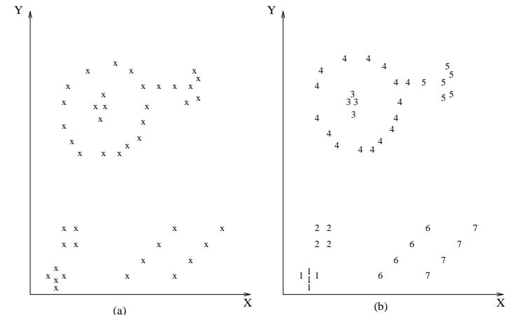  
Figure 1. Data clustering.

The goal of this paper is to survey the core concepts and techniques in the large subset of cluster analysis with its roots in statistics and decision theory. Where appropriate, references will be made to key concepts and techniques arising from clustering methodology in the machine-learning and other communities.

The audience for this paper includes practitioners in the pattern recognition and image analysis communities (who should view it as a summarization of current practice), practitioners in the machine-learning communities (who should view it as a snapshot of a closely related field with a rich history of wellunderstood techniques), and the broader audience of scientific professionals (who should view it as an accessible introduction to a mature field that is making important contributions to computing application areas).

# 1.2 Components of a Clustering Task

Typical pattern clustering activity involves the following steps [Jain and Dubes 1988]:

(1) pattern representation (optionally including feature extraction and/or selection),   
(2) definition of a pattern proximity measure appropriate to the data domain,   
(3) clustering or grouping,   
(4) data abstraction (if needed), and   
(5) assessment of output (if needed).

Figure 2 depicts a typical sequencing of the first three of these steps, including a feedback path where the grouping process output could affect subsequent feature extraction and similarity computations.

Pattern representation refers to the number of classes, the number of available patterns, and the number, type, and scale of the features available to the clustering algorithm. Some of this information may not be controllable by the practitioner. Feature selection is the process of identifying the most effective subset of the original features to use in clustering. Feature extraction is the use of one or more transformations of the input features to produce new salient features. Either or both of these techniques can be used to obtain an appropriate set of features to use in clustering.

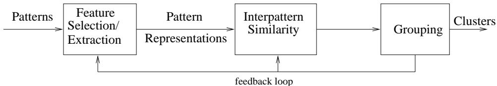  
Figure 2. Stages in clustering.

Pattern proximity is usually measured by a distance function defined on pairs of patterns. A variety of distance measures are in use in the various communities [Anderberg 1973; Jain and Dubes 1988; Diday and Simon 1976]. A simple distance measure like Euclidean distance can often be used to reflect dissimilarity between two patterns, whereas other similarity measures can be used to characterize the conceptual similarity between patterns [Michalski and Stepp 1983]. Distance measures are discussed in Section 4.

The grouping step can be performed in a number of ways. The output clustering (or clusterings) can be hard (a partition of the data into groups) or fuzzy (where each pattern has a variable degree of membership in each of the output clusters). Hierarchical clustering algorithms produce a nested series of partitions based on a criterion for merging or splitting clusters based on similarity. Partitional clustering algorithms identify the partition that optimizes (usually locally) a clustering criterion. Additional techniques for the grouping operation include probabilistic [Brailovski 1991] and graph-theoretic [Zahn 1971] clustering methods. The variety of techniques for cluster formation is described in Section 5.

Data abstraction is the process of extracting a simple and compact representation of a data set. Here, simplicity is either from the perspective of automatic analysis (so that a machine can perform further processing efficiently) or it is human-oriented (so that the representation obtained is easy to comprehend and intuitively appealing). In the clustering context, a typical data abstraction is a compact description of each cluster, usually in terms of cluster prototypes or representative patterns such as the centroid [Diday and Simon 1976].

How is the output of a clustering algorithm evaluated? What characterizes a ‘good’ clustering result and a ‘poor’ one? All clustering algorithms will, when presented with data, produce clusters — regardless of whether the data contain clusters or not. If the data does contain clusters, some clustering algorithms may obtain ‘better’ clusters than others. The assessment of a clustering procedure’s output, then, has several facets. One is actually an assessment of the data domain rather than the clustering algorithm itself— data which do not contain clusters should not be processed by a clustering algorithm. The study of cluster tendency, wherein the input data are examined to see if there is any merit to a cluster analysis prior to one being performed, is a relatively inactive research area, and will not be considered further in this survey. The interested reader is referred to Dubes [1987] and Cheng [1995] for information.

Cluster validity analysis, by contrast, is the assessment of a clustering procedure’s output. Often this analysis uses a specific criterion of optimality; however, these criteria are usually arrived at subjectively. Hence, little in the way of ‘gold standards’ exist in clustering except in well-prescribed subdomains. Validity assessments are objective [Dubes 1993] and are performed to determine whether the output is meaningful. A clustering structure is valid if it cannot reasonably have occurred by chance or as an artifact of a clustering algorithm. When statistical approaches to clustering are used, validation is accomplished by carefully applying statistical methods and testing hypotheses. There are three types of validation studies. An external assessment of validity compares the recovered structure to an $a$ priori structure. An internal examination of validity tries to determine if the structure is intrinsically appropriate for the data. A relative test compares two structures and measures their relative merit. Indices used for this comparison are discussed in detail in Jain and Dubes [1988] and Dubes [1993], and are not discussed further in this paper.

# 1.3 The User’s Dilemma and the Role of Expertise

The availability of such a vast collection of clustering algorithms in the literature can easily confound a user attempting to select an algorithm suitable for the problem at hand. In Dubes and Jain [1976], a set of admissibility criteria defined by Fisher and Van Ness [1971] are used to compare clustering algorithms. These admissibility criteria are based on: (1) the manner in which clusters are formed, (2) the structure of the data, and (3) sensitivity of the clustering technique to changes that do not affect the structure of the data. However, there is no critical analysis of clustering algorithms dealing with the important questions such as

—How should the data be normalized?

—Which similarity measure is appropriate to use in a given situation?

—How should domain knowledge be utilized in a particular clustering problem?

—How can a vary large data set (say, a million patterns) be clustered efficiently?

These issues have motivated this survey, and its aim is to provide a perspective on the state of the art in clustering methodology and algorithms. With such a perspective, an informed practitioner should be able to confidently assess the tradeoffs of different techniques, and ultimately make a competent decision on a technique or suite of techniques to employ in a particular application.

There is no clustering technique that is universally applicable in uncovering the variety of structures present in multidimensional data sets. For example, consider the two-dimensional data set shown in Figure 1(a). Not all clustering techniques can uncover all the clusters present here with equal facility, because clustering algorithms often contain implicit assumptions about cluster shape or multiple-cluster configurations based on the similarity measures and grouping criteria used.

Humans perform competitively with automatic clustering procedures in two dimensions, but most real problems involve clustering in higher dimensions. It is difficult for humans to obtain an intuitive interpretation of data embedded in a high-dimensional space. In addition, data hardly follow the “ideal” structures (e.g., hyperspherical, linear) shown in Figure 1. This explains the large number of clustering algorithms which continue to appear in the literature; each new clustering algorithm performs slightly better than the existing ones on a specific distribution of patterns.

It is essential for the user of a clustering algorithm to not only have a thorough understanding of the particular technique being utilized, but also to know the details of the data gathering process and to have some domain expertise; the more information the user has about the data at hand, the more likely the user would be able to succeed in assessing its true class structure [Jain and Dubes 1988]. This domain information can also be used to improve the quality of feature extraction, similarity computation, grouping, and cluster representation [Murty and Jain 1995].

Appropriate constraints on the data source can be incorporated into a clustering procedure. One example of this is mixture resolving [Titterington et al. 1985], wherein it is assumed that the data are drawn from a mixture of an unknown number of densities (often assumed to be multivariate Gaussian). The clustering problem here is to identify the number of mixture components and the parameters of each component. The concept of density clustering and a methodology for decomposition of feature spaces [Bajcsy 1997] have also been incorporated into traditional clustering methodology, yielding a technique for extracting overlapping clusters.

# 1.4 History

Even though there is an increasing interest in the use of clustering methods in pattern recognition [Anderberg 1973], image processing [Jain and Flynn 1996] and information retrieval [Rasmussen 1992; Salton 1991], clustering has a rich history in other disciplines [Jain and Dubes 1988] such as biology, psychiatry, psychology, archaeology, geology, geography, and marketing. Other terms more or less synonymous with clustering include unsupervised learning [Jain and Dubes 1988], numerical taxonomy [Sneath and Sokal 1973], vector quantization [Oehler and Gray 1995], and learning by observation [Michalski and Stepp 1983]. The field of spatial analysis of point patterns [Ripley 1988] is also related to cluster analysis. The importance and interdisciplinary nature of clustering is evident through its vast literature.

A number of books on clustering have been published [Jain and Dubes 1988; Anderberg 1973; Hartigan 1975; Spath 1980; Duran and Odell 1974; Everitt 1993; Backer 1995], in addition to some useful and influential review papers. A survey of the state of the art in clustering circa 1978 was reported in Dubes and Jain [1980]. A comparison of various clustering algorithms for constructing the minimal spanning tree and the short spanning path was given in Lee [1981]. Cluster analysis was also surveyed in Jain et al. [1986]. A review of image segmentation by clustering was reported in Jain and Flynn [1996]. Comparisons of various combinatorial optimization schemes, based on experiments, have been reported in Mishra and Raghavan [1994] and Al-Sultan and Khan [1996].

# 1.5 Outline

This paper is organized as follows. Section 2 presents definitions of terms to be used throughout the paper. Section 3 summarizes pattern representation, feature extraction, and feature selection. Various approaches to the computation of proximity between patterns are discussed in Section 4. Section 5 presents a taxonomy of clustering approaches, describes the major techniques in use, and discusses emerging techniques for clustering incorporating non-numeric constraints and the clustering of large sets of patterns. Section 6 discusses applications of clustering methods to image analysis and data mining problems. Finally, Section 7 presents some concluding remarks.

# 2. DEFINITIONS AND NOTATION

The following terms and notation are used throughout this paper.

—A pattern (or feature vector, observation, or datum) $\mathbf { x }$ is a single data item used by the clustering algorithm. It typically consists of a vector of $d$ measurements: $\mathbf { x } = ( x _ { 1 } , \ \ldots \ . \ x _ { d } )$ .

—The individual scalar components $x _ { i }$ of a pattern $\mathbf { x }$ are called features (or attributes).

— $\scriptstyle { \mathcal { d } }$ is the dimensionality of the pattern or of the pattern space.

—A pattern set is denoted $\mathcal { X } =$ $\left\{ \mathbf { x } _ { 1 } , \ldots , \mathbf { x } _ { n } \right\}$ . The ith pattern in $\mathcal { X }$ is denoted $\mathbf { x } _ { i } = ( x _ { i , 1 } , \ . \ . \ . \ x _ { i , d } )$ . In many cases a pattern set to be clustered is viewed as an $n \times d$ pattern matrix.

—A class, in the abstract, refers to a state of nature that governs the pattern generation process in some cases. More concretely, a class can be viewed as a source of patterns whose distribution in feature space is governed by a probability density specific to the class. Clustering techniques attempt to group patterns so that the classes thereby obtained reflect the different pattern generation processes represented in the pattern set.

—Hard clustering techniques assign a class label $l _ { i }$ to each patterns $\mathbf { x } _ { i }$ , identifying its class. The set of all labels for a pattern set $\mathcal { X }$ is $\mathcal { L } =$ $\{ l _ { 1 } , \ldots l _ { n } \}$ , with $l _ { i } \in \{ 1 , \cdot \cdot \cdot , k \}$ where $k$ is the number of clusters.

—Fuzzy clustering procedures assign to each input pattern $\mathbf { x } _ { i }$ a fractional degree of membership $f _ { i j }$ in each output cluster $j$ .

—A distance measure (a specialization of a proximity measure) is a metric (or quasi-metric) on the feature space used to quantify the similarity of patterns.

# 3. PATTERN REPRESENTATION, FEATURE SELECTION AND EXTRACTION

There are no theoretical guidelines that suggest the appropriate patterns and features to use in a specific situation. Indeed, the pattern generation process is often not directly controllable; the user’s role in the pattern representation process is to gather facts and conjectures about the data, optionally perform feature selection and extraction, and design the subsequent elements of the clustering system. Because of the difficulties surrounding pattern representation, it is conveniently assumed that the pattern representation is available prior to clustering. Nonetheless, a careful investigation of the available features and any available transformations (even simple ones) can yield significantly improved clustering results. A good pattern representation can often yield a simple and easily understood clustering; a poor pattern representation may yield a complex clustering whose true structure is difficult or impossible to discern. Figure 3 shows a simple example. The points in this 2D feature space are arranged in a curvilinear cluster of approximately constant distance from the origin. If one chooses Cartesian coordinates to represent the patterns, many clustering algorithms would be likely to fragment the cluster into two or more clusters, since it is not compact. If, however, one uses a polar coordinate representation for the clusters, the radius coordinate exhibits tight clustering and a one-cluster solution is likely to be easily obtained.

A pattern can measure either a physical object (e.g., a chair) or an abstract notion (e.g., a style of writing). As noted above, patterns are represented conventionally as multidimensional vectors, where each dimension is a single feature [Duda and Hart 1973]. These features can be either quantitative or qualitative. For example, if weight and color are the two features used, then \~20, black! is the representation of a black object with 20 units of weight. The features can be subdivided into the following types [Gowda and Diday 1992]:

(1) Quantitative features: e.g. (a) continuous values (e.g., weight); (b) discrete values (e.g., the number of computers); (c) interval values (e.g., the duration of an event).

(2) Qualitative features: (a) nominal or unordered (e.g., color);

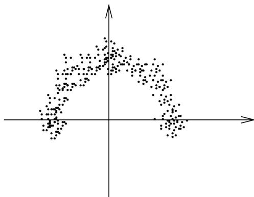  
Figure 3. A curvilinear cluster whose points are approximately equidistant from the origin. Different pattern representations (coordinate systems) would cause clustering algorithms to yield different results for this data (see text).

(b) ordinal (e.g., military rank or qualitative evaluations of temperature (“cool” or “hot”) or sound intensity (“quiet” o r “loud”)).

Quantitative features can be measured on a ratio scale (with a meaningful reference value, such as temperature), or on nominal or ordinal scales.

One can also use structured features [Michalski and Stepp 1983] which are represented as trees, where the parent node represents a generalization of its child nodes. For example, a parent node “vehicle” may be a generalization of children labeled “cars,” “buses,” “trucks,” and “motorcycles.” Further, the node “cars” could be a generalization of cars of the type “Toyota,” “Ford,” “Benz,” etc. A generalized representation of patterns, called symbolic objects was proposed in Diday [1988]. Symbolic objects are defined by a logical conjunction of events. These events link values and features in which the features can take one or more values and all the objects need not be defined on the same set of features.

It is often valuable to isolate only the most descriptive and discriminatory features in the input set, and utilize those features exclusively in subsequent analysis. Feature selection techniques identify a subset of the existing features for subsequent use, while feature extraction techniques compute new features from the original set. In either case, the goal is to improve classification performance and/or computational efficiency. Feature selection is a well-explored topic in statistical pattern recognition [Duda and Hart 1973]; however, in a clustering context (i.e., lacking class labels for patterns), the feature selection process is of necessity ad hoc, and might involve a trial-and-error process where various subsets of features are selected, the resulting patterns clustered, and the output evaluated using a validity index. In contrast, some of the popular feature extraction processes (e.g., principal components analysis [Fukunaga 1990]) do not depend on labeled data and can be used directly. Reduction of the number of features has an additional benefit, namely the ability to produce output that can be visually inspected by a human.

# 4. SIMILARITY MEASURES

Since similarity is fundamental to the definition of a cluster, a measure of the similarity between two patterns drawn from the same feature space is essential to most clustering procedures. Because of the variety of feature types and scales, the distance measure (or measures) must be chosen carefully. It is most common to calculate the dissimilarity between two patterns using a distance measure defined on the feature space. We will focus on the well-known distance measures used for patterns whose features are all continuous.

The most popular metric for continuous features is the Euclidean distance

$$
\begin{array} { l } { { \displaystyle d _ { 2 } ( { \bf x } _ { i } , { \bf x } _ { j } ) = ( \sum _ { k = 1 } ^ { d } ( x _ { i , k } - x _ { j , k } ) ^ { 2 } ) ^ { 1 / 2 } } } \\ { { = \| { \bf x } _ { i } - { \bf x } _ { j } \| _ { 2 } , } } \end{array}
$$

which is a special case $( p = 2 )$ of the Minkowski metric

$$
\begin{array} { l } { { \displaystyle d _ { { p } } ( \mathbf { x } _ { i } , \mathbf { x } _ { j } ) = ( \sum _ { k = 1 } ^ { d } \vert x _ { i , k } - x _ { j , k } \vert ^ { p } ) ^ { 1 / p } } } \\ { { \displaystyle = \| \mathbf { x } _ { i } - \mathbf { x } _ { j } \| _ { p } } . } \end{array}
$$

The Euclidean distance has an intuitive appeal as it is commonly used to evaluate the proximity of objects in two or three-dimensional space. It works well when a data set has “compact” or “isolated” clusters [Mao and Jain 1996]. The drawback to direct use of the Minkowski metrics is the tendency of the largest-scaled feature to dominate the others. Solutions to this problem include normalization of the continuous features (to a common range or variance) or other weighting schemes. Linear correlation among features can also distort distance measures; this distortion can be alleviated by applying a whitening transformation to the data or by using the squared Mahalanobis distance

$$
d _ { M } ( \mathbf { x } _ { i } , \mathbf { x } _ { j } ) = ( \mathbf { x } _ { i } - \mathbf { x } _ { j } ) \Sigma ^ { - 1 } ( \mathbf { x } _ { i } - \mathbf { x } _ { j } ) ^ { T } ,
$$

where the patterns $\mathbf { x } _ { i }$ and $\mathbf { x } _ { j }$ are assumed to be row vectors, and $\Sigma$ is the sample covariance matrix of the patterns or the known covariance matrix of the pattern generation process; $d _ { M } ( \cdot , \cdot )$ assigns different weights to different features based on their variances and pairwise linear correlations. Here, it is implicitly assumed that class conditional densities are unimodal and characterized by multidimensional spread, i.e., that the densities are multivariate Gaussian. The regularized Mahalanobis distance was used in Mao and Jain [1996] to extract hyperellipsoidal clusters. Recently, several researchers [Huttenlocher et al. 1993; Dubuisson and Jain 1994] have used the Hausdorff distance in a point set matching context.

Some clustering algorithms work on a matrix of proximity values instead of on the original pattern set. It is useful in such situations to precompute all the $n ( n \mathrm { ~ - ~ } 1 ) / 2$ pairwise distance values for the $n$ patterns and store them in a (symmetric) matrix.

Computation of distances between patterns with some or all features being noncontinuous is problematic, since the different types of features are not comparable and (as an extreme example) the notion of proximity is effectively binary-valued for nominal-scaled features. Nonetheless, practitioners (especially those in machine learning, where mixed-type patterns are common) have developed proximity measures for heterogeneous type patterns. A recent example is Wilson and Martinez [1997], which proposes a combination of a modified Minkowski metric for continuous features and a distance based on counts (population) for nominal attributes. A variety of other metrics have been reported in Diday and Simon [1976] and Ichino and Yaguchi [1994] for computing the similarity between patterns represented using quantitative as well as qualitative features.

Patterns can also be represented using string or tree structures [Knuth 1973]. Strings are used in syntactic clustering [Fu and Lu 1977]. Several measures of similarity between strings are described in Baeza-Yates [1992]. A good summary of similarity measures between trees is given by Zhang [1995]. A comparison of syntactic and statistical approaches for pattern recognition using several criteria was presented in Tanaka [1995] and the conclusion was that syntactic methods are inferior in every aspect. Therefore, we do not consider syntactic methods further in this paper.

There are some distance measures reported in the literature [Gowda and Krishna 1977; Jarvis and Patrick 1973] that take into account the effect of surrounding or neighboring points. These surrounding points are called context in Michalski and Stepp [1983]. The similarity between two points $\mathbf { x } _ { i }$ and $\mathbf { x } _ { j }$ given this context, is given by

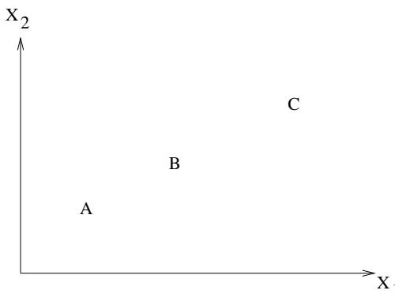  
Figure 4. A and $\mathrm { B }$ are more similar than A and C.

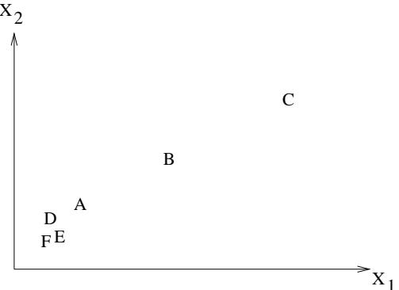  
Figure 5. After a change in context, B and C are more similar than B and A.

$$
s ( \mathbf { x } _ { i } , \mathbf { x } _ { j } ) = f ( \mathbf { x } _ { i } , \mathbf { x } _ { j } , \mathcal { E } ) ,
$$

where $\mathcal { E }$ is the context (the set of surrounding points). One metric defined using context is the mutual neighbor distance (MND), proposed in Gowda and Krishna [1977], which is given by

$$
M N D ( { \bf x } _ { i } , { \bf x } _ { j } ) = N N ( { \bf x } _ { i } , { \bf x } _ { j } ) + N N ( { \bf x } _ { j } , { \bf x } _ { i } ) ,
$$

where $N N ( \mathbf { x } _ { i } , \ \mathbf { x } _ { j } )$ is the neighbor number of $\mathbf { x } _ { j }$ with respect to $\mathbf { x } _ { i }$ . Figures 4 and 5 give an example. In Figure 4, the nearest neighbor of A is B, and B’s nearest neighbor is A. So, $N N ( A , B ) =$ $N N ( B , A ) = 1$ and the MND between A and B is 2. However, $N N ( B , C ) = 1$ but $N N ( C , B ) = 2$ , and therefore $M N D ( B , C ) = 3$ . Figure 5 was obtained from Figure 4 by adding three new points D, E, and F. Now $M N D ( B , C )$ $= \ 3$ (as before), but $M N D ( A , B ) = 5$ The MND between A and B has increased by introducing additional points, even though A and B have not moved. The MND is not a metric (it does not satisfy the triangle inequality [Zhang 1995]). In spite of this, MND has been successfully applied in several clustering applications [Gowda and Diday 1992]. This observation supports the viewpoint that the dissimilarity does not need to be a metric.

Watanabe’s theorem of the ugly duckling [Watanabe 1985] states:

“Insofar as we use a finite set of predicates that are capable of distinguishing any two objects considered, the number of predicates shared by any two such objects is constant, independent of the choice of objects.”

This implies that it is possible to make any two arbitrary patterns equally similar by encoding them with a sufficiently large number of features. As a consequence, any two arbitrary patterns are equally similar, unless we use some additional domain information. For example, in the case of conceptual clustering [Michalski and Stepp 1983], the similarity between $\mathbf { x } _ { i }$ and $\mathbf { x } _ { j }$ is defined as

$$
s ( \mathbf { x } _ { i } , \mathbf { x } _ { j } ) = f ( \mathbf { x } _ { i } , \mathbf { x } _ { j } , \boldsymbol { \mathcal { C } } , \boldsymbol { \mathcal { E } } ) ,
$$

where $\mathcal { C }$ is a set of pre-defined concepts. This notion is illustrated with the help of Figure 6. Here, the Euclidean distance between points A and B is less than that between B and C. However, B and C can be viewed as “more similar” than A and B because B and C belong to the same concept (ellipse) and A belongs to a different concept (rectangle). The conceptual similarity measure is the most general similarity measure. We discuss several pragmatic issues associated with its use in Section 5.

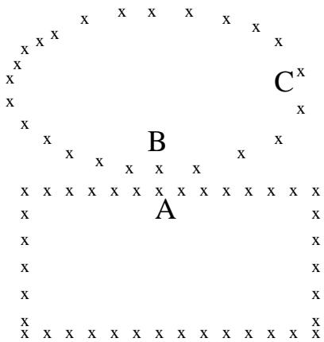  
Figure 6. Conceptual similarity between points .

# 5. CLUSTERING TECHNIQUES

Different approaches to clustering data can be described with the help of the hierarchy shown in Figure 7 (other taxonometric representations of clustering methodology are possible; ours is based on the discussion in Jain and Dubes [1988]). At the top level, there is a distinction between hierarchical and partitional approaches (hierarchical methods produce a nested series of partitions, while partitional methods produce only one).

The taxonomy shown in Figure 7 must be supplemented by a discussion of cross-cutting issues that may (in principle) affect all of the different approaches regardless of their placement in the taxonomy.

—Agglomerative vs. divisive: This aspect relates to algorithmic structure and operation. An agglomerative approach begins with each pattern in a distinct (singleton) cluster, and successively merges clusters together until a stopping criterion is satisfied. A divisive method begins with all patterns in a single cluster and performs splitting until a stopping criterion is met.

Monothetic vs. polythetic: This aspect relates to the sequential or simultaneous use of features in the clustering process. Most algorithms are polythetic; that is, all features enter into the computation of distances between patterns, and decisions are based on those distances. A simple monothetic algorithm reported in Anderberg [1973] considers features sequentially to divide the given collection of patterns. This is illustrated in Figure 8. Here, the collection is divided into two groups using feature $x _ { 1 }$ ; the vertical broken line $\mathrm { v }$ is the separating line. Each of these clusters is further divided independently using feature $x _ { 2 }$ , as depicted by the broken lines $H _ { 1 }$ and $H _ { 2 }$ . The major problem with this algorithm is that it generates $2 ^ { d }$ clusters where $d$ is the dimensionality of the patterns. For large values of $d$ $( d > 1 0 0$ is typical in information retrieval applications [Salton 1991]), the number of clusters generated by this algorithm is so large that the data set is divided into uninterestingly small and fragmented clusters.

—Hard vs. fuzzy: A hard clustering algorithm allocates each pattern to a single cluster during its operation and in its output. A fuzzy clustering method assigns degrees of membership in several clusters to each input pattern. A fuzzy clustering can be converted to a hard clustering by assigning each pattern to the cluster with the largest measure of membership.

—Deterministic vs. stochastic: This issue is most relevant to partitional approaches designed to optimize a squared error function. This optimization can be accomplished using traditional techniques or through a random search of the state space consisting of all possible labelings.

—Incremental vs. non-incremental: This issue arises when the pattern set to be clustered is large, and constraints on execution time or memory space affect the architecture of the algorithm. The early history of clustering methodology does not contain many examples of clustering algorithms designed to work with large data sets, but the advent of data mining has fostered the development of clustering algorithms that minimize the number of scans through the pattern set, reduce the number of patterns examined during execution, or reduce the size of data structures used in the algorithm’s operations.

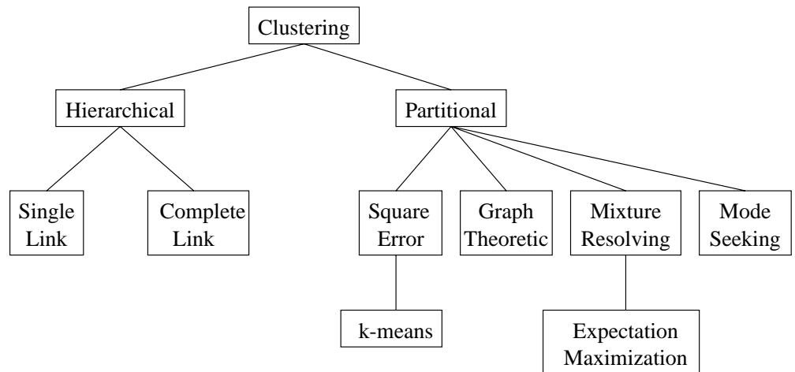  
Figure 7. A taxonomy of clustering approaches.

A cogent observation in Jain and Dubes [1988] is that the specification of an algorithm for clustering usually leaves considerable flexibilty in implementation.

# 5.1 Hierarchical Clustering Algorithms

The operation of a hierarchical clustering algorithm is illustrated using the two-dimensional data set in Figure 9. This figure depicts seven patterns labeled A, B, C, D, E, F, and G in three clusters. A hierarchical algorithm yields a dendrogram representing the nested grouping of patterns and similarity levels at which groupings change. A dendrogram corresponding to the seven points in Figure 9 (obtained from the single-link algorithm [Jain and Dubes 1988]) is shown in Figure 10. The dendrogram can be broken at different levels to yield different clusterings of the data.

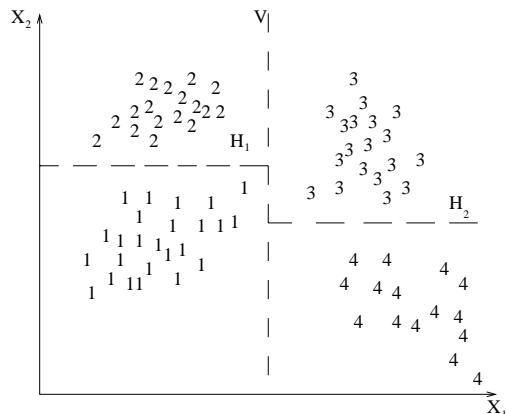  
Figure 8. Monothetic partitional clustering.

Most hierarchical clustering algorithms are variants of the single-link [Sneath and Sokal 1973], complete-link [King 1967], and minimum-variance [Ward 1963; Murtagh 1984] algorithms. Of these, the single-link and completelink algorithms are most popular. These two algorithms differ in the way they characterize the similarity between a pair of clusters. In the single-link method, the distance between two clusters is the minimum of the distances between all pairs of patterns drawn from the two clusters (one pattern from the first cluster, the other from the second). In the complete-link algorithm, the distance between two clusters is the maximum of all pairwise distances between patterns in the two clusters. In either case, two clusters are merged to form a larger cluster based on minimum distance criteria. The complete-link algorithm produces tightly bound or compact clusters [Baeza-Yates 1992]. The single-link algorithm, by contrast, suffers from a chaining effect [Nagy 1968]. It has a tendency to produce clusters that are straggly or elongated. There are two clusters in Figures 12 and 13 separated by a “bridge” of noisy patterns. The single-link algorithm produces the clusters shown in Figure 12, whereas the complete-link algorithm obtains the clustering shown in Figure 13. The clusters obtained by the completelink algorithm are more compact than those obtained by the single-link algorithm; the cluster labeled 1 obtained using the single-link algorithm is elongated because of the noisy patterns labeled “\*”. The single-link algorithm is more versatile than the complete-link algorithm, otherwise. For example, the single-link algorithm can extract the concentric clusters shown in Figure 11, but the complete-link algorithm cannot. However, from a pragmatic viewpoint, it has been observed that the completelink algorithm produces more useful hierarchies in many applications than the single-link algorithm [Jain and Dubes 1988].

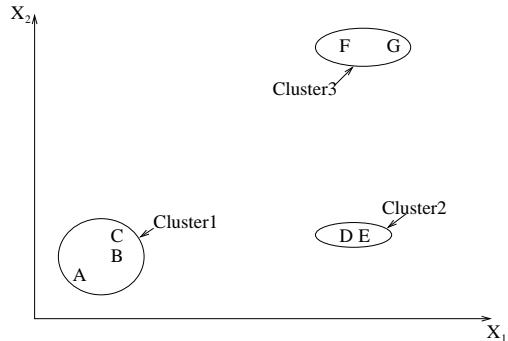  
Figure 9. Points falling in three clusters.

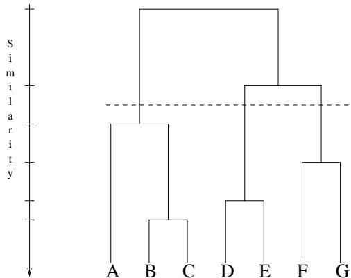  
Figure 10. The dendrogram obtained using the single-link algorithm.

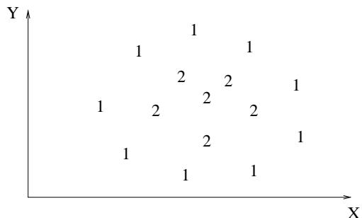  
Figure 11. Two concentric clusters.

# Agglomerative Single-Link Clustering Algorithm

(1) Place each pattern in its own cluster. Construct a list of interpattern distances for all distinct unordered pairs of patterns, and sort this list in ascending order.

(2) Step through the sorted list of distances, forming for each distinct dissimilarity value $d _ { k }$ a graph on the patterns where pairs of patterns closer than $d _ { k }$ are connected by a graph edge. If all the patterns are members of a connected graph, stop. Otherwise, repeat this step.

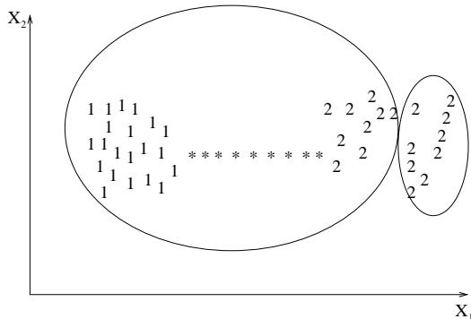  
Figure 12. A single-link clustering of a pattern set containing two classes (1 and 2) connected by a chain of noisy patterns $( ^ { * } )$ .

(3) The output of the algorithm is a nested hierarchy of graphs which can be cut at a desired dissimilarity level forming a partition (clustering) identified by simply connected components in the corresponding graph.

# Agglomerative Complete-Link Clustering Algorithm

(1) Place each pattern in its own cluster. Construct a list of interpattern distances for all distinct unordered pairs of patterns, and sort this list in ascending order.

(2) Step through the sorted list of distances, forming for each distinct dissimilarity value $d _ { k }$ a graph on the patterns where pairs of patterns closer than $d _ { k }$ are connected by a graph edge. If all the patterns are members of a completely connected graph, stop.

(3) The output of the algorithm is a nested hierarchy of graphs which can be cut at a desired dissimilarity level forming a partition (clustering) identified by completely connected components in the corresponding graph.

Hierarchical algorithms are more versatile than partitional algorithms. For example, the single-link clustering algorithm works well on data sets containing non-isotropic clusters including well-separated, chain-like, and concentric clusters, whereas a typical partitional algorithm such as the $k$ -means algorithm works well only on data sets having isotropic clusters [Nagy 1968]. On the other hand, the time and space complexities [Day 1992] of the partitional algorithms are typically lower than those of the hierarchical algorithms. It is possible to develop hybrid algorithms [Murty and Krishna 1980] that exploit the good features of both categories.

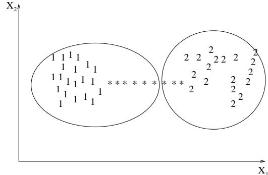  
Figure 13. A complete-link clustering of a pattern set containing two classes (1 and 2) connected by a chain of noisy patterns $( ^ { * } )$ .

# Hierarchical Agglomerative Clustering Algorithm

(1) Compute the proximity matrix containing the distance between each pair of patterns. Treat each pattern as a cluster.

(2) Find the most similar pair of clusters using the proximity matrix. Merge these two clusters into one cluster. Update the proximity matrix to reflect this merge operation.

(3) If all patterns are in one cluster, stop. Otherwise, go to step 2.

Based on the way the proximity matrix is updated in step 2, a variety of agglomerative algorithms can be designed. Hierarchical divisive algorithms start with a single cluster of all the given objects and keep splitting the clusters based on some criterion to obtain a partition of singleton clusters.

# 5.2 Partitional Algorithms

A partitional clustering algorithm obtains a single partition of the data instead of a clustering structure, such as the dendrogram produced by a hierarchical technique. Partitional methods have advantages in applications involving large data sets for which the construction of a dendrogram is computationally prohibitive. A problem accompanying the use of a partitional algorithm is the choice of the number of desired output clusters. A seminal paper [Dubes 1987] provides guidance on this key design decision. The partitional techniques usually produce clusters by optimizing a criterion function defined either locally (on a subset of the patterns) or globally (defined over all of the patterns). Combinatorial search of the set of possible labelings for an optimum value of a criterion is clearly computationally prohibitive. In practice, therefore, the algorithm is typically run multiple times with different starting states, and the best configuration obtained from all of the runs is used as the output clustering.

5.2.1 Squared Error Algorithms. The most intuitive and frequently used criterion function in partitional clustering techniques is the squared error criterion, which tends to work well with isolated and compact clusters. The squared error for a clustering $\mathcal { L }$ of a pattern set $\mathcal { X }$ (containing $K$ clusters) is

$$
e ^ { 2 } ( \mathcal { X } , \mathcal { L } ) = \sum _ { j = 1 } ^ { K } \sum _ { i = 1 } ^ { n _ { j } } \big \| \mathbf { x } _ { i } ^ { ( j ) } - \mathbf { c } _ { j } \big \| ^ { 2 } ,
$$

where $\mathbf { x } _ { i } ^ { ( j ) }$ is the $i ^ { t h }$ pattern belonging to the $j ^ { t h }$ cluster and $\mathbf { c } _ { j }$ is the centroid of the $j ^ { t h }$ cluster.

The $k$ -means is the simplest and most commonly used algorithm employing a squared error criterion [McQueen 1967]. It starts with a random initial partition and keeps reassigning the patterns to clusters based on the similarity between the pattern and the cluster centers until a convergence criterion is met (e.g., there is no reassignment of any pattern from one cluster to another, or the squared error ceases to decrease significantly after some number of iterations). The $k$ -means algorithm is popular because it is easy to implement, and its time complexity is $O ( n )$ , where $n$ is the number of patterns. A major problem with this algorithm is that it is sensitive to the selection of the initial partition and may converge to a local minimum of the criterion function value if the initial partition is not properly chosen. Figure 14 shows seven two-dimensional patterns. If we start with patterns A, B, and C as the initial means around which the three clusters are built, then we end up with the partition {{A}, {B, C}, {D, E, F, G}} shown by ellipses. The squared error criterion value is much larger for this partition than for the best partition {{A, B, C}, {D, E}, {F, G}} shown by rectangles, which yields the global minimum value of the squared error criterion function for a clustering containing three clusters. The correct three-cluster solution is obtained by choosing, for example, A, D, and $\mathbf { F }$ a s the initial cluster means.

# Squared Error Clustering Method

(1) Select an initial partition of the patterns with a fixed number of clusters and cluster centers.   
(2) Assign each pattern to its closest cluster center and compute the new cluster centers as the centroids of the clusters. Repeat this step until convergence is achieved, i.e., until the cluster membership is stable.   
(3) Merge and split clusters based on some heuristic information, optionally repeating step 2.

# $k$ -Means Clustering Algorithm

(1) Choose $k$ cluster centers to coincide with $k$ randomly-chosen patterns or $k$ randomly defined points inside the hypervolume containing the pattern set.

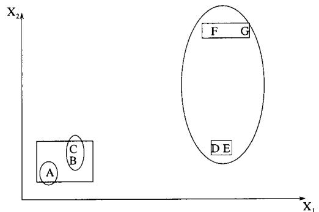  
Figure 14. The $k$ -means algorithm is sensitive to the initial partition.

(2) Assign each pattern to the closest cluster center.   
(3) Recompute the cluster centers using the current cluster memberships.   
(4) If a convergence criterion is not met, go to step 2. Typical convergence criteria are: no (or minimal) reassignment of patterns to new cluster centers, or minimal decrease in squared error.

Several variants [Anderberg 1973] of the $k$ -means algorithm have been reported in the literature. Some of them attempt to select a good initial partition so that the algorithm is more likely to find the global minimum value.

Another variation is to permit splitting and merging of the resulting clusters. Typically, a cluster is split when its variance is above a pre-specified threshold, and two clusters are merged when the distance between their centroids is below another pre-specified threshold. Using this variant, it is possible to obtain the optimal partition starting from any arbitrary initial partition, provided proper threshold values are specified. The well-known ISODATA [Ball and Hall 1965] algorithm employs this technique of merging and splitting clusters. If ISODATA is given the “ellipse” partitioning shown in Figure 14 as an initial partitioning, it will produce the optimal three-cluster partitioning. ISODATA will first merge the clusters $\{ \mathrm { A } \}$ and {B,C} into one cluster because the distance between their centroids is small and then split the cluster {D,E,F,G}, which has a large variance, into two clusters $\{ \mathrm { D } , \mathrm { E } \}$ and {F,G}.

Another variation of the $k$ -means algorithm involves selecting a different criterion function altogether. The dynamic clustering algorithm (which permits representations other than the centroid for each cluster) was proposed in Diday [1973], and Symon [1977] and describes a dynamic clustering approach obtained by formulating the clustering problem in the framework of maximum-likelihood estimation. The regularized Mahalanobis distance was used in Mao and Jain [1996] to obtain hyperellipsoidal clusters.

5.2.2 Graph-Theoretic Clustering. The best-known graph-theoretic divisive clustering algorithm is based on construction of the minimal spanning tree (MST) of the data [Zahn 1971], and then deleting the MST edges with the largest lengths to generate clusters. Figure 15 depicts the MST obtained from nine two-dimensional points. By breaking the link labeled CD with a length of 6 units (the edge with the maximum Euclidean length), two clusters ({A, B, C} and {D, E, F, G, H, I}) are obtained. The second cluster can be further divided into two clusters by breaking the edge EF, which has a length of 4.5 units.

The hierarchical approaches are also related to graph-theoretic clustering. Single-link clusters are subgraphs of the minimum spanning tree of the data [Gower and Ross 1969] which are also the connected components [Gotlieb and Kumar 1968]. Complete-link clusters are maximal complete subgraphs, and are related to the node colorability of graphs [Backer and Hubert 1976]. The maximal complete subgraph was considered the strictest definition of a cluster in Augustson and Minker [1970] and Raghavan and Yu [1981]. A graph-oriented approach for non-hierarchical structures and overlapping clusters is presented in Ozawa [1985]. The Delaunay graph (DG) is obtained by connecting all the pairs of points that are Voronoi neighbors. The DG contains all the neighborhood information contained in the MST and the relative neighborhood graph (RNG) [Toussaint 1980].

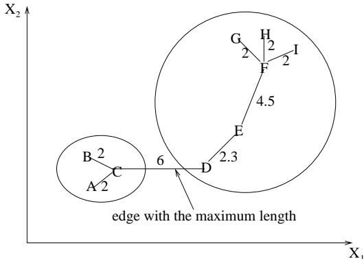  
Figure 15. Using the minimal spanning tree to form clusters.

# 5.3 Mixture-Resolving and Mode-Seeking Algorithms

The mixture resolving approach to cluster analysis has been addressed in a number of ways. The underlying assumption is that the patterns to be clustered are drawn from one of several distributions, and the goal is to identify the parameters of each and (perhaps) their number. Most of the work in this area has assumed that the individual components of the mixture density are Gaussian, and in this case the parameters of the individual Gaussians are to be estimated by the procedure. Traditional approaches to this problem involve obtaining (iteratively) a maximum likelihood estimate of the parameter vectors of the component densities [Jain and Dubes 1988].

More recently, the Expectation Maximization (EM) algorithm (a generalpurpose maximum likelihood algorithm [Dempster et al. 1977] for missing-data problems) has been applied to the problem of parameter estimation. A recent book [Mitchell 1997] provides an accessible description of the technique. In the EM framework, the parameters of the component densities are unknown, as are the mixing parameters, and these are estimated from the patterns. The EM procedure begins with an initial estimate of the parameter vector and iteratively rescores the patterns against the mixture density produced by the parameter vector. The rescored patterns are then used to update the parameter estimates. In a clustering context, the scores of the patterns (which essentially measure their likelihood of being drawn from particular components of the mixture) can be viewed as hints at the class of the pattern. Those patterns, placed (by their scores) in a particular component, would therefore be viewed as belonging to the same cluster.

Nonparametric techniques for density-based clustering have also been developed [Jain and Dubes 1988]. Inspired by the Parzen window approach to nonparametric density estimation, the corresponding clustering procedure searches for bins with large counts in a multidimensional histogram of the input pattern set. Other approaches include the application of another partitional or hierarchical clustering algorithm using a distance measure based on a nonparametric density estimate.

# 5.4 Nearest Neighbor Clustering

Since proximity plays a key role in our intuitive notion of a cluster, nearestneighbor distances can serve as the basis of clustering procedures. An iterative procedure was proposed in Lu and Fu [1978]; it assigns each unlabeled pattern to the cluster of its nearest labeled neighbor pattern, provided the distance to that labeled neighbor is below a threshold. The process continues until all patterns are labeled or no additional labelings occur. The mutual neighborhood value (described earlier in the context of distance computation) can also be used to grow clusters from near neighbors.

# 5.5 Fuzzy Clustering

Traditional clustering approaches generate partitions; in a partition, each pattern belongs to one and only one cluster. Hence, the clusters in a hard clustering are disjoint. Fuzzy clustering extends this notion to associate each pattern with every cluster using a membership function [Zadeh 1965]. The output of such algorithms is a clustering, but not a partition. We give a high-level partitional fuzzy clustering algorithm below.

# Fuzzy Clustering Algorithm

(1) Select an initial fuzzy partition of the $N$ objects into $K$ clusters by selecting the $N \times K$ membership matrix U. An element $u _ { i j }$ of this matrix represents the grade of membership of object $\mathbf { x } _ { i }$ in cluster $\mathbf { c } _ { j }$ Typically, $u _ { i j } \in [ 0 , 1 ]$ .

(2) Using U, find the value of a fuzzy criterion function, e.g., a weighted squared error criterion function, associated with the corresponding partition. One possible fuzzy criterion function is

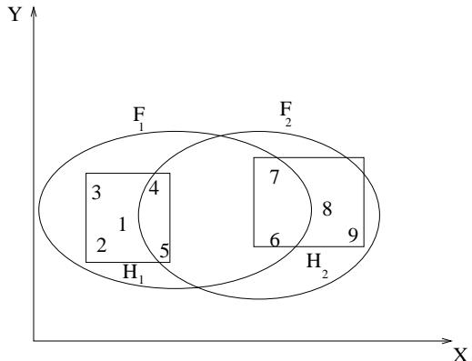  
Figure 16. Fuzzy clusters.

have membership values in [0,1] for each cluster. For example, fuzzy cluster $F _ { 1 }$ could be compactly described as

and $F _ { 2 }$ could be described as \$\~1,0.0!, \~2,0.0!, \~3,0.0!, \~4,0.1!, \~5,0.15!,

$$
E ^ { 2 } ( \mathcal { X } , { \bf U } ) = \sum _ { i = 1 k = 1 } ^ { N } u _ { i j } \| { \bf x } _ { i } - { \bf c } _ { k } \| ^ { 2 } ,
$$

$N$ where $\mathbf { c } _ { k } = \sum _ { i = 1 } u _ { i k } \mathbf { x } _ { i }$ is the $k ^ { t h }$ fuzzy 5cluster center.

Reassign patterns to clusters to reduce this criterion function value and recompute U.

(3) Repeat step 2 until entries in U do not change significantly.

In fuzzy clustering, each cluster is a fuzzy set of all the patterns. Figure 16 illustrates the idea. The rectangles enclose two “hard” clusters in the data: $H _ { 1 } = \{ 1 , 2 , 3 , 4 , 5 \}$ and $H _ { 2 } = \{ 6 , 7 , 8 , 9 \}$ A fuzzy clustering algorithm might produce the two fuzzy clusters $F _ { 1 }$ and $F _ { 2 }$ depicted by ellipses. The patterns will

The ordered pairs $( i , \mu _ { i } )$ in each cluster represent the ith pattern and its membership value to the cluster $\mu _ { i }$ . Larger membership values indicate higher confidence in the assignment of the pattern to the cluster. A hard clustering can be obtained from a fuzzy partition by thresholding the membership value.

Fuzzy set theory was initially applied to clustering in Ruspini [1969]. The book by Bezdek [1981] is a good source for material on fuzzy clustering. The most popular fuzzy clustering algorithm is the fuzzy $c$ -means (FCM) algorithm. Even though it is better than the hard $k$ -means algorithm at avoiding local minima, FCM can still converge to local minima of the squared error criterion. The design of membership functions is the most important problem in fuzzy clustering; different choices include those based on similarity decomposition and centroids of clusters. A generalization of the FCM algorithm was proposed by Bezdek [1981] through a family of objective functions. A fuzzy $c$ -shell algorithm and an adaptive variant for detecting circular and elliptical boundaries was presented in Dave [1992].

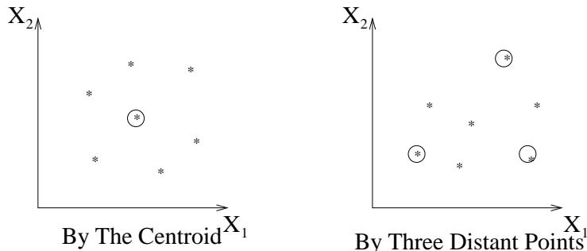  
Figure 17. Representation of a cluster by points.

# 5.6 Representation of Clusters

In applications where the number of classes or clusters in a data set must be discovered, a partition of the data set is the end product. Here, a partition gives an idea about the separability of the data points into clusters and whether it is meaningful to employ a supervised classifier that assumes a given number of classes in the data set. However, in many other applications that involve decision making, the resulting clusters have to be represented or described in a compact form to achieve data abstraction. Even though the construction of a cluster representation is an important step in decision making, it has not been examined closely by researchers. The notion of cluster representation was introduced in Duran and Odell [1974] and was subsequently studied in Diday and Simon [1976] and Michalski et al. [1981]. They suggested the following representation schemes:

(1) Represent a cluster of points by their centroid or by a set of distant points in the cluster. Figure 17 depicts these two ideas.

(2) Represent clusters using nodes in a classification tree. This is illustrated in Figure 18.

(3) Represent clusters by using conjunctive logical expressions. For example, the expression $[ X _ { 1 } > 3 ] [ X _ { 2 } < 2 ]$ in Figure 18 stands for the logical statement ${ \mathrm { \Sigma } } ^ { \left\{ \right. } \left. \mathrm { \Sigma } \right. $ is greater than ${ \boldsymbol { 3 } } ^ { \prime }$ and $X _ { 2 }$ is less than $2 ^ { \circ }$ .

Use of the centroid to represent a cluster is the most popular scheme. It works well when the clusters are compact or isotropic. However, when the clusters are elongated or non-isotropic, then this scheme fails to represent them properly. In such a case, the use of a collection of boundary points in a cluster captures its shape well. The number of points used to represent a cluster should increase as the complexity of its shape increases. The two different representations illustrated in Figure 18 are equivalent. Every path in a classification tree from the root node to a leaf node corresponds to a conjunctive statement. An important limitation of the typical use of the simple conjunctive concept representations is that they can describe only rectangular or isotropic clusters in the feature space.

Data abstraction is useful in decision making because of the following:

(1) It gives a simple and intuitive description of clusters which is easy for human comprehension. In both conceptual clustering [Michalski and Stepp 1983] and symbolic clustering [Gowda and Diday 1992] this representation is obtained without using an additional step. These algorithms generate the clusters as well as their descriptions. A set of fuzzy rules can be obtained from fuzzy clusters of a data set. These rules can be used to build fuzzy classifiers and fuzzy controllers.

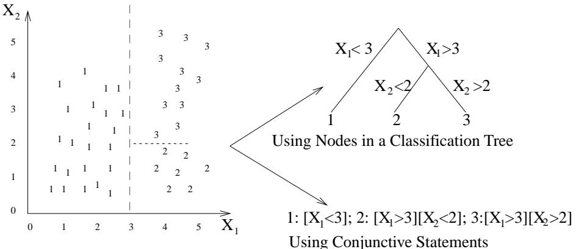  
Figure 18. Representation of clusters by a classification tree or by conjunctive statements.

(2) It helps in achieving data compression that can be exploited further by a computer [Murty and Krishna 1980]. Figure 19(a) shows samples belonging to two chain-like clusters labeled 1 and 2. A partitional clustering like the $k$ -means algorithm cannot separate these two structures properly. The single-link algorithm works well on this data, but is computationally expensive. So a hybrid approach may be used to exploit the desirable properties of both these algorithms. We obtain 8 subclusters of the data using the (computationally efficient) $k$ -means algorithm. Each of these subclusters can be represented by their centroids as shown in Figure 19(a). Now the single-link algorithm can be applied on these centroids alone to cluster them into 2 groups. The resulting groups are shown in Figure 19(b). Here, a data reduction is achieved by representing the subclusters by their centroids.

(3) It increases the efficiency of the decision making task. In a clusterbased document retrieval technique [Salton 1991], a large collection of documents is clustered and each of the clusters is represented using its centroid. In order to retrieve documents relevant to a query, the query is matched with the cluster centroids rather than with all the documents. This helps in retrieving relevant documents efficiently. Also in several applications involving large data sets, clustering is used to perform indexing, which helps in efficient decision making [Dorai and Jain 1995].

# 5.7 Artificial Neural Networks for Clustering

Artificial neural networks (ANNs) [Hertz et al. 1991] are motivated by biological neural networks. ANNs have been used extensively over the past three decades for both classification and clustering [Sethi and Jain 1991; Jain and Mao 1994]. Some of the features of the ANNs that are important in pattern clustering are:

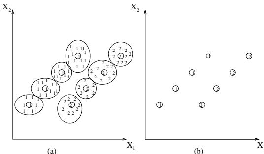  
Figure 19. Data compression by clustering.

(1) ANNs process numerical vectors and so require patterns to be represented using quantitative features only.

(2) ANNs are inherently parallel and distributed processing architectures.

(3) ANNs may learn their interconnection weights adaptively [Jain and Mao 1996; Oja 1982]. More specifically, they can act as pattern normalizers and feature selectors by appropriate selection of weights.

Competitive (or winner–take–all) neural networks [Jain and Mao 1996] are often used to cluster input data. In competitive learning, similar patterns are grouped by the network and represented by a single unit (neuron). This grouping is done automatically based on data correlations. Well-known examples of ANNs used for clustering include Kohonen’s learning vector quantization (LVQ) and self-organizing map (SOM) [Kohonen 1984], and adaptive resonance theory models [Carpenter and Grossberg 1990]. The architectures of these ANNs are simple: they are singlelayered. Patterns are presented at the input and are associated with the output nodes. The weights between the input nodes and the output nodes are iteratively changed (this is called learning) until a termination criterion is satisfied. Competitive learning has been found to exist in biological neural networks. However, the learning or weight update procedures are quite similar to those in some classical clustering approaches. For example, the relationship between the $k$ -means algorithm and LVQ is addressed in Pal et al. [1993]. The learning algorithm in ART models is similar to the leader clustering algorithm [Moor 1988].

The SOM gives an intuitively appealing two-dimensional map of the multidimensional data set, and it has been successfully used for vector quantization and speech recognition [Kohonen 1984]. However, like its sequential counterpart, the SOM generates a suboptimal partition if the initial weights are not chosen properly. Further, its convergence is controlled by various parameters such as the learning rate and a neighborhood of the winning node in which learning takes place. It is possible that a particular input pattern can fire different output units at different iterations; this brings up the stability issue of learning systems. The system is said to be stable if no pattern in the training data changes its category after a finite number of learning iterations. This problem is closely associated with the problem of plasticity, which is the ability of the algorithm to adapt to new data. For stability, the learning rate should be decreased to zero as iterations progress and this affects the plasticity. The ART models are supposed to be stable and plastic [Carpenter and Grossberg 1990]. However, ART nets are order-dependent; that is, different partitions are obtained for different orders in which the data is presented to the net. Also, the size and number of clusters generated by an ART net depend on the value chosen for the vigilance threshold, which is used to decide whether a pattern is to be assigned to one of the existing clusters or start a new cluster. Further, both SOM and ART are suitable for detecting only hyperspherical clusters [Hertz et al. 1991]. A two-layer network that employs regularized Mahalanobis distance to extract hyperellipsoidal clusters was proposed in Mao and Jain [1994]. All these ANNs use a fixed number of output nodes which limit the number of clusters that can be produced.

# 5.8 Evolutionary Approaches for Clustering

Evolutionary approaches, motivated by natural evolution, make use of evolutionary operators and a population of solutions to obtain the globally optimal partition of the data. Candidate solutions to the clustering problem are encoded as chromosomes. The most commonly used evolutionary operators are: selection, recombination, and mutation. Each transforms one or more input chromosomes into one or more output chromosomes. A fitness function evaluated on a chromosome determines a chromosome’s likelihood of surviving into the next generation. We give below a high-level description of an evolutionary algorithm applied to clustering.

# An Evolutionary Algorithm for Clustering

(1) Choose a random population of solutions. Each solution here corresponds to a valid $k$ -partition of the data. Associate a fitness value with each solution. Typically, fitness is inversely proportional to the squared error value. A solution with a small squared error will have a larger fitness value.

(2) Use the evolutionary operators selection, recombination and mutation to generate the next population of solutions. Evaluate the fitness values of these solutions.

(3) Repeat step 2 until some termination condition is satisfied.

The best-known evolutionary techniques are genetic algorithms (GAs) [Holland 1975; Goldberg 1989], evolution strategies (ESs) [Schwefel 1981], and evolutionary programming (EP) [Fogel et al. 1965]. Out of these three approaches, GAs have been most frequently used in clustering. Typically, solutions are binary strings in GAs. In

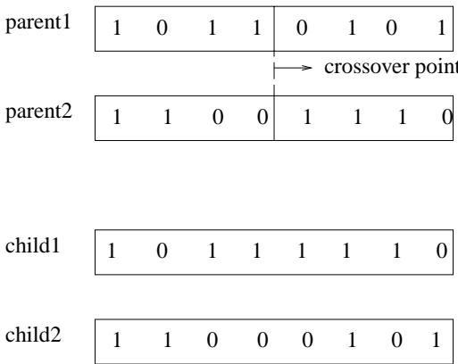  
Figure 20. Crossover operation.

GAs, a selection operator propagates solutions from the current generation to the next generation based on their fitness. Selection employs a probabilistic scheme so that solutions with higher fitness have a higher probability of getting reproduced.

There are a variety of recombination operators in use; crossover is the most popular. Crossover takes as input a pair of chromosomes (called parents) and outputs a new pair of chromosomes (called children or offspring) as depicted in Figure 20. In Figure 20, a single point crossover operation is depicted. It exchanges the segments of the parents across a crossover point. For example, in Figure 20, the parents are the binary strings $\mathsf { \cdot } _ { 1 0 1 1 0 1 0 1 } \bar { \mathsf { \Omega } }$ and ‘11001110’. The segments in the two parents after the crossover point (between the fourth and fifth locations) are exchanged to produce the child chromosomes. Mutation takes as input a chromosome and outputs a chromosome by complementing the bit value at a randomly selected location in the input chromosome. For example, the string $^ { \cdot } 1 1 1 1 1 1 0 ^ { , }$ is generated by applying the mutation operator to the second bit location in the string $^ { \cdot } 1 0 1 1 1 1 0 ^ { \cdot }$ (starting at the left). Both crossover and mutation are applied with some prespecified probabilities which depend on the fitness values.

GAs represent points in the search space as binary strings, and rely on the crossover operator to explore the search space. Mutation is used in GAs for the sake of completeness, that is, to make sure that no part of the search space is left unexplored. ESs and EP differ from the GAs in solution representation and type of the mutation operator used; EP does not use a recombination operator, but only selection and mutation. Each of these three approaches have been used to solve the clustering problem by viewing it as a minimization of the squared error criterion. Some of the theoretical issues such as the convergence of these approaches were studied in Fogel and Fogel [1994].

GAs perform a globalized search for solutions whereas most other clustering procedures perform a localized search. In a localized search, the solution obtained at the ‘next iteration’ of the procedure is in the vicinity of the current solution. In this sense, the $k$ -means algorithm, fuzzy clustering algorithms, ANNs used for clustering, various annealing schemes (see below), and tabu search are all localized search techniques. In the case of GAs, the crossover and mutation operators can produce new solutions that are completely different from the current ones. We illustrate this fact in Figure 21. Let us assume that the scalar X is coded using a 5-bit binary representation, and let $S _ { 1 }$ and $S _ { 2 }$ be two points in the one-dimensional search space. The decimal values of $S _ { 1 }$ and $S _ { 2 }$ are 8 and 31, respectively. Their binary representations are $S _ { 1 } =$ 01000 and $S _ { 2 } = 1 1 1 1 1$ . Let us apply the single-point crossover to these strings, with the crossover site falling between the second and third most significant bits as shown below.

# 01!000

# 11!111

This will produce a new pair of points or chromosomes $S _ { 3 }$ and $S _ { 4 }$ as shown in Figure 21. Here, $S _ { 3 } = 0 1 1 1 1$ and

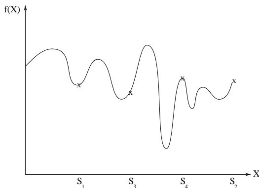  
Figure 21. GAs perform globalized search.

$S _ { 4 } = 1 1 0 0 0$ . The corresponding decimal values are 15 and 24, respectively. Similarly, by mutating the most significant bit in the binary string 01111 (decimal 15), the binary string 11111 (decimal 31) is generated. These jumps, or gaps between points in successive generations, are much larger than those produced by other approaches.

Perhaps the earliest paper on the use of GAs for clustering is by Raghavan and Birchand [1979], where a GA was used to minimize the squared error of a clustering. Here, each point or chromosome represents a partition of $N$ objects into $K$ clusters and is represented by a $\kappa$ -ary string of length $N$ . For example, consider six patterns—A, B, C, D, E, and F—and the string 101001. This sixbit binary $( K = 2$ ) string corresponds to placing the six patterns into two clusters. This string represents a two-partition, where one cluster has the first, third, and sixth patterns and the second cluster has the remaining patterns. In other words, the two clusters are $\{ \mathrm { A } , \mathrm { C } , \mathrm { F } \}$ and $\{ \mathbf { B } , \mathbf { D } , \mathbf { E } \}$ (the six-bit binary string 010110 represents the same clustering of the six patterns). When there are $K$ clusters, there are $K !$ different chromosomes corresponding to each $\kappa$ -partition of the data. This increases the effective search space size by a factor of $K !$ . Further, if crossover is applied on two good chromosomes, the resulting offspring may be inferior in this representation. For example, let {A,B,C} and {D,E,F} be the clusters in the optimal 2-partition of the six patterns considered above. The corresponding chromosomes are 111000 and 000111. By applying single-point crossover at the location between the third and fourth bit positions on these two strings, we get 111111 and 000000 as offspring and both correspond to an inferior partition. These problems have motivated researchers to design better representation schemes and crossover operators.

In Bhuyan et al. [1991], an improved representation scheme is proposed where an additional separator symbol is used along with the pattern labels to represent a partition. Let the separator symbol be represented by \*. Then the chromosome ACF\*BDE corresponds to a 2-partition {A,C,F} and $\{ \mathbf { B } , \mathbf { D } , \mathbf { E } \}$ . Using this representation permits them to map the clustering problem into a permutation problem such as the traveling salesman problem, which can be solved by using the permutation crossover operators [Goldberg 1989]. This solution also suffers from permutation redundancy. There are 72 equivalent chromosomes (permutations) corresponding to the same partition of the data into the two clusters {A,C,F} and {B,D,E}.

More recently, Jones and Beltramo [1991] investigated the use of edgebased crossover [Whitley et al. 1989] to solve the clustering problem. Here, all patterns in a cluster are assumed to form a complete graph by connecting them with edges. Offspring are generated from the parents so that they inherit the edges from their parents. It is observed that this crossover operator takes $O ( K ^ { 6 } + N )$ time for $N$ patterns and $K$ clusters ruling out its applicability on practical data sets having more than 10 clusters. In a hybrid approach proposed in Babu and Murty [1993], the GA is used only to find good initial cluster centers and the $k$ -means algorithm is applied to find the final partition. This hybrid approach performed better than the GA.

A major problem with GAs is their sensitivity to the selection of various parameters such as population size, crossover and mutation probabilities, etc. Grefenstette [Grefenstette 1986] has studied this problem and suggested guidelines for selecting these control parameters. However, these guidelines may not yield good results on specific problems like pattern clustering. It was reported in Jones and Beltramo [1991] that hybrid genetic algorithms incorporating problem-specific heuristics are good for clustering. A similar claim is made in Davis [1991] about the applicability of GAs to other practical problems. Another issue with GAs is the selection of an appropriate representation which is low in order and short in defining length.

It is possible to view the clustering problem as an optimization problem that locates the optimal centroids of the clusters directly rather than finding an optimal partition using a GA. This view permits the use of ESs and EP, because centroids can be coded easily in both these approaches, as they support the direct representation of a solution as a real-valued vector. In Babu and Murty [1994], ESs were used on both hard and fuzzy clustering problems and EP has been used to evolve fuzzy min-max clusters [Fogel and Simpson 1993]. It has been observed that they perform better than their classical counterparts, the $k$ -means algorithm and the fuzzy $c$ -means algorithm. However, all of these approaches suffer (as do GAs and ANNs) from sensitivity to control parameter selection. For each specific problem, one has to tune the parameter values to suit the application.

# 5.9 Search-Based Approaches

Search techniques used to obtain the optimum value of the criterion function are divided into deterministic and stochastic search techniques. Deterministic search techniques guarantee an optimal partition by performing exhaustive enumeration. On the other hand, the stochastic search techniques generate a near-optimal partition reasonably quickly, and guarantee convergence to optimal partition asymptotically. Among the techniques considered so far, evolutionary approaches are stochastic and the remainder are deterministic. Other deterministic approaches to clustering include the branch-and-bound technique adopted in Koontz et al. [1975] and Cheng [1995] for generating optimal partitions. This approach generates the optimal partition of the data at the cost of excessive computational requirements. In Rose et al. [1993], a deterministic annealing approach was proposed for clustering. This approach employs an annealing technique in which the error surface is smoothed, but convergence to the global optimum is not guaranteed. The use of deterministic annealing in proximity-mode clustering (where the patterns are specified in terms of pairwise proximities rather than multidimensional points) was explored in Hofmann and Buhmann [1997]; later work applied the deterministic annealing approach to texture segmentation [Hofmann and Buhmann 1998].

The deterministic approaches are typically greedy descent approaches, whereas the stochastic approaches permit perturbations to the solutions in non-locally optimal directions also with nonzero probabilities. The stochastic search techniques are either sequential or parallel, while evolutionary approaches are inherently parallel. The simulated annealing approach (SA) [Kirkpatrick et al. 1983] is a sequential stochastic search technique, whose applicability to clustering is discussed in Klein and Dubes [1989]. Simulated annealing procedures are designed to avoid (or recover from) solutions which correspond to local optima of the objective functions. This is accomplished by accepting with some probability a new solution for the next iteration of lower quality (as measured by the criterion function). The probability of acceptance is governed by a critical parameter called the temperature (by analogy with annealing in metals), which is typically specified in terms of a starting (first iteration) and final temperature value. Selim and Al-Sultan [1991] studied the effects of control parameters on the performance of the algorithm, and BaezaYates [1992] used SA to obtain nearoptimal partition of the data. SA is statistically guaranteed to find the global optimal solution [Aarts and Korst 1989]. A high-level outline of a SA based algorithm for clustering is given below.

# Clustering Based on Simulated Annealing

(1) Randomly select an initial partition and $P _ { 0 }$ , and compute the squared error value, $E _ { P _ { 0 } }$ . Select values for the control parameters, initial and final temperatures $T _ { 0 }$ and $T _ { f } .$   
(2) Select a neighbor $P _ { 1 }$ of $P _ { 0 }$ and compute its squared error value, $E _ { P _ { 1 } }$ . If $E _ { P _ { 1 } }$ is larger than $E _ { P _ { 0 } }$ , then assign $P _ { 1 }$ to $P _ { 0 }$ with a temperature-dependent probability. Else assign $P _ { 1 }$ to $P _ { 0 }$ . Repeat this step for a fixed number of iterations.   
(3) Reduce the value of $T _ { 0 }$ , i.e. $T _ { 0 } \ =$ $c T _ { 0 }$ , where $c$ is a predetermined constant. If $T _ { 0 }$ is greater than $T _ { f } ,$ then go to step 2. Else stop.

The SA algorithm can be slow in reaching the optimal solution, because optimal results require the temperature to be decreased very slowly from iteration to iteration.

Tabu search [Glover 1986], like SA, is a method designed to cross boundaries of feasibility or local optimality and to systematically impose and release constraints to permit exploration of otherwise forbidden regions. Tabu search was used to solve the clustering problem in Al-Sultan [1995].

# 5.10 A Comparison of Techniques

In this section we have examined various deterministic and stochastic search techniques to approach the clustering problem as an optimization problem. A majority of these methods use the squared error criterion function. Hence, the partitions generated by these approaches are not as versatile as those generated by hierarchical algorithms. The clusters generated are typically hyperspherical in shape. Evolutionary approaches are globalized search techniques, whereas the rest of the approaches are localized search technique. ANNs and GAs are inherently parallel, so they can be implemented using parallel hardware to improve their speed. Evolutionary approaches are population-based; that is, they search using more than one solution at a time, and the rest are based on using a single solution at a time. ANNs, GAs, SA, and Tabu search (TS) are all sensitive to the selection of various learning/ control parameters. In theory, all four of these methods are weak methods [Rich 1983] in that they do not use explicit domain knowledge. An important feature of the evolutionary approaches is that they can find the optimal solution even when the criterion function is discontinuous.

An empirical study of the performance of the following heuristics for clustering was presented in Mishra and Raghavan [1994]; SA, GA, TS, randomized branch-and-bound (RBA) [Mishra and Raghavan 1994], and hybrid search (HS) strategies [Ismail and Kamel 1989] were evaluated. The conclusion was that GA performs well in the case of one-dimensional data, while its performance on high dimensional data sets is not impressive. The performance of SA is not attractive because it is very slow. RBA and TS performed best. HS is good for high dimensional data. However, none of the methods was found to be superior to others by a significant margin. An empirical study of $k$ -means, SA, TS, and GA was presented in Al-Sultan and Khan [1996]. TS, GA and SA were judged comparable in terms of solution quality, and all were better than $k$ -means. However, the $k$ -means method is the most efficient in terms of execution time; other schemes took more time (by a factor of 500 to 2500) to partition a data set of size 60 into 5 clusters. Further, GA encountered the best solution faster than TS and SA; SA took more time than TS to encounter the best solution. However, GA took the maximum time for convergence, that is, to obtain a population of only the best solutions, followed by TS and SA. An important observation is that in both Mishra and Raghavan [1994] and Al-Sultan and Khan [1996] the sizes of the data sets considered are small; that is, fewer than 200 patterns.

A two-layer network was employed in Mao and Jain [1996], with the first layer including a number of principal component analysis subnets, and the second layer using a competitive net. This network performs partitional clustering using the regularized Mahalanobis distance. This net was trained using a set of 1000 randomly selected pixels from a large image and then used to classify every pixel in the image. Babu et al. [1997] proposed a stochastic connectionist approach (SCA) and compared its performance on standard data sets with both the SA and $k$ -means algorithms. It was observed that SCA is superior to both SA and $k$ -means in terms of solution quality. Evolutionary approaches are good only when the data size is less than 1000 and for low dimensional data.

In summary, only the $k$ -means algorithm and its ANN equivalent, the Kohonen net [Mao and Jain 1996] have been applied on large data sets; other approaches have been tested, typically, on small data sets. This is because obtaining suitable learning/control parameters for ANNs, GAs, TS, and SA is difficult and their execution times are very high for large data sets. However, it has been shown [Selim and Ismail

1984] that the $k$ -means method converges to a locally optimal solution. This behavior is linked with the initial seed selection in the $k$ -means algorithm. So if a good initial partition can be obtained quickly using any of the other techniques, then $k$ -means would work well even on problems with large data sets. Even though various methods discussed in this section are comparatively weak, it was revealed through experimental studies that combining domain knowledge would improve their performance. For example, ANNs work better in classifying images represented using extracted features than with raw images, and hybrid classifiers work better than ANNs [Mohiuddin and Mao 1994]. Similarly, using domain knowledge to hybridize a GA improves its performance [Jones and Beltramo 1991]. So it may be useful in general to use domain knowledge along with approaches like GA, SA, ANN, and TS. However, these approaches (specifically, the criteria functions used in them) have a tendency to generate a partition of hyperspherical clusters, and this could be a limitation. For example, in cluster-based document retrieval, it was observed that the hierarchical algorithms performed better than the partitional algorithms [Rasmussen 1992].

# 5.11 Incorporating Domain Constraints in Clustering

As a task, clustering is subjective in nature. The same data set may need to be partitioned differently for different purposes. For example, consider a whale, an elephant, and a tuna fish [Watanabe 1985]. Whales and elephants form a cluster of mammals. However, if the user is interested in partitioning them based on the concept of living in water, then whale and tuna fish are clustered together. Typically, this subjectivity is incorporated into the clustering criterion by incorporating domain knowledge in one or more phases of clustering.

Every clustering algorithm uses some type of knowledge either implicitly or explicitly. Implicit knowledge plays a role in (1) selecting a pattern representation scheme (e.g., using one’s prior experience to select and encode features), (2) choosing a similarity measure (e.g., using the Mahalanobis distance instead of the Euclidean distance to obtain hyperellipsoidal clusters), and (3) selecting a grouping scheme (e.g., specifying the $k$ -means algorithm when it is known that clusters are hyperspherical). Domain knowledge is used implicitly in ANNs, GAs, TS, and SA to select the control/learning parameter values that affect the performance of these algorithms.

It is also possible to use explicitly available domain knowledge to constrain or guide the clustering process. Such specialized clustering algorithms have been used in several applications. Domain concepts can play several roles in the clustering process, and a variety of choices are available to the practitioner. At one extreme, the available domain concepts might easily serve as an additional feature (or several), and the remainder of the procedure might be otherwise unaffected. At the other extreme, domain concepts might be used to confirm or veto a decision arrived at independently by a traditional clustering algorithm, or used to affect the computation of distance in a clustering algorithm employing proximity. The incorporation of domain knowledge into clustering consists mainly of ad hoc approaches with little in common; accordingly, our discussion of the idea will consist mainly of motivational material and a brief survey of past work. Machine learning research and pattern recognition research intersect in this topical area, and the interested reader is referred to the prominent journals in machine learning (e.g., Machine Learning, J. of AI Research, or Artificial Intelligence) for a fuller treatment of this topic.

As documented in Cheng and Fu [1985], rules in an expert system may be clustered to reduce the size of the knowledge base. This modification of clustering was also explored in the domains of universities, congressional voting records, and terrorist events by Lebowitz [1987].

5.11.1 Similarity Computation. Conceptual knowledge was used explicitly in the similarity computation phase in Michalski and Stepp [1983]. It was assumed that the pattern representations were available and the dynamic clustering algorithm [Diday 1973] was used to group patterns. The clusters formed were described using conjunctive statements in predicate logic. It was stated in Stepp and Michalski [1986] and Michalski and Stepp [1983] that the groupings obtained by the conceptual clustering are superior to those obtained by the numerical methods for clustering. A critical analysis of that work appears in Dale [1985], and it was observed that monothetic divisive clustering algorithms generate clusters that can be described by conjunctive statements. For example, consider Figure 8. Four clusters in this figure, obtained using a monothetic algorithm, can be described by using conjunctive concepts as shown below:

Cluster 1: $\begin{array} { r } { [ \mathrm { X } \leq \mathrm { a } ] \wedge [ \mathrm { Y } \leq \mathrm { b } ] } \\ { \ [ \mathrm { X } \leq \mathrm { a } ] \wedge [ \mathrm { Y } > \mathrm { b } ] } \\ { \ [ \mathrm { X } > \mathrm { a } ] \wedge [ \mathrm { Y } > \mathrm { c } ] } \\ { \ [ \mathrm { X } > \mathrm { a } ] \wedge [ \mathrm { Y } \leq \mathrm { c } ] } \end{array}$   
Cluster 2:   
Cluster 3:   
Cluster 4:

where $\wedge$ is the Boolean conjunction (‘and’) operator, and a, b, and c are constants.

5.11.2 Pattern Representation. It was shown in Srivastava and Murty [1990] that by using knowledge in the pattern representation phase, as is implicitly done in numerical taxonomy approaches, it is possible to obtain the same partitions as those generated by conceptual clustering. In this sense, conceptual clustering and numerical taxonomy are not diametrically opposite, but are equivalent. In the case of conceptual clustering, domain knowledge is explicitly used in interpattern similarity computation, whereas in numerical taxonomy it is implicitly assumed that pattern representations are obtained using the domain knowledge.

5.11.3 Cluster Descriptions. Typically, in knowledge-based clustering, both the clusters and their descriptions or characterizations are generated [Fisher and Langley 1985]. There are some exceptions, for instance,, Gowda and Diday [1992], where only clustering is performed and no descriptions are generated explicitly. In conceptual clustering, a cluster of objects is described by a conjunctive logical expression [Michalski and Stepp 1983]. Even though a conjunctive statement is one of the most common descriptive forms used by humans, it is a limited form. In Shekar et al. [1987], functional knowledge of objects was used to generate more intuitively appealing cluster descriptions that employ the Boolean implication operator. A system that represents clusters probabilistically was described in Fisher [1987]; these descriptions are more general than conjunctive concepts, and are well-suited to hierarchical classification domains (e.g., the animal species hierarchy). A conceptual clustering system in which clustering is done first is described in Fisher and Langley [1985]. These clusters are then described using probabilities. A similar scheme was described in Murty and Jain [1995], but the descriptions are logical expressions that employ both conjunction and disjunction.

An important characteristic of conceptual clustering is that it is possible to group objects represented by both qualitative and quantitative features if the clustering leads to a conjunctive concept. For example, the concept cricket ball might be represented as

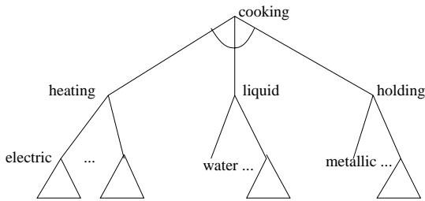  
Figure 22. Functional knowledge.

where radius is a quantitative feature and the rest are all qualitative features. This description is used to describe a cluster of cricket balls. In Stepp and Michalski [1986], a graph (the goal dependency network) was used to group structured objects. In Shekar et al. [1987] functional knowledge was used to group man-made objects. Functional knowledge was represented using and/or trees [Rich 1983]. For example, the function cooking shown in Figure 22 can be decomposed into functions like holding and heating the material in a liquid medium. Each man-made object has a primary function for which it is produced. Further, based on its features, it may serve additional functions. For example, a book is meant for reading, but if it is heavy then it can also be used as a paper weight. In Sutton et al. [1993], object functions were used to construct generic recognition systems.

5.11.4 Pragmatic Issues. Any implementation of a system that explicitly incorporates domain concepts into a clustering technique has to address the following important pragmatic issues:

(1) Representation, availability and completeness of domain concepts.   
(2) Construction of inferences using the knowledge.   
(3) Accommodation of changing or dynamic knowledge.

In some domains, complete knowledge is available explicitly. For example, the ACM Computing Reviews classification tree used in Murty and Jain [1995] is complete and is explicitly available for use. In several domains, knowledge is incomplete and is not available explicitly. Typically, machine learning techniques are used to automatically extract knowledge, which is a difficult and challenging problem. The most prominently used learning method is “learning from examples” [Quinlan 1990]. This is an inductive learning scheme used to acquire knowledge from examples of each of the classes in different domains. Even if the knowledge is available explicitly, it is difficult to find out whether it is complete and sound. Further, it is extremely difficult to verify soundness and completeness of knowledge extracted from practical data sets, because such knowledge cannot be represented in propositional logic. It is possible that both the data and knowledge keep changing with time. For example, in a library, new books might get added and some old books might be deleted from the collection with time. Also, the classification system (knowledge) employed by the library is updated periodically.

A major problem with knowledgebased clustering is that it has not been applied to large data sets or in domains with large knowledge bases. Typically, the number of objects grouped was less than 1000, and number of rules used as a part of the knowledge was less than 100. The most difficult problem is to use a very large knowledge base for clustering objects in several practical problems including data mining, image segmentation, and document retrieval.

# 5.12 Clustering Large Data Sets

There are several applications where it is necessary to cluster a large collection of patterns. The definition of ‘large’ has varied (and will continue to do so) with changes in technology (e.g., memory and processing time). In the 1960s, ‘large’ meant several thousand patterns [Ross 1968]; now, there are applications where millions of patterns of high dimensionality have to be clustered. For example, to segment an image of size $5 0 0 ~ \times ~ 5 0 0$ pixels, the number of pixels to be clustered is 250,000. In document retrieval and information filtering, millions of patterns with a dimensionality of more than 100 have to be clustered to achieve data abstraction. A majority of the approaches and algorithms proposed in the literature cannot handle such large data sets. Approaches based on genetic algorithms, tabu search and simulated annealing are optimization techniques and are restricted to reasonably small data sets. Implementations of conceptual clustering optimize some criterion functions and are typically computationally expensive.

The convergent $k$ -means algorithm and its ANN equivalent, the Kohonen net, have been used to cluster large data sets [Mao and Jain 1996]. The reasons behind the popularity of the $k$ -means algorithm are:

(1) Its time complexity is $O ( n k l )$ where $n$ is the number of patterns, $k$ is the number of clusters, and $l$ is the number of iterations taken by the algorithm to converge. Typically, $k$ and $l$ are fixed in advance and so the algorithm has linear time complexity in the size of the data set [Day 1992].

(2) Its space complexity is $O ( k { \mathrm { ~ + ~ } } n )$ . It requires additional space to store the data matrix. It is possible to store the data matrix in a secondary memory and access each pattern based on need. However, this scheme requires a huge access time because of the iterative nature of the algorithm, and as a consequence processing time increases enormously.

(3) It is order-independent; for a given initial seed set of cluster centers, it generates the same partition of the data irrespective of the order in which the patterns are presented to the algorithm.

Table I. Complexity of Clustering Algorithms   

<table><tr><td>Clustering Algorithm</td><td>Time Complexity Complexity</td><td>Space</td></tr><tr><td>leader</td><td>O(kn)</td><td>O(k)</td></tr><tr><td>k-means</td><td>O(nkl)</td><td>O(k)</td></tr><tr><td>ISODATA</td><td>O(nkl)</td><td>O(k)</td></tr><tr><td>shortest spanning path</td><td>O(2)</td><td>O(n)</td></tr><tr><td>single-line</td><td>O(n2 log n)</td><td>O(n2)</td></tr><tr><td>complete-line</td><td>O(n2 log n)</td><td>O(n2)</td></tr></table>

However, the $k$ -means algorithm is sensitive to initial seed selection and even in the best case, it can produce only hyperspherical clusters.

Hierarchical algorithms are more versatile. But they have the following disadvantages:

(1) The time complexity of hierarchical agglomerative algorithms is $O ( n ^ { 2 }$ log $n$ ! [Kurita 1991]. It is possible to obtain single-link clusters using an MST of the data, which can be constructed in $O ( n \ \log ^ { 2 } n )$ time for two-dimensional data [Choudhury and Murty 1990].

(2) The space complexity of agglomerative algorithms is $O ( n ^ { 2 } )$ . This is because a similarity matrix of size $n \times n$ has to be stored. To cluster every pixel in a $1 0 0 ~ \times ~ 1 0 0$ image, approximately 200 megabytes of storage would be required (assuning single-precision storage of similarities). It is possible to compute the entries of this matrix based on need instead of storing them (this would increase the algorithm’s time complexity [Anderberg 1973]).

Table I lists the time and space complexities of several well-known algorithms. Here, $n$ is the number of patterns to be clustered, $k$ is the number of clusters, and $l$ is the number of iterations.

A possible solution to the problem of clustering large data sets while only marginally sacrificing the versatility of clusters is to implement more efficient variants of clustering algorithms. A hybrid approach was used in Ross [1968], where a set of reference points is chosen as in the $k$ -means algorithm, and each of the remaining data points is assigned to one or more reference points or clusters. Minimal spanning trees (MST) are obtained for each group of points separately. These MSTs are merged to form an approximate global MST. This approach computes similarities between only a fraction of all possible pairs of points. It was shown that the number of similarities computed for 10,000 patterns using this approach is the same as the total number of pairs of points in a collection of 2,000 points. Bentley and Friedman [1978] contains an algorithm that can compute an approximate MST in $O ( n \log n )$ time. A scheme to generate an approximate dendrogram incrementally in $O ( n \ \log { n } )$ time was presented in Zupan [1982], while Venkateswarlu and Raju [1992] proposed an algorithm to speed up the ISODATA clustering algorithm. A study of the approximate single-linkage cluster analysis of large data sets was reported in Eddy et al. [1994]. In that work, an approximate MST was used to form single-link clusters of a data set of size 40,000.

The emerging discipline of data mining (discussed as an application in Section 6) has spurred the development of new algorithms for clustering large data sets. Two algorithms of note are the CLARANS algorithm developed by $\mathbf { N g }$ and Han [1994] and the BIRCH algorithm proposed by Zhang et al. [1996]. CLARANS (Clustering Large Applications based on RANdom Search) identifies candidate cluster centroids through analysis of repeated random samples from the original data. Because of the use of random sampling, the time complexity is $O ( n )$ for a pattern set of $n$ elements. The BIRCH algorithm (Balanced Iterative Reducing and Clustering) stores summary information about candidate clusters in a dynamic tree data structure. This tree hierarchically organizes the clusterings represented at the leaf nodes. The tree can be rebuilt when a threshold specifying cluster size is updated manually, or when memory constraints force a change in this threshold. This algorithm, like CLARANS, has a time complexity linear in the number of patterns.

The algorithms discussed above work on large data sets, where it is possible to accommodate the entire pattern set in the main memory. However, there are applications where the entire data set cannot be stored in the main memory because of its size. There are currently three possible approaches to solve this problem.

(1) The pattern set can be stored in a secondary memory and subsets of this data clustered independently, followed by a merging step to yield a clustering of the entire pattern set. We call this approach the divide and conquer approach.

(2) An incremental clustering algorithm can be employed. Here, the entire data matrix is stored in a secondary memory and data items are transferred to the main memory one at a time for clustering. Only the cluster representations are stored in the main memory to alleviate the space limitations.

(3) A parallel implementation of a clustering algorithm may be used. We discuss these approaches in the next three subsections.

5.12.1 Divide and Conquer Approach. Here, we store the entire pattern matrix of size $n \times d$ in a secondary storage space (e.g., a disk file). We divide this data into $p$ blocks, where an optimum value of $p$ can be chosen based on the clustering algorithm used [Murty and Krishna 1980]. Let us assume that we have ${ n / p }$ patterns in each of the blocks.

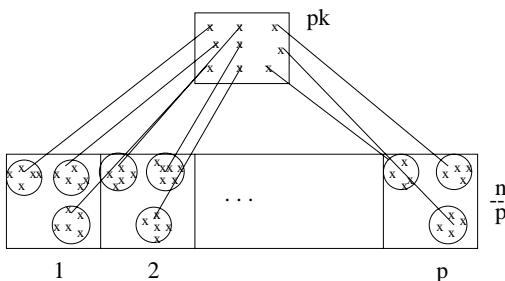  
Figure 23. Divide and conquer approach to clustering.

We transfer each of these blocks to the main memory and cluster it into $k$ clusters using a standard algorithm. One or more representative samples from each of these clusters are stored separately; we have $p k$ of these representative patterns if we choose one representative per cluster. These $p k$ representatives are further clustered into $k$ clusters and the cluster labels of these representative patterns are used to relabel the original pattern matrix. We depict this two-level algorithm in Figure 23. It is possible to extend this algorithm to any number of levels; more levels are required if the data set is very large and the main memory size is very small [Murty and Krishna 1980]. If the singlelink algorithm is used to obtain 5 clusters, then there is a substantial savings in the number of computations as shown in Table II for optimally chosen $p$ when the number of clusters is fixed at 5. However, this algorithm works well only when the points in each block are reasonably homogeneous which is often satisfied by image data.

A two-level strategy for clustering a data set containing 2,000 patterns was described in Stahl [1986]. In the first level, the data set is loosely clustered into a large number of clusters using the leader algorithm. Representatives from these clusters, one per cluster, are the input to the second level clustering, which is obtained using Ward’s hierarchical method.

Table II. Number of Distance Computations (n) for the Single-Link Clustering Algorithm and a Two-Level Divide and Conquer Algorithm   

<table><tr><td>n</td><td>Single-link</td><td>p</td><td>Two-level</td></tr><tr><td>100</td><td>4,950</td><td></td><td>1200</td></tr><tr><td>500</td><td>124,750</td><td>2</td><td>10,750</td></tr><tr><td>100</td><td>499,500</td><td>4</td><td>31,500</td></tr><tr><td>10,000</td><td>49,995,000</td><td>10</td><td>1,013,750</td></tr></table>

5.12.2 Incremental Clustering. Incremental clustering is based on the assumption that it is possible to consider patterns one at a time and assign them to existing clusters. Here, a new data item is assigned to a cluster without affecting the existing clusters significantly. A high level description of a typical incremental clustering algorithm is given below.

# An Incremental Clustering Algorithm

(1) Assign the first data item to a cluster.   
(2) Consider the next data item. Either assign this item to one of the existing clusters or assign it to a new cluster. This assignment is done based on some criterion, e.g. the distance between the new item and the existing cluster centroids.   
(3) Repeat step 2 till all the data items are clustered.

The major advantage with the incremental clustering algorithms is that it is not necessary to store the entire pattern matrix in the memory. So, the space requirements of incremental algorithms are very small. Typically, they are noniterative. So their time requirements are also small. There are several incremental clustering algorithms:

(1) The leader clustering algorithm [Hartigan 1975] is the simplest in terms of time complexity which is $O ( n k )$ . It has gained popularity because of its neural network implementation, the ART network [Carpenter and Grossberg 1990]. It is very easy to implement as it requires only $O ( k )$ space.

(2) The shortest spanning path (SSP) algorithm [Slagle et al. 1975] was originally proposed for data reorganization and was successfully used in automatic auditing of records [Lee et al. 1978]. Here, SSP algorithm was used to cluster 2000 patterns using 18 features. These clusters are used to estimate missing feature values in data items and to identify erroneous feature values.

(3) The cobweb system [Fisher 1987] is an incremental conceptual clustering algorithm. It has been successfully used in engineering applications [Fisher et al. 1993].

(4) An incremental clustering algorithm for dynamic information processing was presented in Can [1993]. The motivation behind this work is that, in dynamic databases, items might get added and deleted over time. These changes should be reflected in the partition generated without significantly affecting the current clusters. This algorithm was used to cluster incrementally an INSPEC database of 12,684 documents corresponding to computer science and electrical engineering.

Order-independence is an important property of clustering algorithms. An algorithm is order-independent if it generates the same partition for any order in which the data is presented. Otherwise, it is order-dependent. Most of the incremental algorithms presented above are order-dependent. We illustrate this order-dependent property in Figure 24 where there are 6 two-dimensional objects labeled 1 to 6. If we present these patterns to the leader algorithm in the order 2,1,3,5,4,6 then the two clusters obtained are shown by ellipses. If the order is 1,2,6,4,5,3, then we get a twopartition as shown by the triangles. The SSP algorithm, cobweb, and the algorithm in Can [1993] are all order-dependent.

5.12.3 Parallel Implementation. Recent work [Judd et al. 1996] demonstrates that a combination of algorithmic enhancements to a clustering algorithm and distribution of the computations over a network of workstations can allow an entire $5 1 2 \times 5 1 2$ image to be clustered in a few minutes. Depending on the clustering algorithm in use, parallelization of the code and replication of data for efficiency may yield large benefits. However, a global shared data structure, namely the cluster membership table, remains and must be managed centrally or replicated and synchronized periodically. The presence or absence of robust, efficient parallel clustering techniques will determine the success or failure of cluster analysis in large-scale data mining applications in the future.

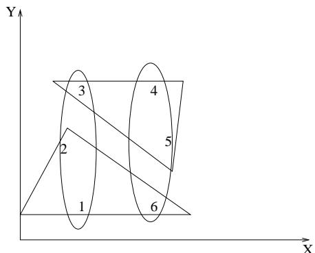  
Figure 24. The leader algorithm is order dependent.

# 6. APPLICATIONS

Clustering algorithms have been used in a large variety of applications [Jain and Dubes 1988; Rasmussen 1992; Oehler and Gray 1995; Fisher et al. 1993]. In this section, we describe several applications where clustering has been employed as an essential step. These areas are: (1) image segmentation, (2) object and character recognition, (3) document retrieval, and (4) data mining.

# 6.1 Image Segmentation Using Clustering

Image segmentation is a fundamental component in many computer vision applications, and can be addressed as a clustering problem [Rosenfeld and Kak 1982]. The segmentation of the image(s) presented to an image analysis system is critically dependent on the scene to be sensed, the imaging geometry, configuration, and sensor used to transduce the scene into a digital image, and ultimately the desired output (goal) of the system.

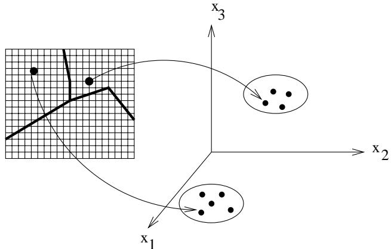  
Figure 25. Feature representation for clustering. Image measurements and positions are transformed to features. Clusters in feature space correspond to image segments.

The applicability of clustering methodology to the image segmentation problem was recognized over three decades ago, and the paradigms underlying the initial pioneering efforts are still in use today. A recurring theme is to define feature vectors at every image location (pixel) composed of both functions of image intensity and functions of the pixel location itself. This basic idea, depicted in Figure 25, has been successfully used for intensity images (with or without texture), range (depth) images and multispectral images.

6.1.1 Segmentation. An image segmentation is typically defined as an exhaustive partitioning of an input image into regions, each of which is considered to be homogeneous with respect to some image property of interest (e.g., intensity, color, or texture) [Jain et al. 1995]. If

$$
\mathcal { F } = \{ x _ { i j } , i = 1 . \ldots N _ { r } , j = 1 . \ldots N _ { c } \}
$$

is the input image with $N _ { r }$ rows and $N _ { c }$ columns and measurement value $x _ { i j }$ at pixel $( i , j )$ , then the segmentation can be expressed as $\mathcal { S } = \{ S _ { 1 } , . . . . S _ { k } \}$ , with the lth segment

$$
{ { S } _ { l } } = \{ ( { { i } _ { l _ { 1 } } } , { { j } _ { l _ { 1 } } } ) , ~ . ~ . ~ . ~ ( { { i } _ { l _ { N _ { l } } } } , { { j } _ { l _ { N _ { l } } } } ) \}
$$

consisting of a connected subset of the pixel coordinates. No two segments share any pixel locations $( S _ { i } \cap S _ { j } = \emptyset$ $\forall i \ne j )$ , and the union of all segments covers the entire image \~ $\backslash \cup _ { i = 1 } ^ { k } S _ { i } =$ $\{ 1 . ~ . ~ . ~ N _ { r } \} \times \{ 1 . ~ . ~ . ~ N _ { c } \} )$ . Jain and Dubes [1988], after Fu and Mui [1981] identified three techniques for producing segmentations from input imagery: region-based, edge-based, or clusterbased.

Consider the use of simple gray level thresholding to segment a high-contrast intensity image. Figure 26(a) shows a grayscale image of a textbook’s bar code scanned on a flatbed scanner. Part b shows the results of a simple thresholding operation designed to separate the dark and light regions in the bar code area. Binarization steps like this are often performed in character recognition systems. Thresholding in effect ‘clusters’ the image pixels into two groups based on the one-dimensional intensity measurement [Rosenfeld 1969;

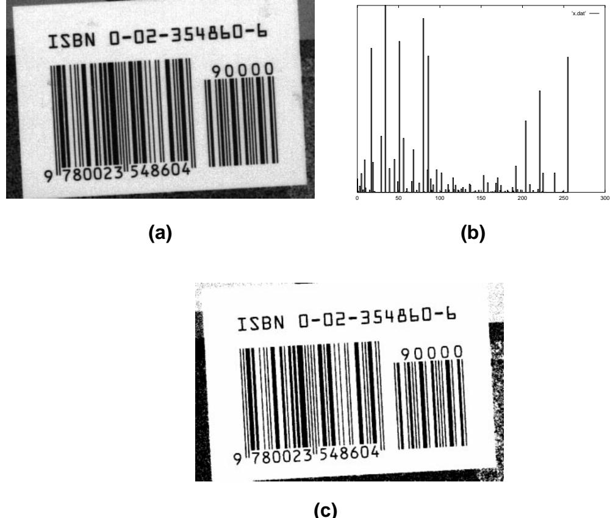  
Figure 26. Binarization via thresholding. (a): Original grayscale image. (b): Gray-level histogram. (c): Results of thresholding.

Dunn et al. 1974]. A postprocessing step separates the classes into connected regions. While simple gray level thresholding is adequate in some carefully controlled image acquisition environments and much research has been devoted to appropriate methods for thresholding [Weszka 1978; Trier and Jain 1995], complex images require more elaborate segmentation techniques.

Many segmenters use measurements which are both spectral (e.g., the multispectral scanner used in remote sensing) and spatial (based on the pixel’s location in the image plane). The measurement at each pixel hence corresponds directly to our concept of a pattern.

6.1.2 Image Segmentation Via Clustering. The application of local feature clustering to segment gray–scale images was documented in Schachter et al. [1979]. This paper emphasized the appropriate selection of features at each pixel rather than the clustering methodology, and proposed the use of image plane coordinates (spatial information) as additional features to be employed in clustering-based segmentation. The goal of clustering was to obtain a sequence of hyperellipsoidal clusters starting with cluster centers positioned at maximum density locations in the pattern space, and growing clusters about these centers until a $\chi ^ { 2 }$ test for goodness of fit was violated. A variety of features were discussed and applied to both grayscale and color imagery.

An agglomerative clustering algorithm was applied in Silverman and Cooper [1988] to the problem of unsupervised learning of clusters of coefficient vectors for two image models that correspond to image segments. The first image model is polynomial for the observed image measurements; the assumption here is that the image is a collection of several adjoining graph surfaces, each a polynomial function of the image plane coordinates, which are sampled on the raster grid to produce the observed image. The algorithm proceeds by obtaining vectors of coefficients of least-squares fits to the data in $M$ disjoint image windows. An agglomerative clustering algorithm merges (at each step) the two clusters that have a minimum global between-cluster Mahalanobis distance. The same framework was applied to segmentation of textured images, but for such images the polynomial model was inappropriate, and a parameterized Markov Random Field model was assumed instead.

Wu and Leahy [1993] describe the application of the principles of network flow to unsupervised classification, yielding a novel hierarchical algorithm for clustering. In essence, the technique views the unlabeled patterns as nodes in a graph, where the weight of an edge (i.e., its capacity) is a measure of similarity between the corresponding nodes. Clusters are identified by removing edges from the graph to produce connected disjoint subgraphs. In image segmentation, pixels which are 4-neighbors or 8-neighbors in the image plane share edges in the constructed adjacency graph, and the weight of a graph edge is based on the strength of a hypothesized image edge between the pixels involved (this strength is calculated using simple derivative masks). Hence, this segmenter works by finding closed contours in the image, and is best labeled edgebased rather than region-based.

In Vinod et al. [1994], two neural networks are designed to perform pattern clustering when combined. A twolayer network operates on a multidimensional histogram of the data to identify ‘prototypes’ which are used to classify the input patterns into clusters. These prototypes are fed to the classification network, another two-layer network operating on the histogram of the input data, but are trained to have differing weights from the prototype selection network. In both networks, the histogram of the image is used to weight the contributions of patterns neighboring the one under consideration to the location of prototypes or the ultimate classification; as such, it is likely to be more robust when compared to techniques which assume an underlying parametric density function for the pattern classes. This architecture was tested on gray-scale and color segmentation problems.

Jolion et al. [1991] describe a process for extracting clusters sequentially from the input pattern set by identifying hyperellipsoidal regions (bounded by loci of constant Mahalanobis distance) which contain a specified fraction of the unclassified points in the set. The extracted regions are compared against the best-fitting multivariate Gaussian density through a Kolmogorov-Smirnov test, and the fit quality is used as a figure of merit for selecting the ‘best’ region at each iteration. The process continues until a stopping criterion is satisfied. This procedure was applied to the problems of threshold selection for multithreshold segmentation of intensity imagery and segmentation of range imagery.

Clustering techniques have also been successfully used for the segmentation of range images, which are a popular source of input data for three-dimensional object recognition systems [Jain and Flynn 1993]. Range sensors typically return raster images with the measured value at each pixel being the coordinates of a 3D location in space. These 3D positions can be understood as the locations where rays emerging from the image plane locations in a bundle intersect the objects in front of the sensor.

The local feature clustering concept is particularly attractive for range image segmentation since (unlike intensity measurements) the measurements at each pixel have the same units (length); this would make ad hoc transformations or normalizations of the image features unnecessary if their goal is to impose equal scaling on those features. However, range image segmenters often add additional measurements to the feature space, removing this advantage.

A range image segmentation system described in Hoffman and Jain [1987] employs squared error clustering in a six-dimensional feature space as a source of an “initial” segmentation which is refined (typically by merging segments) into the output segmentation. The technique was enhanced in Flynn and Jain [1991] and used in a recent systematic comparison of range image segmenters [Hoover et al. 1996]; as such, it is probably one of the longest-lived range segmenters which has performed well on a large variety of range images.

This segmenter works as follows. At each pixel $( i , j )$ in the input range image, the corresponding 3D measurement is denoted $( x _ { i j } , y _ { i j } , z _ { i j } )$ , where typically $x _ { i j }$ is a linear function of $j$ (the column number) and $y _ { i j }$ is a linear function of $i$ (the row number). A $k \times k$ neighborhood of $( i , j )$ is used to estimate the 3D surface normal ${ \bf n } _ { i j } = ( n _ { i j } ^ { x } , n _ { i j } ^ { y } , n _ { i j } ^ { z } )$ at $( i , j )$ , typically by finding the leastsquares planar fit to the 3D points in the neighborhood. The feature vector for the pixel at $( i , j )$ is the six-dimensional measurement $( x _ { i j } , y _ { i j } , z _ { i j } , n _ { i j } ^ { x } , n _ { i j } ^ { y } , n _ { i j } ^ { z } )$ and a candidate segmentation is found by clustering these feature vectors. For practical reasons, not every pixel’s feature vector is used in the clustering procedure; typically 1000 feature vectors are chosen by subsampling.

The CLUSTER algorithm [Jain and Dubes 1988] was used to obtain segment labels for each pixel. CLUSTER is an enhancement of the $k$ -means algorithm; it has the ability to identify several clusterings of a data set, each with a different number of clusters. Hoffman and Jain [1987] also experimented with other clustering techniques (e.g., complete-link, single-link, graph-theoretic, and other squared error algorithms) and found CLUSTER to provide the best combination of performance and accuracy. An additional advantage of CLUSTER is that it produces a sequence of output clusterings (i.e., a 2-cluster solution up through a $K _ { m a x }$ -cluster solution where $K _ { m a x }$ is specified by the user and is typically 20 or so); each clustering in this sequence yields a clustering statistic which combines between-cluster separation and within-cluster scatter. The clustering that optimizes this statistic is chosen as the best one. Each pixel in the range image is assigned the segment label of the nearest cluster center. This minimum distance classification step is not guaranteed to produce segments which are connected in the image plane; therefore, a connected components labeling algorithm allocates new labels for disjoint regions that were placed in the same cluster. Subsequent operations include surface type tests, merging of adjacent patches using a test for the presence of crease or jump edges between adjacent segments, and surface parameter estimation.

Figure 27 shows this processing applied to a range image. Part a of the figure shows the input range image; part b shows the distribution of surface normals. In part c, the initial segmentation returned by CLUSTER and modified to guarantee connected segments is shown. Part d shows the final segmentation produced by merging adjacent patches which do not have a significant crease edge between them. The final clusters reasonably represent distinct surfaces present in this complex object.

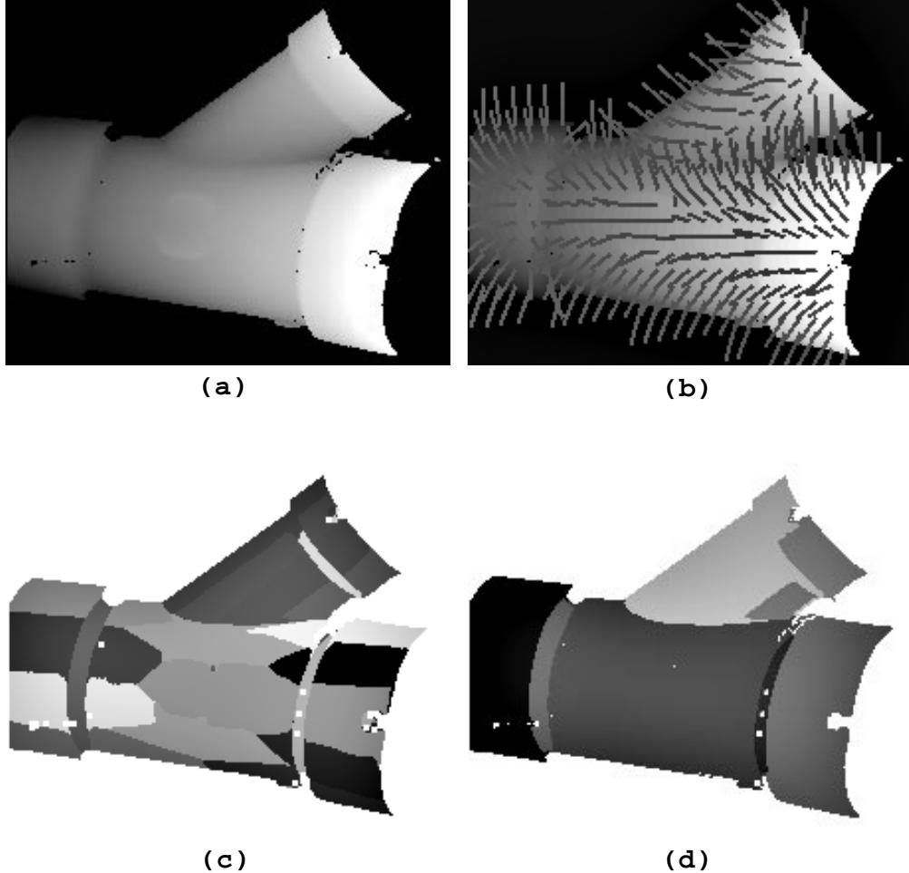  
Figure 27. Range image segmentation using clustering. (a): Input range image. (b): Surface normals for selected image pixels. (c): Initial segmentation (19 cluster solution) returned by CLUSTER using 1000 six-dimensional samples from the image as a pattern set. (d): Final segmentation (8 segments) produced by postprocessing.

The analysis of textured images has been of interest to researchers for several years. Texture segmentation techniques have been developed using a variety of texture models and image operations. In Nguyen and Cohen [1993], texture image segmentation was addressed by modeling the image as a hierarchy of two Markov Random Fields, obtaining some simple statistics from each image block to form a feature vector, and clustering these blocks using a fuzzy $K$ -means clustering method. The clustering procedure here is modified to jointly estimate the number of clusters as well as the fuzzy membership of each feature vector to the various clusters.

A system for segmenting texture images was described in Jain and Farrokhnia [1991]; there, Gabor filters were used to obtain a set of 28 orientation- and scale-selective features that characterize the texture in the neighborhood of each pixel. These 28 features are reduced to a smaller number through a feature selection procedure, and the resulting features are preprocessed and then clustered using the CLUSTER program. An index statistic [Dubes 1987] is used to select the best clustering. Minimum distance classification is used to label each of the original image pixels. This technique was tested on several texture mosaics including the natural Brodatz textures and synthetic images. Figure 28(a) shows an input texture mosaic consisting of four of the popular Brodatz textures [Brodatz 1966]. Part b shows the segmentation produced when the Gabor filter features are augmented to contain spatial information (pixel coordinates). This Gabor filter based technique has proven very powerful and has been extended to the automatic segmentation of text in documents [Jain and Bhattacharjee 1992] and segmentation of objects in complex backgrounds [Jain et al. 1997].

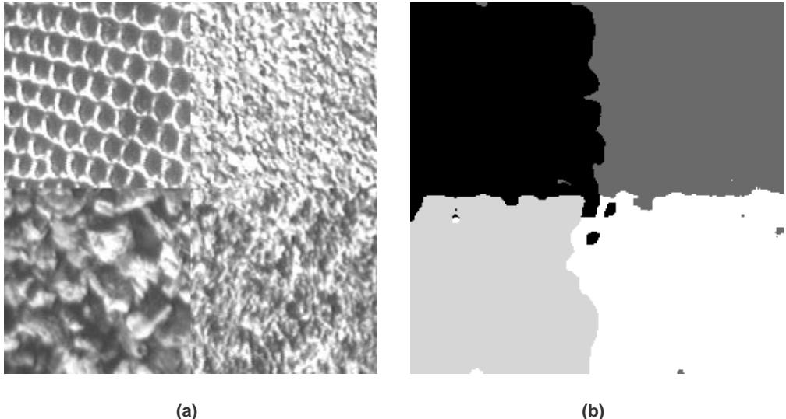  
Figure 28. Texture image segmentation results. (a): Four-class texture mosaic. (b): Four-cluster solution produced by CLUSTER with pixel coordinates included in the feature set.

Clustering can be used as a preprocessing stage to identify pattern classes for subsequent supervised classification. Taxt and Lundervold [1994] and Lundervold et al. [1996] describe a partitional clustering algorithm and a manual labeling technique to identify material classes (e.g., cerebrospinal fluid, white matter, striated muscle, tumor) in registered images of a human head obtained at five different magnetic resonance imaging channels (yielding a fivedimensional feature vector at each pixel). A number of clusterings were obtained and combined with domain knowledge (human expertise) to identify the different classes. Decision rules for supervised classification were based on these obtained classes. Figure 29(a) shows one channel of an input multispectral image; part b shows the 9-cluster result.

The $k$ -means algorithm was applied to the segmentation of LANDSAT imagery in Solberg et al. [1996]. Initial cluster centers were chosen interactively by a trained operator, and correspond to land-use classes such as urban areas, soil (vegetation-free) areas, forest, grassland, and water. Figure 30(a) shows the input image rendered as grayscale; part b shows the result of the clustering procedure.

6.1.3 Summary. In this section, the application of clustering methodology to image segmentation problems has been motivated and surveyed. The historical record shows that clustering is a powerful tool for obtaining classifications of image pixels. Key issues in the design of any clustering-based segmenter are the choice of pixel measurements (features) and dimensionality of the feature vector (i.e., should the feature vector contain intensities, pixel positions, model parameters, filter outputs?), a measure of similarity which is appropriate for the selected features and the application domain, the identification of a clustering algorithm, the development of strategies for feature and data reduction (to avoid the “curse of dimensionality” and the computational burden of classifying large numbers of patterns and/or features), and the identification of necessary pre- and post-processing techniques (e.g., image smoothing and minimum distance classification). The use of clustering for segmentation dates back to the 1960s, and new variations continue to emerge in the literature. Challenges to the more successful use of clustering include the high computational complexity of many clustering algorithms and their incorporation of strong assumptions (often multivariate Gaussian) about the multidimensional shape of clusters to be obtained. The ability of new clustering procedures to handle concepts and semantics in classification (in addition to numerical measurements) will be important for certain applications [Michalski and Stepp 1983; Murty and Jain 1995].

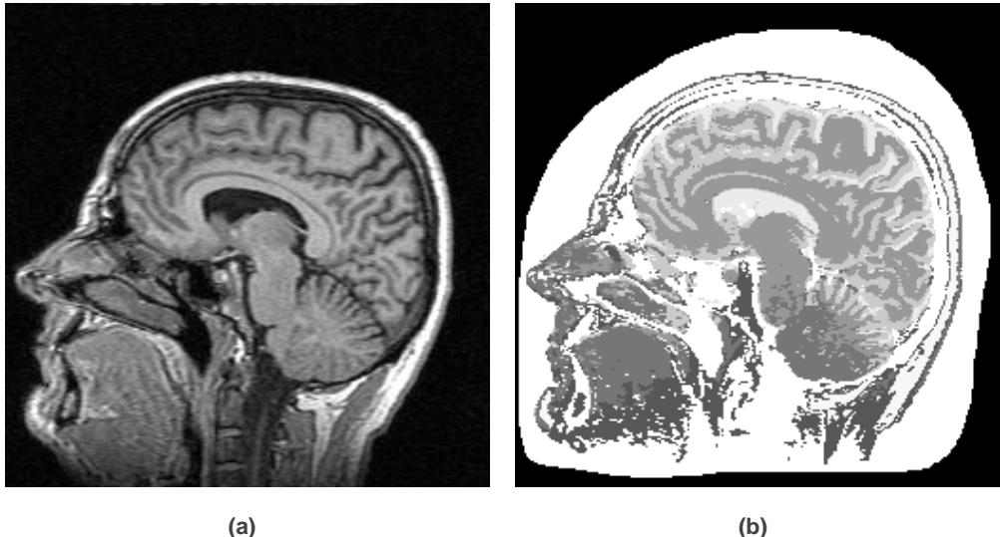  
Figure 29. Multispectral medical image segmentation. (a): A single channel of the input image. (b): 9-cluster segmentation.

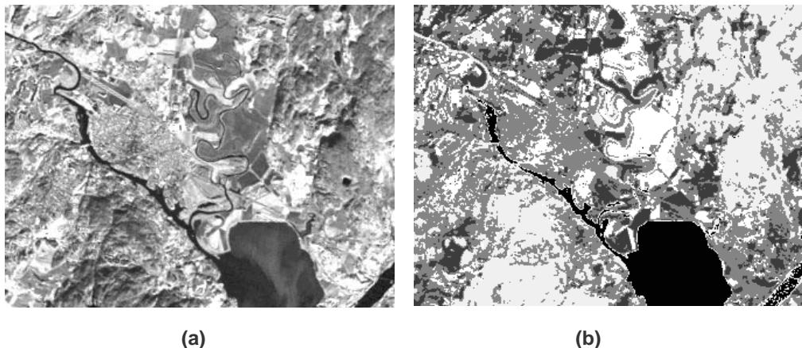  
Figure 30. LANDSAT image segmentation. (a): Original image (ESA/EURIMAGE/Sattelitbild). (b): Clustered scene.

shape index values (which are related to surface curvature values) and accumulating all the object pixels that fall into each bin. By normalizing the spectrum with respect to the total object area, the scale (size) differences that may exist between different objects are removed. The first moment $m _ { 1 }$ is computed as the weighted mean of ${ \bar { H } } ( h )$ :

# 6.2 Object and Character Recognition

6.2.1 Object Recognition. The use of clustering to group views of 3D objects for the purposes of object recognition in range data was described in Dorai and Jain [1995]. The term view refers to a range image of an unoccluded object obtained from any arbitrary viewpoint. The system under consideration employed a viewpoint dependent (or viewcentered) approach to the object recognition problem; each object to be recognized was represented in terms of a library of range images of that object.

There are many possible views of a 3D object and one goal of that work was to avoid matching an unknown input view against each image of each object. A common theme in the object recognition literature is indexing, wherein the unknown view is used to select a subset of views of a subset of the objects in the database for further comparison, and rejects all other views of objects. One of the approaches to indexing employs the notion of view classes; a view class is the set of qualitatively similar views of an object. In that work, the view classes were identified by clustering; the rest of this subsection outlines the technique.

Object views were grouped into classes based on the similarity of shape spectral features. Each input image of an object viewed in isolation yields a feature vector which characterizes that view. The feature vector contains the first ten central moments of a normalized shape spectral distribution, ${ \bar { H } } ( h )$ , of an object view. The shape spectrum of an object view is obtained from its range data by constructing a histogram of

$$
m _ { 1 } = \sum _ { h } ( h ) \bar { H } ( h ) .
$$

The other central moments, $m _ { p }$ , $2 \leq p$ $\le ~ 1 0$ are defined as:

$$
m _ { p } = \sum _ { h } ( h - m _ { 1 } ) ^ { p } \bar { H } ( h ) .
$$

Then, the feature vector is denoted as $R = ( m _ { 1 } , m _ { 2 } , \cdot \cdot \cdot , m _ { 1 0 } )$ , with the range of each of these moments being @21,1#.

Let ${ \mathbb O } = \{ O ^ { 1 } , O ^ { 2 } , \cdot \cdot \cdot , O ^ { n } \}$ be a collection of $n$ 3D objects whose views are present in the model database, ${ \mathcal { M } } _ { D }$ . The ith view of the $j$ th object, $O _ { j } ^ { i }$ in the database is represented by $\langle L _ { j } ^ { i } , R _ { j } ^ { i } \rangle$ , where $L _ { j } ^ { i }$ is the object label and $R _ { j } ^ { i }$ is the feature vector. Given a set of object representations $\mathcal { R } ^ { i } = \{ \langle L _ { 1 } ^ { i } , R _ { 1 } ^ { i } \rangle , \cdots .$ , $\langle L _ { m } ^ { i } , R _ { m } ^ { i } \rangle \}$ that describes $m$ views of the ith object, the goal is to derive a partition of the views, $\mathcal { P } ^ { i } = \{ C _ { 1 } ^ { i }$ $C _ { 2 } ^ { i } , \cdot \cdot \cdot , C _ { k _ { i } } ^ { i } \}$ . Each cluster in ${ \mathcal { P } } ^ { i }$ contains those views of the ith object that have been adjudged similar based on the dissimilarity between the corresponding moment features of the shape spectra of the views. The measure of dissimilarity, between $R _ { j } ^ { i }$ and $R _ { \mathit { k } } ^ { i }$ , is defined as:

$$
\mathcal { D } ( R _ { j } ^ { i } , R _ { k } ^ { i } ) = \sum _ { l = 1 } ^ { 1 0 } ( R _ { j l } ^ { i } - R _ { k l } ^ { i } ) ^ { 2 } .
$$

6.2.2 Clustering Views. A database containing 3,200 range images of 10 different sculpted objects with 320 views per object is used [Dorai and Jain 1995].

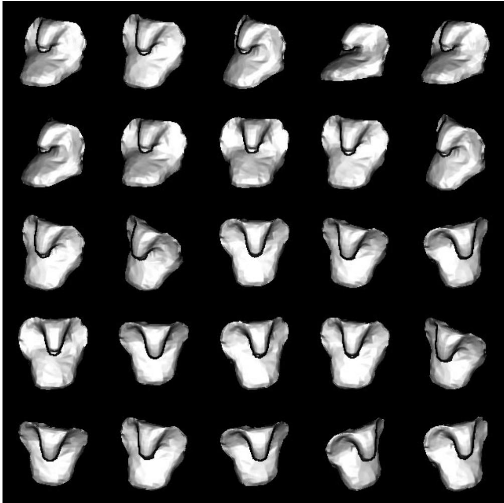  
Figure 31. A subset of views of Cobra chosen from a set of 320 views.

The range images from 320 possible viewpoints (determined by the tessellation of the view-sphere using the icosahedron) of the objects were synthesized. Figure 31 shows a subset of the collection of views of Cobra used in the experiment.

The shape spectrum of each view is computed and then its feature vector is determined. The views of each object are clustered, based on the dissimilarity measure $\mathcal { D }$ between their moment vectors using the complete-link hierarchical clustering scheme [Jain and Dubes 1988]. The hierarchical grouping obtained with 320 views of the Cobra object is shown in Figure 32. The view grouping hierarchies of the other nine objects are similar to the dendrogram in Figure 32. This dendrogram is cut at a dissimilarity level of 0.1 or less to obtain compact and well-separated clusters. The clusterings obtained in this manner demonstrate that the views of each object fall into several distinguishable clusters. The centroid of each of these clusters was determined by computing the mean of the moment vectors of the views falling into the cluster.

Dorai and Jain [1995] demonstrated that this clustering-based view grouping procedure facilitates object matching in terms of classification accuracy and the number of matches necessary for correct classification of test views. Object views are grouped into compact and homogeneous view clusters, thus demonstrating the power of the clusterbased scheme for view organization and efficient object matching.

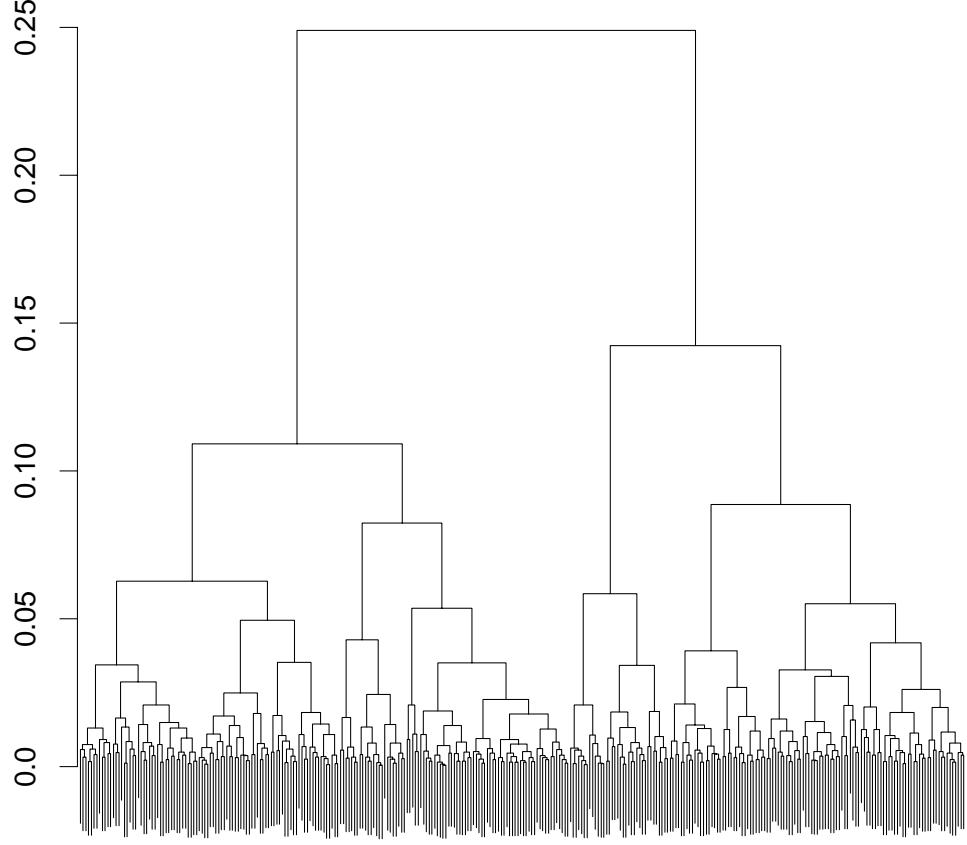  
Figure 32. Hierarchical grouping of 320 views of a cobra sculpture.

6.2.3 Character Recognition. Clustering was employed in Connell and Jain [1998] to identify lexemes in handwritten text for the purposes of writerindependent handwriting recognition. The success of a handwriting recognition system is vitally dependent on its acceptance by potential users. Writerdependent systems provide a higher level of recognition accuracy than writer-independent systems, but require a large amount of training data. A writerindependent system, on the other hand, must be able to recognize a wide variety of writing styles in order to satisfy an individual user. As the variability of the writing styles that must be captured by a system increases, it becomes more and more difficult to discriminate between different classes due to the amount of overlap in the feature space. One solution to this problem is to separate the data from these disparate writing styles for each class into different subclasses, known as lexemes. These lexemes represent portions of the data which are more easily separated from the data of classes other than that to which the lexeme belongs.

In this system, handwriting is captured by digitizing the $( x , y )$ position of the pen and the state of the pen point (up or down) at a constant sampling rate. Following some resampling, normalization, and smoothing, each stroke of the pen is represented as a variablelength string of points. A metric based on elastic template matching and dynamic programming is defined to allow the distance between two strokes to be calculated.

Using the distances calculated in this manner, a proximity matrix is constructed for each class of digits (i.e., 0 through 9). Each matrix measures the intraclass distances for a particular digit class. Digits in a particular class are clustered in an attempt to find a small number of prototypes. Clustering is done using the CLUSTER program described above [Jain and Dubes 1988], in which the feature vector for a digit is its $N$ proximities to the digits of the same class. CLUSTER attempts to produce the best clustering for each value of $K$ over some range, where $K$ is the number of clusters into which the data is to be partitioned. As expected, the mean squared error (MSE) decreases monotonically as a function of $K$ . The “optimal” value of K is chosen by identifying a “knee” in the plot of MSE vs. K.

When representing a cluster of digits by a single prototype, the best on-line recognition results were obtained by using the digit that is closest to that cluster’s center. Using this scheme, a correct recognition rate of $9 9 . 3 3 \%$ was obtained.

# 6.3 Information Retrieval

Information retrieval (IR) is concerned with automatic storage and retrieval of documents [Rasmussen 1992]. Many university libraries use IR systems to provide access to books, journals, and other documents. Libraries use the Library of Congress Classification (LCC) scheme for efficient storage and retrieval of books. The LCC scheme consists of classes labeled A to Z [LC Classification Outline 1990] which are used to characterize books belonging to different subjects. For example, label $\mathbf { Q }$ corresponds to books in the area of science, and the subclass QA is assigned to mathematics. Labels QA76 to QA76.8 are used for classifying books related to computers and other areas of computer science.

There are several problems associated with the classification of books using the LCC scheme. Some of these are listed below:

When a user is searching for books in a library which deal with a topic of interest to him, the LCC number alone may not be able to retrieve all the relevant books. This is because the classification number assigned to the books or the subject categories that are typically entered in the database do not contain sufficient information regarding all the topics covered in a book. To illustrate this point, let us consider the book Algorithms for Clustering Data by Jain and Dubes [1988]. Its LCC number is ‘QA 278.J35’. In this LCC number, QA 278 corresponds to the topic ‘cluster analysis’, J corresponds to the first author’s name and 35 is the serial number assigned by the Library of Congress. The subject categories for this book provided by the publisher (which are typically entered in a database to facilitate search) are cluster analysis, data processing and algorithms. There is a chapter in this book [Jain and Dubes 1988] that deals with computer vision, image processing, and image segmentation. So a user looking for literature on computer vision and, in particular, image segmentation will not be able to access this book by searching the database with the help of either the LCC number or the subject categories provided in the database. The LCC number for computer vision books is TA 1632 [LC Classification 1990] which is very different from the number QA 278.J35 assigned to this book.

(2) There is an inherent problem in assigning LCC numbers to books in a rapidly developing area. For example, let us consider the area of neural networks. Initially, category ‘QP’ in LCC scheme was used to label books and conference proceedings in this area. For example, Proceedings of the International Joint Conference on Neural Networks [IJCNN’91] was assigned the number ‘QP 363.3’. But most of the recent books on neural networks are given a number using the category label ‘QA’; Proceedings of the IJCNN’92 [IJCNN’92] is assigned the number ‘QA 76.87’. Multiple labels for books dealing with the same topic will force them to be placed on different stacks in a library. Hence, there is a need to update the classification labels from time to time in an emerging discipline.

(3) Assigning a number to a new book is a difficult problem. A book may deal with topics corresponding to two or more LCC numbers, and therefore, assigning a unique number to such a book is difficult.

Murty and Jain [1995] describe a knowledge-based clustering scheme to group representations of books, which are obtained using the ACM CR (Association for Computing Machinery Computing Reviews) classification tree [ACM CR Classifications 1994]. This tree is used by the authors contributing to various ACM publications to provide keywords in the form of ACM CR category labels. This tree consists of 11 nodes at the first level. These nodes are labeled A to K. Each node in this tree has a label that is a string of one or more symbols. These symbols are alphanumeric characters. For example, I515 is the label of a fourth-level node in the tree.

6.3.1 Pattern Representation. Each book is represented as a generalized list [Sangal 1991] of these strings using the ACM CR classification tree. For the sake of brevity in representation, the fourth-level nodes in the ACM CR classification tree are labeled using numerals 1 to 9 and characters A to Z. For example, the children nodes of I.5.1 (models) are labeled I.5.1.1 to I.5.1.6. Here, I.5.1.1 corresponds to the node labeled deterministic, and I.5.1.6 stands for the node labeled structural. In a similar fashion, all the fourth-level nodes in the tree can be labeled as necessary. From now on, the dots in between successive symbols will be omitted to simplify the representation. For example, I.5.1.1 will be denoted as I511.

We illustrate this process of representation with the help of the book by Jain and Dubes [1988]. There are five chapters in this book. For simplicity of processing, we consider only the information in the chapter contents. There is a single entry in the table of contents for chapter 1, ‘Introduction,’ and so we do not extract any keywords from this. Chapter 2, labeled ‘Data Representation,’ has section titles that correspond to the labels of the nodes in the ACM CR classification tree [ACM CR Classifications 1994] which are given below:

(1a) I522 (feature evaluation and selection),   
(2b) I532 (similarity measures), and   
(3c) I515 (statistical).

Based on the above analysis, Chapter 2 of Jain and Dubes [1988] can be characterized by the weighted disjunction ( $( \mathrm { I 5 2 2 \vee I 5 3 2 \vee }$ I515)(1,4)). The weights (1,4) denote that it is one of the four chapters which plays a role in the representation of the book. Based on the table of contents, we can use one or more of the strings I522, I532, and I515 to represent Chapter 2. In a similar manner, we can represent other chapters in this book as weighted disjunctions based on the table of contents and the ACM CR classification tree. The representation of the entire book, the conjunction of all these chapter representations, is given by \~ $( \mathrm { I 5 2 2 \vee I 5 3 2 \vee }$ I515!\~1,4! $\wedge$ \~ $( \mathrm { I } 5 1 5 \vee \mathrm { I } 5 3 1 ) ( 2 , 4 ) )$ ∧ \~ $( \mathrm { I } 5 4 1 \vee \mathrm { I } 4 6 \vee \mathrm { I } 4 3 4 )$ !\~1,4!!!.

Currently, these representations are generated manually by scanning the table of contents of books in computer science area as ACM CR classification tree provides knowledge of computer science books only. The details of the collection of books used in this study are available in Murty and Jain [1995].

6.3.2 Similarity Measure. The similarity between two books is based on the similarity between the corresponding strings. Two of the well-known distance functions between a pair of strings are [Baeza-Yates 1992] the Hamming distance and the edit distance. Neither of these two distance functions can be meaningfully used in this application. The following example illustrates the point. Consider three strings I242, I233, and H242. These strings are labels (predicate logic for knowledge representation, logic programming, and distributed database systems) of three fourthlevel nodes in the ACM CR classification tree. Nodes I242 and I233 are the grandchildren of the node labeled I2 (artificial intelligence) and H242 is a grandchild of the node labeled H2 (database management). So, the distance between I242 and I233 should be smaller than that between I242 and H242. However, Hamming distance and edit distance [Baeza-Yates 1992] both have a value 2 between I242 and I233 and a value of 1 between I242 and H242. This limitation motivates the definition of a new similarity measure that correctly captures the similarity between the above strings. The similarity between two strings is defined as the ratio of the length of the largest common prefix [Murty and Jain 1995] between the two strings to the length of the first string. For example, the similarity between strings I522 and I51 is 0.5. The proposed similarity measure is not symmetric because the similarity between I51 and I522 is 0.67. The minimum and maximum values of this similarity measure are 0.0 and 1.0, respectively. The knowledge of the relationship between nodes in the ACM

CR classification tree is captured by the representation in the form of strings. For example, node labeled pattern recognition is represented by the string I5, whereas the string I53 corresponds to the node labeled clustering. The similarity between these two nodes (I5 and I53) is 1.0. A symmetric measure of similarity [Murty and Jain 1995] is used to construct a similarity matrix of size 100 $\textbf { x 1 0 0 }$ corresponding to 100 books used in experiments.

6.3.3 An Algorithm for Clustering Books. The clustering problem can be stated as follows. Given a collection $\mathcal { B }$ of books, we need to obtain a set $\mathcal { C }$ of clusters. A proximity dendrogram [Jain and Dubes 1988], using the completelink agglomerative clustering algorithm for the collection of 100 books is shown in Figure 33. Seven clusters are obtained by choosing a threshold $\mathbf { \Pi } ^ { ( \tau ) }$ value of 0.12. It is well known that different values for $\tau$ might give different clusterings. This threshold value is chosen because the “gap” in the dendrogram between the levels at which six and seven clusters are formed is the largest. An examination of the subject areas of the books [Murty and Jain 1995] in these clusters revealed that the clusters obtained are indeed meaningful. Each of these clusters are represented using a list of string s and frequency $s _ { f }$ pairs, where $s _ { f }$ is the number of books in the cluster in which s is present. For example, cluster $\mathbf { c } _ { 1 }$ contains 43 books belonging to pattern recognition, neural networks, artificial intelligence, and computer vision; a part of its representation ${ \mathcal { R } } ( C _ { 1 } )$ is given below.

$$
\begin{array} { l } { { \displaystyle \mathcal { R } ( C _ { 1 } ) = ( ( B { 7 } 1 8 , 1 ) , ( C { 1 } 2 , 1 ) , ( D { 0 } , 2 ) , } } \\ { { \displaystyle ~ ( D 3 1 1 , 1 ) , ( D 3 1 2 , 2 ) , ( D 3 2 1 , 1 ) , } } \\ { { \displaystyle ~ ( D 3 2 2 , 1 ) , ( D 3 2 9 , 1 ) , . . . ~ ( I 4 6 , 3 ) , } } \\ { { \displaystyle ~ ( I 4 6 1 , 2 ) , ( I 4 6 2 , 1 ) , ( I 4 6 3 , 3 ) , } } \\ { { . . . ~ ( J 2 6 , 1 ) , ( J 6 , 1 ) , } } \\ { { \displaystyle ~ ( J 6 1 , 7 ) , ( J 7 1 , 1 ) ) } } \end{array}
$$

These clusters of books and the corresponding cluster descriptions can be used as follows: If a user is searching for books, say, on image segmentation (I46), then we select cluster $C _ { 1 }$ because its representation alone contains the string I46. Books $B _ { 2 }$ (Neurocomputing) and $B _ { 1 8 }$ (Sensory Neural Networks: Lateral Inhibition) are both members of cluster $C _ { 1 }$ even though their LCC numbers are quite different $( B _ { 2 }$ is QA76.5.H4442, $B _ { 1 8 }$ is $Q P 3 6 3 . 3 . N 3 3 )$ .

Four additional books labeled $\boldsymbol { B } _ { 1 0 1 }$ $\boldsymbol { B } _ { 1 0 2 }$ , $\boldsymbol { B } _ { 1 0 3 }$ , and $B _ { 1 0 4 }$ have been used to study the problem of assigning classification numbers to new books. The LCC numbers of these books are: $( B _ { 1 0 1 } )$ Q335.T39, $( B _ { 1 0 2 } )$ QA76.73.P356C57, $( B _ { 1 0 3 } )$ QA76.5.B76C.2, and $( B _ { 1 0 4 } )$ QA76.9D5W44. These books are assigned to clusters based on nearest neighbor classification. The nearest neighbor of $\boldsymbol { B } _ { 1 0 1 }$ , a book on artificial intelligence, is $B _ { 2 3 }$ and so $\boldsymbol { B } _ { 1 0 1 }$ is assigned to cluster $C _ { 1 }$ . It is observed that the assignment of these four books to the respective clusters is meaningful, demonstrating that knowledge-based clustering is useful in solving problems associated with document retrieval.

# 6.4 Data Mining

In recent years we have seen ever increasing volumes of collected data of all sorts. With so much data available, it is necessary to develop algorithms which can extract meaningful information from the vast stores. Searching for useful nuggets of information among huge amounts of data has become known as the field of data mining.

Data mining can be applied to relational, transaction, and spatial databases, as well as large stores of unstructured data such as the World Wide Web. There are many data mining systems in use today, and applications include the U.S. Treasury detecting money laundering, National Basketball Association coaches detecting trends and patterns of play for individual players and teams, and categorizing patterns of children in the foster care system [Hedberg 1996]. Several journals have had recent special issues on data mining [Cohen 1996, Cross 1996, Wah 1996].

6.4.1 Data Mining Approaches. Data mining, like clustering, is an exploratory activity, so clustering methods are well suited for data mining. Clustering is often an important initial step of several in the data mining process [Fayyad 1996]. Some of the data mining approaches which use clustering are database segmentation, predictive modeling, and visualization of large databases.

Segmentation. Clustering methods are used in data mining to segment databases into homogeneous groups. This can serve purposes of data compression (working with the clusters rather than individual items), or to identify characteristics of subpopulations which can be targeted for specific purposes (e.g., marketing aimed at senior citizens).

A continuous $k$ -means clustering algorithm [Faber 1994] has been used to cluster pixels in Landsat images [Faber et al. 1994]. Each pixel originally has 7 values from different satellite bands, including infra-red. These 7 values are difficult for humans to assimilate and analyze without assistance. Pixels with the 7 feature values are clustered into 256 groups, then each pixel is assigned the value of the cluster centroid. The image can then be displayed with the spatial information intact. Human viewers can look at a single picture and identify a region of interest (e.g., highway or forest) and label it as a concept. The system then identifies other pixels in the same cluster as an instance of that concept.

Predictive Modeling. Statistical methods of data analysis usually involve hypothesis testing of a model the analyst already has in mind. Data mining can aid the user in discovering potential hypotheses prior to using statistical tools. Predictive modeling uses clustering to group items, then infers rules to characterize the groups and suggest models. For example, magazine subscribers can be clustered based on a number of factors (age, sex, income, etc.), then the resulting groups characterized in an attempt to find a model which will distinguish those subscribers that will renew their subscriptions from those that will not [Simoudis 1996].

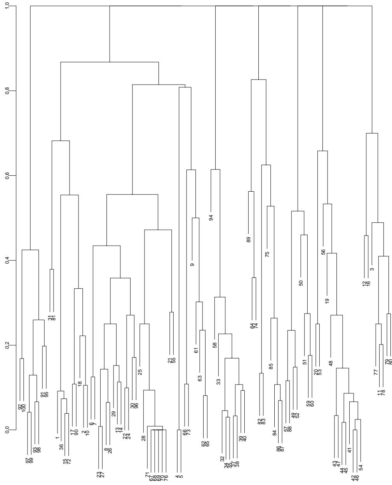  
Figure 33. A dendrogram corresponding to 100 books.

Visualization. Clusters in large databases can be used for visualization, in order to aid human analysts in identifying groups and subgroups that have similar characteristics. WinViz [Lee and Ong 1996] is a data mining visualization tool in which derived clusters can be exported as new attributes which can then be characterized by the system. For example, breakfast cereals are clustered according to calories, protein, fat, sodium, fiber, carbohydrate, sugar, potassium, and vitamin content per serving. Upon seeing the resulting clusters, the user can export the clusters to WinViz as attributes. The system shows that one of the clusters is characterized by high potassium content, and the human analyst recognizes the individuals in the cluster as belonging to the “bran” cereal family, leading to a generalization that “bran cereals are high in potassium.”

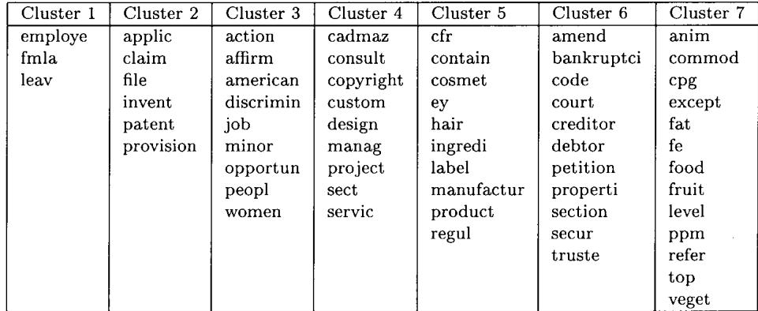

6.4.2 Mining Large Unstructured Databases. Data mining has often been performed on transaction and relational databases which have well-defined fields which can be used as features, but there has been recent research on large unstructured databases such as the World Wide Web [Etzioni 1996].

Examples of recent attempts to classify Web documents using words or functions of words as features include Maarek and Shaul [1996] and Chekuri et al. [1999]. However, relatively small sets of labeled training samples and very large dimensionality limit the ultimate success of automatic Web document categorization based on words as features.

Rather than grouping documents in a word feature space, Wulfekuhler and Punch [1997] cluster the words from a small collection of World Wide Web documents in the document space. The sample data set consisted of 85 documents from the manufacturing domain in 4 different user-defined categories (labor, legal, government, and design). These 85 documents contained 5190 distinct word stems after common words (the, and, of) were removed. Since the words are certainly not uncorrelated, they should fall into clusters where words used in a consistent way across the document set have similar values of frequency in each document.

$\kappa$ -means clustering was used to group the 5190 words into 10 groups. One surprising result was that an average of $9 2 \%$ of the words fell into a single cluster, which could then be discarded for data mining purposes. The smallest clusters contained terms which to a human seem semantically related. The 7 smallest clusters from a typical run are shown in Figure 34.

Terms which are used in ordinary contexts, or unique terms which do not occur often across the training document set will tend to cluster into the large 4000 member group. This takes care of spelling errors, proper names which are infrequent, and terms which are used in the same manner throughout the entire document set. Terms used in specific contexts (such as file in the context of filing a patent, rather than a computer file) will appear in the documents consistently with other terms appropriate to that context (patent, invent) and thus will tend to cluster together. Among the groups of words, unique contexts stand out from the crowd.

After discarding the largest cluster, the smaller set of features can be used to construct queries for seeking out other relevant documents on the Web using standard Web searching tools (e.g., Lycos, Alta Vista, Open Text).

Searching the Web with terms taken from the word clusters allows discovery of finer grained topics (e.g., family medical leave) within the broadly defined categories (e.g., labor).

6.4.3 Data Mining in Geological Databases. Database mining is a critical resource in oil exploration and production. It is common knowledge in the oil industry that the typical cost of drilling a new offshore well is in the range of $\$ 30 – 40$ million, but the chance of that site being an economic success is 1 in 10. More informed and systematic drilling decisions can significantly reduce overall production costs.

Advances in drilling technology and data collection methods have led to oil companies and their ancillaries collecting large amounts of geophysical/geological data from production wells and exploration sites, and then organizing them into large databases. Data mining techniques has recently been used to derive precise analytic relations between observed phenomena and parameters. These relations can then be used to quantify oil and gas reserves.

In qualitative terms, good recoverable reserves have high hydrocarbon saturation that are trapped by highly porous sediments (reservoir porosity) and surrounded by hard bulk rocks that prevent the hydrocarbon from leaking away. A large volume of porous sediments is crucial to finding good recoverable reserves, therefore developing reliable and accurate methods for estimation of sediment porosities from the collected data is key to estimating hydrocarbon potential.

The general rule of thumb experts use for porosity computation is that it is a quasiexponential function of depth:

$$
P o r o s i t y = K \cdot e ^ { - F ( x _ { 1 } , x _ { 2 } , . . . , x _ { m } ) \cdot D e p t h } .
$$

A number of factors such as rock types, structure, and cementation as parameters of function $F$ confound this relationship. This necessitates the definition of proper contexts, in which to attempt discovery of porosity formulas. Geological contexts are expressed in terms of geological phenomena, such as geometry, lithology, compaction, and subsidence, associated with a region. It is well known that geological context changes from basin to basin (different geographical areas in the world) and also from region to region within a basin [Allen and Allen 1990; Biswas 1995]. Furthermore, the underlying features of contexts may vary greatly. Simple model matching techniques, which work in engineering domains where behavior is constrained by man-made systems and well-established laws of physics, may not apply in the hydrocarbon exploration domain. To address this, data clustering was used to identify the relevant contexts, and then equation discovery was carried out within each context. The goal was to derive the subset $x _ { 1 }$ $x _ { 2 }$ , . . . , $x _ { m }$ from a larger set of geological features, and the functional relationship $F$ that best defined the porosity function in a region.

The overall methodology illustrated in Figure 35, consists of two primary steps: (i) Context definition using unsupervised clustering techniques, and (ii) Equation discovery by regression analysis [Li and Biswas 1995]. Real exploration data collected from a region in the

# (1) Context Definition

1.1 discover primitive structures $( g _ { 1 } , g _ { 2 } , . . . , g _ { m } )$ by clustering,

1.2 define context in terms of the relevant sequences of primitive structures, i.e., ${ \cal { C } } _ { i } \ =$ $g _ { i 1 } \circ g _ { i 2 } \circ , . . . , \circ g _ { i k }$

1.3 group data according to the context definition to form homogeneous data groups,

1.4 for each relevant data group, determine the set of relevant variables $( x _ { 1 } , x _ { 2 } , . . . , x _ { k } )$ for porosity.

# (2Equation Derivation

2.1 select possible base models (equations) using domain theory,

2.2 use the least squares method to generate coefficient values for each base model, 2.3 use the component plus residual plot (cprp) heuristic to dynamically modify the equation model to better fit the data,

Alaska basin was analyzed using the methodology developed. The data objects (patterns) are described in terms of 37 geological features, such as porosity, permeability, grain size, density, and sorting, amount of different mineral fragments (e.g., quartz, chert, feldspar) present, nature of the rock fragments, pore characteristics, and cementation. All these feature values are numeric measurements made on samples obtained from well-logs during exploratory drilling processes.

The $k$ -means clustering algorithm was used to identify a set of homogeneous primitive geological structures $( g _ { 1 } , g _ { 2 } , . . . , g _ { m } )$ . These primitives were then mapped onto the unit code versus stratigraphic unit map. Figure 36 depicts a partial mapping for a set of wells and four primitive structures. The next step in the discovery process identified sections of wells regions that were made up of the same sequence of geological primitives. Every sequence defined a context $C _ { i }$ . From the partial mapping of Figure 36, the context $C _ { 1 } = g _ { 2 } \circ g _ { 1 } \circ$ $g _ { 2 } \circ g _ { 3 }$ was identified in two well regions (the 300 and 600 series). After the contexts were defined, data points belonging to each context were grouped together for equation derivation. The derivation procedure employed multiple regression analysis [Sen and Srivastava 1990].

This method was applied to a data set of about 2600 objects corresponding to sample measurements collected from wells is the Alaskan Basin. The $k$ -means clustered this data set into seven groups. As an illustration, we selected a set of 138 objects representing a context for further analysis. The features that best defined this cluster were selected, and experts surmised that the context represented a low porosity region, which was modeled using the regression procedure.

# 7. SUMMARY

There are several applications where decision making and exploratory pattern analysis have to be performed on large data sets. For example, in document retrieval, a set of relevant documents has to be found among several millions of documents of dimensionality of more than 1000. It is possible to handle these problems if some useful abstraction of the data is obtained and is used in decision making, rather than directly using the entire data set. By data abstraction, we mean a simple and compact representation of the data. This simplicity helps the machine in efficient processing or a human in comprehending the structure in data easily. Clustering algorithms are ideally suited for achieving data abstraction.

In this paper, we have examined various steps in clustering: (1) pattern representation, (2) similarity computation, (3) grouping process, and (4) cluster representation. Also, we have discussed statistical, fuzzy, neural, evolutionary, and knowledge-based approaches to clustering. We have described four applications of clustering: (1) image segmentation, (2) object recognition, (3) document retrieval, and (4) data mining.

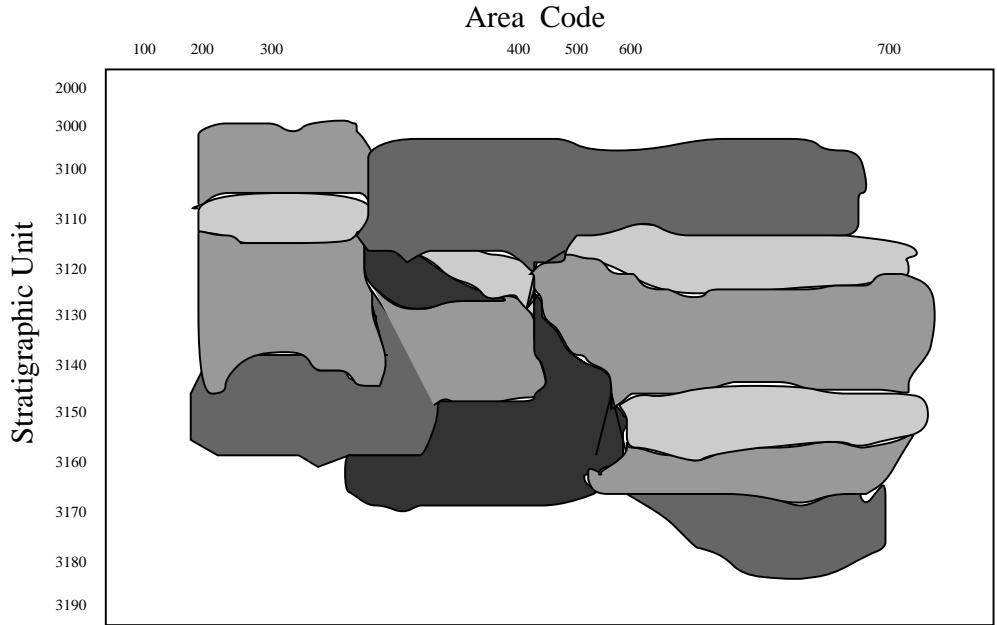  
Figure 36. Area code versus stratigraphic unit map for part of the studied region.

Clustering is a process of grouping data items based on a measure of similarity. Clustering is a subjective process; the same set of data items often needs to be partitioned differently for different applications. This subjectivity makes the process of clustering difficult. This is because a single algorithm or approach is not adequate to solve every clustering problem. A possible solution lies in reflecting this subjectivity in the form of knowledge. This knowledge is used either implicitly or explicitly in one or more phases of clustering. Knowledge-based clustering algorithms use domain knowledge explicitly.

The most challenging step in clustering is feature extraction or pattern representation. Pattern recognition researchers conveniently avoid this step by assuming that the pattern representations are available as input to the clustering algorithm. In small size data sets, pattern representations can be obtained based on previous experience of the user with the problem. However, in the case of large data sets, it is difficult for the user to keep track of the importance of each feature in clustering. A solution is to make as many measurements on the patterns as possible and use them in pattern representation. But it is not possible to use a large collection of measurements directly in clustering because of computational costs. So several feature extraction/selection approaches have been designed to obtain linear or nonlinear combinations of these measurements which can be used to represent patterns. Most of the schemes proposed for feature extraction/selection are typically iterative in nature and cannot be used on large data sets due to prohibitive computational costs.

The second step in clustering is similarity computation. A variety of schemes have been used to compute similarity between two patterns. They use knowledge either implicitly or explicitly. Most of the knowledge-based clustering algorithms use explicit knowledge in similarity computation. However, if patterns are not represented using proper features, then it is not possible to get a meaningful partition irrespective of the quality and quantity of knowledge used in similarity computation. There is no universally acceptable scheme for computing similarity between patterns represented using a mixture of both qualitative and quantitative features. Dissimilarity between a pair of patterns is represented using a distance measure that may or may not be a metric.

The next step in clustering is the grouping step. There are broadly two grouping schemes: hierarchical and partitional schemes. The hierarchical schemes are more versatile, and the partitional schemes are less expensive. The partitional algorithms aim at maximizing the squared error criterion function. Motivated by the failure of the squared error partitional clustering algorithms in finding the optimal solution to this problem, a large collection of approaches have been proposed and used to obtain the global optimal solution to this problem. However, these schemes are computationally prohibitive on large data sets. ANN-based clustering schemes are neural implementations of the clustering algorithms, and they share the undesired properties of these algorithms. However, ANNs have the capability to automatically normalize the data and extract features. An important observation is that even if a scheme can find the optimal solution to the squared error partitioning problem, it may still fall short of the requirements because of the possible non-isotropic nature of the clusters.

In some applications, for example in document retrieval, it may be useful to have a clustering that is not a partition. This means clusters are overlapping. Fuzzy clustering and functional clustering are ideally suited for this purpose. Also, fuzzy clustering algorithms can handle mixed data types. However, a major problem with fuzzy clustering is that it is difficult to obtain the membership values. A general approach may not work because of the subjective nature of clustering. It is required to represent clusters obtained in a suitable form to help the decision maker. Knowledge-based clustering schemes generate intuitively appealing descriptions of clusters. They can be used even when the patterns are represented using a combination of qualitative and quantitative features, provided that knowledge linking a concept and the mixed features are available. However, implementations of the conceptual clustering schemes are computationally expensive and are not suitable for grouping large data sets.

The $k$ -means algorithm and its neural implementation, the Kohonen net, are most successfully used on large data sets. This is because $k$ -means algorithm is simple to implement and computationally attractive because of its linear time complexity. However, it is not feasible to use even this linear time algorithm on large data sets. Incremental algorithms like leader and its neural implementation, the ART network, can be used to cluster large data sets. But they tend to be order-dependent. Divide and conquer is a heuristic that has been rightly exploited by computer algorithm designers to reduce computational costs. However, it should be judiciously used in clustering to achieve meaningful results.

In summary, clustering is an interesting, useful, and challenging problem. It has great potential in applications like object recognition, image segmentation, and information filtering and retrieval. However, it is possible to exploit this potential only after making several design choices carefully.

# ACKNOWLEDGMENTS

The authors wish to acknowledge the generosity of several colleagues who read manuscript drafts, made suggestions, and provided summaries of emerging application areas which we have incorporated into this paper. Gautam Biswas and Cen Li of Vanderbilt University provided the material on knowledge discovery in geological databases. Ana Fred of Instituto Superior Técnico in Lisbon, Portugal provided material on cluster analysis in the syntactic domain. William Punch and Marilyn Wulfekuhler of Michigan State University provided material on the application of cluster analysis to data mining problems. Scott Connell of Michigan State provided material describing his work on character recognition. Chitra Dorai of IBM T.J. Watson Research Center provided material on the use of clustering in 3D object recognition. Jianchang Mao of IBM Almaden Research Center, Peter Bajcsy of the University of Illinois, and Zoran Obradovic´ of Washington State University also provided many helpful comments. Mario de Figueirido performed a meticulous reading of the manuscript and provided many helpful suggestions.

This work was supported by the National Science Foundation under grant INT-9321584.

# REFERENCES

AARTS, E. AND KORST, J. 1989. Simulated Annealing and Boltzmann Machines: A Stochastic Approach to Combinatorial Optimization and Neural Computing. Wiley-Interscience series in discrete mathematics and optimization. John Wiley and Sons, Inc., New York, NY.   
ACM, 1994. ACM CR Classifications. ACM Computing Surveys 35, 5–16.   
AL-SULTAN, K. S. 1995. A tabu search approach to clustering problems. Pattern Recogn. 28, 1443–1451.   
AL-SULTAN, K. S. AND KHAN, M. M. 1996. Computational experience on four algorithms for the hard clustering problem. Pattern Recogn. Lett. 17, 3, 295–308.   
ALLEN, P. A. AND ALLEN, J. R. 1990. Basin Analysis: Principles and Applications. Blackwell Scientific Publications, Inc., Cambridge, MA.   
ALTA VISTA, 1999. http://altavista.digital.com.   
AMADASUN, M. AND KING, R. A. 1988. Low-level segmentation of multispectral images via agData Clustering • 317 glomerative clustering of uniform neighbourhoods. Pattern Recogn. 21, 3 (1988), 261–268.   
ANDERBERG, M. R. 1973. Cluster Analysis for Applications. Academic Press, Inc., New York, NY.   
AUGUSTSON, J. G. AND MINKER, J. 1970. An analysis of some graph theoretical clustering techniques. J. ACM 17, 4 (Oct. 1970), 571– 588.   
BABU, G. P. AND MURTY, M. N. 1993. A nearoptimal initial seed value selection in $K$ -means algorithm using a genetic algorithm. Pattern Recogn. Lett. 14, 10 (Oct. 1993), 763– 769.   
BABU, G. P. AND MURTY, M. N. 1994. Clustering with evolution strategies. Pattern Recogn. 27, 321–329.   
BABU, G. P., MURTY, M. N., AND KEERTHI, S. S. 2000. Stochastic connectionist approach for pattern clustering (To appear). IEEE Trans. Syst. Man Cybern..   
BACKER, F. B. AND HUBERT, L. J. 1976. A graphtheoretic approach to goodness-of-fit in complete-link hierarchical clustering. J. Am. Stat. Assoc. 71, 870 – 878.   
BACKER, E. 1995. Computer-Assisted Reasoning in Cluster Analysis. Prentice Hall International (UK) Ltd., Hertfordshire, UK.   
BAEZA-YATES, R. A. 1992. Introduction to data structures and algorithms related to information retrieval. In Information Retrieval: Data Structures and Algorithms, W. B. Frakes and R. Baeza-Yates, Eds. PrenticeHall, Inc., Upper Saddle River, NJ, 13–27.   
BAJCSY, P. 1997. Hierarchical segmentation and clustering using similarity analysis. Ph.D. Dissertation. Department of Computer Science, University of Illinois at Urbana-Champaign, Urbana, IL.   
BALL, G. H. AND HALL, D. J. 1965. ISODATA, a novel method of data analysis and classification. Tech. Rep.. Stanford University, Stanford, CA.   
BENTLEY, J. L. AND FRIEDMAN, J. H. 1978. Fast algorithms for constructing minimal spanning trees in coordinate spaces. IEEE Trans. Comput. C-27, 6 (June), 97–105.   
BEZDEK, J. C. 1981. Pattern Recognition With Fuzzy Objective Function Algorithms. Plenum Press, New York, NY.   
BHUYAN, J. N., RAGHAVAN, V. V., AND VENKATESH, K. E. 1991. Genetic algorithm for clustering with an ordered representation. In Proceedings of the Fourth International Conference on Genetic Algorithms, 408 – 415.   
BISWAS, G., WEINBERG, J., AND LI, C. 1995. A Conceptual Clustering Method for Knowledge Discovery in Databases. Editions Technip.   
BRAILOVSKY, V. L. 1991. A probabilistic approach to clustering. Pattern Recogn. Lett. 12, 4 (Apr. 1991), 193–198.   
BRODATZ, P. 1966. Textures: A Photographic Album for Artists and Designers. Dover Publications, Inc., Mineola, NY.   
CAN, F. 1993. Incremental clustering for dynamic information processing. ACM Trans. Inf. Syst. 11, 2 (Apr. 1993), 143–164.   
CARPENTER, G. AND GROSSBERG, S. 1990. ART3: Hierarchical search using chemical transmitters in self-organizing pattern recognition architectures. Neural Networks 3, 129 –152.   
CHEKURI, C., GOLDWASSER, M. H., RAGHAVAN, P., AND UPFAL, E. 1997. Web search using automatic classification. In Proceedings of the Sixth International Conference on the World Wide Web (Santa Clara, CA, Apr.), http:// theory.stanford.edu/people/wass/publications/ Web Search/Web Search.html.   
CHENG, C. H. 1995. A branch-and-bound clustering algorithm. IEEE Trans. Syst. Man Cybern. 25, 895–898.   
CHENG, Y. AND FU, K. S. 1985. Conceptual clustering in knowledge organization. IEEE Trans. Pattern Anal. Mach. Intell. 7, 592–598.   
CHENG, Y. 1995. Mean shift, mode seeking, and clustering. IEEE Trans. Pattern Anal. Mach. Intell. 17, 7 (July), 790 –799.   
CHIEN, Y. T. 1978. Interactive Pattern Recognition. Marcel Dekker, Inc., New York, NY.   
CHOUDHURY, S. AND MURTY, M. N. 1990. A divisive scheme for constructing minimal spanning trees in coordinate space. Pattern Recogn. Lett. 11, 6 (Jun. 1990), 385–389.   
1996. Special issue on data mining. Commun. ACM 39, 11.   
COLEMAN, G. B. AND ANDREWS, H. C. 1979. Image segmentation by clustering. Proc. IEEE 67, 5, 773–785.   
CONNELL, S. AND JAIN, A. K. 1998. Learning prototypes for on-line handwritten digits. In Proceedings of the 14th International Conference on Pattern Recognition (Brisbane, Australia, Aug.), 182–184.   
CROSS, S. E., Ed. 1996. Special issue on data mining. IEEE Expert 11, 5 (Oct.).   
DALE, M. B. 1985. On the comparison of conceptual clustering and numerical taxonomy. IEEE Trans. Pattern Anal. Mach. Intell. 7, 241–244.   
DAVE, R. N. 1992. Generalized fuzzy C-shells clustering and detection of circular and elliptic boundaries. Pattern Recogn. 25, 713–722.   
DAVIS, T., Ed. 1991. The Handbook of Genetic Algorithms. Van Nostrand Reinhold Co., New York, NY.   
DAY, W. H. E. 1992. Complexity theory: An introduction for practitioners of classification. In Clustering and Classification, P. Arabie and L. Hubert, Eds. World Scientific Publishing Co., Inc., River Edge, NJ.   
DEMPSTER, A. P., LAIRD, N. M., AND RUBIN, D. B. 1977. Maximum likelihood from incomplete data via the EM algorithm. J. Royal Stat. Soc. B. 39, 1, 1–38.   
DIDAY, E. 1973. The dynamic cluster method in non-hierarchical clustering. J. Comput. Inf. Sci. 2, 61– 88.   
DIDAY, E. AND SIMON, J. C. 1976. Clustering analysis. In Digital Pattern Recognition, K. S. Fu, Ed. Springer-Verlag, Secaucus, NJ, 47–94.   
DIDAY, E. 1988. The symbolic approach in clustering. In Classification and Related Methods, H. H. Bock, Ed. North-Holland Publishing Co., Amsterdam, The Netherlands.   
DORAI, C. AND JAIN, A. K. 1995. Shape spectra based view grouping for free-form objects. In Proceedings of the International Conference on Image Processing (ICIP-95), 240 –243.   
DUBES, R. C. AND JAIN, A. K. 1976. Clustering techniques: The user’s dilemma. Pattern Recogn. 8, 247–260.   
DUBES, R. C. AND JAIN, A. K. 1980. Clustering methodology in exploratory data analysis. In Advances in Computers, M. C. Yovits,, Ed. Academic Press, Inc., New York, NY, 113– 125.   
DUBES, R. C. 1987. How many clusters are best?—an experiment. Pattern Recogn. 20, 6 (Nov. 1, 1987), 645–663.   
DUBES, R. C. 1993. Cluster analysis and related issues. In Handbook of Pattern Recognition & Computer Vision, C. H. Chen, L. F. Pau, and P. S. P. Wang, Eds. World Scientific Publishing Co., Inc., River Edge, NJ, 3–32.   
DUBUISSON, M. P. AND JAIN, A. K. 1994. A modified Hausdorff distance for object matching. In Proceedings of the International Conference on Pattern Recognition (ICPR ’94), 566–568.   
DUDA, R. O. AND HART, P. E. 1973. Pattern Classification and Scene Analysis. John Wiley and Sons, Inc., New York, NY.   
DUNN, S., JANOS, L., AND ROSENFELD, A. 1983. Bimean clustering. Pattern Recogn. Lett. 1, 169–173.   
DURAN, B. S. AND ODELL, P. L. 1974. Cluster Analysis: A Survey. Springer-Verlag, New York, NY.   
EDDY, W. F., MOCKUS, A., AND OUE, S. 1996. Approximate single linkage cluster analysis of large data sets in high-dimensional spaces. Comput. Stat. Data Anal. 23, 1, 29 – 43.   
ETZIONI, O. 1996. The World-Wide Web: quagmire or gold mine? Commun. ACM 39, 11, 65–68.   
EVERITT, B. S. 1993. Cluster Analysis. Edward Arnold, Ltd., London, UK.   
FABER, V. 1994. Clustering and the continuous k-means algorithm. Los Alamos Science 22, 138–144.   
FABER, V., HOCHBERG, J. C., KELLY, P. M., THOMAS, T. R., AND WHITE, J. M. 1994. Concept extraction: A data-mining technique. Los Alamos Science 22, 122–149.   
FAYYAD, U. M. 1996. Data mining and knowledge discovery: Making sense out of data. IEEE Expert 11, 5 (Oct.), 20 –25.   
FISHER, D. AND LANGLEY, P. 1986. Conceptual clustering and its relation to numerical taxonomy. In Artificial Intelligence and Statistics, A W. Gale, Ed. Addison-Wesley Longman Publ. Co., Inc., Reading, MA, 77–116.   
FISHER, D. 1987. Knowledge acquisition via incremental conceptual clustering. Mach. Learn. 2, 139–172.   
FISHER, D., XU, L., CARNES, R., RICH, Y., FENVES, S. J., CHEN, J., SHIAVI, R., BISWAS, G., AND WEINBERG, J. 1993. Applying AI clustering to engineering tasks. IEEE Expert 8, 51– 60.   
FISHER, L. AND VAN NESS, J. W. 1971. Admissible clustering procedures. Biometrika 58, 91–104.   
FLYNN, P. J. AND JAIN, A. K. 1991. BONSAI: 3D object recognition using constrained search. IEEE Trans. Pattern Anal. Mach. Intell. 13, 10 (Oct. 1991), 1066–1075.   
FOGEL, D. B. AND SIMPSON, P. K. 1993. Evolving fuzzy clusters. In Proceedings of the International Conference on Neural Networks (San Francisco, CA), 1829 –1834.   
FOGEL, D. B. AND FOGEL, L. J., Eds. 1994. Special issue on evolutionary computation. IEEE Trans. Neural Netw. (Jan.).   
FOGEL, L. J., OWENS, A. J., AND WALSH, M. J. 1965. Artificial Intelligence Through Simulated Evolution. John Wiley and Sons, Inc., New York, NY.   
FRAKES, W. B. AND BAEZA-YATES, R., Eds. 1992. Information Retrieval: Data Structures and Algorithms. Prentice-Hall, Inc., Upper Saddle River, NJ.   
FRED, A. L. N. AND LEITAO, J. M. N. 1996. A minimum code length technique for clustering of syntactic patterns. In Proceedings of the International Conference on Pattern Recognition (Vienna, Austria), 680 – 684.   
FRED, A. L. N. 1996. Clustering of sequences using a minimum grammar complexity criterion. In Grammatical Inference: Learning Syntax from Sentences, L. Miclet and C. Higuera, Eds. Springer-Verlag, Secaucus, NJ, 107–116.   
FU, K. S. AND LU, S. Y. 1977. A clustering procedure for syntactic patterns. IEEE Trans. Syst. Man Cybern. 7, 734 –742.   
FU, K. S. AND MUI, J. K. 1981. A survey on image segmentation. Pattern Recogn. 13, 3–16.   
FUKUNAGA, K. 1990. Introduction to Statistical Pattern Recognition. 2nd ed. Academic Press Prof., Inc., San Diego, CA.   
GLOVER, F. 1986. Future paths for integer programming and links to artificial intelligence. Comput. Oper. Res. 13, 5 (May 1986), 533– 549.   
GOLDBERG, D. E. 1989. Genetic Algorithms in Search, Optimization and Machine Learning. Addison-Wesley Publishing Co., Inc., Redwood City, CA.   
GORDON, A. D. AND HENDERSON, J. T. 1977. Algorithm for Euclidean sum of squares. Biometrics 33, 355–362.   
GOTLIEB, G. C. AND KUMAR, S. 1968. Semantic clustering of index terms. J. ACM 15, 493– 513.   
GOWDA, K. C. 1984. A feature reduction and unsupervised classification algorithm for multispectral data. Pattern Recogn. 17, 6, 667– 676.   
GOWDA, K. C. AND KRISHNA, G. 1977. Agglomerative clustering using the concept of mutual nearest neighborhood. Pattern Recogn. 10, 105–112.   
GOWDA, K. C. AND DIDAY, E. 1992. Symbolic clustering using a new dissimilarity measure. IEEE Trans. Syst. Man Cybern. 22, 368–378.   
GOWER, J. C. AND ROSS, G. J. S. 1969. Minimum spanning rees and single-linkage cluster analysis. Appl. Stat. 18, 54 – 64.   
GREFENSTETTE, J 1986. Optimization of control parameters for genetic algorithms. IEEE Trans. Syst. Man Cybern. SMC-16, 1 (Jan./ Feb. 1986), 122–128.   
HARALICK, R. M. AND KELLY, G. L. 1969. Pattern recognition with measurement space and spatial clustering for multiple images. Proc. IEEE 57, 4, 654 – 665.   
HARTIGAN, J. A. 1975. Clustering Algorithms. John Wiley and Sons, Inc., New York, NY.   
HEDBERG, S. 1996. Searching for the mother lode: Tales of the first data miners. IEEE Expert 11, 5 (Oct.), 4 –7.   
HERTZ, J., KROGH, A., AND PALMER, R. G. 1991. Introduction to the Theory of Neural Computation. Santa Fe Institute Studies in the Sciences of Complexity lecture notes. AddisonWesley Longman Publ. Co., Inc., Reading, MA.   
HOFFMAN, R. AND JAIN, A. K. 1987. Segmentation and classification of range images. IEEE Trans. Pattern Anal. Mach. Intell. PAMI-9, 5 (Sept. 1987), 608 – 620.   
HOFMANN, T. AND BUHMANN, J. 1997. Pairwise data clustering by deterministic annealing. IEEE Trans. Pattern Anal. Mach. Intell. 19, 1 (Jan.), 1–14.   
HOFMANN, T., PUZICHA, J., AND BUCHMANN, J. M. 1998. Unsupervised texture segmentation in a deterministic annealing framework. IEEE Trans. Pattern Anal. Mach. Intell. 20, 8, 803–818.   
HOLLAND, J. H. 1975. Adaption in Natural and Artificial Systems. University of Michigan Press, Ann Arbor, MI.   
HOOVER, A., JEAN-BAPTISTE, G., JIANG, X., FLYNN, P. J., BUNKE, H., GOLDGOF, D. B., BOWYER, K., EGGERT, D. W., FITZGIBBON, A., AND FISHER, R. B. 1996. An experimental comparison of range image segmentation algorithms. IEEE Trans. Pattern Anal. Mach. Intell. 18, 7, 673– 689.   
HUTTENLOCHER, D. P., KLANDERMAN, G. A., AND RUCKLIDGE, W. J. 1993. Comparing images using the Hausdorff distance. IEEE Trans. Pattern Anal. Mach. Intell. 15, 9, 850–863.   
ICHINO, M. AND YAGUCHI, H. 1994. Generalized Minkowski metrics for mixed feature-type data analysis. IEEE Trans. Syst. Man Cybern. 24, 698–708.   
1991. Proceedings of the International Joint Conference on Neural Networks. (IJCNN’91).   
1992. Proceedings of the International Joint Conference on Neural Networks.   
ISMAIL, M. A. AND KAMEL, M. S. 1989. Multidimensional data clustering utilizing hybrid search strategies. Pattern Recogn. 22, 1 (Jan. 1989), 75–89.   
JAIN, A. K. AND DUBES, R. C. 1988. Algorithms for Clustering Data. Prentice-Hall advanced reference series. Prentice-Hall, Inc., Upper Saddle River, NJ.   
JAIN, A. K. AND FARROKHNIA, F. 1991. Unsupervised texture segmentation using Gabor filters. Pattern Recogn. 24, 12 (Dec. 1991), 1167–1186.   
JAIN, A. K. AND BHATTACHARJEE, S. 1992. Text segmentation using Gabor filters for automatic document processing. Mach. Vision Appl. 5, 3 (Summer 1992), 169–184.   
JAIN, A. J. AND FLYNN, P. J., Eds. 1993. Three Dimensional Object Recognition Systems. Elsevier Science Inc., New York, NY.   
JAIN, A. K. AND MAO, J. 1994. Neural networks and pattern recognition. In Computational Intelligence: Imitating Life, J. M. Zurada, R. J. Marks, and C. J. Robinson, Eds. 194 – 212.   
JAIN, A. K. AND FLYNN, P. J. 1996. Image segmentation using clustering. In Advances in Image Understanding: A Festschrift for Azriel Rosenfeld, N. Ahuja and K. Bowyer, Eds, IEEE Press, Piscataway, NJ, 65– 83.   
JAIN, A. K. AND MAO, J. 1996. Artificial neural networks: A tutorial. IEEE Computer 29 (Mar.), 31– 44.   
JAIN, A. K., RATHA, N. K., AND LAKSHMANAN, S. 1997. Object detection using Gabor filters. Pattern Recogn. 30, 2, 295–309.   
JAIN, N. C., INDRAYAN, A., AND GOEL, L. R. 1986. Monte Carlo comparison of six hierarchical clustering methods on random data. Pattern Recogn. 19, 1 (Jan./Feb. 1986), 95–99.   
JAIN, R., KASTURI, R., AND SCHUNCK, B. G. 1995. Machine Vision. McGraw-Hill series in computer science. McGraw-Hill, Inc., New York, NY.   
JARVIS, R. A. AND PATRICK, E. A. 1973. Clustering using a similarity method based on shared near neighbors. IEEE Trans. Comput. C-22, 8 (Aug.), 1025–1034.   
JOLION, J.-M., MEER, P., AND BATAOUCHE, S. 1991. Robust clustering with applications in computer vision. IEEE Trans. Pattern Anal. Mach. Intell. 13, 8 (Aug. 1991), 791– 802.   
JONES, D. AND BELTRAMO, M. A. 1991. Solving partitioning problems with genetic algorithms. In Proceedings of the Fourth International Conference on Genetic Algorithms, 442– 449.   
JUDD, D., MCKINLEY, P., AND JAIN, A. K. 1996. Large-scale parallel data clustering. In Proceedings of the International Conference on Pattern Recognition (Vienna, Austria), 488 – 493.   
KING, B. 1967. Step-wise clustering procedures. J. Am. Stat. Assoc. 69, 86 –101.   
KIRKPATRICK, S., GELATT, C. D., JR., AND VECCHI, M. P. 1983. Optimization by simulated annealing. Science 220, 4598 (May), 671– 680.   
KLEIN, R. W. AND DUBES, R. C. 1989. Experiments in projection and clustering by simulated annealing. Pattern Recogn. 22, 213–220.   
KNUTH, D. 1973. The Art of Computer Programming. Addison-Wesley, Reading, MA.   
KOONTZ, W. L. G., FUKUNAGA, K., AND NARENDRA, P. M. 1975. A branch and bound clustering algorithm. IEEE Trans. Comput. 23, 908 – 914.   
KOHONEN, T. 1989. Self-Organization and Associative Memory. 3rd ed. Springer information sciences series. Springer-Verlag, New York, NY.   
KRAAIJVELD, M., MAO, J., AND JAIN, A. K. 1995. A non-linear projection method based on Kohonen’s topology preserving maps. IEEE Trans. Neural Netw. 6, 548 –559.   
KRISHNAPURAM, R., FRIGUI, H., AND NASRAOUI, O. 1995. Fuzzy and probabilistic shell clustering algorithms and their application to boundary detection and surface approximation. IEEE Trans. Fuzzy Systems 3, 29 – 60.   
KURITA, T. 1991. An efficient agglomerative clustering algorithm using a heap. Pattern Recogn. 24, 3 (1991), 205–209.   
LIBRARY OF CONGRESS, 1990. LC classification outline. Library of Congress, Washington, DC.   
LEBOWITZ, M. 1987. Experiments with incremental concept formation. Mach. Learn. 2, 103–138.   
LEE, H.-Y. AND ONG, H.-L. 1996. Visualization support for data mining. IEEE Expert 11, 5 (Oct.), 69 –75.   
LEE, R. C. T., SLAGLE, J. R., AND MONG, C. T. 1978. Towards automatic auditing of records. IEEE Trans. Softw. Eng. 4, 441– 448.   
LEE, R. C. T. 1981. Cluster analysis and its applications. In Advances in Information Systems Science, J. T. Tou, Ed. Plenum Press, New York, NY.   
LI, C. AND BISWAS, G. 1995. Knowledge-based scientific discovery in geological databases. In Proceedings of the First International Conference on Knowledge Discovery and Data Mining (Montreal, Canada, Aug. 20-21), 204–209.   
LU, S. Y. K. S. sentence clustering procedure for pattern analysis. IEEE Trans. Syst. Man Cybern. 8, 381–389.   
LUNDERVOLD, A., FENSTAD, A. M., ERSLAND, L., AND TAXT, T. 1996. Brain tissue volumes from multispectral 3D MRI: A comparative study of four classifiers. In Proceedings of the Conference of the Society on Magnetic Resonance,   
MAAREK, Y. S. AND BEN SHAUL, I. Z. 1996. Automatically organizing bookmarks per contents. In Proceedings of the Fifth International Conference on the World Wide Web (Paris, May), http://www5conf.inria.fr/fichhtml/paper-sessions.html.   
MCQUEEN, J. 1967. Some methods for classification and analysis of multivariate observations. In Proceedings of the Fifth Berkeley Symposium on Mathematical Statistics and Probability, 281–297.   
MAO, J. AND JAIN, A. K. 1992. Texture classification and segmentation using multiresolution simultaneous autoregressive models. Pattern Recogn. 25, 2 (Feb. 1992), 173–188.   
MAO, J. AND JAIN, A. K. 1995. Artificial neural networks for feature extraction and multivariate data projection. IEEE Trans. Neural Netw. 6, 296–317.   
MAO, J. AND JAIN, A. K. 1996. A self-organizing network for hyperellipsoidal clustering (HEC). IEEE Trans. Neural Netw. 7, 16 –29.   
MEVINS, A. J. 1995. A branch and bound incremental conceptual clusterer. Mach. Learn. 18, 5–22.   
MICHALSKI, R., STEPP, R. E., AND DIDAY, E. 1981. A recent advance in data analysis: Clustering objects into classes characterized by conjunctive concepts. In Progress in Pattern Recognition, Vol. 1, L. Kanal and A. Rosenfeld, Eds. North-Holland Publishing Co., Amsterdam, The Netherlands.   
MICHALSKI, R., STEPP, R. E., AND DIDAY, E. 1983. Automated construction of classifications: conceptual clustering versus numerical taxonomy. IEEE Trans. Pattern Anal. Mach. Intell. PAMI-5, 5 (Sept.), 396 – 409.   
MISHRA, S. K. AND RAGHAVAN, V. V. 1994. An empirical study of the performance of heuristic methods for clustering. In Pattern Recognition in Practice, E. S. Gelsema and L. N. Kanal, Eds. 425–436.   
MITCHELL,T. 1997. MachineLearning. McGrawHill, Inc., New York, NY.   
MOHIUDDIN, K. M. AND MAO, J. 1994. A comparative study of different classifiers for handprinted character recognition. In Pattern Recognition in Practice, E. S. Gelsema and L. N. Kanal, Eds. 437–448.   
MOOR, B. K. 1988. ART 1 and Pattern Clustering. In 1988 Connectionist Summer School, Morgan Kaufmann, San Mateo, CA, 174–185.   
MURTAGH, F. 1984. A survey of recent advances in hierarchical clustering algorithms which use cluster centers. Comput. J. 26, 354 –359.   
MURTY, M. N. AND KRISHNA, G. 1980. A computationally efficient technique for data clustering. Pattern Recogn. 12, 153–158.   
MURTY, M. N. AND JAIN, A. K. 1995. Knowledgebased clustering scheme for collection management and retrieval of library books. Pattern Recogn. 28, 949 –964.   
NAGY, G. 1968. State of the art in pattern recognition. Proc. IEEE 56, 836 – 862.   
NG, R. AND HAN, J. 1994. Very large data bases. In Proceedings of the 20th International Conference on Very Large Data Bases (VLDB’94, Santiago, Chile, Sept.), VLDB Endowment, Berkeley, CA, 144 –155.   
NGUYEN, H. H. AND COHEN, P. 1993. Gibbs random fields, fuzzy clustering, and the unsupervised segmentation of textured images. CVGIP: Graph. Models Image Process. 55, 1 (Jan. 1993), 1–19.   
OEHLER, K. L. AND GRAY, R. M. 1995. Combining image compression and classification using vector quantization. IEEE Trans. Pattern Anal. Mach. Intell. 17, 461– 473.   
OJA, E. 1982. A simplified neuron model as a principal component analyzer. Bull. Math. Bio. 15, 267–273.   
OZAWA, K. 1985. A stratificational overlapping cluster scheme. Pattern Recogn. 18, 279–286.   
OPEN TEXT, 1999. http://index.opentext.net.   
KAMGAR-PARSI, B., GUALTIERI, J. A., DEVANEY, J. A., AND KAMGAR-PARSI, K. 1990. Clustering with neural networks. Biol. Cybern. 63, 201–208.   
LYCOS, 1999. http://www.lycos.com.   
PAL, N. R., BEZDEK, J. C., AND TSAO, E. C.-K. 1993. Generalized clustering networks and Kohonen’s self-organizing scheme. IEEE Trans. Neural Netw. 4, 549 –557.   
QUINLAN, J. R. 1990. Decision trees and decision making. IEEE Trans. Syst. Man Cybern. 20, 339–346.   
RAGHAVAN, V. V. AND BIRCHAND, K. 1979. A clustering strategy based on a formalism of the reproductive process in a natural system. In Proceedings of the Second International Conference on Information Storage and Retrieval, 10 –22.   
RAGHAVAN, V. V. AND YU, C. T. 1981. A comparison of the stability characteristics of some graph theoretic clustering methods. IEEE Trans. Pattern Anal. Mach. Intell. 3, 393– 402.   
RASMUSSEN, E. 1992. Clustering algorithms. In Information Retrieval: Data Structures and Algorithms, W. B. Frakes and R. Baeza-Yates, Eds. Prentice-Hall, Inc., Upper Saddle River, NJ, 419 – 442.   
RICH, E. 1983. Artificial Intelligence. McGrawHill, Inc., New York, NY.   
RIPLEY, B. D., Ed. 1989. Statistical Inference for Spatial Processes. Cambridge University Press, New York, NY.   
ROSE, K., GUREWITZ, E., AND FOX, G. C. 1993. Deterministic annealing approach to constrained clustering. IEEE Trans. Pattern Anal. Mach. Intell. 15, 785–794.   
ROSENFELD, A. AND KAK, A. C. 1982. Digital Picture Processing. 2nd ed. Academic Press, Inc., New York, NY.   
ROSENFELD, A., SCHNEIDER, V. B., AND HUANG, M. K. 1969. An application of cluster detection to text and picture processing. IEEE Trans. Inf. Theor. 15, 6, 672– 681.   
ROSS, G. J. S. 1968. Classification techniques for large sets of data. In Numerical Taxonomy, A. J. Cole, Ed. Academic Press, Inc., New York, NY.   
RUSPINI, E. H. 1969. A new approach to clustering. Inf. Control 15, 22–32.   
SALTON, G. 1991. Developments in automatic text retrieval. Science 253, 974 –980.   
SAMAL, A. AND IYENGAR, P. A. 1992. Automatic recognition and analysis of human faces and facial expressions: A survey. Pattern Recogn. 25, 1 (Jan. 1992), 65–77.   
SAMMON, J. W. JR. 1969. A nonlinear mapping for data structure analysis. IEEE Trans. Comput. 18, 401–409.   
SANGAL, R. 1991. Programming Paradigms in LISP. McGraw-Hill, Inc., New York, NY.   
SCHACHTER, B. J., DAVIS, L. S., AND ROSENFELD, A. 1979. Some experiments in image segmentation by clustering of local feature values. Pattern Recogn. 11, 19 –28.   
SCHWEFEL, H. P. 1981. Numerical Optimization of Computer Models. John Wiley and Sons, Inc., New York, NY.   
SELIM, S. Z. AND ISMAIL, M. A. 1984. K-meanstype algorithms: A generalized convergence theorem and characterization of local optimality. IEEE Trans. Pattern Anal. Mach. Intell. 6, 81– 87.   
SELIM, S. Z. AND ALSULTAN, K. 1991. A simulated annealing algorithm for the clustering problem. Pattern Recogn. 24, 10 (1991), 1003–1008.   
SEN, A. AND SRIVASTAVA, M. 1990. Regression Analysis. Springer-Verlag, New York, NY.   
SETHI, I. AND JAIN, A. K., Eds. 1991. Artificial Neural Networks and Pattern Recognition: Old and New Connections. Elsevier Science Inc., New York, NY.   
SHEKAR, B., MURTY, N. M., AND KRISHNA, G. 1987. A knowledge-based clustering scheme. Pattern Recogn. Lett. 5, 4 (Apr. 1, 1987), 253– 259.   
SILVERMAN, J. F. AND COOPER, D. B. 1988. Bayesian clustering for unsupervised estimation of surface and texture models. IEEE Trans. Pattern Anal. Mach. Intell. 10, 4 (July 1988), 482–495.   
SIMOUDIS, E. 1996. Reality check for data mining. IEEE Expert 11, 5 (Oct.), 26 –33.   
SLAGLE, J. R., CHANG, C. L., AND HELLER, S. R. 1975. A clustering and data-reorganizing algorithm. IEEE Trans. Syst. Man Cybern. 5, 125–128.   
SNEATH, P. H. A. AND SOKAL, R. R. 1973. Numerical Taxonomy. Freeman, London, UK. for Data Reduction and Classification. Ellis Horwood, Upper Saddle River, NJ.   
SOLBERG, A., TAXT, T., AND JAIN, A. 1996. A Markov random field model for classification of multisource satellite imagery. IEEE Trans. Geoscience and Remote Sensing 34, 1, 100–113.   
SRIVASTAVA, A. AND MURTY, M. N 1990. A comparison between conceptual clustering and conventional clustering. Pattern Recogn. 23, 9 (1990), 975–981.   
STAHL, H. 1986. Cluster analysis of large data sets. In Classification as a Tool of Research, W. Gaul and M. Schader, Eds. Elsevier North-Holland, Inc., New York, NY, 423– 430.   
STEPP, R. E. AND MICHALSKI, R. S. 1986. Conceptual clustering of structured objects: A goal-oriented approach. Artif. Intell. 28, 1 (Feb. 1986), 43–69.   
SUTTON, M., STARK, L., AND BOWYER, K. 1993. Function-based generic recognition for multiple object categories. In Three-Dimensional Object Recognition Systems, A. Jain and P. J. Flynn, Eds. Elsevier Science Inc., New York, NY.   
SYMON, M. J. 1977. Clustering criterion and multi-variate normal mixture. Biometrics 77, 35–43.   
TANAKA, E. 1995. Theoretical aspects of syntactic pattern recognition. Pattern Recogn. 28, 1053–1061.   
TAXT, T. AND LUNDERVOLD, A. 1994. Multispectral analysis of the brain using magnetic resonance imaging. IEEE Trans. Medical Imaging 13, 3, 470–481.   
TITTERINGTON, D. M., SMITH, A. F. M., AND MAKOV, U. E. 1985. Statistical Analysis of Finite Mixture Distributions. John Wiley and Sons, Inc., New York, NY.   
TOUSSAINT, G. T. 1980. The relative neighborhood graph of a finite planar set. Pattern Recogn. 12, 261–268.   
TRIER, O. D. AND JAIN, A. K. 1995. Goaldirected evaluation of binarization methods. IEEE Trans. Pattern Anal. Mach. Intell. 17, 1191–1201.   
UCHIYAMA, T. AND ARBIB, M. A. 1994. Color image segmentation using competitive learning. IEEE Trans. Pattern Anal. Mach. Intell. 16, 12 (Dec. 1994), 1197–1206.   
URQUHART, R. B. 1982. Graph theoretical clustering based on limited neighborhood sets. Pattern Recogn. 15, 173–187.   
VENKATESWARLU, N. B. AND RAJU, P. S. V. S. K. 1992. Fast ISODATA clustering algorithms. Pattern Recogn. 25, 3 (Mar. 1992), 335–342.   
VINOD, V. V., CHAUDHURY, S., MUKHERJEE, J., AND GHOSE, S. 1994. A connectionist approach for clustering with applications in image analysis. IEEE Trans. Syst. Man Cybern. 24, 365–384.   
WAH, B. W., Ed. 1996. Special section on mining of databases. IEEE Trans. Knowl. Data Eng. (Dec.).   
WARD, J. H. JR. 1963. Hierarchical grouping to optimize an objective function. J. Am. Stat. Assoc. 58, 236 –244.   
WATANABE, S. 1985. Pattern Recognition: Human and Mechanical. John Wiley and Sons, Inc., New York, NY.   
WESZKA, J. 1978. A survey of threshold selection techniques. Pattern Recogn. 7, 259 –265.   
WHITLEY, D., STARKWEATHER, T., AND FUQUAY, D. 1989. Scheduling problems and traveling salesman: the genetic edge recombination. In Proceedings of the Third International Conference on Genetic Algorithms (George Mason University, June 4 –7), J. D. Schaffer, Ed. Morgan Kaufmann Publishers Inc., San Francisco, CA, 133–140.   
WILSON, D. R. AND MARTINEZ, T. R. 1997. Improved heterogeneous distance functions. J. Artif. Intell. Res. 6, 1–34.   
WU, Z. AND LEAHY, R. 1993. An optimal graph theoretic approach to data clustering: Theory and its application to image segmentation. IEEE Trans. Pattern Anal. Mach. Intell. 15, 1101–1113.   
WULFEKUHLER, M. AND PUNCH, W. 1997. Finding salient features for personal web page categories. In Proceedings of the Sixth International Conference on the World Wide Web (Santa Clara, CA, Apr.), http://theory.stanford.edu/people/ wass/publications/Web Search/Web Search.html.   
ZADEH, L. A. 1965. Fuzzy sets. Inf. Control 8, 338–353.   
ZAHN, C. T. 1971. Graph-theoretical methods for detecting and describing gestalt clusters. IEEE Trans. Comput. C-20 (Apr.), 68 – 86.   
ZHANG, K. 1995. Algorithms for the constrained editing distance between ordered labeled trees and related problems. Pattern Recogn. 28, 463–474.   
ZHANG, J. AND MICHALSKI, R. S. 1995. An integration of rule induction and exemplar-based learning for graded concepts. Mach. Learn. 21, 3 (Dec. 1995), 235–267.   
ZHANG, T., RAMAKRISHNAN, R., AND LIVNY, M. 1996. BIRCH: An efficient data clustering method for very large databases. SIGMOD Rec. 25, 2, 103–114.   
ZUPAN, J. 1982. Clustering of Large Data Sets. Research Studies Press Ltd., Taunton, UK.