# MARCHING CUBES: A HIGH RESOLUTION3D SURFACE CONSTRUCTION ALGORITHM

William E. Lorensen Harvey E. Cline

General Electric Company Corporate Research and Development Schenectady, New York 12301

# Abstract

We present a new algorithm, called marching cubes, that creates triangle models of constant density surfaces from 3D medical data. Using a divide-and-conquer approach to generate inter-slice connectivity, we create a case table that defines triangle topology. The algorithm processes the 3D medical data in scan-line order and calculates triangle vertices using linear interpolation. We find the gradient of the original data, normalize it, and use it as a basis for shading the models. The detail in images produced from the generated surface models is the result of maintaining the inter-slice connectivity, surface data, and gradient information present in the original 3D data. Results from computed tomography (CT), magnetic resonance (MR), and single-photon emission computed tomography (SPECT) illustrate the quality and functionality of marching cubes. We also discuss improvements that decrease processing time and add solid modeling capabilities.

# CR Categories: 3.3, 3.5

Additional Keywords: computer graphics, medical imaging, surface reconstruction

# 1. INTRODUCTION.

Three-dimensional surfaces of the anatomy offer a valuable medical tool. Images of these surfaces, constructed from multiple 2D slices of computed tomography (CT), magnetic resonance ${ \bf ( M R ) }$ , and single-photon emission computed tomography (SPECT), help physicians to understand the complex anatomy present in the slices. Interpretation of 2D medical images requires special training, and although radiologists have these skills, they must often communicate their interpretations to the referring physicians, who sometimes have difficulty visualizing the 3D anatomy.

Researchers have reported the application of 3D medical images in a variety of areas. The visualization of complex

Permission to copy without fee all or part of this material is granted provided that the copies are not made or distributed for direct commercial advantage, the ACM copyright notice and the title of the publication and its date appear, and notice is given that copying is by permission of the Association for Computing Machinery. To copy otherwise, or to republish, requires a fee and/or specific permission.

acetabular fractures [6], craniofacial abnormalities [17,18], and intracranial structure [13] illustrate 3D's potential for the study of complex bone structures. Applications in radiation therapy [27,11] and surgical planning [4,5,31] show interactive 3D techniques combined with 3D surface images. Cardiac applications include artery visualization [2,16] and nongraphic modeling applications to calculate surface area and volume [21].

Existing 3D algorithms lack detail and sometimes introduce artifacts. We present a new, high-resolution 3D surface construction algorithm that produces models with unprecedented detail. This new algorithm, called marching cubes, creates a polygonal representation of constant density surfaces from a 3D array of data. The resulting model can be displayed with conventional graphics-rendering algorithms implemented in software or hardware.

After describing the information flow for 3D medical applications, we describe related work and discuss the drawbacks of that work. Then we describe the algorithm as well as efficiency and functional enhancements, followed by case studies using three different medical imaging techniques to illustrate the new algorithm's capabilities.

# 2. INFORMATION FLOW FOR 3D MEDICAL ALGORITHMS.

Medical applications of 3D consist of four steps (Figure 1). Although one can combine the last three steps into one algorithm, we logically decompose the process as follows:

# 1. Data acquisition.

This first step, performed by the medical imaging hardware, samples some property in a patient and produces multiple 2D slices of information. The ·data sampled depends on the data acquisition technique.

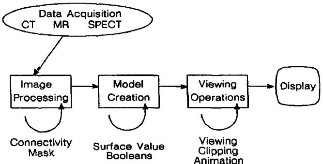  
Figure 1. 3D Medical Information Flow.

X-ray computed tomography (CT) measures the spatially varying $\mathbf { X }$ -ray attenuation coefficient [3]. CT images show internal structure. For 3D applications, CT is frequently used to look at bone structure, although we have had success visualizing soft tissue.

Magnetic resonance (MR) measures three physical properties [20]. One property is the distribution of "mobile" hydrogen nuclei and shows overall structure within the slices. The other two properties measure relaxation times of the nuclei. MR, a recent technique, shows excellent contrast between a variety of soft tissues. However, the variety of surfaces presents a challenge to 3D surface construction and requires techniques for selective surface extraction and display.

A third acquisition technique, single-photon emission computed tomography (SPECT) measures the emission of gamma rays [24].  The source of these rays is a radioisotope distributed within the body. In addition to structure, SPECT can show the presence of blood in structures with a much lower dose than that required by CT.

# 2. Image processing.

Some algorithms use image processing techniques to find structures within the 3D data [1,32,30,29] or to filter the original data. MR data, in particular, needs image processing to select appropriate structure.

# 3.Surface construction.

Surface construction, the topic of this paper, involves the creation of a surface model from the 3D data. The model usually consists of 3D volume elements (voxels) or polygons. Users select the desired surface by specifying a density value. This step can also include the creation of cut or capped surfaces.

# 4.Display.

Having created the surface, the final step displays that surface using display techniques that include ray casting, depth shading, and color shading.

# 3. RELATED WORK.

There are several approaches to the 3D surface generation problem. An early technique [23] starts with contours of the surface to be constructed and connects contours on consecutive slices with triangles. Unfortunately, if more than one contour of surface exists on a slice, ambiguities arise when determining which contours to connect [14]. Interactive intervention by the user can overcome some of these ambiguities [8]; however, in a clinical environment, user interaction should be kept to a minimum.

Another approach, developed by G. Herman and colleagues [19] creates surfaces from cuberilles. A cuberille is "dissection of space into equal cubes (called voxels) by three orthogonal sets of parallel planes [7]." Although there are many ways to display a cuberille model, the most realistic images result when the gradient, calculated from cuberilles in a neighborhood, is used to find the shade of a point on the model [15]. Meagher [25] uses an octree representation to compress the storage of the 3D data, allowing rapid manipulation and display of voxels.

Farrell [12] uses ray casting to find the 3D surface, but rather than shade the image with a gray scale, uses hue lightness to display the surface. In another ray casting method, Hohne [22], after locating the surface along a ray, calculates the gradient along the surface and uses this gradient, scaled by an "appropriate" value, to generate gray scales for the image.

A different approach, used at the Mayo Clinic [26], displays the density volume rather than the surface. This method produces, in effect, a conventional shadow graph that can be viewed from arbitrary angles. Motion enhances the three-dimensional effect obtained using the volume model.

Each of these techniques for surface construction and display suffer shortcomings because they throw away useful information in the original data. The connected contour algorithms throw away the inter-slice connectivity that exists in the original data. The cuberille approach, using thresholding to represent the surface as blocks in 3D space, attempts to recover shading information from the blocks. The ray casting methods either use depth shading alone, or try to approximate shading with an unnormalized gradient. Since they display all values and not just those visible from a given point of view, volume models rely on motion to produce a three-dimensional sensation.

Our approach uses information from the original 3D data to derive inter-slice connectivity, surface location, and surface gradient. The resulting triangle model can be displayed on conventional graphics display systems using standard rendering algorithms.

# 4. MARCHING CUBES ALGORITHM.

There are two primary steps in our approach to the surface construction problem. First, we locate the surface corresponding to a user-specified value and create triangles. Then, to ensure a quality image of the surface, we calculate the normals to the surface at each vertex of each triangle.

Marching cubes uses a divide-and-conquer approach to locate the surface in a logical cube created from eight pixels; four each from two adjacent slices (Figure 2).

The algorithm determines how the surface intersects this cube, then moves (or marcls) to the next cube. To find the surface intersection in a cube, we assign a one to a cube's vertex if the data value at that vertex exceeds (or equals) the value of the surface we are constructing. These vertices are inside (or on) the surface.' Cube vertices with values below the surface receive a zero and are outside the surface. The surface intersects those cube edges where one vertex is outside the surface (one) and the other is inside the surface (zero). With this assumption, we determine the topology of the surface within a cube, finding the location of the intersection later.

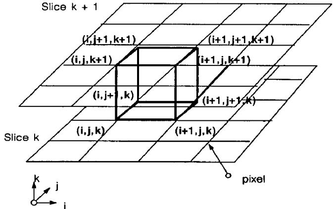  
Figure 2. Marching Cube.

Since there are eight vertices in each cube and two states, inside and outside, there are only $2 ^ { 8 } \ = \ 2 5 6$ ways a surface can intersect the cube. By enumerating these 256 cases, we create a table to look up surface-edge intersections, given the labeling of a cubes vertices. The table contains the edges intersected for each case.

Triangulating the 256 cases is possible but tedious and error-prone. Two different symmetries of the cube reduce the problem from 256 cases to 14 patterns. First, the topology of the triangulated surface is unchanged if the relationship of the surface values to the cubes is reversed. Complementary cases, where vertices greater than the surface value are interchanged with those less than the value, are equivalent. Thus, only cases with zero to four vertices greater than the surface value need be considered, reducing the number of cases to 128. Using the second symmetry property, rotational symmetry, we reduced the problem to 14 patterns by inspection. Figure 3 shows the triangulation for the 14 patterns.

The simplest pattern, O, occurs if all vertex values are above (or below) the selected value and produces no triangles. The next pattern, 1, occurs if the surface separates on vertex from the other seven, resulting in one triangle defined by the three edge intersections. Other patterns produce multiple triangles. Permutation of these 14 basic patterns using complementary and rotational symmetry produces the 256 cases.

We create an index for each case, based on the state of the vertex. Using the vertex numbering in Figure 4, the eight bit index contains one bit for each vertex.

This index serves as a pointer into an edge table that gives all edge intersections for a given cube configuration.

Using the index to tell which edge the surface intersects, we can interpolate the surface intersection along the edge. We use linear interpolation, but have experimented with higher degree interpolations. Since the algorithm produces at least one and as many as four triangles per cube, the higher degree surfaces show little improvement over linear interpolation.

The final step in marching cubes calculates a unit normal for each triangle vertex. The rendering algorithms use this normal to produce Gouraud-shaded images. A surface of constant density has a zero gradient component along the surface tangeniial direction; consequently, the direction of the gradient vector, z, is normal to the surface. We can use this fact to determine surface normal vector, $\daleth$ ,if the magnitude of the gradient, gk is nonzero. Fortunately, at the surface of interest between two tissue types of different densities, the gradient vector is nonzero. The gradient vector, 5, is the derivative of the density function

$$
\begin{array} { r } { \vec { \boldsymbol { \mathfrak { g } } } \left( x , y , z \right) = \nabla \vec { \mathcal { f } } ( x , y , z ) . } \end{array}
$$

To estimate the gradient vector at the surface of interest, we first estimate the gradient vectors at the cube vertices and linearly interpolate the gradient at the point of intersection. The gradient at cube vertex $( \ i , j , k )$ , is estimated using central differences along the three coordinate axes by:

$$
\begin{array} { l } { G _ { x } ( i , j , k ) = \frac { D \left( i + 1 , j , k \right) - D \left( i - 1 , j , k \right) } { \Delta x } } \\ { G _ { y } ( i , j , k ) = \frac { D \left( i , j + 1 , k \right) - D \left( i , j - 1 , k \right) } { \Delta y } } \\ { G _ { z } ( i , j , k ) = \frac { D \left( i , j , k + 1 \right) - D \left( i , j , k - 1 \right) } { \Delta z } } \end{array}
$$

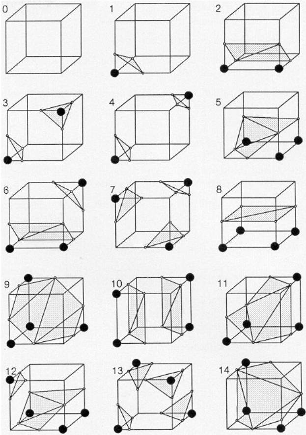  
Figure 3. Triangulated Cubes.

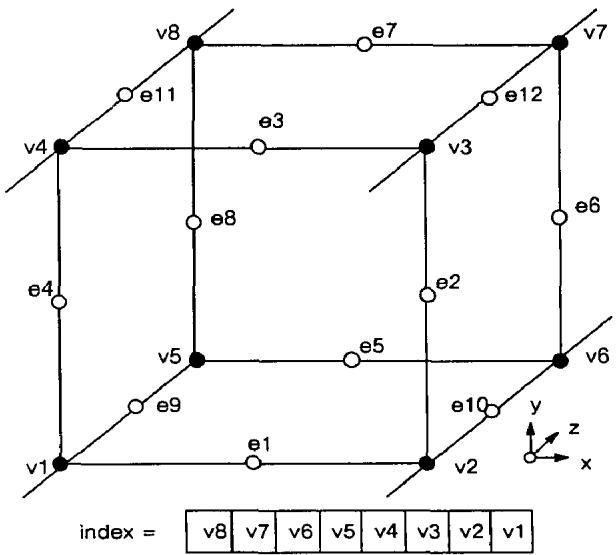  
Figure 4. Cube Numbering.

where $D \left( i , j , k \right)$ is the density at pixel $( i , j )$ in slice $k$ and $\Delta x , \Delta y , \Delta z$ are the lengths of the cube edges. Dividing the gradient by its length produces the unit normal at the vertex required for rendering. We linearly interpolate this normal to the point of intersection. Note that to calculate the gradient at all vertices of the cube, we keep four slices in memory at once.

ln summary, marching cubes creates a surface from a three-dimensional set of data as follows:

1. Read four slices into memory.   
2. Scan two slices and create a cube from four neighbors on one slice and four neighbors on the next slice.   
3. Calculate an index for the cube by comparing the eight density values at the cube vertices with the surface constant.   
4Using the index, look up the list of edges from a precalculated table.   
5. Using the densities at each edge vertex, find the surfaceedge intersection via linear interpolation.   
6. Calculate a unit normal at each cube vertex using central differences. Interpolate the normal to each triangle vertex.   
7. Output the triangle vertices and vertex normals.

# 5. ENHANCEMENTS TO THE BASIC ALGORITHM

We have made several improvements to the original marching cubes that make the algorithm run faster and that add solid modeling capabilities.

# 5.1 Efficiency Enhancements.

The efficiency enhancements allow the algorithm to take advantage of pixel-to-pixel, line-to-line, and slice-to-slice coherence. For cubes interior to the original data limits (those not including slice 0, line 0, or pixel O), only three new edges need to be interpolated for each cube. We can obtain the other nine edges from previous slices, lines, or pixels. In Figure. 5, the shaded circles represent values available from prior calculations; only edges 6, 7, and 12 have to be calculated for the new cube.

Special cases are present along the boundaries of the data, but, by enumerating these cases, we can limit vertex calculations to once per vertex. In practice, we only save the previous pixel and line intersections because the memory required to save the previous slice's intersections is large. Using the coherence speeds up the algorithm by a factor of three.

Reducing the slice resolution, by averaging four pixels into one, decreases the number of triangles, improves the surface construction efficiency and smooths the image. Although there is some loss of detail in the averaged slices, the averaging makes the number of triangles morc manageable for high-resolution slices.

# 5.2 Functional Enhancements.

We have added a solid modeling capability to the algorithm. Boolean operations permit cutting and capping of solid models, as well as the extraction of multiple surfaces. In a medical application, cutting is analogous to performing surgery and capping (and texture mapping) is analogous to the medical imaging technique of reformatting.

We use the cube index described earlier to do Boolean operations on the surfaces. Here, just consider three values of the index:

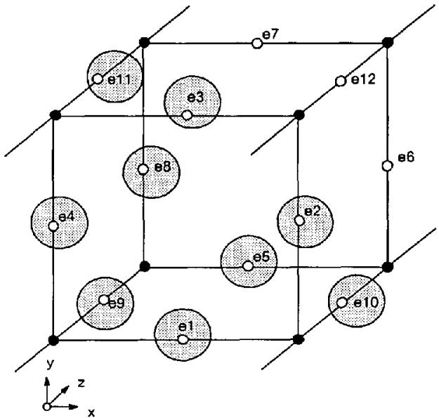  
Figure 5. Coherence.

index $= \theta$ for cubes outside the surface.   
$i n d e x = 2 5 5$ for cubes inside the surface.   
$\theta <$ index $< ~ 2 5 5$ for cubes on the surface.

Solid modeling uses these notions of inside, ourside, and on to create a surface. Analytic functions also provide the same information; so, for example the equation of a plane, $a x + b y + c z - d ,$ tells where a given point lies with respect to the plane. Let $\bf - s$ , 8S, and S represent sets of points that are outside, on, and inside a surface, respectively. Referring to Figure 6, we build a truth table, shown in Figure 7, for the Boolean intersection operation.

Nine entries in the truth table describe what to do when two surfaces have a given index. With x's representing no operation, the entry for $\displaystyle ( \mathbf { S } , \mathbf { \Omega } \sim \mathbf { P } )$ shows thal the cube in question is inside one surface but outside the other, resulting in no triangles. The (δS, P) entry produces triangles from the $s$ surface, while the (S, δP) entry produces triangles from the $P$ surface. The (δS, δP) entry, created when a cube is on both surfaces, requires special processing. We clip each triangle from one surface against each triangle from the other, using the Sutherland-Hodgman clipping algorithm [28].

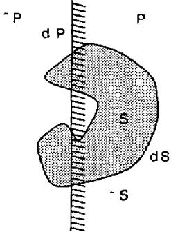  
Figure 6. Point/Surface Relations.

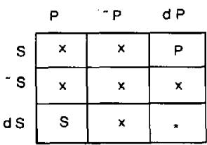  
Figure 7. Truth Table.

This technique applies to any suraces that have inside/outside functions. We have used it with planes and with connectivity masks generated by scparate image processing algorithms [9]. Application of a "logical or" truth tablc provides the capability for multiple surface extraction.

We implement texture mapping by finding the triangles on a plane's surface and attcnuating the normal's length using the original slice data.

# IMPLEMENTATION.

Marching cubes, writlen in C, runs on Sun Workstationsl under Unix², VAX's under VMS³, and an $\mathrm { I B M } ~ 3 0 8 1$ under $\mathrm { { 1 X / 3 7 0 ^ { 4 } } }$ We display the models using an in-house $\mathbf { Z }$ -buffer program or a General Electric Graphicon $7 0 0 ^ { \mathrm { s } }$ For our models, the Graphicon displays at a rate of 10,000 triangles per second. In addition to surfaces of constant density, the software allows any number of planes that can be transparent, capped with triangles, or textured with interpolated density data. Medical practitioners refer to this texture mapping as reformatting. Execution times depend on the number of surfaces and resolution of the original data. Model creation times on a VAX 11/780 vary from 100 seconds for 64 by 64 by 48 SPECT data to 30 minutes for 260 by 260 by $9 3 \ \subset \mathbb { T }$ studies. Times for the same studies on the IBM 3081 are twelve times faster. The number of triangles in a surface model is proportional to the area of the surface. This number can get large (over 500,000 in some cases), so we rcducc it using cul planes and surface connectivity. Also, somctimes we reduce the resolution of the original data by filtering, producing a somewhat smoother surface with some loss of resolution.

# 7. RESULTS.

We have applied marching cubes to data oblained from CT, MR, and SPECT, as well as data generated from analytic functions. We present three case studies that illustrate the quality of the construcled surfaces and some modeling options. Each image was rendered at 512 by 512 resolution without antialiasing.

# 7.1 Computed Tomography.

The first case is a CT study of the head of a twelve year old male with a hole in the skull near the left side of the nose. The 93 axial slices are $1 . 5 \ \mathfrak { m m }$ thick, with pixel dimensions of $0 . 8 \ \mathsf { m m }$ . This study by D.C. Hemmy, MD, of the Medical College of Wisconsin, illustrates the detail present in surfaces constructed by marching cubes. Figures 8 and 9 show the bone and soft tissue surfaces respectively. The tube in the patient's mouth is present to administer anesthetic during the scanning process. The soft tissue image shows fine detail that includes the patient's pierced ear and the impression of adhesive tape on the face. Although these details are not clinically significant, they do show the resolution present in the constructed surface. Figure I0 is a tilted view of the soft tissue surface that shows nasal and ear passages. In Figure 11, a sagittal cut, texture mapped with the original

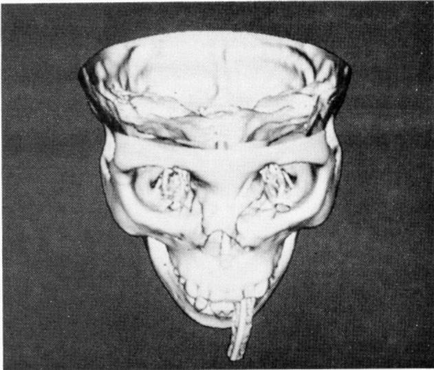  
Figure 8. Bone Surface.

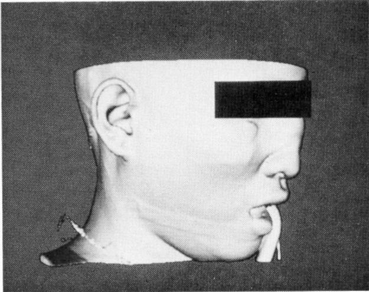  
Figure 9. Soft Tissue Surface.

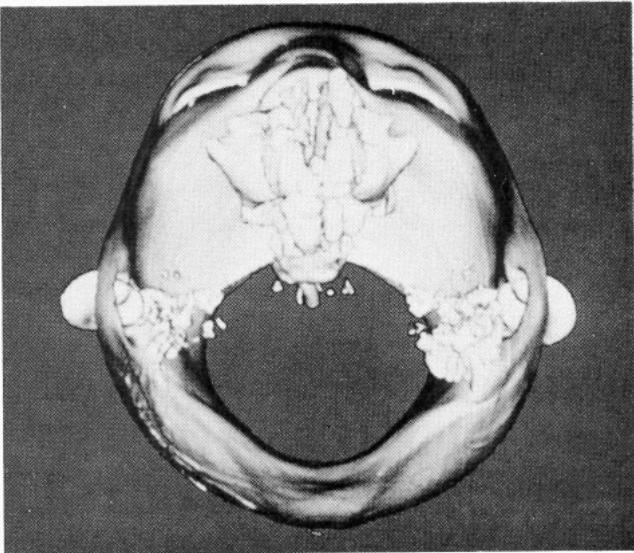  
Figure 10. Soft Tissue, Top View.

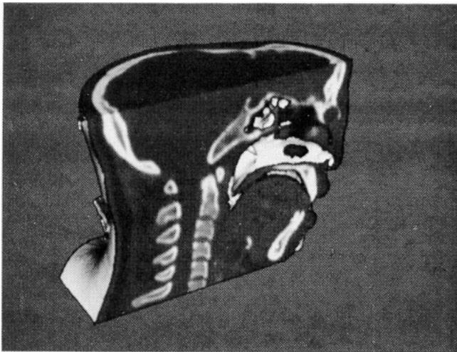  
Figure 11. Sagittal Cut with Texture Mapping.

CT data, shows the slice data in relation to the constructed surface. The bone surface contains 550,oo0 triangles while the soft tissue surface has 375,000.

# 7.2 Magnetic Resonance.

The MR case of an adult male volunteer consists of 128 $1 . 9 ~ \mathrm { m m }$ coronal slices. A 3D FT, flow compensated, fasl scquence acquired the 128 slices in only 9 minutes. This pulse sequence, contrasting the unsaturated spins of the fresh blood flowing into the excited region of saturated spins, was produced by G. Glover of GE Medical Systems Group. Because of the complex anatomy present in the MR slices, we show, in Figure 12, the texture mapped cut surfaces intersected with the surface of the skin. Although the original slices are coronal, we show sagittal cuts to illustratc the algorithm's ability to interpolale texture on a cut plane. The largest surface model in the sequence contains 330,000 trianglcs, including triangles on the cut surface.

# 7.3 Single-Photon Emission Computed Tomography.

The SPECT study consisting of 29 coronal slices of the hcart shows the algorithm's performance on low resolution data. D. Nowak from GE Medical Systems provided the 64 by 64 pixcl data. Figure 13, showing the surface of the blood pool in the diastolic heart, contains 5,000 triangles. The descending aorta is the large vessel in the left of the picture.

# 8. CONCLUSIONS.

Marching cubes, a new algorithm for 3D surface construction, complements 2D CT, MR, and SPECT data by giving physicians 3D vicws of the anatomy. The algorithm uses a case table of edge intersections to describe how a surface cuts through each cube in a 3D data set. Additional realism is achieved by the calculation, from the original data, of the normalized gradient. The resulting polygonal structure can be displayed on conventional graphics display systems. Although thesc models often contain large numbers of triangles, surface cutting and connectivity can reduce this number. As CAD hardware increases in speed and capacity, we expect that marching cubes will receive increased use in practical, clinical environments.

Recently we developed another high-resolution surface construction algorithm called dividing cubes that generales points rather than triangles [10]. As the resolution of the 3D medical data increases, the number of triangles approaches the number of pixels in the displayed image. The density of surface points is chosen to cover the raster display. Both algorithms produce the same quality images, since the shading governs the perceived quality of the image.

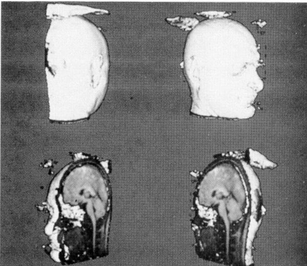  
Figure 12. Rotated Sequence of Cut MR Brain.

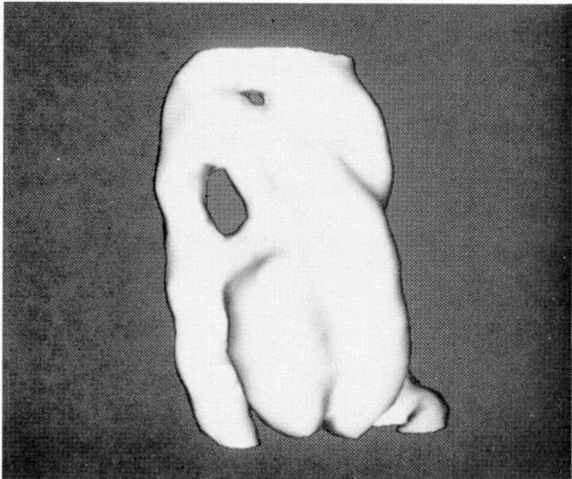  
Figure 13. Blood Pool in the Diastolic Heart.

# 9. ACKNOWLEDGMENT.

We thank C. Crawford from General Electric's Medical Systems for slimulating our work in this area. Throughout the project, he has provided us with data and encouragement to improve thc algorithm. R. Redington from our laboratory's Medical Diagnostics Branch provided a stable research environmcnt and insight into the practical applications of 3D in medicine. W. Leue assisted us in converting between the different medical data formats and provided interfaces to our MR equipment.

# 0. REFERENCES

[1] Artzy, E., Frieder, G., and Herman, G. T. The Theory, Design, Implementation and Evaluation of a Three-Dimensional Surface Delection Algorithm. Compuer Graphics and Image Processing 15, 1 (January 1981), 1-24. [2] Barillot, C.. Gibaud, B., Scarabin, J., and Coatrieux, J. 3D Reconstruction of Cerebral Blood Vessels. IEEE Computer Graphics and Applications 5. 12 (December 1985), 13-19.   
[3] Bates, R. H.. Garden, K. L., and Peters, T. M. Overview of Computerized Tomography with Emphasis on Future Developments. Proc. of the IEEE 71, 3 (March 1983), 356-372. [4] Bloch, P. and Udupa, J. K. Application of Computerized Tomography to Radiation Therapy and Surgical Planning. Proc. of the IEEE 71, 3 (March 1983), 351-355.   
Brer, L. J., Triv, S. S. Tut, H. K. nd Uu, J. K. Interactive Surgical Planning. IEEE Computer Graphics and Applications 4, 3 (March 1984), 31-40.   
[6] Burk, D. L., Mears, D. C., Kennedy, W. H., Cooperstein, L. A., and Herbert, D. L. Three-Dimensional Computed Tomography of Acetabula Fractures. Radiology 155. 1 (1985), 183-186.   
[7] Chen, L.. Herman, G. T., Reynolds, R. A., and Udupa, J. K. Surface Shading in the Cuberille Environment. IEEE Computer Graphics and Applications 5, 12 (December 1985), 33-43.   
[8] Christiansen, H. N. and Sederbcrg, T. W. Conversion of Complex Contour Line Definitions into Polygonal Element Meshes. Computer Graphics 12, 3 (August 1978), 187-192.   
[9] Cline, H. E., Dumoulin, C. L., Lorensen, W. E., Hart, H. R., and Ludke, S. 3D Reconstruction of the Brain from Magnetic Resonance Images. Magnetic Resonance Imaging (1987, to appear).   
[10] Cline, H. E., Lorensen, W. E., Ludke, S., Crawford, C. R., and Teeter, B. C. High-Resolution ThreeDimensional Reconstruction of Tomograms. Medical Physics (1987, to appear).   
[11] Cook, L. T., Dwyer, S. J., Batnitzky, S., and Lec, K. R. A Three-Dimensional Display System for Diagnostic Imaging Applications. IEEE Computer Graphics and Applications 3, 5 (August 1983), 13-19.   
[12] Farrell, E. J. Color Display and Interactive Interpretation of Three-Dimensional Data. IBM J. Res. Develop 27, 4 (July 1983), 356-366.   
[13] Farrcll, E. J., Zappulla, R., and Yang, W. C. Color 3D Imaging of Normal and Pathologic Intracranial Structures. IEEE Compuler Graphics and Applications 4, 9 (September 1984), 5-17.   
[14] Fuchs, H., Kedem, Z. M., and Uselton, S. P. Optimal Surface Reconstruction from Planar Contours. Comm. of the ACM 20, 10 (October 1977), 693-702.   
[15] Gordon, D. and Reynolds, R. A. Image Space Shading of 3-Dimensional Objects. Computer Graphics and Image Processing 29, 3 (March 1985), 361-376.   
Hale, J.D.Vak, P. E. an Wats, J. C.MR I of Blood Vessels Using Threc-Dimensional Reconstruction: Methodology. Radiology 157, 3 (December 1985), 727-733.   
{17] Ilemmy, D. C., David, D. J., and Herman, G. T. Three-Dimensional Reconstruction of Craniofacial Deformity Using Computed Tomography. Neurosurgery 13, 5 (November 1983), 534-541.   
[18] Hemmy, D. C. and Tessier, P. L. CT of Dry Skulls with Craniofacial Deformities: Accuracy of ThreeDimensional Reconstruction. Radiology 157, 1 (October 1985), 113-116.   
[19] Herman, G. T. and Udupa, J. K. Display of 3D Digital Images: Computational Foundations and Medical Applications. IEEE Computer Graphics and Applications 3, 5 (August 1983), 39-46.   
[20] Hinshaw, W. S. and Lent, A. H. An Introduction to NMR Imaging: From the Bloch Equation to the Imaging Equation. Proc. of the IEEE 71, 3 (March 1983), 338-350.   
[21] Hoffman, E. A. and Ritman, E. L. Shape and Dimensions of Cardiac Chambers: Importance of CT Section Thickness and Orientation. Radiology 155, 3 (June 1985), 739-744.   
[22] Hohne, K. H. and Bernstein, R. Shading 3D-Images from CT Using Gray-Level Gradients. IEEE Trans. on Medical Imaging MI-5, 1 (March 1986), 45-47.   
[23] Keppel, E. Approximating Complex Surfaces by Triangulation of Contour Lines. IBM J. Res. Develop 19, 1 (January 1975), 2-11.   
[24] Knoll, G. F. Single-Photon Emission Computed Tomography. Proc. of the IEEE 71. 3 (March 1983), 320-329.   
[25] Meagher, D. J. Geometric Modeling Using Octree Encoding. Computer Graphics and Image Processing 19, 2 (June 1982), 129-147.   
[26] Robb, R. A.., Hoffman, E. A., Sinak, L. J., Harris, L. D., and Ritman, E. L. High-Speed Three-Dimensional X-Ray Computed Tomography: The Dynamic Spatial Reconstructor. Proc. of the IEEE 71, 3 (March 1983), 308-319.   
[27] Sunguroff, A. and Greenberg, D. Computer Gencrated Images for Medical Application. Computer Graphics 12, 3 (August 1978), 196-202.   
[28] Suthcrland, I. E. and Hodgman, G. W. Rcentrant Polygon Clipping. Comm. of the ACM 17, 1 (January 1974), 32-42.   
[29] Trivcdi, S. S., Herman, G. T., and Udupa, J. K. Segmentation Into Three Classes Using Gradients. IEEE Trans. on Medical Imaging Ml-5, 2 (June 1986), 116-119.   
[30] Udupa, J. K. Interactive Segmentation and Boundary Surface Formation for 3-D Digital Images. Computer Graphics and Image Processing 18, 3 (March 1982), 213-235.   
[31] Vannier, M. W., Marsh, J. L., and Warren, J. O. Three Dimensional CT Reconstruction Images for Craniofacial Surgical Planning and Evaluation. Radiology 150, 1 (January 1984), 179-184.   
[32} Zucker, S. W. and Hummel, R. A. A ThreeDimensional Edge Operator. IEEE Trans. on Pattern Analysis and Machine Intelligence PAMI-3, 3 (May 1981324-331