# Vision meets robotics: The KITTI dataset

A Geiger1, P Lenz2, C Stiller2 and R Urtasun3

# Abstract

We present a novel dataset captured from a VW station wagon for use in mobile robotics and autonomous driving research. In total, we recorded 6 hours of traffic scenarios at 10–100 Hz using a variety of sensor modalities such as high-resolution color and grayscale stereo cameras, a Velodyne 3D laser scanner and a high-precision GPS/IMU inertial navigation system. The scenarios are diverse, capturing real-world traffic situations, and range from freeways over rural areas to inner-city scenes with many static and dynamic objects. Our data is calibrated, synchronized and timestamped, and we provide the rectified and raw image sequences. Our dataset also contains object labels in the form of 3D tracklets, and we provide online benchmarks for stereo, optical flow, object detection and other tasks. This paper describes our recording platform, the data format and the utilities that we provide.

# Keywords

Dataset, autonomous driving, mobile robotics, field robotics, computer vision, cameras, laser, GPS, benchmarks, stereo, optical flow, SLAM, object detection, tracking, KITTI

# 1. Introduction

The KITTI dataset has been recorded from a moving platform (Figure 1) while driving in and around Karlsruhe, Germany (Figure 2). It includes camera images, laser scans, high-precision GPS measurements and IMU accelerations from a combined GPS/IMU system. The main purpose of this dataset is to push forward the development of computer vision and robotic algorithms targeted at autonomous driving (Paul and Newman, 2010; Pfeiffer and Franke, 2010; Geiger et al., 2011a,b; Wojek et al., 2012; Singh and Kosecka, 2012; Brubaker et al., 2013). While our introductory paper (Geiger et al., 2012a) mainly focuses on the benchmarks, their creation and use for evaluating state-of-the-art computer vision methods, here we complement this information by providing technical details on the raw data itself. We give precise instructions on how to access the data and comment on sensor limitations and common pitfalls. The dataset can be downloaded from http://www.cvlibs.net/datasets/kitti. For a review on related work, we refer the reader to Geiger et al. (2012a).

# 2. Sensor setup

Our sensor setup is illustrated in Figure 3:

$2 ~ \times$ PointGray Flea2 grayscale cameras (FL2-14S3MC), 1.4 Megapixels, $1 / 2 ^ { \mathfrak { s } }$ Sony ICX267 CCD, global shutter

$2 \times$ PointGray Flea2 color cameras (FL2-14S3C-C), 1.4 Megapixels, $1 / 2 ^ { \mathfrak { s } }$ Sony ICX267 CCD, global shutter $4 \times$ Edmund Optics lenses, $4 \mathrm { m m }$ , opening angle $\sim 9 0 ^ { \circ }$ , vertical opening angle of region of interest $( \mathrm { R O I } ) \sim 3 5 ^ { \circ }$ $1 ~ \times$ Velodyne HDL-64E rotating 3D laser scanner, 10 Hz, 64 beams, 0.09 degree angular resolution, $2 \mathrm { c m }$ distance accuracy, collecting $\sim 1 . 3$ million points/second, field of view: $3 6 0 ^ { \circ }$ horizontal, $2 6 . 8 ^ { \circ }$ vertical, range: $1 2 0 \mathrm { m }$ $1 \times \mathrm { O X T S }$ RT3003 inertial and GPS navigation system, 6 axis, $1 0 0 \mathrm { H z }$ , L1/L2 RTK, resolution: $0 . 0 2 \mathrm { ~ m ~ / ~ } 0 . 1 ^ { \circ }$

Note that the color cameras lack in terms of resolution due to the Bayer pattern interpolation process and are less sensitive to light. This is the reason why we use two stereo camera rigs, one for grayscale and one for color. The baseline of both stereo camera rigs is approximately $5 4 \mathrm { \ c m }$ . The trunk of our vehicle houses a PC with two sixcore Intel XEON X5650 processors and a shock-absorbed

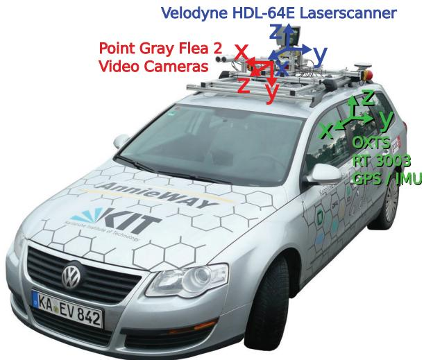  
Fig. 1. Recording platform. Our VW Passat station wagon is equipped with four video cameras (two color and two grayscale cameras), a rotating 3D laser scanner and a combined GPS/IMU inertial navigation system.

RAID 5 hard disk storage with a capacity of 4 Terabytes. Our computer runs Ubuntu Linux (64 bit) and a real-time database (Goebl and Faerber, 2007) to store the incoming data streams.

# 3. Dataset

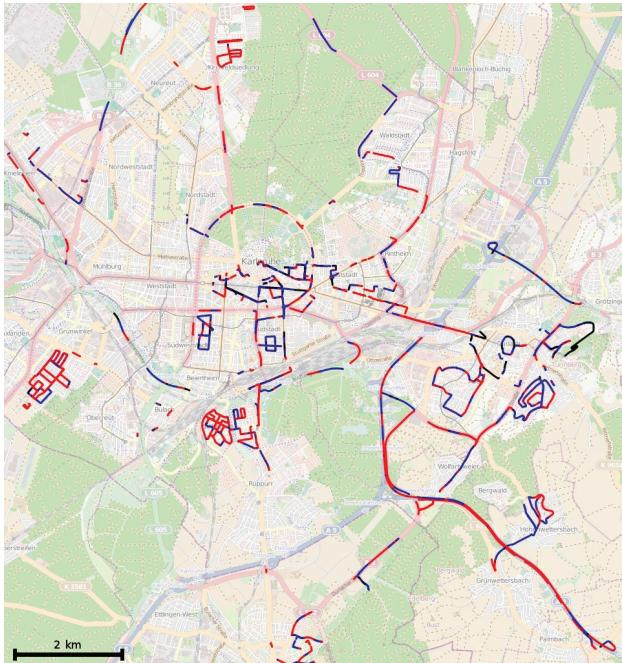  
Fig. 2. Recording zone. This figure shows the GPS traces of our recordings in the metropolitan area of Karlsruhe, Germany. Colors encode the GPS signal quality: red tracks have been recorded with highest precision using RTK corrections; blue denotes the absence of correction signals. The black runs have been excluded from our data set as no GPS signal has been available.

The raw data described in this paper can be accessed from http://www.cvlibs.net/datasets/kitti and contains $\sim 2 5 \%$ of our overall recordings. The reason for this is that primarily data with 3D tracklet annotations has been put online, though we will make more data available upon request. Furthermore, we have removed all sequences which are part of our benchmark test sets. The raw data set is divided into the categories ‘Road’, ‘City’, ‘Residential’, ‘Campus’ and ‘Person’. Example frames are illustrated in Figure 4. For each sequence, we provide the raw data, object annotations in form of 3D bounding box tracklets and a calibration file, as illustrated in Figure 5. Our recordings have taken place on the 26th, 28th, 29th, 30th of September and on the 3rd of October 2011 during daytime. The total size of the provided data is 180 GB.

# 3.1. Data description

All sensor readings of a sequence are zipped into a single file named date_drive.zip, where date and drive are placeholders for the recording date and the sequence number. The directory structure is shown in Figure 5. Besides the raw recordings (‘raw data’), we also provide post-processed data (‘synced data’), i.e., rectified and synchronized video streams, on the dataset website.

data sub-folders. Each line in timestamps.txt is composed of the date and time in hours, minutes and seconds. As the Velodyne laser scanner has a ‘rolling shutter’, three timestamp files are provided for this sensor, one for the start position (timestamps_start.txt) of a spin, one for the end position (timestamps_end.txt) of a spin, and one for the time, where the laser scanner is facing forward and triggering the cameras (timestamps.txt). The data format in which each sensor stream is stored is as follows:

Timestamps are stored in timestamps.txt and perframe sensor readings are provided in the corresponding

Images Both, color and grayscale images are stored with loss-less compression using 8-bit PNG files. The engine hood and the sky region have been cropped. To simplify working with the data, we also provide rectified images. The size of the images after rectification depends on the calibration parameters and is $\sim 0 . 5 \ : \mathrm { M p x }$ on average. The original images before rectification are available as well.

OXTS (GPS/IMU) For each frame, we store 30 different GPS/IMU values in a text file: the geographic coordinates including altitude, global orientation, velocities, accelerations, angular rates, accuracies and satellite information. Accelerations and angular rates are both specified using two coordinate systems, one which is attached to the vehicle body $( x , y , z )$ and one that is mapped to the tangent plane of the earth surface at that location $( f , l , u )$ . From time to time we encountered short $\mathit { \Delta } \sim \mathit { \Delta } 1$ second) communication outages with the OXTS device for which we interpolated all values linearly and set the last 3 entries to $^ { \circ } - 1 ^ { \circ }$ to indicate the missing information. More details are provided in dataformat.txt. Conversion utilities are provided in the development kit.

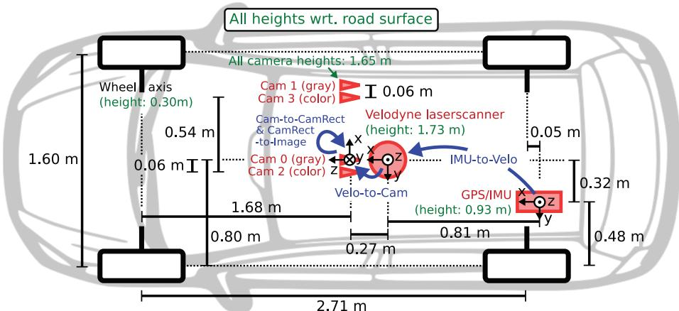  
Fig. 3. Sensor setup. This figure illustrates the dimensions and mounting positions of the sensors (red) with respect to the vehicle body. Heights above ground are marked in green and measured with respect to the road surface. Transformations between sensors are shown in blue.

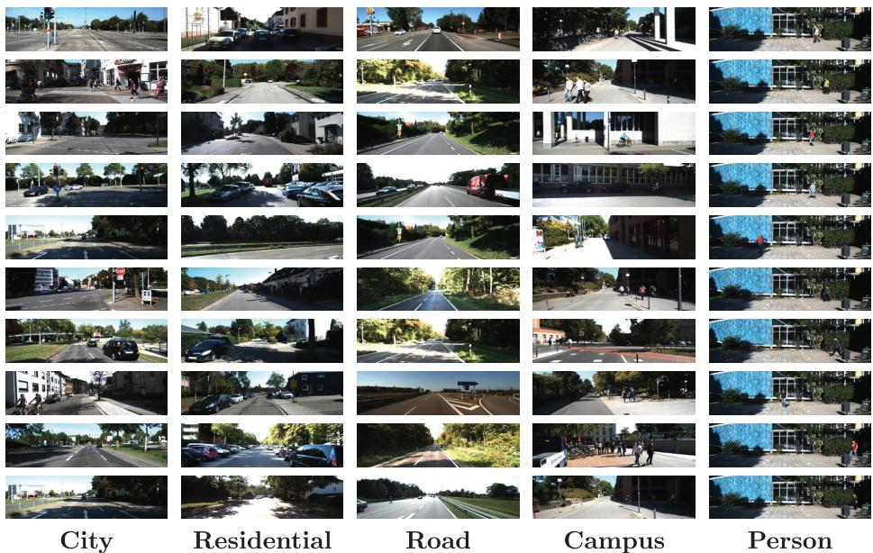  
Fig. 4. Examples from the KITTI dataset. This figure demonstrates the diversity in our dataset. The left color camera image is shown.

# 3.2. Annotations

Velodyne For efficiency, the Velodyne scans are stored as floating point binaries that are easy to parse using the $\mathrm { C } { + + }$ or MATLAB code provided. Each point is stored with its $( x , y , z )$ coordinate and an additional reflectance value $( r )$ . While the number of points per scan is not constant, on average each file/frame has a size of $\sim 1 . 9 \mathrm { M B }$ which corresponds to $\sim 1 2 0 , 0 0 0 \ 3 \mathrm { D }$ points and reflectance values. Note that the Velodyne laser scanner rotates continuously around its vertical axis (counter-clockwise), which can be taken into account using the timestamp files.

For each dynamic object within the reference camera’s field of view, we provide annotations in the form of 3D bounding box tracklets, represented in Velodyne coordinates. We define the classes ‘Car’, ‘Van’, ‘Truck’, ‘Pedestrian’, ‘Person (sitting)’, ‘Cyclist’, ‘Tram’ and ‘Misc’ (e.g., trailers, segways). The tracklets are stored in date_drive_tracklets.xml. Each object is assigned a class and its 3D size (height, width, length). For each frame, we provide the object’s translation and rotation in 3D, as illustrated in Figure 6. Note that we only provide the yaw angle, while the other two angles are assumed to be close to zero. Furthermore, the level of occlusion and truncation is specified. The development kit contains $\mathrm { C } { + } { + } /$ MATLAB code for reading and writing tracklets using

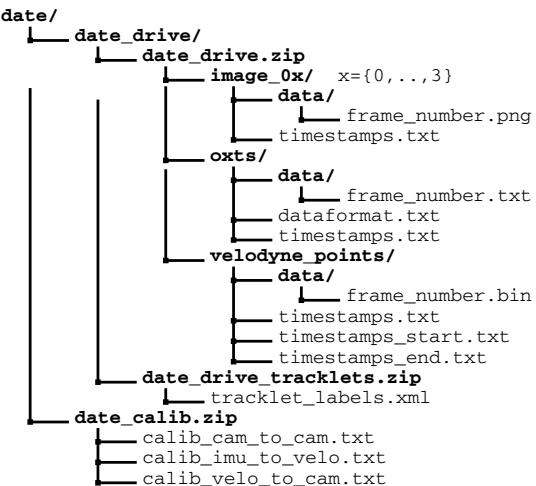  
Fig. 5. Structure of the provided zip files and their location within a global file structure that stores all KITTI sequences. Here, ‘date’ and ‘drive’ are placeholders, and ‘image_ $\mathbf { 0 x } ^ { \prime }$ refers to the 4 video camera streams.

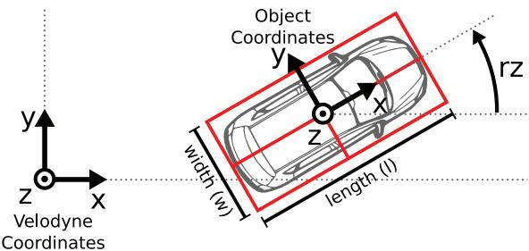  
Fig. 6. Object coordinates. This figure illustrates the coordinate system of the annotated 3D bounding boxes with respect to the coordinate system of the 3D Velodyne laser scanner. In $z \cdot$ -direction, the object coordinate system is located at the bottom of the object (contact point with the supporting surface).

To give further insights into the properties of our dataset, we provide statistics for all sequences that contain annotated objects. The total number of objects and the object orientations for the two predominant classes ‘Car’ and ‘Pedestrian’ are shown in Figure 7. For each object class, the number of object labels per image and the length of the captured sequences is shown in Figure 8. The egomotion of our platform recorded by the GPS/IMU system as well as statistics about the sequence length and the number of objects are shown in Figure 9 for the whole dataset and in Figure 10 per street category.

# 3.3. Development kit

The raw data development kit provided on the KITTI website contains MATLAB demonstration code with $\mathrm { C } { + } { + }$ wrappers and a readme.txt file which gives further details.2 Here, we will briefly discuss the most important features. Before running the scripts, the mex wrapper readTrackletsMex.cpp for reading tracklets into MATLAB structures and cell arrays needs to be built using the script make.m. It wraps the file tracklets.h from the cpp folder which holds the tracklet object for serialization. This file can also be directly interfaced with when working in a $\mathrm { C } { + + }$ environment.

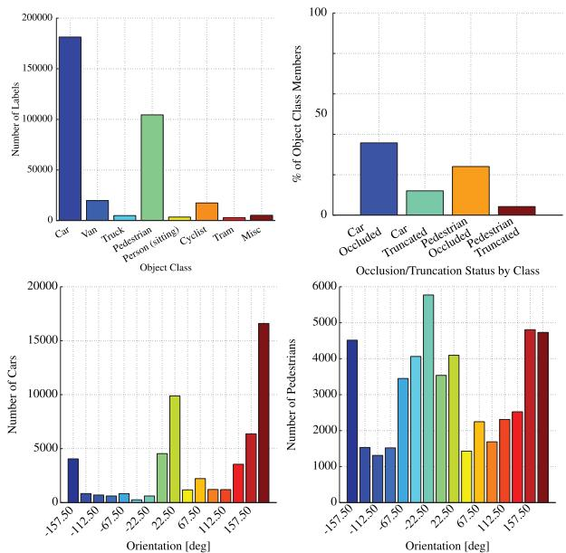  
Fig. 7. Object occurrence and orientation statistics of our dataset. This figure shows the different types of objects occurring in our sequences (top) and the orientation histograms (bottom) for the two most predominant categories ‘Car’ and ‘Pedestrian’.

The script run_demoTracklets.m demonstrates how 3D bounding box tracklets can be read from the XML files and projected onto the image plane of the cameras. The projection of 3D Velodyne point clouds into the image plane is demonstrated in run_demoVelodyne.m. See Figure 11 for an illustration.

The script run_demoVehiclePath.m shows how to read and display the 3D vehicle trajectory using the GPS/IMU data. It makes use of convertOxtsToPose(), which takes as input GPS/IMU measurements and outputs the 6D pose of the vehicle in Euclidean space. For this conversion we make use of the Mercator projection (Osborne, 2008)

$$
\begin{array} { l } { \displaystyle \boldsymbol { x } = \boldsymbol { s } \times \boldsymbol { r } \times \frac { \pi \mathit { l o n } } { 1 8 0 } } \\ { \displaystyle \boldsymbol { y } = \boldsymbol { s } \times \boldsymbol { r } \times \log \left( \tan \left( \frac { \pi ( 9 0 + l a t ) } { 3 6 0 } \right) \right) } \end{array}
$$

with earth radius $r ~ \approx ~ 6 , 3 7 8 , 1 3 7$ meters, scale $s \quad =$ cos $\left( { \frac { l a t _ { 0 } \times \pi } { 1 8 0 } } \right)$ , and $( l a t , l o n )$ the geographic coordinates. $l a t _ { 0 }$ denotes the latitude of the first frame’s coordinates and uniquely determines the Mercator scale.

The function loadCalibrationCamToCam() can be used to read the intrinsic and extrinsic calibration parameters of the four video sensors. The other 3D rigid body transformations can be parsed with loadCalibrationRigid().

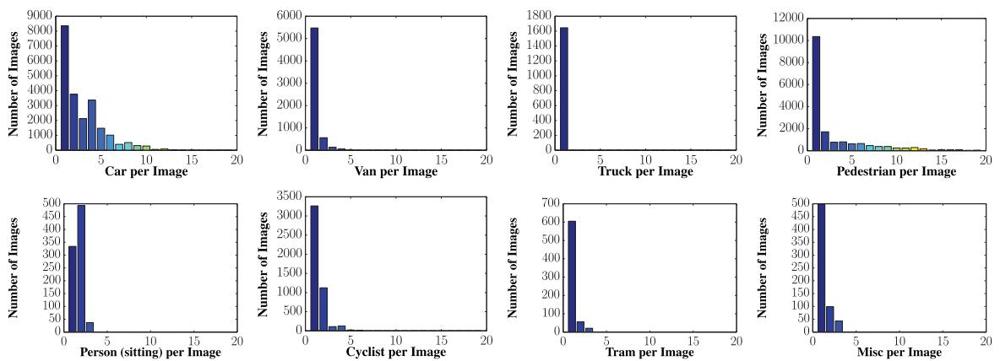  
Fig. 8. Number of object labels per class and image. This figure shows how often an object occurs in an image. Since our labeling efforts focused on cars and pedestrians, these are the most predominant classes here.

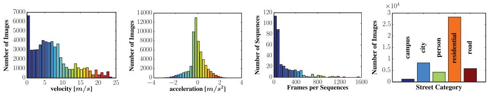  
Fig. 9. Egomotion, sequence count and length. This figure shows (from-left-to-right) the egomotion (velocity and acceleration) of our recording platform for the whole dataset. Note that we excluded sequences with a purely static observer from these statistics. The length of the available sequences is shown as a histogram counting the number of frames per sequence. The rightmost figure shows the number of frames/images per scene category.

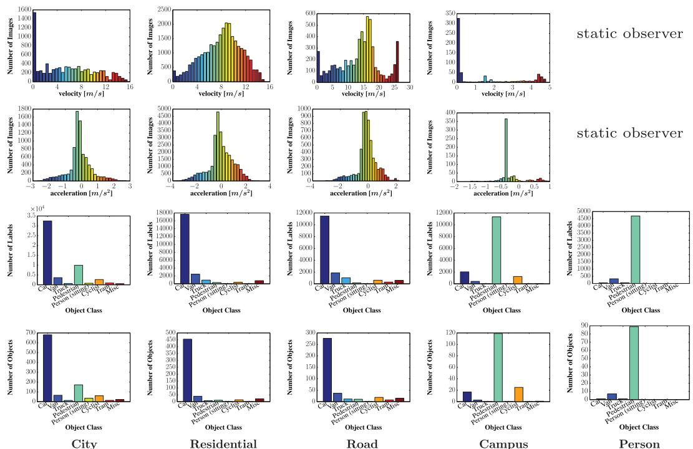  
Fig. 10. Velocities, accelerations and number of objects per object class. For each scene category we show the acceleration and velocity of the mobile platform as well as the number of labels and objects per class. Note that sequences with a purely static observer have been excluded from the velocity and acceleration histograms as they don’t represent natural driving behavior. The category ‘Person’ has been recorded from a static observer.

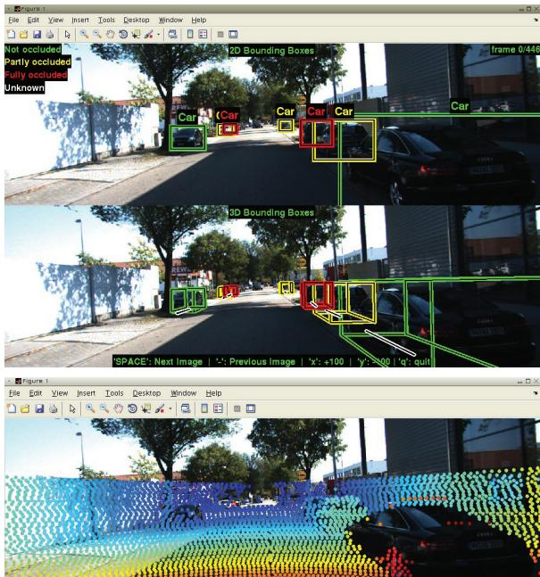  
Fig. 11. Development kit. Working with tracklets (top), Velodyne point clouds (bottom) and their projections onto the image plane is demonstrated in the MATLAB development kit which is available from the KITTI website.

# 3.4. Benchmarks

In addition to the raw data, our KITTI website hosts evaluation benchmarks for several computer vision and robotic tasks such as stereo, optical flow, visual odometry, SLAM, 3D object detection and 3D object tracking. For details about the benchmarks and evaluation metrics we refer the reader to Geiger et al. (2012a).

# 4. Sensor calibration

We took care that all sensors were carefully synchronized and calibrated. To avoid drift over time, we calibrated the sensors every day after our recordings. Note that even though the sensor setup hasn’t been altered in between, numerical differences are possible. The coordinate systems are defined as illustrated in Figures 1 and 3, i.e.:

Camera: $x = { \mathrm { r i g h t } }$ , $y = \mathrm { d o w n }$ , $z =$ forward Velodyne: $x =$ forward, $y =$ left, $z = { \mathrm { u p } }$ • GPS/IMU: $x =$ forward, $y =$ left, $z = { \mathrm { u p } }$

Notation: In the following, we write scalars in lowercase letters $( a )$ , vectors in bold lower-case (a) and matrices using bold-face capitals (A). 3D rigid-body transformations which take points from coordinate system $a$ to coordinate system $^ b$ will be denoted by $\mathbf { T } _ { a } ^ { b }$ , with $\mathbf { T }$ for ‘transformation’.

# 4.1. Synchronization

In order to synchronize the sensors, we use the timestamps of the Velodyne 3D laser scanner as a reference and consider each spin as a frame. We mounted a reed contact at the bottom of the continuously rotating scanner, triggering the cameras when facing forward. This minimizes the differences in the range and image observations caused by dynamic objects. Unfortunately, the GPS/IMU system cannot be synchronized that way. Instead, as it provides updates at $1 0 0 \mathrm { H z }$ , we collect the information with the closest timestamp to the laser scanner timestamp for a particular frame, resulting in a worst-case time difference of $5 \mathrm { m s }$ between a GPS/IMU and a camera/Velodyne data package. Note that all timestamps are provided such that positioning information at any time can be easily obtained via interpolation. All timestamps have been recorded on our host computer using the system clock.

# 4.2. Camera calibration

For calibrating the cameras intrinsically and extrinsically, we use the approach proposed in Geiger et al. (2012b). Note that all camera centers are aligned, i.e., they lie on the same $x / y$ -plane. This is important as it allows us to rectify all images jointly.

The calibration parameters for each day are stored in row-major order in calib_cam_to_cam.txt using the following notation:

$\mathbf { s } ^ { ( i ) } \in \mathbb { N } ^ { 2 }$ . . original image size $( 1 3 9 2 \times 5 1 2$ pixels) $\mathbf { K } ^ { ( i ) } \in \mathbb { R } ^ { 3 \times 3 }$ . . calibration matrices (unrectified) $\mathbf { d } ^ { ( i ) } \in \mathbb { R } ^ { 5 }$ . . distortion coefficients (unrectified) $\mathbf { R } ^ { ( i ) } \in \mathbb { R } ^ { 3 \times 3 }$ . rotation from camera 0 to camera $i$   
• $\mathbf { t } ^ { ( i ) } \in \mathbb { R } ^ { 1 \times 3 }$ $\mathbf { s } _ { r e c t } ^ { ( i ) } \in \mathbb { N } ^ { 2 }$ . . translation from camera 0 to camera . . . . . . . . . image size after rectificatio $i$   
• $\mathbf { R } _ { r e c t } ^ { ( i ) } \in \mathbb { R } ^ { 3 \times 3 }$ . . . rectifying rotation matrix $\mathbf { P } _ { r e c t } ^ { ( i ) } \in \mathbb { R } ^ { 3 \times 4 }$ . . . projection matrix after rectification

Here, $i \in \{ 0 , 1 , 2 , 3 \}$ is the camera index, where 0 represents the left grayscale, 1 the right grayscale, 2 the left color and 3 the right color camera. Note that the variable definitions are compliant with the OpenCV library, which we used for warping the images. When working with the synchronized and rectified datasets only the variables with rect-subscript are relevant. Note that due to the pincushion distortion effect the images have been cropped such that the size of the rectified images is smaller than the original size of $1 3 9 2 \times 5 1 2$ pixels.

The projection of a 3D point $\mathbf { x } = ( x , y , z , 1 ) ^ { T }$ in rectified (rotated) camera coordinates to a point $\textbf { y } = ( u , \nu , 1 ) ^ { T }$ in the $i ^ { * }$ th camera image is given as

$$
\mathbf { y } = \mathbf { P } _ { r e c t } ^ { ( i ) } \textbf { x }
$$

with

$$
\mathbf { P } _ { r e c t } ^ { ( i ) } = \left( \begin{array} { c c c c } { f _ { u } ^ { ( i ) } } & { 0 } & { c _ { u } ^ { ( i ) } } & { - f _ { u } ^ { ( i ) } b _ { x } ^ { ( i ) } } \\ { 0 } & { f _ { \nu } ^ { ( i ) } } & { c _ { \nu } ^ { ( i ) } } & { 0 } \\ { 0 } & { 0 } & { 1 } & { 0 } \end{array} \right)
$$

the i’th projection matrix. Here, $b _ { x } ^ { ( i ) }$ denotes the baseline (in meters) with respect to reference camera 0. Note that in order to project a 3D point $\mathbf { X }$ in reference camera coordinates to a point on the i’th image plane, the rectifying rotation matrix of the reference camera $\mathbf { R } _ { r e c t } ^ { ( 0 ) }$ must be considered as well:

$$
\mathbf { y } = \mathbf { P } _ { r e c t } ^ { ( i ) } \mathbf { R } _ { r e c t } ^ { ( 0 ) } \textbf { x }
$$

Here, $\mathbf { R } _ { r e c t } ^ { ( 0 ) }$ has been expanded into a $4 \times 4$ matrix by appending a fourth zero-row and column, and setting $\bar { \mathbf { R } } _ { r e c t } ^ { ( 0 ) } ( 4 , 4 ) = 1$ .

# 4.3. Velodyne and IMU calibration

We have registered the Velodyne laser scanner with respect to the reference camera coordinate system (camera 0) by initializing the rigid body transformation using Geiger et al. (2012b). Next, we optimized an error criterion based on the Euclidean distance of 50 manually selected correspondences and a robust measure on the disparity error with respect to the three top performing stereo methods in the KITTI stereo benchmark Geiger et al. (2012a). The optimization was carried out using Metropolis-Hastings sampling.

The rigid body transformation from Velodyne coordinates to camera coordinates is given in calib_velo_to_cam.txt:

• $\mathbf { R } _ { \nu e l o } ^ { c a m } \in \mathbb { R } ^ { 3 \times 3 }$ . . . rotation matrix: velodyne camera • $\mathbf { t } _ { \nu e l o } ^ { c a m } \in \mathbb { R } ^ { 1 \times 3 }$ . . . translation vector: velodyne camera

Using

$$
\mathbf { T } _ { \nu e l o } ^ { c a m } = \left( \begin{array} { c c } { \mathbf { R } _ { \nu e l o } ^ { c a m } } & { \mathbf { t } _ { \nu e l o } ^ { c a m } } \\ { 0 } & { 1 } \end{array} \right)
$$

a 3D point $\mathbf { X }$ in Velodyne coordinates gets projected to a point $\mathbf { y }$ in the $i ^ { \because }$ ’th camera image as

$$
\mathbf { y } = \mathbf { P } _ { r e c t } ^ { ( i ) } \mathbf { R } _ { r e c t } ^ { ( 0 ) } \mathbf { T } _ { \nu e l o } ^ { c a m } \mathbf { x }
$$

For registering the IMU/GPS with respect to the Velodyne laser scanner, we first recorded a sequence with an $^ { \mathfrak { s } } \infty ^ { \mathfrak { z } }$ -loop and registered the (untwisted) point clouds using the Point-to-Plane ICP algorithm. Given two trajectories this problem corresponds to the well-known hand-eye calibration problem which can be solved using standard tools (Horaud and Dornaika, 1995). The rotation matrix $\mathbf { R } _ { i m u } ^ { v e l o }$ and the translation vector ${ \bf t } _ { i m u } ^ { \nu e l o }$ are stored in calib_imu_to_velo.txt. A 3D point $\mathbf { X }$ in IMU/GPS coordinates gets projected to a point $\mathbf { y }$ in the $i ^ { \because }$ th image as

$$
\begin{array} { r } { \mathbf { y } = \mathbf { P } _ { r e c t } ^ { ( i ) } \mathbf { R } _ { r e c t } ^ { ( 0 ) } \mathbf { T } _ { \nu e l o } ^ { c a m } \mathbf { T } _ { i m u } ^ { \nu e l o } \textbf { x } } \end{array}
$$

# 5. Summary and future work

In this paper, we have presented a calibrated, synchronized and rectified autonomous driving dataset capturing a wide range of interesting scenarios. We believe that this dataset will be highly useful in many areas of robotics and computer vision. In the future we plan on expanding the set of available sequences by adding additional 3D object labels for currently unlabeled sequences and recording new sequences, for example in difficult lighting situations such as at night, in tunnels, or in the presence of fog or rain. Furthermore, we plan on extending our benchmark suite through novel challenges. In particular, we will provide pixel-accurate semantic labels for many of the sequences.

# Notes

1. See http://www.boost.org.   
2. See http://www.cvlibs.net/datasets/kitti/raw_data.php.

# Funding

This research received no specific grant from any funding agency in the public, commercial, or not-for-profit sectors.

# References

Brubaker MA, Geiger A and Urtasun R (2013) Lost! leveraging the crowd for probabilistic visual self-localization. In: Conference on computer vision and pattern recognition (CVPR).   
Geiger A, Lauer M and Urtasun R (2011a) A generative model for 3D urban scene understanding from movable platforms. In: Conference on computer vision and pattern recognition (CVPR).   
Geiger A, Wojek C and Urtasun R (2011b) Joint 3D estimation of objects and scene layout. In: Conference on neural information processing systems (NIPS).   
Geiger A, Lenz P and Urtasun R (2012a) Are we ready for autonomous driving? The KITTI vision benchmark suite. In: Conference on computer vision and pattern recognition (CVPR).   
Geiger A, Moosmann F, Car O and Schuster B (2012b) A toolbox for automatic calibration of range and camera sensors using a single shot. In: International conference on robotics and automation (ICRA).   
Goebl M and Faerber G (2007) A real-time-capable hard- and software architecture for joint image and knowledge processing in cognitive automobiles. In: Proceedings of the Intelligent Vehicles Symposium (IV).   
Horaud R and Dornaika F (1995) Hand-eye calibration. International Journal of Robotics Research 14(3): 195–210.   
Osborne P (2008) The mercator projections. Available at: http://mercator.myzen.co.uk/mercator.pdf.   
Paul R and Newman P (2010) FAB-MAP 3D: Topological mapping with spatial and visual appearance. In: International conference on robotics and automation (ICRA).   
Pfeiffer D and Franke U (2010) Efficient representation of traffic scenes by means of dynamic stixels. In: Proceedings of the Intelligent Vehicles Symposium (IV).   
Singh G and Kosecka J (2012) Acquiring semantics induced topology in urban environments. In: International conference on robotics and automation (ICRA).   
Wojek C, Walk S, Roth S, Schindler K and Schiele B (2012) Monocular visual scene understanding: Understanding multiobject traffic scenes. In: Proceedings of the Intelligent Vehicles Symposium (IV).