# A survey on Image Data Augmentation for Deep Learning

Connor Shorten\* and Taghi M. Khoshgoftaar

\*Correspondence: cshorten2015@fau.edu Department of Computer and Electrical Engineering and Computer Science, Florida Atlantic University, Boca Raton, USA

# Abstract

Deep convolutional neural networks have performed remarkably well on many Computer Vision tasks. However, these networks are heavily reliant on big data to avoid overftting. Overftting refers to the phenomenon when a network learns a function with very high variance such as to perfectly model the training data. Unfortunately, many application domains do not have access to big data, such as medical image analysis. This survey focuses on Data Augmentation, a data-space solution to the problem of limited data. Data Augmentation encompasses a suite of techniques that enhance the size and quality of training datasets such that better Deep Learning models can be built using them. The image augmentation algorithms discussed in this survey include geometric transformations, color space augmentations, kernel flters, mixing images, random erasing, feature space augmentation, adversarial training, generative adversarial networks, neural style transfer, and meta-learning. The application of augmentation methods based on GANs are heavily covered in this survey. In addition to augmentation techniques, this paper will briefy discuss other characteristics of Data Augmentation such as test-time augmentation, resolution impact, fnal dataset size, and curriculum learning. This survey will present existing methods for Data Augmentation, promising developments, and meta-level decisions for implementing Data Augmentation. Readers will understand how Data Augmentation can improve the performance of their models and expand limited datasets to take advantage of the capabilities of big data.

Keywords: Data Augmentation, Big data, Image data, Deep Learning, GANs

# Introduction

Deep Learning models have made incredible progress in discriminative tasks. Tis has been fueled by the advancement of deep network architectures, powerful computation, and access to big data. Deep neural networks have been successfully applied to Computer Vision tasks such as image classifcation, object detection, and image segmentation thanks to the development of convolutional neural networks (CNNs). Tese neural networks utilize parameterized, sparsely connected kernels which preserve the spatial characteristics of images. Convolutional layers sequentially downsample the spatial resolution of images while expanding the depth of their feature maps. Tis series of convolutional transformations can create much lower-dimensional and more useful representations of images than what could possibly be hand-crafted. Te success of CNNs has spiked interest and optimism in applying Deep Learning to Computer Vision tasks.

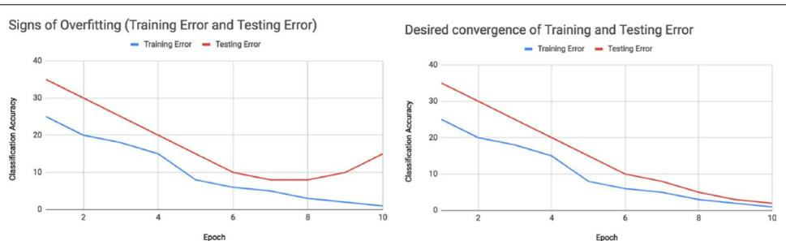  
Fig. 1 The plot on the left shows an infection point where the validation error starts to increase as the training rate continues to decrease. The increased training has caused the model to overft to the training data and perform poorly on the testing set relative to the training set. In contrast, the plot on the right shows a model with the desired relationship between training and testing error

Tere are many branches of study that hope to improve current benchmarks by applying deep convolutional networks to Computer Vision tasks. Improving the generalization ability of these models is one of the most difcult challenges. Generalizability refers to the performance diference of a model when evaluated on previously seen data (training data) versus data it has never seen before (testing data). Models with poor generalizability have overftted the training data. One way to discover overftting is to plot the training and validation accuracy at each epoch during training. Te graph below depicts what overftting might look like when visualizing these accuracies over training epochs (Fig. 1).

To build useful Deep Learning models, the validation error must continue to decrease with the training error. Data Augmentation is a very powerful method of achieving this. Te augmented data will represent a more comprehensive set of possible data points, thus minimizing the distance between the training and validation set, as well as any future testing sets.

Data Augmentation, the focus of this survey, is not the only technique that has been developed to reduce overftting. Te following few paragraphs will introduce other solutions available to avoid overftting in Deep Learning models. Tis listing is intended to give readers a broader understanding of the context of Data Augmentation.

Many other strategies for increasing generalization performance focus on the model’s architecture itself. Tis has led to a sequence of progressively more complex architectures from AlexNet [1] to VGG-16 [2], ResNet [3], Inception-V3 [4], and DenseNet [5]. Functional solutions such as dropout regularization, batch normalization, transfer learning, and pretraining have been developed to try to extend Deep Learning for application on smaller datasets. A brief description of these overftting solutions is provided below. A complete survey of regularization methods in Deep Learning has been compiled by Kukacka et  al. [6]. Knowledge of these overftting solutions will inform readers about other existing tools, thus framing the high-level context of Data Augmentation and Deep Learning.

• Dropout [7] is a regularization technique that zeros out the activation values of randomly chosen neurons during training. Tis constraint forces the network to learn more robust features rather than relying on the predictive capability of a small subset of neurons in the network. Tompson et  al. [8] extended this idea to convolutional networks with Spatial Dropout, which drops out entire feature maps rather than individual neurons.

• Batch normalization [9] is another regularization technique that normalizes the set of activations in a layer. Normalization works by subtracting the batch mean from each activation and dividing by the batch standard deviation. Tis normalization technique, along with standardization, is a standard technique in the preprocessing of pixel values.

• Transfer Learning [10, 11] is another interesting paradigm to prevent overftting. Transfer Learning works by training a network on a big dataset such as ImageNet [12] and then using those weights as the initial weights in a new classifcation task. Typically, just the weights in convolutional layers are copied, rather than the entire network including fully-connected layers. Tis is very efective since many image datasets share low-level spatial characteristics that are better learned with big data. Understanding the relationship between transferred data domains is an ongoing research task [13]. Yosinski et  al. [14] fnd that transferability is negatively afected primarily by the specialization of higher layer neurons and difculties with splitting co-adapted neurons.

• Pretraining [15] is conceptually very similar to transfer learning. In Pretraining, the network architecture is defned and then trained on a big dataset such as ImageNet [12]. Tis difers from Transfer Learning because in Transfer Learning, the network architecture such as VGG-16 [2] or ResNet [3] must be transferred as well as the weights. Pretraining enables the initialization of weights using big datasets, while still enabling fexibility in network architecture design.

• One-shot and Zero-shot learning [16, 17] algorithms represent another paradigm for building models with extremely limited data. One-shot learning is commonly used in facial recognition applications [18]. An approach to one-shot learning is the use of siamese networks [19] that learn a distance function such that image classifcation is possible even if the network has only been trained on one or a few instances. Another very popular approach to one-shot learning is the use of memory-augmented networks [20]. Zero-shot learning is a more extreme paradigm in which a network uses input and output vector embeddings such as Word2Vec [21] or GloVe [22] to classify images based on descriptive attributes.

In contrast to the techniques mentioned above, Data Augmentation approaches overftting from the root of the problem, the training dataset. Tis is done under the assumption that more information can be extracted from the original dataset through augmentations. Tese augmentations artifcially infate the training dataset size by either data warping or oversampling. Data warping augmentations transform existing images such that their label is preserved. Tis encompasses augmentations such as geometric and color transformations, random erasing, adversarial training, and neural style transfer. Oversampling augmentations create synthetic instances and add them to the training set. Tis includes mixing images, feature space augmentations, and generative adversarial networks (GANs). Oversampling and Data Warping augmentations do not form a mutually exclusive dichotomy. For example, GAN samples can be stacked with random cropping to further infate the dataset. Decisions around fnal dataset size, test-time augmentation, curriculum learning, and the impact of resolution are covered in this survey under the “Design considerations for image Data Augmentation” section. Descriptions of individual augmentation techniques will be enumerated in the “Image Data Augmentation techniques” section. A quick taxonomy of the Data Augmentations is depicted below in Fig. 2.

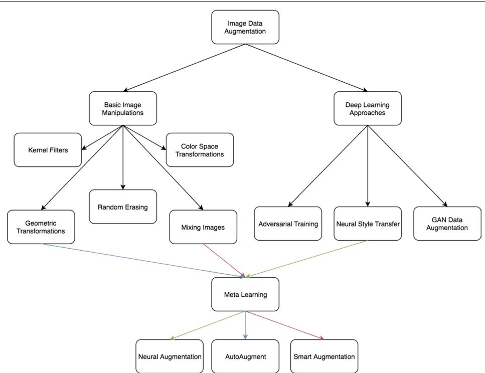  
Fig. 2 A taxonomy of image data augmentations covered; the colored lines in the fgure depict which data augmentation method the corresponding meta-learning scheme uses, for example, meta-learning using Neural Style Transfer is covered in neural augmentation [36]

Before discussing image augmentation techniques, it is useful to frame the context of the problem and consider what makes image recognition such a difcult task in the frst place. In classic discriminative examples such as cat versus dog, the image recognition software must overcome issues of viewpoint, lighting, occlusion, background, scale, and more. Te task of Data Augmentation is to bake these translational invariances into the dataset such that the resulting models will perform well despite these challenges.

It is a generally accepted notion that bigger datasets result in better Deep Learning models [23, 24]. However, assembling enormous datasets can be a very daunting task due to the manual efort of collecting and labeling data. Limited datasets is an especially prevalent challenge in medical image analysis. Given big data, deep convolutional networks have been shown to be very powerful for medical image analysis tasks such as skin lesion classifcation as demonstrated by Esteva et  al. [25]. Tis has inspired the use of CNNs on medical image analysis tasks [26] such as liver lesion classifcation, brain scan analysis, continued research in skin lesion classifcation, and more. Many of the images studied are derived from computerized tomography (CT) and magnetic resonance imaging (MRI) scans, both of which are expensive and labor-intensive to collect. It is especially difcult to build big medical image datasets due to the rarity of diseases, patient privacy, the requirement of medical experts for labeling, and the expense and manual efort needed to conduct medical imaging processes. Tese obstacles have led to many studies on image Data Augmentation, especially GAN-based oversampling, from the application perspective of medical image classifcation.

Many studies on the efectiveness of Data Augmentation utilize popular academic image datasets to benchmark results. Tese datasets include MNIST hand written digit recognition, CIFAR-10/100, ImageNet, tiny-imagenet-200, SVHN (street view house numbers), Caltech-101/256, MIT places, MIT-Adobe 5K dataset, Pascal VOC, and Stanford Cars. Te datasets most frequently discussed are CIFAR-10, CIFAR-100, and ImageNet. Te expansion of open-source datasets has given researchers a wide variety of cases to compare performance results of Data Augmentation techniques. Most of these datasets such as ImageNet would be classifed as big data. Many experiments constrain themselves to a subset of the dataset to simulate limited data problems.

In addition to our focus on limited datasets, we will also consider the problem of class imbalance and how Data Augmentation can be a useful oversampling solution. Class imbalance describes a dataset with a skewed ratio of majority to minority samples. Leevy et  al. [27] describe many of the existing solutions to high-class imbalance across data types. Our survey will show how class-balancing oversampling in image data can be done with Data Augmentation.

Many aspects of Deep Learning and neural network models draw comparisons with human intelligence. For example, a human intelligence anecdote of transfer learning is illustrated in learning music. If two people are trying to learn how to play the guitar, and one already knows how to play the piano, it seems likely that the piano-player will learn to play the guitar faster. Analogous to learning music, a model that can classify ImageNet images will likely perform better on CIFAR-10 images than a model with random weights.

Data Augmentation is similar to imagination or dreaming. Humans imagine diferent scenarios based on experience. Imagination helps us gain a better understanding of our world. Data Augmentation methods such as GANs and Neural Style Transfer can ‘imagine’ alterations to images such that they have a better understanding of them. Te remainder of the paper is organized as follows: A brief “Background” is provided to give readers a historical context of Data Augmentation and Deep Learning. “Image Data Augmentation techniques” discusses each image augmentation technique in detail along with experimental results. “Design considerations for image Data Augmentation” discusses additional characteristics of augmentation such as test-time augmentation and the impact of image resolution. Te paper concludes with a “Discussion” of the presented material, areas of “Future work”, and “Conclusion”.

# Background

Image augmentation in the form of data warping can be found in LeNet-5 [28]. Tis was one of the frst applications of CNNs on handwritten digit classifcation. Data augmentation has also been investigated in oversampling applications. Oversampling is a technique used to re-sample imbalanced class distributions such that the model is not overly biased towards labeling instances as the majority class type. Random Oversampling (ROS) is a naive approach which duplicates images randomly from the minority class until a desired class ratio is achieved. Intelligent oversampling techniques date back to SMOTE (Synthetic Minority Over-sampling Technique), which was developed by Chawla et al. [29]. SMOTE and the extension of Borderline-SMOTE [30] create new instances by interpolating new points from existing instances via k-Nearest Neighbors. Te primary focus of this technique was to alleviate problems due to class imbalance, and SMOTE was primarily used for tabular and vector data.

Te AlexNet CNN architecture developed by Krizhevsky et  al. [1] revolutionized image classifcation by applying convolutional networks to the ImageNet dataset. Data Augmentation is used in their experiments to increase the dataset size by a magnitude of 2048. Tis is done by randomly cropping $2 2 4 \times 2 2 4$ patches from the original images, fipping them horizontally, and changing the intensity of the RGB channels using PCA color augmentation. Tis Data Augmentation helped reduce overftting when training a deep neural network. Te authors claim that their augmentations reduced the error rate of the model by over $1 \%$ .

Since then, GANs were introduced in 2014 [31], Neural Style Transfer [32] in 2015, and Neural Architecture Search (NAS) [33] in 2017. Various works on GAN extensions such as DCGANs, CycleGANs and Progressively-Growing GANs [34] were published in 2015, 2017, and 2017, respectively. Neural Style Transfer was sped up with the development of Perceptual Losses by Johnson et al. [35] in 2016. Applying metalearning concepts from NAS to Data Augmentation has become increasingly popular with works such as Neural Augmentation [36], Smart Augmentation [37], and AutoAugment [38] published in 2017, 2017, and 2018, respectively.

Applying Deep Learning to medical imaging has been a popular application for CNNs since they became so popular in 2012. Deep Learning and medical imaging became increasingly popular with the demonstration of dermatologist-level skin cancer detection by Esteva et al. [25] in 2017.

Te use of GANs in medical imaging is well documented in a survey by Yi et  al. [39]. Tis survey covers the use of GANs in reconstruction such as CT denoising [40], accelerated magnetic resonance imaging [41], PET denoising [42], and the application of super-resolution GANs in retinal vasculature segmentation [43]. Additionally, Yi et al. [39] cover the use of GAN image synthesis in medical imaging applications such as brain MRI synthesis [44, 45], lung cancer diagnosis [46], high-resolution skin lesion synthesis [47], and chest $\mathbf { x }$ -ray abnormality classifcation [48]. GAN-based image synthesis Data Augmentation was used by Frid-Adar et al. [49] in 2018 for liver lesion classifcation. Tis improved classifcation performance from $7 8 . 6 \%$ sensitivity and $8 8 . 4 \%$ specifcity using classic augmentations to $8 5 . 7 \%$ sensitivity and $9 2 . 4 \%$ specifcity using GAN-based Data Augmentation.

Most of the augmentations covered focus on improving Image Recognition models. Image Recognition is when a model predicts an output label such as ‘dog’ or ‘cat’ given an input image.

However, it is possible to extend results from image recognition to other Computer Vision tasks such as Object Detection led by the algorithms YOLO [50], R-CNN [51], fast R-CNN [52], and faster R-CNN [53] or Semantic Segmentation [54] including algorithms such as U-Net [55].

# Image Data Augmentation techniques

Te earliest demonstrations showing the efectiveness of Data Augmentations come from simple transformations such as horizontal fipping, color space augmentations, and random cropping. Tese transformations encode many of the invariances discussed earlier that present challenges to image recognition tasks. Te augmentations listed in this survey are geometric transformations, color space transformations, kernel flters, mixing images, random erasing, feature space augmentation, adversarial training, GAN-based augmentation, neural style transfer, and meta-learning schemes. Tis section will explain how each augmentation algorithm works, report experimental results, and discuss disadvantages of the augmentation technique.

# Data Augmentations based on basic image manipulations

# Geometric transformations

Tis section describes diferent augmentations based on geometric transformations and many other image processing functions. Te class of augmentations discussed below could be characterized by their ease of implementation. Understanding these transformations will provide a useful base for further investigation into Data Augmentation techniques.

We will also describe the diferent geometric augmentations in the context of their ‘safety’ of application. Te safety of a Data Augmentation method refers to its likelihood of preserving the label post-transformation. For example, rotations and fips are generally safe on ImageNet challenges such as cat versus dog, but not safe for digit recognition tasks such as 6 versus 9. A non-label preserving transformation could potentially strengthen the model’s ability to output a response indicating that it is not confdent about its prediction. However, achieving this would require refned labels [56] post-augmentation. If the label of the image after a non-label preserving transformation is something like [0.5 0.5], the model could learn more robust confdence predictions. However, constructing refned labels for every non-safe Data Augmentation is a computationally expensive process.

Due to the challenge of constructing refned labels for post-augmented data, it is important to consider the ‘safety’ of an augmentation. Tis is somewhat domain dependent, providing a challenge for developing generalizable augmentation policies, (see AutoAugment [38] for further exploration into fnding generalizable augmentations). Tere is no image processing function that cannot result in a label changing transformation at some distortion magnitude. Tis demonstrates the data-specifc design of augmentations and the challenge of developing generalizable augmentation policies. Tis is an important consideration with respect to the geometric augmentations listed below.

# Flipping

Horizontal axis fipping is much more common than fipping the vertical axis. Tis augmentation is one of the easiest to implement and has proven useful on datasets such as CIFAR-10 and ImageNet. On datasets involving text recognition such as MNIST or SVHN, this is not a label-preserving transformation.

# Color space

Digital image data is usually encoded as a tensor of the dimension ( $\mathrm { \sf { r e i g h t } } \times \mathrm { \mathbf { w i d t h } } \times \mathrm { \mathbf { c o l o } }$ r channels). Performing augmentations in the color channels space is another strategy that is very practical to implement. Very simple color augmentations include isolating a single color channel such as R, G, or B. An image can be quickly converted into its representation in one color channel by isolating that matrix and adding 2 zero matrices from the other color channels. Additionally, the RGB values can be easily manipulated with simple matrix operations to increase or decrease the brightness of the image. More advanced color augmentations come from deriving a color histogram describing the image. Changing the intensity values in these histograms results in lighting alterations such as what is used in photo editing applications.

# Cropping

Cropping images can be used as a practical processing step for image data with mixed height and width dimensions by cropping a central patch of each image. Additionally, random cropping can also be used to provide an efect very similar to translations. Te contrast between random cropping and translations is that cropping will reduce the size of the input such as $( 2 5 6 , 2 5 6 )  ( 2 2 4 , 2 2 4 )$ , whereas translations preserve the spatial dimensions of the image. Depending on the reduction threshold chosen for cropping, this might not be a label-preserving transformation.

# Rotation

Rotation augmentations are done by rotating the image right or left on an axis between $1 ^ { \circ }$ and $3 5 9 ^ { \circ }$ . Te safety of rotation augmentations is heavily determined by the rotation degree parameter. Slight rotations such as between 1 and 20 or $^ { - 1 }$ to $^ { - 2 0 }$ could be useful on digit recognition tasks such as MNIST, but as the rotation degree increases, the label of the data is no longer preserved post-transformation.

# Translation

Shifting images left, right, up, or down can be a very useful transformation to avoid positional bias in the data. For example, if all the images in a dataset are centered, which is common in face recognition datasets, this would require the model to be tested on perfectly centered images as well. As the original image is translated in a direction, the remaining space can be flled with either a constant value such as 0 s or $2 5 5 \ \mathsf { s }$ , or it can be flled with random or Gaussian noise. Tis padding preserves the spatial dimensions of the image post-augmentation.

# Noise injection

Noise injection consists of injecting a matrix of random values usually drawn from a Gaussian distribution. Noise injection is tested by Moreno-Barea et  al. [57] on nine datasets from the UCI repository [58]. Adding noise to images can help CNNs learn more robust features.

Geometric transformations are very good solutions for positional biases present in the training data. Tere are many potential sources of bias that could separate the distribution of the training data from the testing data. If positional biases are present, such as in a facial recognition dataset where every face is perfectly centered in the frame, geometric transformations are a great solution. In addition to their powerful ability to overcome positional biases, geometric transformations are also useful because they are easily implemented. Tere are many imaging processing libraries that make operations such as horizontal fipping and rotation painless to get started with. Some of the disadvantages of geometric transformations include additional memory, transformation compute costs, and additional training time. Some geometric transformations such as translation or random cropping must be manually observed to make sure they have not altered the label of the image. Finally, in many of the application domains covered such as medical image analysis, the biases distancing the training data from the testing data are more complex than positional and translational variances. Terefore, the scope of where and when geometric transformations can be applied is relatively limited.

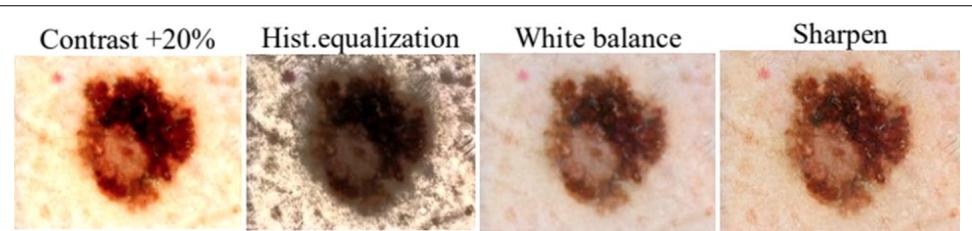  
Fig. 3 Examples of Color Augmentations provided by Mikolajczyk and Grochowski [72] in the domain of melanoma classifcation

# Color space transformations

Image data is encoded into 3 stacked matrices, each of size height $\times$ width. Tese matrices represent pixel values for an individual RGB color value. Lighting biases are amongst the most frequently occurring challenges to image recognition problems. Terefore, the efectiveness of color space transformations, also known as photometric transformations, is fairly intuitive to conceptualize. A quick fx to overly bright or dark images is to loop through the images and decrease or increase the pixel values by a constant value. Another quick color space manipulation is to splice out individual RGB color matrices. Another transformation consists of restricting pixel values to a certain min or max value. Te intrinsic representation of color in digital images lends itself to many strategies of augmentation.

Color space transformations can also be derived from image-editing apps. An image’s pixel values in each RGB color channel is aggregated to form a color histogram. Tis histogram can be manipulated to apply flters that change the color space characteristics of an image.

Tere is a lot of freedom for creativity with color space augmentations. Altering the color distribution of images can be a great solution to lighting challenges faced by testing data (Figs. 3, 4).

Image datasets can be simplified in representation by converting the RGB matrices into a single grayscale image. This results in smaller images, height $\times$ width $\times 1$ , resulting in faster computation. However, this has been shown to reduce performance accuracy. Chatifled et  al. [59] found a $\sim 3 \%$ classification accuracy drop between grayscale and RGB images with their experiments on ImageNet [12] and the PASCAL [60] VOC dataset. In addition to RGB versus grayscale images, there are many other ways of representing digital color such as HSV (Hue, Saturation, and Value). Jurio et al. [61] explore the performance of Image Segmentation on many different color space representations from RGB to YUV, CMY, and HSV.

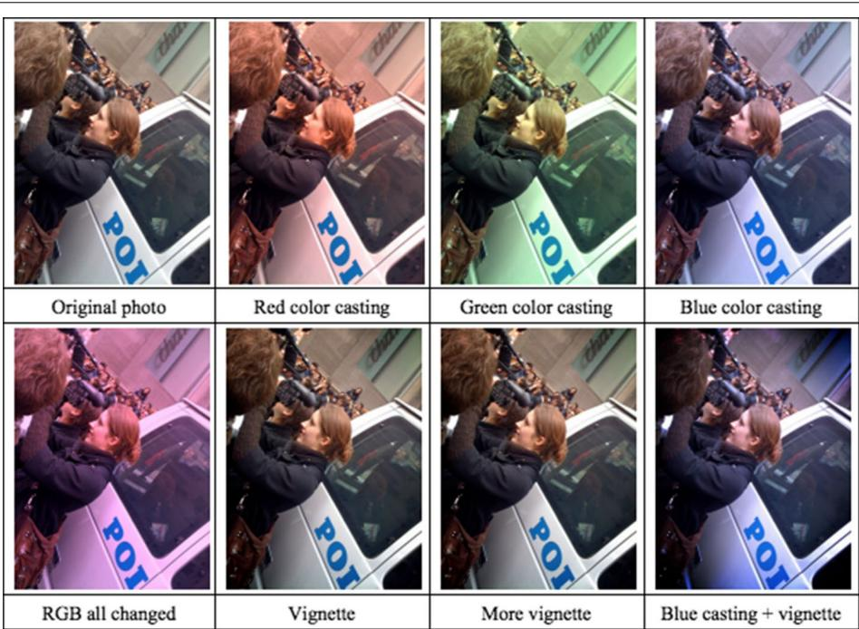  
Fig. 4 Examples of color augmentations tested by Wu et al. [127]

Similar to geometric transformations, a disadvantage of color space transformations is increased memory, transformation costs, and training time. Additionally, color transformations may discard important color information and thus are not always a label-preserving transformation. For example, when decreasing the pixel values of an image to simulate a darker environment, it may become impossible to see the objects in the image. Another indirect example of non-label preserving color transformations is in Image Sentiment Analysis [62]. In this application, CNNs try to visually predict the sentiment score of an image such as: highly negative, negative, neutral, positive, or highly positive. One indicator of a negative/highly negative image is the presence of blood. The dark red color of blood is a key component to distinguish blood from water or paint. If color space transforms repeatedly change the color space such that the model cannot recognize red blood from green paint, the model will perform poorly on Image Sentiment Analysis. In effect, color space transformations will eliminate color biases present in the dataset in favor of spatial characteristics. However, for some tasks, color is a very important distinctive feature.

Table 1 Results of Taylor and  Nitschke’s Data Augmentation experiments on  Caltech101 [63]   

<table><tr><td></td><td>Top-1 accuracy (%)</td><td>Top-5 accuracy (%)</td></tr><tr><td>Baseline</td><td>48.13 ±0.42</td><td>64.50 ±0.65</td></tr><tr><td>Flipping</td><td>49.73±1.13</td><td>67.36±138</td></tr><tr><td>Rotating</td><td>50.80 ± 0.63</td><td>69.41± 0.48</td></tr><tr><td>Cropping</td><td>61.95 + 1.01</td><td>79.10±0.80</td></tr><tr><td>Color Jittering</td><td>49.57±0.53</td><td>67.18±0.42</td></tr><tr><td>Edge Enhancement</td><td>49.29 + 1.16</td><td>66.49 + 0.84</td></tr><tr><td>Fancy PCA</td><td>49.41 ± 0.84</td><td>67.54±1.01</td></tr></table>

Their results fnd that the cropping geometric transformation results in the most accurate classifer The italic value denote high performance according to the comparative metrics

# Geometric versus photometric transformations

Taylor and Nitschke [63] provide a comparative study on the efectiveness of geometric and photometric (color space) transformations. Te geometric transformations studied were fipping, $- 3 0 ^ { \circ }$ to $3 0 ^ { \circ }$ rotations, and cropping. Te color space transformations studied were color jittering, (random color manipulation), edge enhancement, and PCA. Tey tested these augmentations with 4-fold cross-validation on the Caltech101 dataset fltered to 8421 images of size $2 5 6 \times 2 5 6$ (Table 1).

# Kernel flters

Kernel flters are a very popular technique in image processing to sharpen and blur images. Tese flters work by sliding an $n \times n$ matrix across an image with either a Gaussian blur flter, which will result in a blurrier image, or a high contrast vertical or horizontal edge flter which will result in a sharper image along edges. Intuitively, blurring images for Data Augmentation could lead to higher resistance to motion blur during testing. Additionally, sharpening images for Data Augmentation could result in encapsulating more details about objects of interest.

Sharpening and blurring are some of the classical ways of applying kernel flters to images. Kang et  al. [64] experiment with a unique kernel flter that randomly swaps the pixel values in an $n \times n$ sliding window. Tey call this augmentation technique PatchShufe Regularization. Experimenting across diferent flter sizes and probabilities of shufing the pixels at each step, they demonstrate the efectiveness of this by achieving a $5 . 6 6 \%$ error rate on CIFAR-10 compared to an error rate of $6 . 3 3 \%$ achieved without the use of PatchShufe Regularization. Te hyperparameter settings that achieved this consisted of $2 \times 2$ flters and a 0.05 probability of swapping. Tese experiments were done using the ResNet [3] CNN architecture (Figs. 5, 6).

Kernel flters are a relatively unexplored area for Data Augmentation. A disadvantage of this technique is that it is very similar to the internal mechanisms of CNNs. CNNs have parametric kernels that learn the optimal way to represent images layer-by-layer. For example, something like PatchShufe Regularization could be implemented with a convolution layer. Tis could be achieved by modifying the standard convolution layer parameters such that the padding parameters preserve spatial resolution and the subsequent activation layer keeps pixel values between 0 and 255, in contrast to something like a sigmoid activation which maps pixels to values between 0 and 1. Terefore kernel flters can be better implemented as a layer of the network rather than as an addition to the dataset through Data Augmentation.

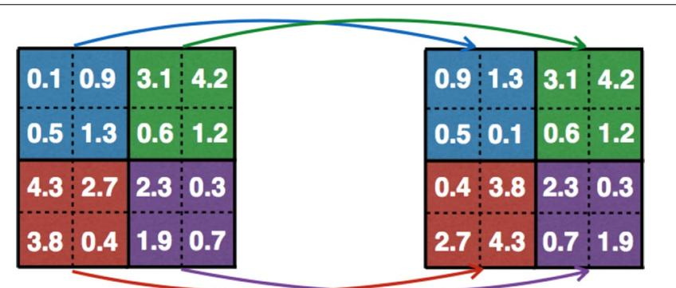  
Fig. 5 Examples of applying the PatchShufe regularization technique [64]

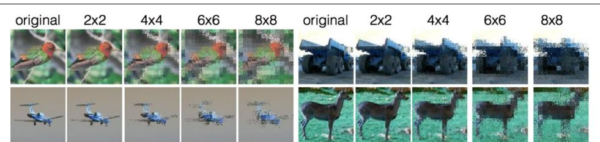  
Fig. 6 Pixels in a $n \times \mathsf n$ window are randomly shifted with a probability parameter p

# Mixing images

Mixing images together by averaging their pixel values is a very counterintuitive approach to Data Augmentation. Te images produced by doing this will not look like a useful transformation to a human observer. However, Ionue [65] demonstrated how the pairing of samples could be developed into an efective augmentation strategy. In this experiment, two images are randomly cropped from $2 5 6 \times 2 5 6$ to $2 2 4 \times 2 2 4$ and randomly fipped horizontally. Tese images are then mixed by averaging the pixel values for each of the RGB channels. Tis results in a mixed image which is used to train a classifcation model. Te label assigned to the new image is the same as the frst randomly selected image (Fig. 7).

On the CIFAR-10 dataset, Ionue reported a reduction in error rate from 8.22 to $6 . 9 3 \%$ when using the SamplePairing Data Augmentation technique. Te researcher found even better results when testing a reduced size dataset, reducing CIFAR-10 to 1000 total samples with 100 in each class. With the reduced size dataset, SamplePairing resulted in an error rate reduction from 43.1 to $3 1 . 0 \%$ . Te reduced CIFAR-10 results demonstrate the usefulness of the SamplePairing technique in limited data applications (Fig. 8).

Another detail found in the study is that better results were obtained when mixing images from the entire training set rather than from instances exclusively belonging to the same class. Starting from a training set of size N, SamplePairing produces a dataset of size $\mathrm { N } ^ { 2 } { + } \mathrm { N }$ . In addition, Sample Pairing can be stacked on top of other augmentation techniques. For example, if using the augmentations demonstrated in the AlexNet paper by Krizhevsky et al. [1], the $2 0 4 8 \times$ dataset increase can be further expanded to $( 2 0 4 8 \times \mathrm { N } ) ^ { 2 }$ .

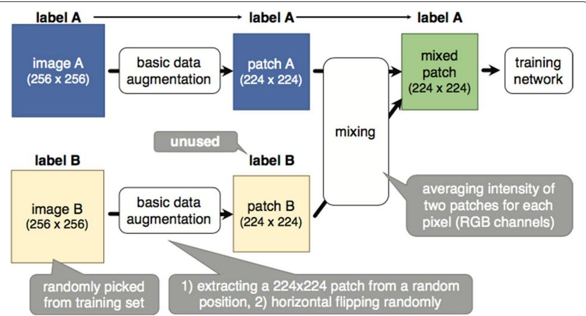  
Fig. 7 SamplePairing augmentation strategy [65]

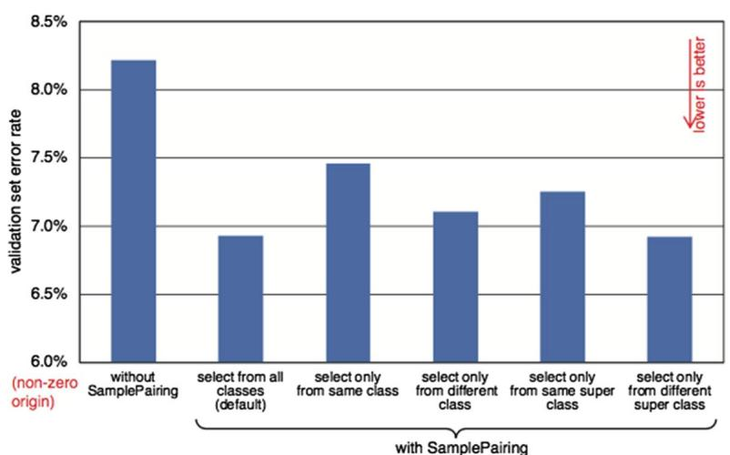  
Fig. 8 Results on the reduced CIFAR-10 dataset. Experimental results demonstrated with respect to sampling pools for image mixing [65]

Te concept of mixing images in an unintuitive way was further investigated by Summers and Dinneen [66]. Tey looked at using non-linear methods to combine images into new training instances. All of the methods they used resulted in better performance compared to the baseline models (Fig. 9).

Amongst these non-linear augmentations tested, the best technique resulted in a reduction from 5.4 to $3 . 8 \%$ error on CIFAR-10 and $2 3 . 6 \%$ to $1 9 . 7 \%$ on CIFAR-100. In like manner, Liang et  al. [67] used GANs to produce mixed images. Tey found that the inclusion of mixed images in the training data reduced training time and increased the diversity of GAN-samples. Takahashi and Matsubara [68] experiment with another approach to mixing images that randomly crops images and concatenates the croppings together to form new images as depicted below. Te results of their technique, as well as SamplePairing and mixup augmentation, demonstrate the sometimes unreasonable efectiveness of big data with Deep Learning models (Fig. 10).

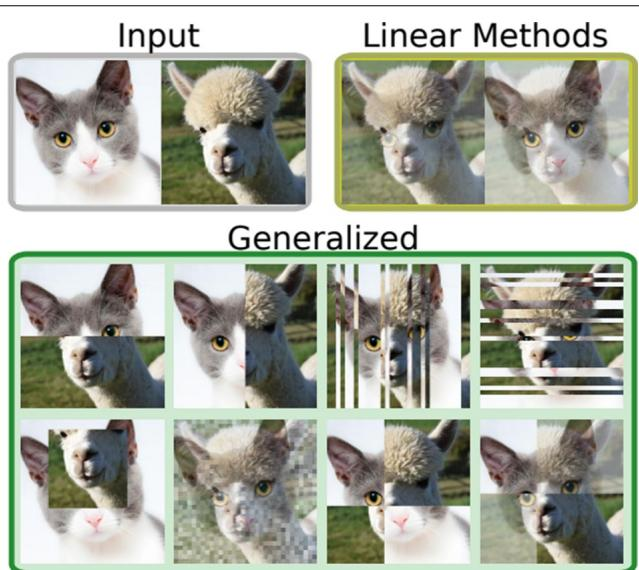  
Fig. 9 Non-linearly mixing images [66]

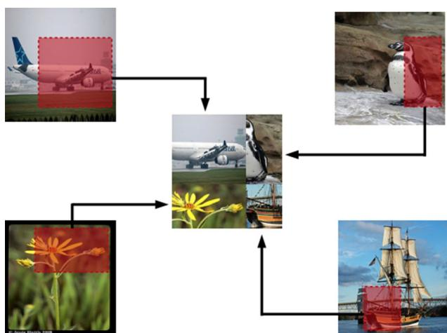  
Fig. 10 Mixing images through random image cropping and patching [68]

An obvious disadvantage of this technique is that it makes little sense from a human perspective. Te performance boost found from mixing images is very difcult to understand or explain. One possible explanation for this is that the increased dataset size results in more robust representations of low-level characteristics such as lines and edges. Testing the performance of this in comparisons to transfer learning and pretraining methods is an interesting area for future work. Transfer learning and pretraining are other techniques that learn low-level characteristics in CNNs. Additionally, it will be interesting to see how the performance changes if we partition the training data such that the frst 100 epochs are trained with original and mixed images and the last 50 with original images only. Tese kinds of strategies are discussed further in Design Considerations of Data Augmentation with respect to curriculum learning [69]. Additionally, the paper will cover a meta-learning technique developed by Lemley et al. [37] that uses a neural network to learn an optimal mixing of images.

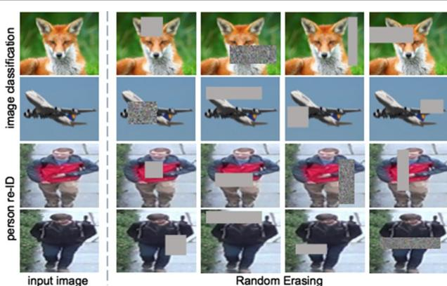  
Fig. 11 Example of random erasing on image recognition tasks [70]

# Random erasing

Random erasing [70] is another interesting Data Augmentation technique developed by Zhong et al. Inspired by the mechanisms of dropout regularization, random erasing can be seen as analogous to dropout except in the input data space rather than embedded into the network architecture. Tis technique was specifcally designed to combat image recognition challenges due to occlusion. Occlusion refers to when some parts of the object are unclear. Random erasing will stop this by forcing the model to learn more descriptive features about an image, preventing it from overftting to a certain visual feature in the image. Aside from the visual challenge of occlusion, in particular, random erasing is a promising technique to guarantee a network pays attention to the entire image, rather than just a subset of it.

Random erasing works by randomly selecting an $\mathbf { n } \times \mathbf { m }$ patch of an image and masking it with either 0 s, $2 5 5 \ : s$ , mean pixel values, or random values. On the CIFAR-10 dataset this resulted in an error rate reduction from 5.17 to $4 . 3 1 \%$ . Te best patch fll method was found to be random values. Te fll method and size of the masks are the only parameters that need to be hand-designed during implementation (Figs. 11, 12).

Random erasing is a Data Augmentation method that seeks to directly prevent overftting by altering the input space. By removing certain input patches, the model is forced to fnd other descriptive characteristics. Tis augmentation method can also be stacked on top of other augmentation techniques such as horizontal fipping or color flters. Random erasing produced one of the highest accuracies on the CIFAR-10 dataset. DeVries and Taylor [71] conducted a similar study called Cutout Regularization. Like the random erasing study, they experimented with randomly masking regions of the image (Table 2).

Mikolajcyzk and Grochowski [72] presented an interesting idea to combine random erasing with GANs designed for image inpainting. Image inpainting describes the task of flling in a missing piece of an image. Using a diverse collection of GAN inpainters, the random erasing augmentation could seed very interesting extrapolations. It will be interesting to see if better results can be achieved by erasing diferent shaped patches such as circles rather than $n \times m$ rectangles. An extension of this will be to parameterize the geometries of random erased patches and learn an optimal erasing confguration.

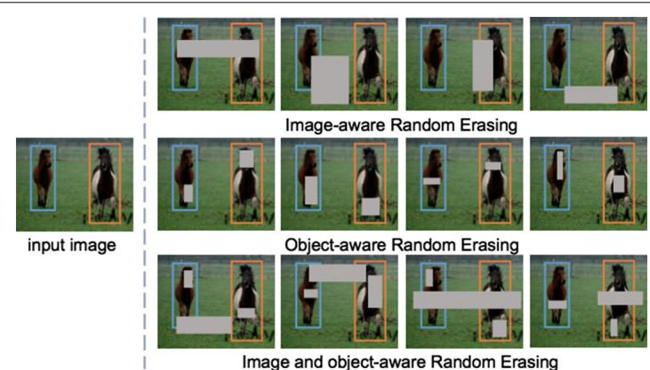  
Fig. 12 Example of random erasing on object detection tasks [70]

Table 2 Results of  Cutout Regularization [104], plus  denotes using traditional augmentation methods, horizontal fipping and cropping   

<table><tr><td>Method</td><td>C10</td><td>C10+</td><td>C100</td><td>C100+</td><td>SVHN</td></tr><tr><td>ResNetl8 [5]</td><td>10.63± 0.26</td><td>4.72±0.21</td><td>36.68±0.57</td><td>22.46±0.31</td><td></td></tr><tr><td>ResNet18 + cutout</td><td>9.31±0.18</td><td>3.99±0.13</td><td>34.98±0.29</td><td>21.96±0.24</td><td>−</td></tr><tr><td>WideResNet [21]</td><td>6.97±0.22</td><td>3.87±0.08</td><td>26.06±0.22</td><td>18.8±0.08</td><td>1.60±0.05</td></tr><tr><td>WideResNet + cutout</td><td>5.54±0.08</td><td>3.08±0.16</td><td>23.94±0.15</td><td>18.41±0.27</td><td>1.30±0.03</td></tr><tr><td>Shake-shake regularization [4]</td><td>−</td><td>2.86</td><td>−</td><td>15.85</td><td>−</td></tr><tr><td>Shake-shake regularization + cutout</td><td>−</td><td>2.56± 0.07</td><td></td><td>15.20±0.21</td><td></td></tr></table>

A $2 . 5 6 \%$ error rate is obtained on CIFAR-10 using cutout and traditional augmentation methods The italic value denote high performance according to the comparative metrics

A disadvantage to random erasing is that it will not always be a label-preserving transformation. In handwritten digit recognition, if the top part of an $ { { } ^ { \prime } } 8  { { } ^ { \prime } }$ is randomly cropped out, it is not any diferent from a ${ } ^ { \prime } 6 { } .$ In many fne-grained tasks such as the Stanford Cars dataset [73], randomly erasing sections of the image (logo, etc.) may make the car brand unrecognizable. Terefore, some manual intervention may be necessary depending on the dataset and task.

# A note on combining augmentations

Of the augmentations discussed, geometric transformations, color space transformations, kernel flters, mixing images, and random erasing, nearly all of these transformations come with an associated distortion magnitude parameter as well. Tis parameter encodes the distortional diference between a $4 5 ^ { \circ }$ rotation and a $3 0 ^ { \circ }$ rotation. With a large list of potential augmentations and a mostly continuous space of magnitudes, it is easy to conceptualize the enormous size of the augmentation search space. Combining augmentations such as cropping, fipping, color shifts, and random erasing can result in massively infated dataset sizes. However, this is not guaranteed to be advantageous. In domains with very limited data, this could result in further overftting. Terefore, it is important to consider search algorithms for deriving an optimal subset of augmented data to train Deep Learning models with. More on this topic will be discussed in Design Considerations of Data Augmentation.

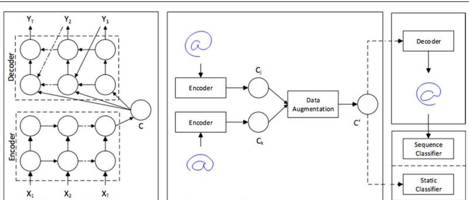  
Fig. 13 Architecture diagram of the feature space augmentation framework presented by DeVries and Taylor [75]

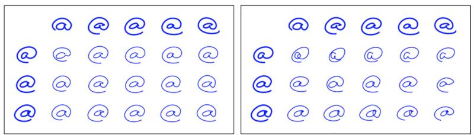  
Fig. 14 Examples of interpolated instances in the feature space on the handwritten $' \textcircled { \scriptsize { \omega } } ^ { \prime }$ character [75]

# Data Augmentations based on Deep Learning

# Feature space augmentation

All of the augmentation methods discussed above are applied to images in the input space. Neural networks are incredibly powerful at mapping high-dimensional inputs into lower-dimensional representations. Tese networks can map images to binary classes or to $n \times 1$ vectors in fattened layers. Te sequential processing of neural networks can be manipulated such that the intermediate representations can be separated from the network as a whole. Te lower-dimensional representations of image data in fully-connected layers can be extracted and isolated. Konno and Iwazume [74] fnd a performance boost on CIFAR-100 from 66 to $7 3 \%$ accuracy by manipulating the modularity of neural networks to isolate and refne individual layers after training. Lower-dimensional representations found in high-level layers of a CNN are known as the feature space. DeVries and Taylor [75] presented an interesting paper discussing augmentation in this feature space. Tis opens up opportunities for many vector operations for Data Augmentation.

SMOTE is a popular augmentation used to alleviate problems with class imbalance. Tis technique is applied to the feature space by joining the $k$ nearest neighbors to form new instances. DeVries and Taylor discuss adding noise, interpolating, and extrapolating as common forms of feature space augmentation (Figs. 13, 14).

Table 3 Performance results of the experiment with feature vs. input space extrapolation on MNIST and CIFAR-10 [75]   

<table><tr><td>Model</td><td>MNIST</td><td>CIFAR-10</td></tr><tr><td>Baseline</td><td>1.093±0.057</td><td>30.65± 0.27</td></tr><tr><td>Baseline + input space affine transformations</td><td>1.477±0.068</td><td></td></tr><tr><td>Baseline + input space extrapolation</td><td>1.010±0.065</td><td>−</td></tr><tr><td>Baseline + feature space extrapolation</td><td>0.950 ± 0.036</td><td>29.24 ± 0.27</td></tr></table>

The italic value denote high performance according to the comparative metrics

Te use of auto-encoders is especially useful for performing feature space augmentations on data. Autoencoders work by having one half of the network, the encoder, map images into low-dimensional vector representations such that the other half of the network, the decoder, can reconstruct these vectors back into the original image. Tis encoded representation is used for feature space augmentation.

DeVries and Taylor [75] tested their feature space augmentation technique by extrapolating between the 3 nearest neighbors per sample to generate new data and compared their results against extrapolating in the input space and using afne transformations in the input space (Table 3).

Feature space augmentations can be implemented with auto-encoders if it is necessary to reconstruct the new instances back into input space. It is also possible to do feature space augmentation solely by isolating vector representations from a CNN. Tis is done by cutting of the output layer of the network, such that the output is a low-dimensional vector rather than a class label. Vector representations are then found by training a CNN and then passing the training set through the truncated CNN. Tese vector representations can be used to train any machine learning model from Naive Bayes, Support Vector Machine, or back to a fully-connected multilayer network. Te efectiveness of this technique is a subject for future work.

A disadvantage of feature space augmentation is that it is very difcult to interpret the vector data. It is possible to recover the new vectors into images using an auto-encoder network; however, this requires copying the entire encoding part of the CNN being trained. For deep CNNs, this results in massive auto-encoders which are very difcult and time-consuming to train. Finally, Wong et  al. [76] fnd that when it is possible to transform images in the data-space, data-space augmentation will outperform feature space augmentation.

# Adversarial training

One of the solutions to search the space of possible augmentations is adversarial training. Adversarial training is a framework for using two or more networks with contrasting objectives encoded in their loss functions. Tis section will discuss using adversarial training as a search algorithm as well as the phenomenon of adversarial attacking. Adversarial attacking consists of a rival network that learns augmentations to images that result in misclassifcations in its rival classifcation network. Tese adversarial attacks, constrained to noise injections, have been surprisingly successful from the perspective of the adversarial network. Tis is surprising because it completely defes intuition about how these models represent images. Te adversarial attacks demonstrate that representations of images are much less robust than what might have been expected. Tis is well demonstrated by Moosavi-Dezfooli et al. [77] using DeepFool, a network that fnds the minimum possible noise injection needed to cause a misclassifcation with high confdence. Su et al. [78] show that $7 0 . 9 7 \%$ of images can be misclassifed by changing just one pixel. Zajac et  al. [79] cause misclassifcations with adversarial attacks limited to the border of images. Te success of adversarial attacks is especially exaggerated as the resolution of images increases.

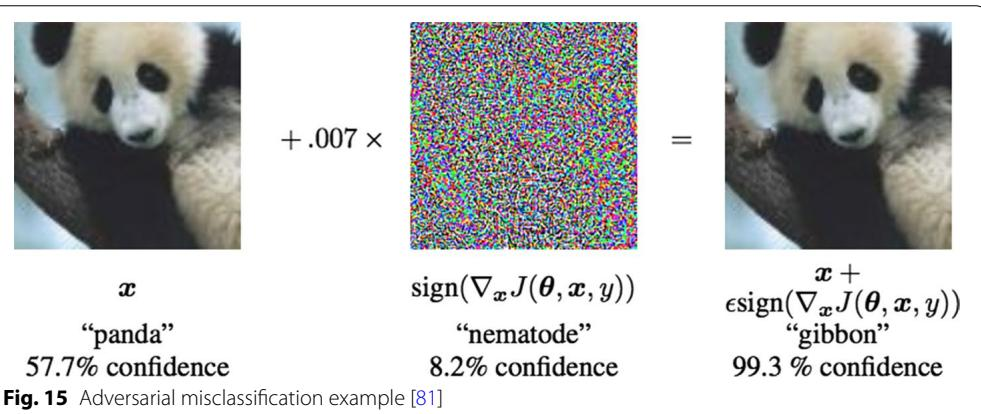

Adversarial attacking can be targeted or untargeted, referring to the deliberation in which the adversarial network is trying to cause misclassifcations. Adversarial attacks can help to illustrate weak decision boundaries better than standard classifcation metrics can.

In addition to serving as an evaluation metric, defense to adversarial attacks, adversarial training can be an efective method for searching for augmentations.

By constraining the set of augmentations and distortions available to an adversarial network, it can learn to produce augmentations that result in misclassifcations, thus forming an efective search algorithm. Tese augmentations are valuable for strengthening weak spots in the classifcation model. Terefore, adversarial training can be an efective search technique for Data Augmentation. Tis is in heavy contrast to the traditional augmentation techniques described previously. Adversarial augmentations may not represent examples likely to occur in the test set, but they can improve weak spots in the learned decision boundary.

Engstrom et  al. [80] showed that simple transformations such as rotations and translations can easily cause misclassifcations by deep CNN models. Te worst out of the random transformations reduced the accuracy of MNIST by $2 6 \%$ , CIFAR10 by $7 2 \%$ and ImageNet (Top 1) by $2 8 \%$ . Goodfellow et al. [81] generate adversarial examples to improve performance on the MNIST classifcation task. Using a technique for generating adversarial examples known as the “fast gradient sign method”, a maxout network [82] misclassifed $8 9 . 4 \%$ of adversarial examples with an average confdence of $9 7 . 6 \%$ . Tis test is done on the MNIST dataset. With adversarial training, the error rate of adversarial examples fell from $8 9 . 4 \%$ to $1 7 . 9 \%$ (Fig. 15).

Li et al. [83] experiment with a novel adversarial training approach and compare the performance on original testing data and adversarial examples. Te results displayed below show how anticipation of adversarial attacks in the training process can dramatically reduce the success of attacks.

Table 4 Test accuracies showing the  impact of  adversarial training, clean refers to  the  original testing data, FGSM refers to  adversary examples derived from  Fast Gradient Sign Method and  PGD refers to  adversarial examples derived from  Projected Gradient Descent [83]   

<table><tr><td>Models</td><td colspan="3">MNIST</td><td colspan="3">CIFAR-10</td></tr><tr><td></td><td>Clean</td><td>FGSM</td><td>PGD</td><td>Clean</td><td>FGSM</td><td>PGD</td></tr><tr><td>Standard</td><td>0.9939</td><td>0.0922</td><td>0</td><td>0.9306</td><td>0.5524</td><td>0.0256</td></tr><tr><td>Adversarially trained</td><td>0.9932</td><td>0.9492</td><td>0.0612</td><td>0.8755</td><td>0.8526</td><td>0.1043</td></tr><tr><td>Our method</td><td>0.9903</td><td>0.9713</td><td>0.9171</td><td>0.8714</td><td>0.6514</td><td>0.3440</td></tr></table>

As shown in Table 4, the adversarial training in their experiment did not improve the test accuracy. However, it does signifcantly improve the test accuracy of adversarial examples. Adversarial defense is a very interesting subject for evaluating security and robustness of Deep Learning models. Improving on the Fast Gradient Sign Method, DeepFool, developed by Moosavi-Dezfooli et al. [77], uses a neural network to fnd the smallest possible noise perturbation that causes misclassifcations.

Another interesting framework that could be used in an adversarial training context is to have an adversary change the labels of training data. Xie et al. [84] presented DisturbLabel, a regularization technique that randomly replaces labels at each iteration. Tis is a rare example of adding noise to the loss layer, whereas most of the other augmentation methods discussed add noise into the input or hidden representation layers. On the MNIST dataset with LeNet [28] CNN architecture, DisturbLabel produced a $0 . 3 2 \%$ error rate compared to a baseline error rate of $0 . 3 9 \%$ . DisturbLabel combined with Dropout Regularization produced a $0 . 2 8 \%$ error rate compared to the $0 . 3 9 \%$ baseline. To translate this to the context of adversarial training, one network takes in the classifer’s training data as input and learns which labels to fip to maximize the error rate of the classifcation network.

Te efectiveness of adversarial training in the form of noise or augmentation search is still a relatively new concept that has not been widely tested and understood. Adversarial search to add noise has been shown to improve performance on adversarial examples, but it is unclear if this is useful for the objective of reducing overftting. Future work seeks to expand on the relationship between resistance to adversarial attacks and actual performance on test datasets.

# GAN‑based Data Augmentation

Another exciting strategy for Data Augmentation is generative modeling. Generative modeling refers to the practice of creating artifcial instances from a dataset such that they retain similar characteristics to the original set. Te principles of adversarial training discussed above have led to the very interesting and massively popular generative modeling framework known as GANs. Bowles et al. [85] describe GANs as a way to “unlock” additional information from a dataset. GANs are not the only generative modeling technique that exists; however they are dramatically leading the way in computation speed and quality of results.

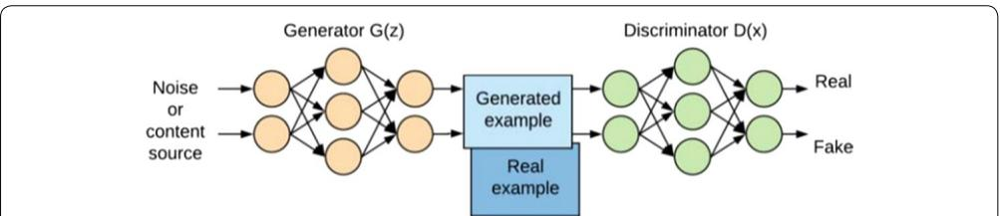  
Fig. 16 Illustration of GAN concept provided by Mikolajczyk and Grochowski [72]

Another useful strategy for generative modeling worth mentioning is variational auto-encoders. Te GAN framework can be extended to improve the quality of samples produced with variational auto-encoders [86]. Variational auto-encoders learn a lowdimensional representation of data points. In the image domain, this translates an image tensor of size $h e i g h t \times w i d t h \times c o l o r$ channels down into a vector of size $n \times 1$ , identical to what was discussed with respect to feature space augmentation. Low-dimensional constraints in vector representations will result in a poorer representation, although these constraints are better for visualization using methods such as t-SNE [87]. Imagine a vector representation of size $5 \times 1$ created by an autoencoder. Tese autoencoders can take in a distribution of labeled data and map them into this space. Tese classes could include ‘head turned left’, ‘centered head’, and ‘head turned right’. Te auto-encoder learns a low-dimensional representation of these data points such that vector operations such as adding and subtracting can be used to simulate a front view-3D rotation of a new instance. Variational auto-encoder outputs can be further improved by inputting them into GANs [31]. Additionally, a similar vector manipulation process can be done on the noise vector inputs to GANs through the use of Bidirectional GANs [88].

Te impressive performance of GANs has resulted in increased attention on how they can be applied to the task of Data Augmentation. Tese networks have the ability to generate new training data that results in better performing classifcation models. Te GAN architecture frst proposed by Ian Goodfellow [31] is a framework for generative modeling through adversarial training. Te best anecdote for understanding GANs is the analogy of a cop and a counterfeiter. Te counterfeiter (generator network) takes in some form of input. Tis could be a random vector, another image, text, and many more. Te counterfeiter learns to produce money such that the cop (discriminator network) cannot tell if the money is real or fake. Te real or fake dichotomy is analogous to whether or not the generated instance is from the training set or if it was created by the generator network (Fig. 16).

Te counterfeiter versus robber analogy is a seamless bridge to understand GANs in the context of network intrusion detection. Lin et al. [89] use a generator network to learn how to fool a black-box detection system. Tis highlights one of the most interesting characteristics of GANs. Analysis tools derived from game theory such as minimax strategy and the Nash Equilibrium [90] suggest that the generator will eventually fool the discriminator. Te success of the generator to overcome the discriminator makes it very powerful for generative modeling. GANs are the most promising generative modeling technique for use in Data Augmentation.

Te vanilla GAN architecture uses multilayer perceptron networks in the generator and discriminator networks. Tis is able to produce acceptable images on a simple image dataset such as the MNIST handwritten digits. However, it fails to produce quality results for higher resolution, more complicated datasets. In the MNIST dataset, each image is only $2 8 \times 2 8 \times 1$ for a total of 784 pixels. GANs applied to the MNIST data are able to produce convincing results. However, MNIST images are far less challenging than other image datasets due to low intra-class variance and resolution, to name a couple diferences of many. Tis is in heavy contrast with other datasets studied in most academic Computer Vision papers such as ImageNet or CIFAR-10. For immediate reference, an ImageNet image is of resolution $2 5 6 \times 2 5 6 \times 3$ , totaling 196,608 pixels, a $2 5 0 \times$ increase in pixel count compared with MNIST.

Many research papers have been published that modify the GAN framework through diferent network architectures, loss functions, evolutionary methods, and many more. Tis research has signifcantly improved the quality of samples created by GANs. Tere have been many new architectures proposed for expanding on the concept of GANs and producing higher resolution output images, many of which are out of the scope of this paper. Amongst these new architectures, DCGANs, Progressively Growing GANs, CycleGANs, and Conditional GANs seem to have the most application potential in Data Augmentation.

Te DCGAN [91] architecture was proposed to expand on the internal complexity of the generator and discriminator networks. Tis architecture uses CNNs for the generator and discriminator networks rather than multilayer perceptrons. Te DCGAN was tested to generate results on the LSUN interior bedroom image dataset, each image being $6 4 \times 6 4 \times 3$ , for a total of 12,288 pixels, (compared to 784 in MNIST). Te idea behind DCGAN is to increase the complexity of the generator network to project the input into a high dimensional tensor and then add deconvolutional layers to go from the projected tensor to an output image. Tese deconvolutional layers will expand on the spatial dimensions, for example, going from $1 4 \times 1 4 \times 6$ to $2 8 \times 2 8 \times 1$ , whereas a convolutional layer will decrease the spatial dimensions such as going from $1 4 \times 1 4 \times 3 2$ to $7 \times 7 \times 6 4$ . Te DCGAN architecture presents a strategy for using convolutional layers in the GAN framework to produce higher resolution images (Figs. 17, 18).

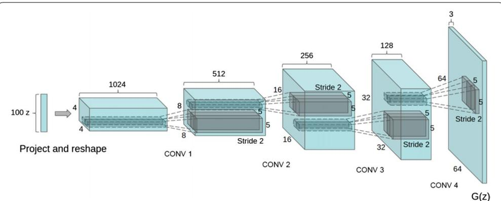  
Fig. 17 DCGAN, generator architecture presented by Radford et al. [91]

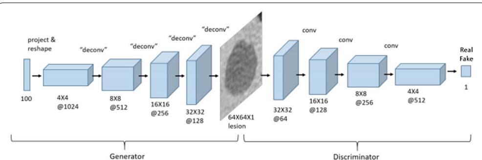  
Fig. 18 Complete DCGAN architecture used by Frid-Adar et al. [49] to generate liver lesion images

Frid-Adar et  al. [49] tested the efectiveness of using DCGANs to generate liver lesion medical images. Tey use the architecture pictured above to generate $6 4 \times 6 4 \times 1$ size images of liver lesion CT scans. Teir original dataset contains $1 8 2 \mathrm { C T }$ scans, (53 Cysts, 64 Metastases, and 65 Hemangiomas). After using classical augmentations to achieve $7 8 . 6 \%$ sensitivity and $8 8 . 4 \%$ specifcity, they observed an increase to $8 5 . 7 \%$ sensitivity and $9 2 . 4 \%$ specifcity once they added the DCGAN-generated samples.

Another architecture of interest is known as Progressively Growing GANs [34]. Tis architecture trains a series of networks with progressive resolution complexity. Tese resolutions range from $4 \times 4$ to $8 \times 8$ and so on until outputs of size $1 0 2 4 \times 1 0 2 4$ are achieved. Tis is built on the concept that GANs can accept images as input as well as random vectors. Terefore, the series of GANs work by passing samples from a lower resolution GAN up to higher-resolution GANs. Tis has produced very amazing results on facial images.

In addition to improving the resolution size of GANs, another interesting architecture that increases the quality of outputs is the CycleGAN [92] proposed by Zhu et al. CycleGAN introduces an additional Cycle-Consistency loss function to help stabilize GAN training. Tis is applied to image-to-image translation. Neural Style Transfer [32], discussed further in the section below, learns a single image to single image translation. However, CycleGAN learns to translate from a domain of images to another domain, such as horses to zebras. Tis is implemented via forward and backward consistency loss functions. A generator takes in images of horses and learns to map them to zebras such that the discriminator cannot tell if they were originally a part of the zebra set or not, as discussed above. After this, the generated zebras from horse images are passed through a network which translates them back into horses. A second discriminator determines if this re-translated image belongs to the horse set or not. Both of these discriminator losses are aggregated to form the cycle-consistency loss.

Te use of CycleGANs was tested by Zhu et  al. [93] in the task of Emotion Classifcation. Using the emotion recognition dataset, FER2013 [94], Facial Expression Recognition Database, they build a CNN classifer to recognize 7 diferent emotions: angry, disgust, fear, happy, sad, surprise, and neutral. Tese classes are imbalanced and the CycleGAN is used as a method of intelligent oversampling.

CycleGANs learned an unpaired image-to-image translation between domains. An example of the domains in this problem is neutral to disgust. Te CycleGAN learns to translate an image representing a neutral image into an image representing the disgust emotion (Figs. 19, 20).

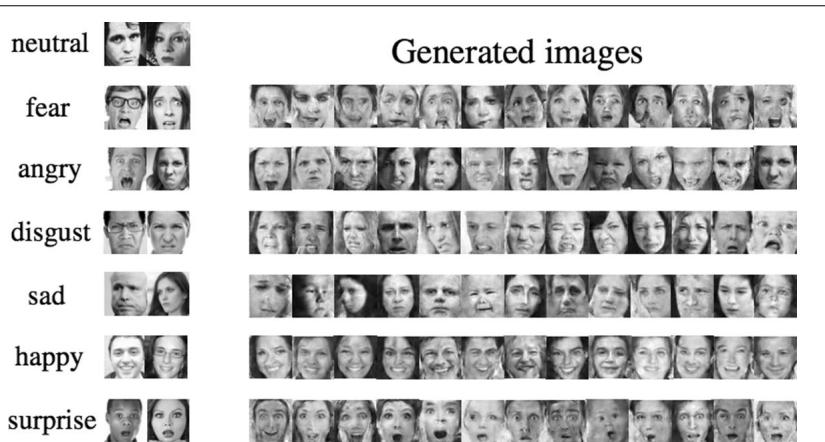  
Fig. 19 Some examples of synthetic data created with CycleGANs for emotion classifcation

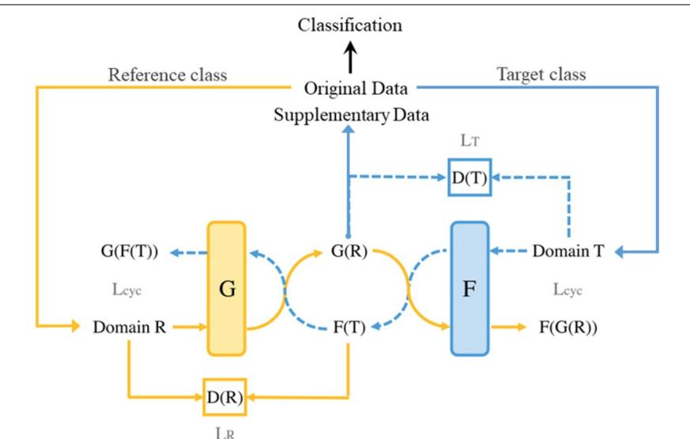  
Fig. 20 Architecture overview: G and F consist of two separate GANs composing the CycleGAN. Two images are taken from the reference and target class and used to generate new data in the target class

Using CycleGANs to translate images from the other 7 classes into the minority classes was very efective in improving the performance of the CNN model on emotion recognition. Employing these techniquess, accuracy improved $5 { - } 1 0 \%$ . To further understand the efectiveness of adding GAN-generated instances, a $\mathrm { \ t { - } S N E }$ visualization is used. t-SNE [87] is a visualization technique that learns to map between highdimensional vectors into a low-dimensional space to facilitate the visualization of decision boundaries (Fig. 21).

Another interesting GAN architecture for use in Data Augmentation is Conditional GANs [95]. Conditional GANs add a conditional vector to both the generator and the discriminator in order to alleviate problems with mode collapse. In addition to inputting a random vector $z$ to the generator, Conditional GANs also input a y vector which could be something like a one-hot encoded class label, e.g. [0 0 0 1 0]. Tis class label targets a specifc class for the generator and the discriminator (Fig. 22).

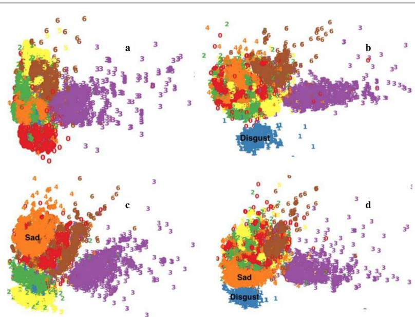  
Fig. 21 t-SNE visualization demonstrating the improved decision boundaries when using CycleGAN-generated samples. a original CNN model, b adding GAN-generated disgust images, c adding GAN-generated sad images, d adding both GAN-generated disgust and sad images [93]

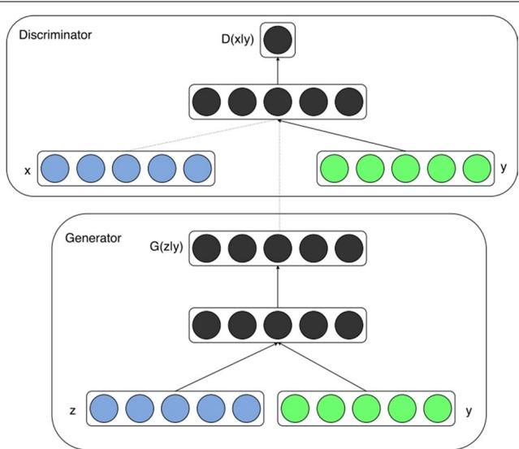  
Fig. 22 Illustration from Mirza and Osindero [95] showing how the conditional y vector is integrated into the GAN framework

Lucic et  al. [96] sought out to compare newly developed GAN loss functions. Tey conducted a series of tests that determined most loss functions can reach similar scores with enough hyperparameter optimization and random restarts. Tis suggests that increased computational power is a more promising area of focus than algorithmic changes in the generator versus discriminator loss function.

Most of the research done in applying GANs to Data Augmentation and reporting the resulting classifcation performance has been done in biomedical image analysis [39]. Tese papers have shown improved classifcation boundaries derived from training with real and generated data from GAN models. In addition, some papers measure the quality of GAN outputs by a visual Turing test. In these tests, the study asks two experts to distinguish between real and artifcial images in medical image tasks such as skin lesion classifcation and liver cancer detection. Table 5 shows that the frst and second experts were only able to correctly label $6 2 . 5 \%$ and $5 8 . 6 \%$ of the GAN-generated liver lesion images as fake. Labeling images as fake refers to their origin coming from the generator rather than an actual liver lesion image (Table 6; Fig. 23).

Table 5 Results of ‘Visual Turing Test’ on DCGAN-generated liver lesion images presented by Frid-Adar et al. [139]   

<table><tr><td></td><td colspan="3">Classification accuracy</td><td>Is ROI real?</td></tr><tr><td></td><td>Real (%)</td><td>Synthetic (%)</td><td>Total score</td><td>Total score</td></tr><tr><td>Expert 1</td><td>78</td><td>77.5</td><td>235\302=77.8%</td><td>189\302=62.5%</td></tr><tr><td>Expert 2</td><td>69.2</td><td>69.2</td><td>209\302=69.2%</td><td>177\302=58.6%</td></tr></table>

Table 6 Results of ‘Visual Turing Test’ on  diferent DCGAN- and WGAN [104]—generated brain tumor MR images presented by Han et al. [140]   

<table><tr><td></td><td>Accuracy (%)</td><td>Real selected as real</td><td>Real as synt</td><td>Synt as real</td><td>Synt as synt</td></tr><tr><td>T1 (DCGAN, 128 x 128)</td><td>70</td><td>26</td><td>24</td><td>6</td><td>44</td></tr><tr><td>Tlc (DCGAN, 128 x 128)</td><td>71</td><td>24</td><td>26</td><td>3</td><td>47</td></tr><tr><td>T2 (DCGAN, 128 x 128)</td><td>64</td><td>22</td><td>28</td><td>8</td><td>42</td></tr><tr><td>FLAIR (DCGAN, 128 x 128)</td><td>54</td><td>12</td><td>38</td><td>8</td><td>42</td></tr><tr><td>Concat (DCGAN, 128 x 128)</td><td>77</td><td>34</td><td>16</td><td>7</td><td>43</td></tr><tr><td>Concat (DCGAN, 64 x 64)</td><td>54</td><td>13</td><td>37</td><td>9</td><td>41</td></tr><tr><td>T1 (WGAN, 128 x 128)</td><td>64</td><td>20</td><td>30</td><td>6</td><td>44</td></tr><tr><td>Tlc (WGAN, 128 x 128)</td><td>55</td><td>13</td><td>37</td><td>8</td><td>42</td></tr><tr><td>T2 (WGAN, 128 x 128)</td><td>58</td><td>19</td><td>31</td><td>11</td><td>39</td></tr><tr><td>FLAIR (WGAN, 128 x 128)</td><td>62</td><td>16</td><td>34</td><td>4</td><td>46</td></tr><tr><td>Concat (WGAN, 128 x 128)</td><td>66</td><td>31</td><td>19</td><td>15</td><td>35</td></tr><tr><td>Concat (WGAN, 64 x 64)</td><td>53</td><td>18</td><td>32</td><td>15</td><td>35</td></tr></table>

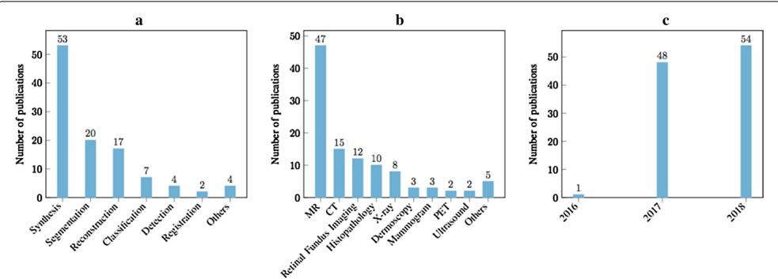  
Fig. 23 Trends in applying GANs to medical image analysis [39]

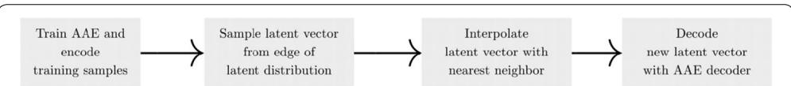  
Fig. 24 Adversarial autoencoder framework used in DOPING [97]

GAN samples can be used as an oversampling technique to solve problems with class imbalance. Lim et al. [97] show how GAN samples can be used for unsupervised anomaly detection. By oversampling rare normal samples, which are samples that occur with small probability, GANs are able to reduce the false positive rate of anomaly detection. Tey do this using the Adversarial Autoencoder framework proposed by Makhzani et al. [98] (Fig. 24).

As exciting as the potential of GANs is, it is very difcult to get high-resolution outputs from the current cutting-edge architectures. Increasing the output size of the images produced by the generator will likely cause training instability and non-convergence. Another drawback of GANs is that they require a substantial amount of data to train. Tus, depending on how limited the initial dataset is, GANs may not be a practical solution. Salimans et al. [99] provide a more complete description of the problems with training GANs.

# Neural Style Transfer

Neural Style Transfer [32] is one of the fashiest demonstrations of Deep Learning capabilities. Te general idea is to manipulate the representations of images created in CNNs. Neural Style Transfer is probably best known for its artistic applications, but it also serves as a great tool for Data Augmentation. Te algorithm works by manipulating the sequential representations across a CNN such that the style of one image can be transferred to another while preserving its original content. A more detailed explanation of the gram matrix operation powering Neural Style Transfer can be found by Li et al. [100] (Fig. 25).

It is important to also recognize an advancement of the original algorithm from Gatys et al. known as Fast Style Transfer [35]. Tis algorithm extends the loss function from a per-pixel loss to a perceptual loss and uses a feed-forward network to stylize images. Tis perceptual loss is reasoned about through the use of another pre-trained net. Te use of perceptual loss over per-pixel loss has also shown great promise in the application of super-resolution [101] as well as style transfer. Tis loss function enhancement enables style transfer to run much faster, increasing interest in practical applications. Additionally, Ulyanov et al. [102] fnd that replacing batch normalization with instance normalization results in a signifcant improvement for fast stylization (Fig. 26).

For the purpose of Data Augmentation, this is somewhat analogous to color space lighting transformations. Neural Style Transfer extends lighting variations and enables the encoding of diferent texture and artistic styles as well. Tis leaves practitioners of Data Augmentation with the decision of which styles to sample from when deriving new images via Neural Style Transfer.

Choosing which styles to sample from can be a challenging task. For applications such as self-driving cars it is fairly intuitive to think of transferring training data into a night-to-day scale, winter-to-summer, or rainy-to-sunny scale. However, in other application domains, the set of styles to transfer into is not so obvious. For ease of implementation, data augmentation via Neural Style Transfer could be done by selecting a set of $k$ styles and applying them to all images in the training set. Te work of Style Augmentation [103], avoids introducing a new form of style bias into the dataset by deriving styles at random from a distribution of 79,433 artistic images. Transferring style in training data has been tested on the transition from simulated environments to the real-world. Tis is very useful for robotic manipulation tasks using Reinforcement Learning because of potential damages to hardware when training in the real-world. Many constraints such as low-fdelity cameras cause these models to generalize poorly when trained in physics simulations and deployed in the real-world.

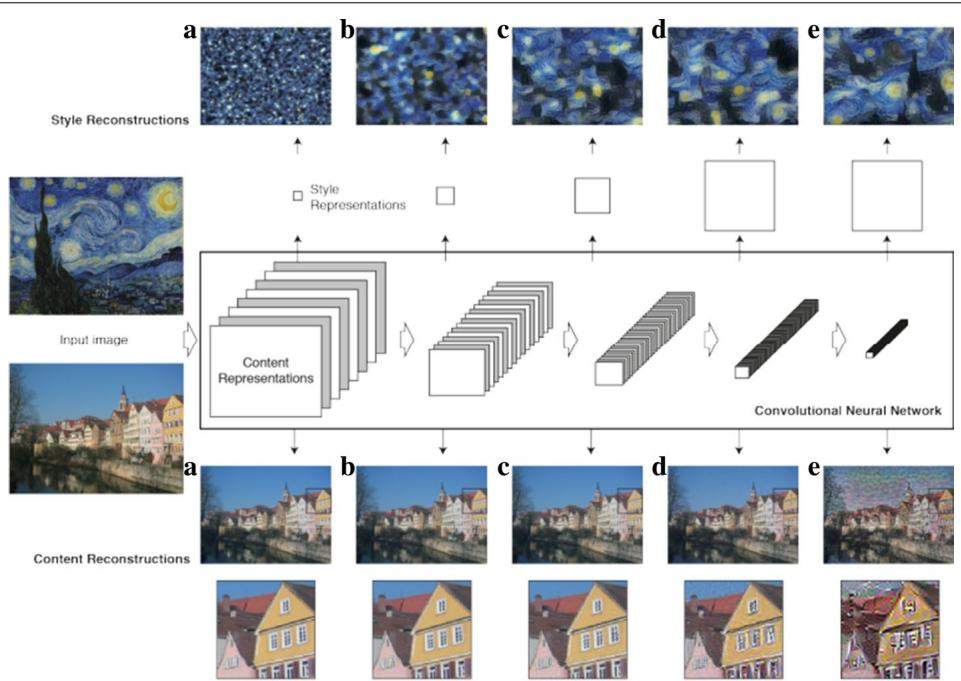  
Fig. 25 Illustration of style and content reconstructions in Neural Style Transfer [32]

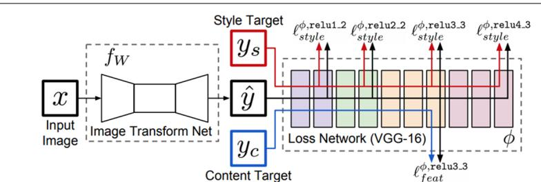  
Fig. 26 Illustration of the Fast neural style algorithm by Johnson et al. [35]

Tobin et al. [104] explore the efectiveness of using diferent styles in training simulation and achieve within $1 . 5 \mathrm { { c m } }$ accuracy in the real-world on the task of object localization. Teir experiments randomize the position and texture of the objects to be detected on the table in the simulation, as well as the texture, lighting, number of lights, and random noise in the background. Tey found that with enough variability in the training data style, the real-world simply appears as another variation to the model. Interestingly, they found that diversity in styles was more efective than simulating in as realistic of an environment as possible. Tis is in contrast to the work of Shrivastava et al. [105] who used GANs to make their simulated data as realistic as possible (Fig. 27).

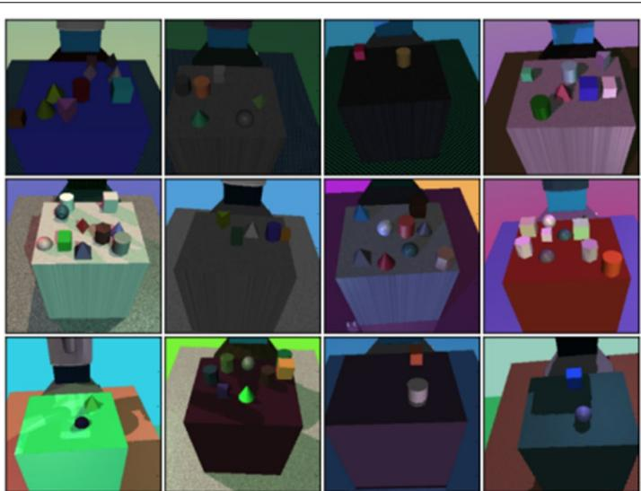  
Fig. 27 Examples of diferent styles simulated by Tobin et al. [104]

Using simulated data to build Computer Vision models has been heavily investigated. One example of this is from Richter et al. [106]. Tey use computer graphics from modern open-world games such as Grand Teft Auto to produce semantic segmentation datasets. Te authors highlight anecdotes of the manual annotation costs required to build these pixel-level datasets. Tey mention the CamVid dataset [107] requires $6 0 \mathrm { { m i n } }$ per image to manually annotate, and the Cityscapes dataset [108] requires $9 0 \ \mathrm { m i n }$ per image. Tis high labor and time cost motivates the use and development of synthetic datasets. Neural Style Transfer is a very interesting strategy to improve the generalization ability of simulated datasets.

A disadvantage of Neural Style Transfer Data Augmentation is the efort required to select styles to transfer images into. If the style set is too small, further biases could be introduced into the dataset. Trying to replicate the experiments of Tobin et al. [104] will require a massive amount of additional memory and compute to transform and store 79,433 new images from each image. Te original algorithm proposed by Gatys et  al. [32] has a very slow running time and is therefore not practical for Data Augmentation. Te algorithm developed by Johnson et  al. [35] is much faster, but limits transfer to a pre-trained set of styles.

# Meta learning Data Augmentations

Te concept of meta-learning in Deep Learning research generally refers to the concept of optimizing neural networks with neural networks. Tis approach has become very popular since the publication of NAS [33] from Zoph and Le. Real et al. [109, 110] also show the efectiveness of evolutionary algorithms for architecture search. Salimans et al. [111] directly compare evolutionary strategies with Reinforcement Learning. Another interesting alternative to Reinforcement Learning is simple random search [112]. Utilizing evolutionary and random search algorithms is an interesting area of future work, but the meta-learning schemes reviewed in this survey are all neural-network, gradient-based.

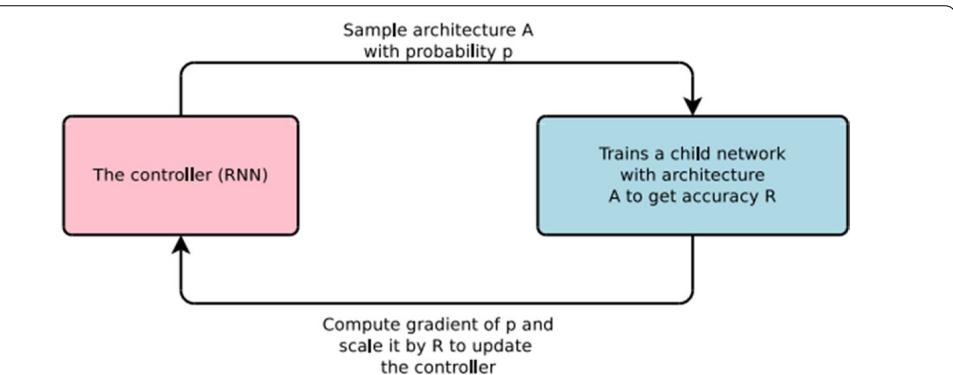  
Fig. 28 Concept behind Neural Architecture Search [33]

Te history of Deep Learning advancement from feature engineering such as SIFT [113] and HOG [114] to architecture design such as AlexNet [1], VGGNet [2], and Inception-V3 [4], suggest that meta-architecture design is the next paradigm shift. NAS takes a novel approach to meta-learning architectures by using a recurrent network trained with Reinforcement Learning to design architectures that result in the best accuracy. On the CIFAR-10 dataset, this achieved an error rate of 3.65 (Fig. 28).

Tis section will introduce three experiments using meta-learning for Data Augmentation. Tese methods use a prepended neural network to learn Data Augmentations via mixing images, Neural Style Transfer, and geometric transformations.

Neural augmentation Te Neural Style Transfer algorithm requires two parameters for the weights of the style and content loss. Perez and Wang [36] presented an algorithm to meta-learn a Neural Style Transfer strategy called Neural Augmentation. Te Neural Augmentation approach takes in two random images from the same class. Te prepended augmentation net maps them into a new image through a CNN with 5 layers, each with 16 channels, $3 \times 3$ flters, and ReLU activation functions. Te image outputted from the augmentation is then transformed with another random image via Neural Style Transfer. Tis style transfer is carried out via the CycleGAN [92] extension of the GAN [31] framework. Tese images are then fed into a classifcation model and the error from the classifcation model is backpropagated to update the Neural Augmentation net. Te Neural Augmentation network uses this error to learn the optimal weighting for content and style images between diferent images as well as the mapping between images in the CNN (Fig. 29).

Perez and Wang tested their algorithm on the MNIST and Tiny-imagenet-200 datasets on binary classifcation tasks such as cat versus dog. Te Tiny-imagenet-200 dataset is used to simulate limited data. Te Tiny-imagenet-200 dataset contains only 500 images in each of the classes, with 100 set aside for validation. Tis problem limits this dataset to 2 classes. Tus there are only 800 images for training. Each of the Tiny-imagenet-200 images is $6 4 \times 6 4 \times 3$ , and the MNIST images are $2 8 \times 2 8 \times 1$ . Te experiment compares their proposed Neural Augmentation [36] approach with traditional augmentation techniques such as cropping and rotation, as well as with a style transfer approach with a predetermined set of styles such as Night/Day and Winter/Summer.

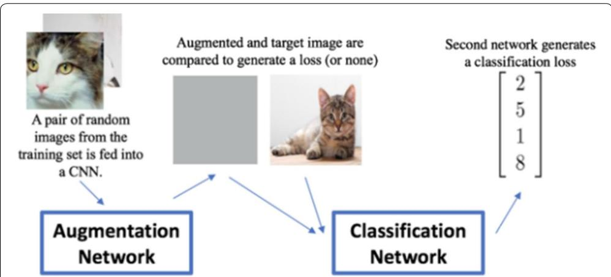  
Fig. 29 Illustration of augmentation network [36]

Te traditional baseline study transformed images by choosing an augmentation from a set (shifted, zoomed in/out, rotated, fipped, distorted, or shaded with a hue). Tis was repeated to increase the dataset size from N to $^ { 2 \mathrm { ~ N ~ } }$ . Te GAN style transfer baseline uses 6 diferent styles to transform images (Cezanne, Enhance, Monet, Ukiyoe, Van Gogh and Winter). Te Neural Augmentation techniques tested consist of three levels based on the design of the loss function for the augmentation net (Content loss, Style loss via gram matrix, and no loss computer at this layer). All experiments are tested with a convolutional network consisting of 3 convolutional layers each followed by max pooling and batch normalization, followed by 2 fully-connected layers. Each experiment runs for 40 epochs at a learning rate of 0.0001 with the Adam optimization technique (Table 7).

Te results of the experiment are very promising. Te Neural Augmentation technique performs signifcantly better on the Dogs versus Goldfsh study and only slightly worse on Dogs versus Cats. Te technique does not have any impact on the MNIST problem. Te paper suggests that the likely best strategy would be to combine the traditional augmentations and the Neural Augmentations.

Smart Augmentation Te Smart Augmentation [37] approach utilizes a similar concept as the Neural Augmentation technique presented above. However, the combination of images is derived exclusively from the learned parameters of a prepended CNN, rather than using the Neural Style Transfer algorithm.

Smart Augmentation is another approach to meta-learning augmentations. Tis is done by having two networks, Network-A and Network-B. Network-A is an augmentation network that takes in two or more input images and maps them into a new image or images to train Network-B. Te change in the error rate in Network- $\mathbf { \nabla } \cdot B$ is then backpropagated to update Network-A. Additionally another loss function is incorporated into Network-A to ensure that its outputs are similar to others within the class. Network-A uses a series of convolutional layers to produce the augmented image. Te conceptual framework of Network-A can be expanded to use several Networks trained in parallel. Multiple Network-As could be very useful for learning class-specifc augmentations via meta-learning (Fig. 30).

Table 7 Results comparing augmentations [36]   

<table><tr><td colspan="3">Quantitative results on dogs vs. goldfish</td></tr><tr><td>Dogs vs goldfish</td><td></td><td></td></tr><tr><td>Augmentation</td><td></td><td>Val. acc.</td></tr><tr><td>None</td><td></td><td>0.855</td></tr><tr><td>Traditional</td><td></td><td>0.890</td></tr><tr><td>GANs</td><td></td><td>0.865</td></tr><tr><td>Neural + no loss</td><td></td><td>0.915</td></tr><tr><td>Neural + content loss</td><td></td><td>0.900</td></tr><tr><td>Neural + style</td><td></td><td>0.890</td></tr><tr><td>Control</td><td></td><td>0.840</td></tr><tr><td colspan="3">Quantitative results on dogs vs cats</td></tr><tr><td>Dogs vs cat</td><td></td><td></td></tr><tr><td>Augmentation</td><td></td><td>Val. acc.</td></tr><tr><td>None</td><td></td><td>0.705</td></tr><tr><td>Traditional</td><td></td><td>0.775</td></tr><tr><td>GANs</td><td></td><td>0.720</td></tr><tr><td>Neural + no loss</td><td></td><td>0.765</td></tr><tr><td>Neural + content loss</td><td></td><td>0.770</td></tr><tr><td>Neural + style</td><td></td><td>0.740</td></tr><tr><td>Control</td><td></td><td>0.710</td></tr><tr><td colspan="3">MNIST O&#x27;s and 8&#x27;s</td></tr><tr><td>Augmentation</td><td></td><td>Val. acc.</td></tr><tr><td>None</td><td></td><td>0.972</td></tr><tr><td>Neural + no loss</td><td></td><td>0.975</td></tr><tr><td>Neural + content loss</td><td></td><td>0.968</td></tr></table>

Smart Augmentation is similar to SamplePairing [65] or mixed-examples in the sense that a combination of existing examples produces new ones. However, the mechanism of Smart Augmentation is much more sophisticated, using an adaptive CNN to derive new images rather than averaging pixels or hand-engineered image combinations.

Te Smart Augmentation technique was tested on the task of gender recognition. On the Feret dataset, accuracy improved from 83.52 to $8 8 . 4 6 \%$ . Te audience dataset responded with an improvement of $7 0 . 0 2 \%$ to $7 6 . 0 6 \%$ . Most interestingly, results from another face dataset increased from 88.15 to $9 5 . 6 6 \%$ . Tis was compared with traditional augmentation techniques which increased the accuracy from 88.15 to $8 9 . 0 8 \%$ . Additionally, this experiment derived the same accuracy when using two Network-As in the augmentation framework as was found with one Network-A. Tis experiment demonstrates the signifcant performance increase with the Smart Augmentation meta-learning strategy (Fig. 31).

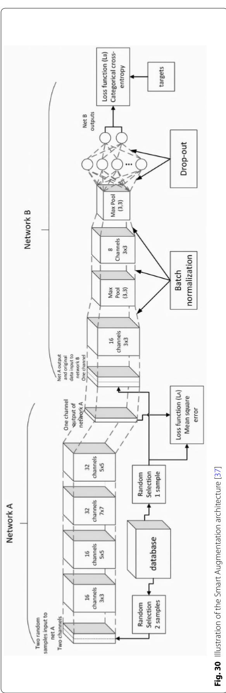

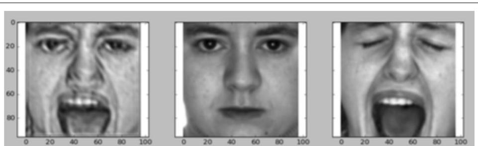  
Fig. 31 On the gender recognition task, the image to the left is an example of an instance produced by Network-A in Smart Augmentation given the right images as input [37]

AutoAugment AutoAugment [38], developed by Cubuk et  al., is a much diferent approach to meta-learning than Neural Augmentation or Smart Augmentation. AutoAugment is a Reinforcement Learning algorithm [115] that searches for an optimal augmentation policy amongst a constrained set of geometric transformations with miscellaneous levels of distortions. For example, ‘translateX 20 pixels’ could be one of the transformations in the search space (Table 8).

In Reinforcement Learning algorithms, a policy is analogous to the strategy of the learning algorithm. Tis policy determines what actions to take at given states to achieve some goal. Te AutoAugment approach learns a policy which consists of many subpolicies, each sub-policy consisting of an image transformation and a magnitude of transformation. Reinforcement Learning is thus used as a discrete search algorithm of augmentations. Te authors also suggest that evolutionary algorithms or random search would be efective search algorithms as well.

AutoAugment found policies which achieved a $1 . 4 8 \%$ error rate on CIFAR-10. AutoAugment also achieved an $8 3 . 5 4 \%$ Top-1 accuracy on the ImageNet dataset. Very interestingly as well, the policies learned on the ImageNet dataset were successful when transferred to the Stanford Cars and FGVC Aircraft image recognition tasks. In this case, the ImageNet policy applied to these other datasets reduced error rates by $1 . 1 6 \%$ and $1 . 7 6 \%$ respectively.

Geng et al. [116] expanded on AutoAugment by replacing the Reinforcement Learning search algorithm with Augmented Random Search (ARS) [112]. Te authors point out that the sub-policies learned from AutoAugment are inherently fawed because of the discrete search space. Tey convert the probability and magnitude of augmentations into a continuous space and search for sub-policies with ARS. With this, they achieve lower error rates on CIFAR-10, CIFAR-100, and ImageNet (Table 9).

Minh et  al. [117] also experimented with using Reinforcement Learning [115] to search for Data Augmentations. Tey further explore the efectiveness of learning transformations for individual instances rather than the entire dataset. Tey fnd classifcation accuracy diferences of $7 0 . 1 8 \%$ versus $7 4 . 4 2 \%$ on the CIFAR-10 dataset and $7 4 . 6 1 \%$ versus $8 0 . 3 5 \%$ on the problem of classifying dogs versus cats. Further, they explore the robustness of classifers with respect to test-time augmentation and fnd that the model trained with Reinforcement Learning augmentation search performs much better. On the CIFAR-10 dataset this results in $5 0 . 9 9 \%$ versus $7 0 . 0 6 \%$ accuracy when the models are evaluated on augmented test data.

Table 8 AutoAugment augmentation policy found on the reduced CIFAR-10 dataset [38]   

<table><tr><td></td><td>Operation 1</td><td>Operation 2</td></tr><tr><td>Sub-policy 0</td><td>(Invert,0.1,7)</td><td>(Contrast,0.2,6)</td></tr><tr><td>Sub-policy 1</td><td>(Rotate,0.7,2)</td><td>(TranslateX,0.3,9)</td></tr><tr><td>Sub-policy 2</td><td>(Sharpness,0.8,1)</td><td>(Sharpness,0.9,3)</td></tr><tr><td>Sub-policy 3</td><td>(ShearY,0.5,8)</td><td>(TranslateY,0.7,9)</td></tr><tr><td>Sub-policy 4</td><td>(AutoContrast,0.5,8)</td><td>(Equalize,0.9,2)</td></tr><tr><td>Sub-policy 5</td><td>(ShearY,0.2,7)</td><td>(Posterize,0.3,7)</td></tr><tr><td>Sub-policy 6</td><td>(Color,0.4,3)</td><td>(Brightness,0.6,7)</td></tr><tr><td>Sub-policy 7</td><td>(Sharpness,0.3,9)</td><td>(Brightness,0.7,9)</td></tr><tr><td>Sub-policy 8</td><td>(Equalize,0.6,5)</td><td>(Equalize,0.5,1)</td></tr><tr><td>Sub-policy 9</td><td>(Contrast,0.6,7)</td><td>(Sharpness,0.6,5)</td></tr><tr><td>Sub-policy 10</td><td>(Color,0.7,7)</td><td>(TranslateX,0.5,8)</td></tr><tr><td>Sub-policy 11</td><td>(Equalize,0.3,7)</td><td>(AutoContrast,0.4,8)</td></tr><tr><td>Sub-policy 12</td><td>(TranslateY,0.4,3)</td><td>(Sharpness,0.2,6)</td></tr><tr><td>Sub-policy 13</td><td>(Brightness,0.9,6)</td><td>(Color,0.2,8)</td></tr><tr><td>Sub-policy 14</td><td>(Solarize,0.5,2)</td><td>(Invert,0.0,3)</td></tr><tr><td>Sub-policy 15</td><td>(Equalize,0.2,0)</td><td>(AutoContrast,0.6,0)</td></tr><tr><td>Sub-policy 16</td><td>(Equalize,0.2,8)</td><td>(Equalize,0.6,4)</td></tr><tr><td>Sub-policy 17</td><td>(Color,0.9,9)</td><td>(Equalize,0.6,6)</td></tr><tr><td>Sub-policy 18</td><td>(AutoContrast,0.8,4)</td><td>(Solarize,0.2,8)</td></tr><tr><td>Sub-policy 19</td><td>(Brightness,0.1,3)</td><td>(Color,0.7,0)</td></tr><tr><td>Sub-policy 20</td><td>(Solarize,0.4,5)</td><td>(AutoContrast,0.9,3)</td></tr><tr><td>Sub-policy 21</td><td>(TranslateY,0.9,9)</td><td>(TranslateY,0.7,9)</td></tr><tr><td>Sub-policy 22</td><td>(AutoContrast,0.9,2)</td><td>(Solarize,0.8,3)</td></tr><tr><td>Sub-policy 23</td><td>(Equalize,0.8,8)</td><td>(Invert,0.1,3)</td></tr><tr><td>Sub-policy 24</td><td>(TranslateY,0.7,9)</td><td>(AutoContrast,0.9,1)</td></tr></table>

Table 9 The performance of ARS on continuous space vs. AutoAugment on discrete space [116]   

<table><tr><td>Model</td><td>AutoAugment</td><td>ARS-Aug</td></tr><tr><td>Wide-ResNet-28-10</td><td>2.68</td><td>2.33</td></tr><tr><td>Shake-Shake (26 2 x 32 days)</td><td>2.47</td><td>2.14</td></tr><tr><td>Shake-Shake (26 2 x 96 days)</td><td>1.99</td><td>1.68</td></tr><tr><td>Shake-Shake (26 2 x 112 days)</td><td>1.89</td><td>1.59</td></tr><tr><td>AmoebaNet-B (6,128)</td><td>1.75</td><td>1.49</td></tr><tr><td>PyramidNet + ShakeDrop</td><td>1.48</td><td>1.26</td></tr></table>

A disadvantage to meta-learning is that it is a relatively new concept and has not been heavily tested. Additionally, meta-learning schemes can be difcult and time-consuming to implement. Practitioners of meta-learning will have to solve problems primarily with vanishing gradients [118], amongst others, to train these networks.

# Comparing Augmentations

As shown throughout “Design considerations for image Data Augmentation” section, possibilities for Data Augmentation. However, there are not many comparative studies that show the performance diferences of these diferent augmentations. One such study was conducted by Shijie et al. [119] which compared GANs, WGANs, fipping, cropping, shifting, PCA jittering, color jittering, adding noise, rotation, and some combinations on the CIFAR-10 and ImageNet datasets. Additionally, the comparative study ranged across dataset sizes with the small set consisting of $^ { 2 \mathrm { ~ k ~ } }$ samples with 200 in each class, tthe medium set consisting of $1 0 ~ \mathrm { k }$ samples with $^ { 1 \mathrm { k } }$ in each class, and the large set consisting of $5 0 \mathrm { k }$ samples with $^ { 5 \mathrm { k } }$ in each class. Tey also tested with 3 levels of augmentation, no augmentation, original plus same size of generated samples, and original plus double size of generated samples. Tey found that cropping, fipping, WGAN, and rotation generally performed better than others. Te combinations of fipping $^ +$ cropping and fip$\mathtt { p i n g } + \mathbb { W } \mathtt { G } \mathtt { A N }$ were the best overall, improving classifcation performance on CIFAR-10 by $+ 3 \%$ and $+ 3 . 5 \%$ , respectively.

# Design considerations for image Data Augmentation

Tis section will briefy describe some additional design decisions with respect to Data Augmentation techniques on image data.

# Test-time augmentation

In addition to augmenting training data, many research reports have shown the efectiveness of augmenting data at test-time as well. Tis can be seen as analogous to ensemble learning techniques in the data space. By taking a test image and augmenting it in the same way as the training images, a more robust prediction can be derived. Tis comes at a computational cost depending on the augmentations performed, and it can restrict the speed of the model. Tis could be a very costly bottleneck in models that require real-time prediction. However, test-time augmentation is a promising practice for applications such as medical image diagnosis. Radosavovic et al. [120] denote test-time augmentation as data distillation to describe the use of ensembled predictions to get a better representation of the image.

Wang et al. [121] sought out to develop a mathematical framework to formulate testtime augmentation. Testing their test-time augmentation scheme on medical image segmentation, they found that it outperformed the single-prediction baseline and dropout-based multiple predictions. Tey also found better uncertainty estimation when using test-time augmentation, reducing highly confdent but incorrect predictions. Teir test-time augmentation method uses a Monte Carlo simulation in order to obtain parameters for diferent augmentations such as fipping, scaling, rotation, and translations, as well as noise injections.

Test-time augmentation can be found in the Alexnet paper [1], which applies CNNs to the ImageNet dataset. In their experiments, they average the predictions on ten randomly cropped patches. Tese patches consist of one extracted from the center, four corner croppings, and the equivalent regions on the horizontally fipped images. Tese predictions are averaged to form the fnal output. He et al. [3] use the same 10-crop testing procedure to evaluate their ResNet CNN architecture (Fig. 32).

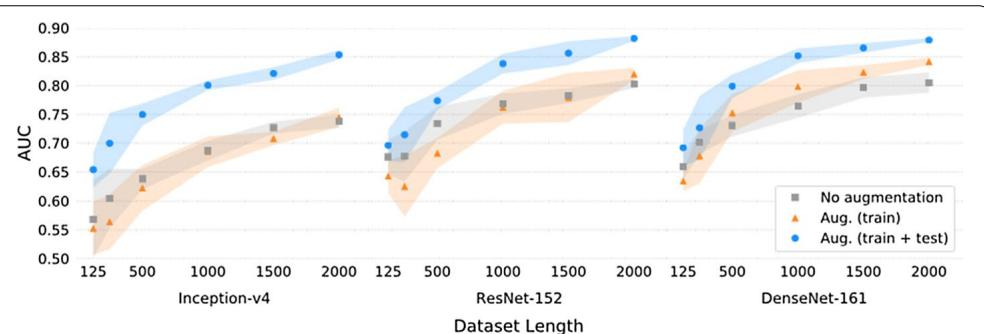  
Fig. 32 Impact of test-time data augmentation for skin lesion classifcation [122]

Perez et al. [122] present a study on the efectiveness of test-time augmentation with many augmentation techniques. Tese augmentations tested include color augmentation, rotation, shearing, scaling, fipping, random cropping, random erasing, elastic, mixing, and combinations between the techniques. Table  9 shows the higher performance achieved when augmenting test images as well as training images. Matsunaga et al. [123] also demonstrate the efectiveness of test-time augmentation on skin lesion classifcation, using geometric transformations such as rotation, translation, scaling, and fipping.

Te impact of test-time augmentation on classifcation accuracy is another mechanism for measuring the robustness of a classifer. A robust classifer is thus defned as having a low variance in predictions across augmentations. For example, a prediction of an image should not be much diferent when that same image is rotated $2 0 ^ { \circ }$ . In their experiments searching for augmentations with Reinforcement Learning, Minh et  al. [117] measure robustness by distorting test images with a $5 0 \%$ probability and contrasting the accuracy on un-augmented data with the augmented data. In this study, the performance of the baseline model decreases from 74.61 to $6 6 . 8 7 \%$ when evaluated on augmented test images.

Some classifcation models lie on the fence in terms of their necessity for speed. Tis suggests promise in developing methods that incrementally upgrade the confdence of prediction. Tis could be done by frst outputting a prediction with little or no testtime augmentation and then incrementally adding test-time augmentations to increase the confdence of the prediction. Diferent Computer Vision tasks require certain constraints on the test-time augmentations that can be used. For example, image recognition can easily aggregate predictions across warped images. However, it is difcult to aggregate predictions on geometrically transformed images in object detection and semantic segmentation.

# Curriculum learning

Aside from the study of Data Augmentation, many researchers have been interested in trying to fnd a strategy for selecting training data that beats random selection. In the context of Data Augmentation, research has been published investigating the relationship between original and augmented data across training epochs. Some research suggests that it is best to initially train with the original data only and then fnish training with the original and augmented data, although there is no clear consensus.

Table 10 Comparison of resolution across three very popular open-source image datasets   

<table><tr><td>Dataset</td><td>Resolution</td></tr><tr><td>MNIST handwritten digits</td><td>28 x 28×1</td></tr><tr><td>CIFAR-10/100</td><td>3232×3</td></tr><tr><td>ImageNet</td><td>256 x 256 x 3</td></tr></table>

In the SamplePairing [65] study, one epoch on ImageNet and 100 epochs on other datasets are completed without SamplePairing before mixed image data is added to the training. Once the SamplePairing images are added to the training set, they run in cycles between 8:2 epochs, 8 with SamplePairing images, 2 without. Jaderberg et al. [124] train exclusively with synthetic data for natural scene text recognition. Te synthetic data produced the training data by enumerating through diferent fonts and augmentations. Tis produced sets of training images for size $5 0 ~ \mathrm { k }$ and $9 0 ~ \mathrm { k }$ lexicons. Mikolajczyk and Grochowski [72] draw comparisons from transfer learning. Tey suggest that training on augmented data to learn the initial weights of a deep convolutional network is similar to transferring weights trained on other datasets such as ImageNet. Tese weights are then fne-tuned only with the original training data.

Curriculum learning decisions are especially important for One-Shot Learning systems such as FaceNet, presented by Schrof et  al. [125]. It is important to fnd faces which are somewhat similar to the new face such that the learned distance function is actually useful. In this sense, the concept of curriculum learning shares many similarities with adversarial search algorithms or learning only on hard examples.

Curriculum learning, a term originally coined by Bengio et al. [126], is an applicable concept for all Deep Learning models, not just those constrained with limited data. Plotting out training accuracy over time across diferent initial training subsets could help reveal patterns in the data that dramatically speed up training time. Data Augmentation constructs massively infated training from combinations such as fipping, translating, and randomly erasing. It is highly likely that a subset exists in this set such that training will be faster and more accurate.

# Resolution impact

Another interesting discussion about Data Augmentation in images is the impact of resolution. Higher resolution images such as HD $( 1 9 2 0 \times 1 0 8 0 \times 3 )$ or $4 \mathrm { K }$ $( 3 8 4 0 \times 2 1 6 0 \times 3 )$ require much more processing and memory to train deep CNNs. However, it seems intuitive that next-generation models would be trained on higher resolution images. Many current models downsample images from their original resolution to make the classifcation problem computationally more feasible. However, sometimes this downsampling causes information loss within the image, making image recognition more diffcult (Table 10).

It is interesting to investigate the nature of this downsampling and resulting performance comparison. Wu et al. [127] compare the tradeof between accuracy and speed when downsampling images to diferent resolutions. Te researchers found that composing an ensemble of models trained with high and low-resolution images performed better than any one model individually. Tis ensemble prediction is found by averaging the softmax predictions. Te models trained on $2 5 6 \times 2 5 6$ images and $5 1 2 \times 5 1 2$ images achieve $7 . 9 6 \%$ and $7 . 4 2 \%$ top-5 error rates, respectively. When aggregated they achieved a lower top-5 error rate of $6 . 9 7 \%$ . Terefore, diferent downsampled images can be viewed as another Data Augmentation scheme (Fig. 33).

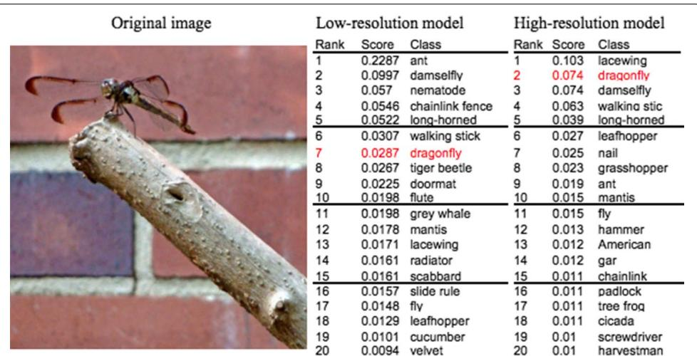  
Fig. 33 Classifcations of the Image to the right by diferent resolution models trained by Wu et al. [127]

With the advance of Super-Resolution Convolutional Neural Networks presented by Chong et  al. [128] or SRGANs, Super-Resolution Generative Adversarial Networks, presented by Ledig et al. [129], it is interesting to consider if upsampling images to an even higher resolution would result in better models. Quality upsampling on CIFAR-10 images from even $3 2 \times 3 2 \times 3$ to $6 4 \times 6 4 \times 3$ could lead to better and more robust image classifers.

Resolution is also a very important topic with GANs. Producing high resolution outputs from GANs is very difcult due to issues with training stability and mode collapse. Many of the newer GAN architectures such as StackGAN [130] and Progressively-Growing GANs [34] are designed to produce higher resolution images. In addition to these architectures, the use of super-resolution networks such as SRGAN could be an efective technique for improving the quality of outputs from a DCGAN [91] model. Once it is practical to produce high resolution outputs from GAN samples, these outputs will be very useful for Data Augmentation.

# Final dataset size

A necessary component of Data Augmentation is the determination of the fnal dataset size. For example, if all images are horizontally fipped and added to the dataset, the resulting dataset size changes from N to 2N. One of the main considerations with respect to fnal dataset size is the additional memory and compute constraints associated with augmenting data. Practitioners have the choice between using generators which transform data on the fy during training or transforming the data beforehand and storing it in memory. Transforming data on the fy can save memory, but will result in slower training. Storing datasets in memory can be extremely problematic depending on how heavily the dataset size has been infated. Storing augmented datasets in memory is especially problematic when augmenting big data. Tis decision is generally categorized as online or ofine data augmentation, (with online augmentation referring to on the fy augmentations and ofine augmentation referring to editing and storing data on the disk).

In the design of a massively distributed training system, Chilimbi et al. [131] augment images before training to speed up image serving. By augmenting images in advance, the distributed system is able to request and pre-cache training batches. Augmentations can also be built into the computational graph used to construct Deep Learning models and facilitate fast diferentiation. Tese augmentations process images immediately after the input image tensor.

Additionally, it is also interesting to explore a subset of the infated data that will result in higher or similar performance to the entire training set. Tis is a similar concept to curriculum learning, since the central idea is to fnd an optimal ordering of training data. Tis idea is also very related to fnal dataset size and the considerations of transformation compute and available memory for storing augmented images.

# Alleviating class imbalance with Data Augmentation

Class imbalance is a common problem in which a dataset is primarily composed of examples from one class. Tis could manifest itself in a binary classifcation problem such that there is a clear majority-minority class distinction, or in multi-class classifcation in which there is one or multiple majority classes and one or multiple minority classes. Imbalanced datasets are harmful because they bias models towards majority class predictions. Imbalanced datasets also render accuracy as a deceitful performance metric. Buda et al. [132] provide a systematic study specifcally investigating the impact of imbalanced data in CNNs processing image data. Leevy et al. [27] cover many Datalevel and Algorithm-level solutions to class imbalance in big data in general. Data Augmentation falls under a Data-level solution to class imbalance and there are many diferent strategies for implementation.

A naive solution to oversampling with Data Augmentation would be a simple random oversampling with small geometric transformations such as a $3 0 ^ { \circ }$ rotation. Other simple image manipulations such as color augmentations, mixing images, kernel flters, and random erasing can also be extended to oversample data in the same manner as geometric augmentations. Tis can be useful for ease of implementation and quick experimentation with diferent class ratios. One problem of oversampling with basic image transformations is that it could cause overftting on the minority class which is being oversampled. Te biases present in the minority class are more prevalent post-sampling with these techniques.

Oversampling methods based on Deep Learning such as adversarial training, Neural Style Transfer, GANs, and meta-learning schemes can also be used as a more intelligent oversampling strategy. Neural Style Transfer is an interesting way to create new images. Tese new images can be created either through extrapolating style with a foreign style or by interpolating styles amongst instances within the dataset. Using GANs to oversample data could be another efective way to increase the minority class size while preserving the extrinsic distribution. Oversampling with GANs can be done using the entire minority class as “real” examples, or by using subsets of the minority class as inputs to GANs. Te use of evolutionary sampling [133] to fnd these subsets to input to GANs for class sampling is a promising area for future work.

# Discussion

Te interesting ways to augment image data fall into two general categories: data warping and oversampling. Many of these augmentations elucidate how an image classifer can be improved, while others do not. It is easy to explain the beneft of horizontal fipping or random cropping. However, it is not clear why mixing pixels or entire images together such as in PatchShufe regularization or SamplePairing is so efective. Additionally, it is difcult to interpret the representations learned by neural networks for GAN-based augmentation, variational auto-encoders, and meta-learning. CNN visualization has been led by Yosinski et al. [134] with their deep visualization method. Having a human-level understanding of convolutional networks features could greatly help guide the augmentation process.

Manipulating the representation power of neural networks is being used in many interesting ways to further the advancement of augmentation techniques. Traditional hand-crafted augmentation techniques such as cropping, fipping, and altering the color space are being extended with the use of GANs, Neural Style Transfer, and meta-learning search algorithms.

Image-to-image translation has many potential uses in Data Augmentation. Neural Style Transfer uses neural layers to translate images into new styles. Tis technique not only utilizes neural representations to separate ‘style’ and ‘content’ from images, but also uses neural transformations to transfer the style of one image into another. Neural Style Transfer is a much more powerful augmentation technique than traditional color space augmentations, but even these methods can be combined together.

An interesting characteristic of these augmentation methods is their ability to be combined together. For example, the random erasing technique can be stacked on top of any of these augmentation methods. Te GAN framework possesses an intrinsic property of recursion which is very interesting. Samples taken from GANs can be augmented with traditional augmentations such as lighting flters, or even used in neural network augmentation strategies such as Smart Augmentation or Neural Augmentation to create even more samples. Tese samples can be fed into further GANs and dramatically increase the size of the original dataset. Te extensibility of the GAN framework is amongst many reasons they are so interesting to Deep Learning researchers.

Test-time augmentation is analogous to ensemble learning in the data space. Instead of aggregating the predictions of diferent learning algorithms, we aggregate predictions across augmented images. We can even extend the solution algorithm to parameterize prediction weights from diferent augmentations. Tis seems like a good solution for systems concerned with achieving very high performance scores, more so than prediction speed. Determining the efectiveness of test-time augmentation by primarily exploring test-time geometric transformations and Neural Style Transfer, is an area of future work.

An interesting question for practical Data Augmentation is how to determine postaugmented dataset size. Tere is no consensus as to which ratio of original to fnal dataset size will result in the best performing model. However, imagine using color augmentations exclusively. If the initial training dataset consists of 50 dogs and 50 cats, and each image is augmented with 100 color flters to produce 5000 dogs and 5000 cats, this dataset will be heavily biased towards the spatial characteristics of the original 50 dogs and 50 cats. Tis over-extensive color-augmented data will cause a deep model to overft even worse than the original. From this anecdote, we can conceptualize the existence of an optimal size for post-augmented data.

Additionally, there is no consensus about the best strategy for combining data warping and oversampling techniques. One important consideration is the intrinsic bias in the initial, limited dataset. Tere are no existing augmentation techniques that can correct a dataset that has very poor diversity with respect to the testing data. All these augmentation algorithms perform best under the assumption that the training data and testing data are both drawn from the same distribution. If this is not true, it is very unlikely that these methods will be useful.

# Future work

Future work in Data Augmentation will be focused on many diferent areas such as establishing a taxonomy of augmentation techniques, improving the quality of GAN samples, learning new ways to combine meta-learning and Data Augmentation, discovering relationships between Data Augmentation and classifer architecture, and extending these principles to other data types. We are interested in seeing how the time-series component in video data impacts the use of static image augmentation techniques. Data Augmentation is not limited to the image domain and can be useful for text, bioinformatics, tabular records, and many more.

Our future work intends to explore performance benchmarks across geometric and color space augmentations across several datasets from diferent image recognition tasks. Tese datasets will be constrained in size to test the efectiveness with respect to limited data problems. Zhang et al. [135] test their novel GAN augmentation technique on the SVHN dataset across 50, 80, 100, 200, and 500 training instances. Similar to this work, we will look to further establish benchmarks for diferent levels of limited data.

Improving the quality of GAN samples and testing their efectiveness on a wide range of datasets is another very important area for future work. We would like to further explore the combinatorics of GAN samples with other augmentation techniques such as applying a range of style transfers to GAN-generated samples.

Super-resolution networks through the use of SRCNNs, Super-Resolution Convolutional Neural Networks, and SRGANs are also very interesting areas for future work in Data Augmentation. We want to explore the performance diferences across architectures with upsampled images such as expanding CIFAR-10 images from $3 2 \times 3 2$ to $6 4 \times 6 4$ to $1 2 8 \times 1 2 8$ and so on. One of the primary difculties with GAN samples is trying to achieve high-resolution outputs. Terefore, it will be interesting to see how we can use super-resolution networks to achieve high-resolution such as DCGAN samples inputted into an SRCNN or SRGAN. Te result of this strategy will be compared with the performance of the Progressively Growing GAN architecture.

Test-time augmentation has the potential to make a massive diference in Computer Vision performance and has not been heavily explored. We want to establish benchmarks for diferent ensembles of test-time augmentations and investigate the solution algorithms used. Currently, majority voting seems to be the dominant solution algorithm for test-time augmentation. It seems highly likely that test-time augmentation can be further improved if the weight of each augmented images prediction is further parameterized and learned. Additionally, we will explore the efectiveness of test-time augmentation on object detection, comparing color space augmentations and the Neural Style Transfer algorithm.

Meta-learning GAN architectures is another exciting area of interest. Using Reinforcement Learning algorithms such as NAS on the generator and discriminator architectures seem very promising. Another interesting area of further research is to use an evolutionary approach to speed up the training of GANs through parallelization and cluster computing.

Another important area of future work for practical integration of Data Augmentation into Deep Learning workfows is the development of software tools. Similar to how the Tensorfow [136] system automates the back-end processes of gradient-descent learning, Data Augmentation libraries will automate preprocessing functions. Te Keras [137] library provides an ImageDataGenerator class that greatly facilitates the implementation of geometric augmentations. Buslaev et  al. presented another augmentation tool they called Albumentations [138]. Te development of Neural Style Transfer, adversarial training, GANs, and meta-learning APIs will help engineers utilize the performance power of advanced Data Augmentation techniques much faster and more easily.

# Conclusion

Tis survey presents a series of Data Augmentation solutions to the problem of overftting in Deep Learning models due to limited data. Deep Learning models rely on big data to avoid overftting. Artifcially infating datasets using the methods discussed in this survey achieves the beneft of big data in the limited data domain. Data Augmentation is a very useful technique for constructing better datasets. Many augmentations have been proposed which can generally be classifed as either a data warping or oversampling technique.

Te future of Data Augmentation is very bright. Te use of search algorithms combining data warping and oversampling methods has enormous potential. Te layered architecture of deep neural networks presents many opportunities for Data Augmentation. Most of the augmentations surveyed operate in the input layer. However, some are derived from hidden layer representations, and one method, DisturbLabel [28], is even manifested in the output layer. Te space of intermediate representations and the label space are under-explored areas of Data Augmentation with interesting results. Tis survey focuses on applications for image data, although many of these techniques and concepts can be expanded to other data domains.

Data Augmentation cannot overcome all biases present in a small dataset. For example, in a dog breed classifcation task, if there are only bulldogs and no instances of golden retrievers, no augmentation method discussed, from SamplePairing to AutoAugment to GANs, will create a golden retriever. However, several forms of biases such as lighting, occlusion, scale, background, and many more are preventable or at least dramatically lessened with Data Augmentation. Overftting is generally not as much of an issue with access to big data. Data Augmentation prevents overftting by modifying limited datasets to possess the characteristics of big data.

# Abbreviations

GAN: generative adversarial network; CNN: convolutional neural network; DCGAN: deep convolutional generative adversarial network; NAS: neural architecture search; SRCNN: super-resolution convolutional neural network; SRGAN: super-resolution generative adversarial network; CT: computerized tomography; MRI: magnetic resonance imaging; PET: positron emission tomography; ROS: random oversampling; SMOTE: synthetic minority oversampling technique; RGB: red-green–blue; PCA: principal components analysis; UCI: University of California Irvine; MNIST: Modifed National Institute of Standards and Technology; CIFAR: Canadian Institute for Advanced Research; t-SNE: t-distributed stochastic neighbor embedding.

# Acknowledgements

We would like to thank the reviewers in the Data Mining and Machine Learning Laboratory at Florida Atlantic University. Additionally, we acknowledge partial support by the NSF (CNS-1427536). Opinions, fndings, conclusions, or recommendations in this paper are solely of the authors’ and do not refect the views of the NSF.

# Authors’ contributions

CS performed the primary literature review and analysis for this work, and also drafted the manuscript. TMK, JLL, RAB, RZ, KW, NS, and RK worked with CS to develop the article’s framework and focus. TMK introduced this topic to CS, and helped to complete and fnalize this work. All authors read and approved the fnal manuscript.

# Funding

Not applicable.

Availability of data and materials Not applicable.

Competing interests The authors declare that they have no competing interests.

Consent for publication Not applicable.

Ethics approval and consent to participate Not applicable.

Received: 9 January 2019 Accepted: 22 April 2019   
Published online: 06 July 2019

# References

1. Krizhevsky A, Sutskever I, Hinton GE. ImageNet classifcation with deep convolutional neural networks. Adv Neural Inf Process Syst. 2012;25:1106–14.   
2. Karen S, Andrew Z. Very deep convolutional networks for large-scale image recognition. arXiv e-prints. 2014.   
3. Kaiming H, Xiangyu Z, Shaoqing R, Jian S. Deep residual learning for image recognition. In: CVPR, 2016.   
4. Christian S, Vincent V, Sergey I, Jon S, Zbigniew W. Rethinking the inception architecture for computer vision. arXiv e-prints, 2015.   
5. Gao H, Zhuang L, Laurens M, Kilian QW. Densely connected convolutional networks. arXiv preprint. 2016.   
6. Jan K, Vladimir G, Daniel C. Regularization for deep learning: a taxonomy. arXiv preprint. 2017.   
7. Nitish S, Geofrey H, Alex K, Ilya S, Ruslan S. Dropout: a simple way to prevent neural networks from overftting. J Mach Learn Res. 2014;15(1):1929–58.   
8. Jonathan T, Ross G, Arjun J, Yann L, Christoph B. Efcient object localization using convolutional networks. In: CVPR’15. 2015.   
9. Sergey I, Christan S. Batch normalization: accelerating deep network training by reducing internal covariate shift. In: ICML; 2015.   
10. Karl W, Taghi MK, DingDing W. A survey of transfer learning. J Big Data. 2016;3:9.   
11. Shao L. Transfer learning for visual categorization: a survey. IEEE Trans Neural Netw Learn Syst. 2015;26(5):1019–34.   
12. Jia D, Wei D, Richard S, Li-Jia L, Kai L, Li F-F. ImageNet: a large-scale hierarchical image database. In: CVPR09, 2009.   
13. Amir Z, Alexander S, William S, Leonidas G, Jitendra M, Silvio S. Taskonomy: disentangling task transfer learning. In: CVPR ‘18. 2018.   
14. Yosinski J, Clune J, Bengio Y, Lipson H. How transferable are features in deep neural networks? Adv Neural Inf Process Syst. 2014;27:3320–8. Mach Learn Res. 2010;11:625–60.   
16. Mark P, Dean P, Geofrey H, Tom MM. Zero-shot learning with semantic output codes. In: NIPS; 2009.   
17. Yongqin X, Christoph HL, Bernt S, Zeynep A. Zero-shot learning—a comprehensive evaluation of the good, the bad and the ugly. arXiv preprint. 2018.   
18. Yaniv T, Ming Y, Marc’ AR, Lior W. DeepFace: closing the gap to human-level performance in face verifcation. In: CVPR ’14; 2014.   
19. Gregory K, Richard Z, Ruslan S. Siamese neural networks for one-shot image recognition. In: ICML Deep Learning workshop; 2015.   
20. Adam S, Sergey B, Matthew B, Dean W, Timothy L. One-shot learning with memory-augmented neural networks. arXiv preprint. 2016.   
21. Tomas M, Ilya S, Kai $\subsetneq$ Greg C, Jefrey D. Distributed representations of words and phrases and their compositionality. Accepted to NIPS 2013.   
22. Jefrey P, Richard S, Christopher DM. GloVe: global vectors for word representation. In: Proceedings of the empirical methods in natural language processing (EMNLP 2014) 12. 2014.   
23. Halevy A, Norvig P, Pereira F. The unreasonable efectiveness of data. IEEE Intell Syst. 2009;24:8–12.   
24. Chen S, Abhinav S, Saurabh S, Abhinav G. Revisting unreasonable efectivness of data in deep learning era. In: ICCV; 2017. p. 843–52.   
25. Esteva A, Kuprel B, Novoa RA, Ko J, Swetter SM, Blau HM, Thrun S. Dermatologist-level classifcation of skin cancer with deep neural networks. Nature. 2017;542:115–8.   
26. Geert L, Thijs K, Babak EB, Arnaud AAS, Francesco $\subsetneq$ Mohsen G, Jeroen AWM, van Bram G, Clara IS. A survey on deep learning in medical image analysis. Med Image Anal. 2017;42:60–88.   
27. Jofrey LL, Taghi MK, Richard AB, Naeem S. A survey on addressing high-class imbalance in big data. Springer J Big Data. 2018;5:42.   
28. LeCun Y, Bottou L, Bengio Y, Hafner P. Gradient-based learning applied to document recognition. Proc IEEE. 1998;86(11):2278–324.   
29. Nitesh VC, Kevin WB, Lawrence OH, Kegelmeyer W. SMOTE: synthetic minority over-sampling technique. J Artif Intellig Res. 2002;16:321–57.   
30. Hui H, Wen-Yuan W, Bing-Huan M. Borderline-SMOTE: a new over-sampling method in imbalanced data sets learning. In: Proceedings of ICIC, vol. 3644, Lecture Notes in Computer Science, New York. 2005, p. 878–87.   
31. Ian JG, Jean PA, Mehdi M, Bing X, David WF, Sherjil O, Aaron C, Yoshua B. Generative adversarial nets. NIPS. 2014.   
32. Leon AG, Alexander SE, Matthias B. A neural algorithm of artistic style. ArXiv. 2015.   
33. Barret Z, Quoc VL. Neural architecture search with reinforcement learning. In: International conference on learning representatoins, 2017.   
34. Tero K, Timo A, Samuli L, Jaakko L. Progressive growing of GANs for improved quality, stability, and variation. CoRR, abs/1710.10196, 2017.   
35. Justin J, Alexandre A, Li FF. Perceptual losses for real-time style transfer and super-resolution. ECCV. 2016;2016:694–711.   
36. Luis P, Jason W. The efectiveness of data augmentation in image classifcation using deep learning. In: Stanford University research report, 2017.   
37. Lemley J, Barzrafkan S, Corcoran P. Smart augmentation learning an optimal data augmentation strategy. In: IEEE Access. 2017.   
38. Ekin DC, Barret Z, Dandelion M, Vijay V, Quoc VL. AutoAugment: learning augmentation policies from data. ArXiv preprint. 2018.   
39. Xin Y, Paul SB, Ekta W. Generative adversarial network in medical imaging: a review. arXiv preprint. 2018.   
40. Jelmer MW, Tim L, Max AV, Ivana I. Generative adversarial networks for noise reduction in low-dose CT. In: IEEE Transactions on Medical Imaging. 2017.   
41. Ohad S, Tammy RR. Accelerated magnetic resonance imaging by adversarial neural network. In: DLMIA/ML-CDS@ MICCAI, 2017.   
42. Wang Y, Biting Y, Wang L, Chen Z, Lalush DS, Lin W, Xi W, Zhou J, Shen D, Zhou L. 3D conditional generative adversarial networks for high-quality PET image estimation at low dose. NeuroImage. 2018;174:550–62.   
43. Dwarikanath M, Behzad B. Retinal vasculature segmentation using local saliency maps and generative adversarial networks for image super resolution. arXiv preprint. 2017.   
44. Francesco C, Aldo M, Claudio S, Giorgio T. Biomedical data augmentation using generative adversarial neural networks. In: International conference on artifcial neural networks. Berlin: Springer; 2017. P. 626–34.   
45. Camilo B, Andrew JP, Larry TD, Allen TN, Susan MR, Bennett AL. Learning implicit brain MRI manifolds with deep learning. Int Soc Opt Photonics. 2018;10574:105741.   
46. Maria JMC, Sarfaraz H, Jeremy B, Ulas B. How to fool radiologists with generative adversarial networks? A visual turing test for lung cancer diagnosis. arXiv preprint. 2017.   
47. Baur C, Albarqouni S, Navab N. MelanoGANs: high resolution skin lesion synthesis with GANs. arXiv preprint. 2018.   
48. Madani A, Moradi M, Karargyris A, Syeda-Mahmood T. Chest x-ray generation and data augmentation for cardiovascular abnormality classifcation. In: Medical imaging 2018. Image Processing 2018;10574:105741.   
49. Maayan F-A, Eyal K, Jacob G, Hayit G. GAN-based data augmentation for improved liver lesion classifcation. arXiv preprint. 2018.   
50. Joseph R, Santosh D, Ross G, Ali F. You only look once: unifed, real-time object detection. In: CVPR‘16. 2016.   
51. Ross G, Jef D, Trevor D, Jitendra M. Rich feature hierarchies for accurate object detection and semantic segmentation. In: CVPR ‘14. 2014.   
52. Ross G. Fast R-CNN. CoRR, abs/1504.08083. 2015.   
53. Shaoqing R, Kaiming H, Ross G, Jian S. Faster R-CNN: towards real-time object detection with region proposal networks. In: NIPS, 2015.   
54. Jonathan L, Evan S, Trevor D. Fully convolutional networks for semantic segmentation. CoRR, abs/1411.4038. 2014. Springer; 2015, p. 234–41.   
56. Hessam B, Maxwell H, Mohammad R, Ali F. Label refnery: improving imagenet classifcation through label progression. arXiv preprint. 2018.   
57. Francisco JM-B, Fiammetta S, Jose MJ, Daniel U, Leonardo F. Forward noise adjustment scheme for data augmentation. arXiv preprints. 2018.   
58. Dua D, Karra TE. UCI machine learning repository [http://archive.ics.uci.edu/ml]. Irvine, CA: University of California, School of Information and Computer Science; 2017.   
59. Ken C, Karen S, Andrea V, Andrew Z. Return of the devil in the details: delving deep into convolutional nets. In: Proceedings of BMVC. 2014.   
60. Mark E, Luc VG, Christopher KIW, John W, Andrew Z. The pascal visual object classes (VOC) challenge. http://www. pascal-network.org/challenges/VOC/voc2008/workshop/. 2008.   
61. Aranzazu J, Miguel P, Mikel $\mathsf { G } ,$ Carlos L-M, Daniel P. A comparison study of diferent color spaces in clustering based image segmentation. IPMU; 2010.   
62. Quanzeng Y, Jiebo L, Hailin J, Jianchao Y. Robust image sentiment analysis using progressively trained and domain transferred deep networks. In: AAAI. 2015, p. 381–8.   
63. Luke T, Geof N. Improving deep learning using generic data augmentation. arXiv preprint. 2017.   
64. Guoliang K, Xuanyi D, Liang Z, Yi Y. PatchShufe regularization. arXiv preprint. 2017.   
65. Hiroshi I. Data augmentation by pairing samples for images classifcation. ArXiv e-prints. 2018.   
66. Cecilia S, Michael JD. Improved mixed-example data augmentation. ArXiv preprint. 2018.   
67. Daojun L, Feng Y, Tian Z, Peter Y. Understanding mixup training methods. In: IEEE access. 2018. p. 1.   
68. Ryo T, Takashi M. Data augmentation using random image cropping and patches for deep CNNs. arXiv preprints. 2018.   
69. Yoshua B, Jerome L, Ronan C, Jason W. Curriculum learning. In: Proceedings of the 26th annual international conference on machine learning, ACM. 2009, p. 41–8.   
70. Zhun Z, Liang Z, Guoliang K, Shaozi L, Yi Y. Random erasing data augmentation. ArXiv e-prints. 2017.   
71. Terrance V, Graham WT. Improved regularization of convolutional neural networks with cutout. arXiv preprint. 2017.   
72. Agnieszka M, Michal G. Data augmentation for improving deep learning in image classifcation problem. In: IEEE 2018 international interdisciplinary Ph.D. Workshop, 2018.   
73. Jonathan K, Michael S, Jia D, Li F-F. 3D object representations for fne-grained categorization. In: 4th IEEE Workshop on 3D Representation and Recognition, at ICCV 2013 (3dRR-13). Sydney, Australia. Dec. 8, 2013.   
74. Tomohiko K, Michiaki I. Icing on the cake: an easy and quick post-learning method you can try after deep learning. arXiv preprints. 2018.   
75. Terrance V, Graham WT. Dataset augmentation in feature space. In: Proceedings of the international conference on machine learning (ICML), workshop track, 2017.   
76. Sebastien CW, Adam G, Victor S, Mark DM. Understanding data augmentation for classifcation: when to warp? CoRR, abs/1609.08764, 2016.   
77. Seyed-Mohsen MD, Alhussein F, Pascal F. DeepFool: a simple and accurate method to fool deep neural networks. arXiv preprint. 2016.   
78. Jiawei S, Danilo VV, Sakurai K. One pixel attack for fooling deep neural networoks. arXiv preprints. 2018.   
79. Michal Z, Konrad Z, Negar R, Pedro OP. Adversarial framing for image and video classifcation. arXiv preprints. 2018.   
80. Logan E, Brandon T, Dimitris T, Ludwig S, Aleksander M. A rotation and a translation sufce: fooling CNNs with simple transformations. ArXiv preprint. 2018.   
81. Goodfellow I, Shlens J, Szegedy C. Explaining and Harnessing Adversarial Examples. International Conference on Learning Representations, 2015.   
82. Ian JG, David W-F, Mehdi M, Aaron C, Yoshua B. Maxout networks. arXiv preprint. 2013.   
83. Shuangtao L, Yuanke C, Yanlin P, Lin B. Learning more robust features with adversarial training. ArXiv preprints. 2018.   
84. Lingxi X, Jingdong W, Zhen W, Meng W, Qi T. DisturbLabel: regularizing CNN on the loss layer. arXiv preprint. 2016.   
85. Christopher B, Liang C, Ricardo GPB, Roger G, Alexander H, David AD, Maria VH, Joanna W, Daniel R. GAN augmentation: augmenting training data using generative adversarial networks. arXiv preprint. 2018.   
86. Doersch C. Tutorial on Variational Autoencoders. ArXiv e-prints. 2016.   
87. Laurens M, Geofrey H. Visualizing data using t-SNE. J Mach Learn Res. 2008;9:2431–56.   
88. Jef D, Philipp K, Trevor D. Adversarial feature learning. In: CVPR’16. 2016.   
89. Lin Z, Shi Y, Xue Z. IDSGAN: Generative Adversarial Networks for Attack Generation against Intrusion Detection. arXiv preprint; 2018.   
90. William F, Mihaela R, Balaji L, Andrew MD, Shakir M, Ian G. Many paths to equilibrium: GANs do not need to decrease a divergence at every step. In: International conference on learning representations (ICLR); 2017.   
91. Alec R, Luke M, Soumith C. Unsupervised representation learning with deep convolutional generative adversarial networks. ICLR, 2016.   
92. Jun-Yan Z, Taesung P, Phillip I, Alexei AE. Unpaired image-to-image translation using cycle-consistent adversarial networks. In: International conference on cmoputer vision (ICCV), 2017.   
93. Xinyue Z, Yifan L, Zengchang Q, Jiahong L. Emotion classifcation with data augmentation using generative adversarial networks. CoRR, vol. abs/1711.00648. 2017.   
94. Goodfellow IJ, Erhan D, Carrier PL, Courville A, Mirza M, Hamner B, Cukierski W, Tang Y, Thaler D, Lee DH, et al. Challenges in representation learning: A report on three machine learning contests. In: NIPS. Berlin: Springer; 2013. p.117–24.   
95. Mehdi M, Simon O. Conditional generative adversarial nets. arXiv preprint. 2014.   
96. Mario L, Karol K, Marcin M, Olivier B, Sylvain G. Are GANs created equal? A large-scale study. arXiv preprint. 2018. vised anomaly detection with GAN. arXiv preprint. 2018. 98. Alireza M, Jonathon S, Navdeep J, Ian G, Brendan F. Adversarial autoencoders. arXiv preprint. 2015.   
99. Tim S, Ian G, Wojciech Z, Vicki C, Alec R, Xi C. Improved techniques for training GANs. arXiv preprint. 2016.   
100. Yanghao L, Naiyan W, Jiaying L, Xiaodi H. Demistifying neural style transfer. arXiv preprint. 2017.   
101. Khizar H. Super-resolution via deep learning. arXiv preprint. 2017.   
102. Dmitry U, Andrea V, Victor L. Instance normalization: the missing ingredient for fast stylization. arXiv preprint. 2016.   
103. Philip TJ, Amir AA, Stephen B, Toby B, Boguslaw O. Style augmentation: data augmentation via style randomization. arXiv e-prints. 2018.   
104. Josh T, Rachel F, Alex R, Jonas S, Wojciech Z, Pieter A. Domain randomization for transferring deep neural networks from simulation to the real world. arXiv preprint. 2017.   
105. Ashish S, Tomas P, Oncel T, Josh S, Wenda W, Russ W. Learning from simulated and unsupervised images through adversarial training. In: Conference on computer vision and pattern recognition, 2017.   
106. Stephan RR, Vibhav V, Stefan R, Vladlen K. Playing for data: ground truth from computer games. In: European conference on computer vision (ECCV); 2016.   
107. Brostow Gabriel J, Fauqueur Julien, Cipolla Roberto. Semantic object classes in video: a high-defnition ground truth database. Pattern Recogn Lett. 2008;30(2):88–97.   
108. Marius C, Mohamed O, Sebastian R, Timo R, Markus E, Rodrigo B, Uwe F, Stefan R, Bernt S. The cityscape dataset for semantic urban scene understanding. In: CVPR; 2016.   
109. Esteban R, Sherry M, Andrew S, Saurabh S, Yutaka LS, Jie T, Quoc VL, Alexey K. Large-scale evolution of image classifers. In: Proceedings of the 34th international conference on machine learning (ICML ‘17). 2017.   
110. Esteban R, Alok A, Yanping H, Quoc VL. Regularized evolution for image classifer architecture search. arXiv preprint. 2018.   
111. Tim S, Jonathan H, Xi C, Szymon S, Ilya S. Evolution strategies as a scalable alternative to reinforcement learning. arXiv e-prints. 2017.   
112. Horia M, Aurelia G, Benjamin R. Simple random search provides a competitive approach to reinforcement learning. In: Advances in neural information processing systems (NIPS); 2018.   
113. David GL. Distinctive image features from scale-invariant keypoints. Int J Comput Vis. 2004;2004:91–110.   
114. Navneet D, Bill T. Histograms of oriented gradients for human detection. In: CVPR, 2005.   
115. Sutton RS, Reinforcement AG. Learning: an introduction. New York: MIT Press; 1998.   
116. Mingyang G, Kele X, Bo D, Huaimin W, Lei Z. Learning data augmentation policies using augmented random search. arXiv preprint. 2018.   
117. Tran NM, Mathieu S, Hoang TL, Martin W. Automated image data preprocessing with deep reinforcement learning. arXiv preprints. 2018.   
118. Hochreiter S. The vanishing gradient problem during learning recurrent neural nets and problem solutions. Int J Uncertain Fuzzin Know Based Syst. 1998;6(02):107–16.   
119. Jia S, Wang P, Jia P, Hu S. Research on data augmentation for image classifcation based on convolutional neural networks. In: 2017 Chinese automation congress (CAC), 2017. p. 4165–70.   
120. Ilija R, Piotr D, Ross G, Georgia G, Kaiming H. Data distillation: towards omni-supervised learning. In: CVPR ’18; 2018.   
121. Guotai W, Michael A, Sebastien O, Wenqi L, Jan D, Tom V. Test-time augmentation with uncertainty estimation for deep learning-based medical image segmentation. OpenReview.net. 2018.   
122. Fabio P, Christina V, Sandra A, Eduardo V. Data augmentation for skin lesion analysis. In: ISIC skin image analysis workshop and challenge $@$ MICCAI 2018. 2018.   
123. Karzuhisa M, Akira H, Akane M, Hiroshi K. Image classifcation of melanoma, nevus and seborrheic keratosis by deep neural network ensemble. In: International skin imaging collaboration (ISIC) 2017 challenge at the international symposium on biomedical imaging (ISBI). 2017.   
124. Max J, Karen S, Andrea V, Andrew Z. Synthetic data and artifcial neural networks for natural scene text recognition. arXiv preprint. 2014.   
125. Florian S, Dmitry K, James P. FaceNet: a unifed embedding for face recognition and clustering. In: CVPR ‘15. 2015.   
126. Xudong M, Qing L, Haoran X, Raymond YKL, Zhen W, Stephen PS. Least squares generative adversarial networks. In: International conference on computer vision (ICCV), 2017.   
127. Ren W, Shengen Y, Yi S, Qingqing D, Gang S. Deep image: scaling up image recognition. CoRR, abs/1501.02876, 2015.   
128. Chao D, Chen CL, Kaiming H, Ziaoou T. Learning a deep convolutional network for image super-resolution. In: ECCV. Berlin: Springer; 2014. , p. 184–99.   
129. Christian L, Lucas T, Ferenc H, Jose C, Andrew C, Alejandro A, Andrew A, Alykhan T, Johannes T, Zehan W, Wenzhe S. Photo-realistic single image super-resolution using a generative adversarial network. arXiv preprint. 2016.   
130. Han Z, Tao X, Hongsheng L, Shaoting Z, Xiaogang W, Xiaolei H, Dimitris M. StackGAN: text to photo-realistic image synthesis with stacked generative adversarial networks. In: ICCV, 2017.   
131. Trishul C, Yutaka S, Johnson A, Karthik K. Project adam: building an efcient and scalable deep learning training system. In: Proceedings of OSDI. 2014. P. 571–82.   
132. Buda Mateusz, Maki Atsuto, Mazurowski Maciej A. A systematic study of the class imbalance problem in convolutional neural networks. Neural Networks. 2018;106:249–59.   
133. Drown DJ, Khoshgoftaar TM, Seliya N. Evolutionary sampling and software quality modeling of high-assurance systems. IEEE Trans Syst. 2009;39(5):1097–107.   
134. Jason Y, Jef C, Anh N, Thomas F, Hod L. Understanding neural networks through deep visualization. In: European conference on computer vision (ECCV). Berlin: Springer; 2015. p. 818–33.   
135. Xiaofeng Z, Zhangyang W, Dong L, Qing L. DADA: deep adversarial data augmentation for extremely low data regime classifcation. arXiv preprint. 2018.   
136. Martin A, Paul B, Jianmin C, Zhifeng $\subsetneq$ Andy D, Jefrey D, Matthieu D, Sanjay G, Geofrey I, Michael I, Manjunath $\mathsf { K } ,$ Josh L, Rajat M, Sherry M, Derek GM, Benoit S, Paul T, Vijay V, Pete W, Matrin W, Yuan Y, Xiaoqiang Z. TensorFlow: a system for large-scale machine learning. In: Proceedings of the 12th USENIX symposium on operating system design and implementation (OSDI ‘16), 2016.   
137. Keras https://keras.io/. 2015.   
138. Alexander B, Alex P, Eugene K, Vladimir II, Alexandr AK. Albumentations: fast and fexible image augmentations. ArXiv preprints. 2018.   
139. Maayan F-A, Idit D, Eyal K, Michal A, Jacob G, Hayit G. GAN-based synthetic medical image augmentation for increased CNN performance in liver lesion classifcation. arXiv preprint. 2018.   
140. Changhee H, Hideaki H, Leonardo R, Ryosuke A, Wataru S, Shinichi M, Yujiro F, Giancarlo M, Hideki N. GAN-based synthetic brain mr image generation. In: 2018 IEEE 15th International Symposium on biomedical imaging (ISBI 2018). IEEE, 2011. P. 734–8.

# Publisher’s Note

Springer Nature remains neutral with regard to jurisdictional claims in published maps and institutional afliations.

# Submit your manuscript to a SpringerOpen journal and benefit from:

Convenient online submission $\blacktriangleright$ Rigorous peer review Open access: articles freely available online High visibility within the field Retaining the copyright to your article

Submit your next manuscript at  springeropen.com