# Planner-Worker Agent 完整功能演示结果

**执行时间**: 2025-12-02 18:09:29

## 测试 1: Evolution Map

**执行状态**: 成功

**总耗时**: 111.27 秒

### 生成的计划

**任务分析**: The task is to generate a technology evolution map for Vision Transformers, including a timeline of major papers, citation relationships, identification of technology branches, and output in Mermaid format. This task can be directly accomplished using the `evolution_mapper` tool. No other tools are needed.

**选择的工具**:

1. **evolution_mapper**
   - 理由: This tool is specifically designed to generate technology evolution maps, including citation network analysis, timeline generation, and branch identification, and supports Mermaid format output as required by the task.
   - 参数: {'topic': 'Vision Transformer', 'format': 'mermaid'}

### 执行结果

#### 步骤 1: evolution_mapper

**状态**: ✅ 成功

**结果长度**: 26111 字符

**完整结果**:

# Vision Transformer 技术演进图

## 📊 统计信息

- **论文总数**: 12898
- **引用关系**: 15879 条
- **时间跨度**: 1962 - 2026

## 🔑 关键论文

### 1. Swin Transformer: Hierarchical Vision Transformer using Shifted Windows

- **发表年份**: 2021
- **引用数**: 27,171
- **作者**: Ze Liu, Yutong Lin, Yue Cao, Han Hu, Yixuan Wei et al. (8 authors)
- **发表会议/期刊**: IEEE International Conference on Computer Vision
- **摘要**: This paper presents a new vision Transformer, called Swin Transformer, that capably serves as a general-purpose backbone for computer vision. Challenges in adapting Transformer from language to vision
- **论文ID**: `c8b25fab5608c3e033d34b4483ec47e68ba109b7`

### 2. Pyramid Vision Transformer: A Versatile Backbone for Dense Prediction without Convolutions

- **发表年份**: 2021
- **引用数**: 4,413
- **作者**: Wenhai Wang, Enze Xie, Xiang Li, Deng-Ping Fan, Kaitao Song et al. (9 authors)
- **发表会议/期刊**: IEEE International Conference on Computer Vision
- **摘要**: Although convolutional neural networks (CNNs) have achieved great success in computer vision, this work investigates a simpler, convolution-free backbone network use-fid for many dense prediction task
- **论文ID**: `8fb1c04dab87ca6c116495e4d03c46c9547e4ec3`

### 3. A Survey on Vision Transformer

- **发表年份**: 2020
- **引用数**: 2,893
- **作者**: Kai Han, Yunhe Wang, Hanting Chen, Xinghao Chen, Jianyuan Guo et al. (13 authors)
- **发表会议/期刊**: IEEE Transactions on Pattern Analysis and Machine Intelligence
- **摘要**: Transformer, first applied to the field of natural language processing, is a type of deep neural network mainly based on the self-attention mechanism. Thanks to its strong representation capabilities,
- **论文ID**: `d40c77c010c8dbef6142903a02f2a73a85012d5d`

### 4. ViViT: A Video Vision Transformer

- **发表年份**: 2021
- **引用数**: 2,585
- **作者**: Anurag Arnab, Mostafa Dehghani, G. Heigold, Chen Sun, Mario Lucic et al. (6 authors)
- **发表会议/期刊**: IEEE International Conference on Computer Vision
- **摘要**: We present pure-transformer based models for video classification, drawing upon the recent success of such models in image classification. Our model extracts spatiotemporal tokens from the input video
- **论文ID**: `b6382a7351c0c595f91472ac71d3b2d87b3c4844`

### 5. PVT v2: Improved baselines with Pyramid Vision Transformer

- **发表年份**: 2021
- **引用数**: 2,018
- **作者**: Wenhai Wang, Enze Xie, Xiang Li, Deng-Ping Fan, Kaitao Song et al. (9 authors)
- **发表会议/期刊**: Computational Visual Media
- **摘要**: Transformers have recently lead to encouraging progress in computer vision. In this work, we present new baselines by improving the original Pyramid Vision Transformer (PVT v1) by adding three designs
- **论文ID**: `67040b931c1a384426c44ae73f9553e97f08cf6a`

### 6. CrossViT: Cross-Attention Multi-Scale Vision Transformer for Image Classification

- **发表年份**: 2021
- **引用数**: 1,819
- **作者**: Chun-Fu Chen, Quanfu Fan, Rameswar Panda
- **发表会议/期刊**: IEEE International Conference on Computer Vision
- **摘要**: The recently developed vision transformer (ViT) has achieved promising results on image classification compared to convolutional neural networks. Inspired by this, in this paper, we study how to learn
- **论文ID**: `0eff37167876356da2163b2e396df2719adf7de9`

### 7. MobileViT: Light-weight, General-purpose, and Mobile-friendly Vision Transformer

- **发表年份**: 2021
- **引用数**: 1,748
- **作者**: Sachin Mehta, Mohammad Rastegari
- **发表会议/期刊**: International Conference on Learning Representations
- **摘要**: Light-weight convolutional neural networks (CNNs) are the de-facto for mobile vision tasks. Their spatial inductive biases allow them to learn representations with fewer parameters across different vi
- **论文ID**: `da74a10824193be9d3889ce0d6ed4c6f8ee48b9e`

### 8. CSWin Transformer: A General Vision Transformer Backbone with Cross-Shaped Windows

- **发表年份**: 2021
- **引用数**: 1,190
- **作者**: Xiaoyi Dong, Jianmin Bao, Dongdong Chen, Weiming Zhang, Nenghai Yu et al. (8 authors)
- **发表会议/期刊**: Computer Vision and Pattern Recognition
- **摘要**: We present CSWin Transformer, an efficient and effective Transformer-based backbone for general-purpose vision tasks. A challenging issue in Transformer design is that global self-attention is very ex
- **论文ID**: `800cfb3d23115cdcd4d114234b65bbdf2080f798`

### 9. Exploring Plain Vision Transformer Backbones for Object Detection

- **发表年份**: 2022
- **引用数**: 996
- **作者**: Yanghao Li, Hanzi Mao, Ross B. Girshick, Kaiming He
- **发表会议/期刊**: European Conference on Computer Vision
- **摘要**: We explore the plain, non-hierarchical Vision Transformer (ViT) as a backbone network for object detection. This design enables the original ViT architecture to be fine-tuned for object detection with
- **论文ID**: `a09cbcaac305884f043810afc4fa4053099b5970`

### 10. LeViT: a Vision Transformer in ConvNet’s Clothing for Faster Inference

- **发表年份**: 2021
- **引用数**: 921
- **作者**: Benjamin Graham, Alaaeldin El-Nouby, Hugo Touvron, Pierre Stock, Armand Joulin et al. (7 authors)
- **发表会议/期刊**: IEEE International Conference on Computer Vision
- **摘要**: We design a family of image classification architectures that optimize the trade-off between accuracy and efficiency in a high-speed regime. Our work exploits recent findings in attention-based archit
- **论文ID**: `003326a15fc4a8833785a47a741d7712474fa256`

## 📈 演进路径

### 路径 1

1. **Principles of neurodynamics** (1962)
   - 引用数: 0

2. **A Survey on Vision Transformer** (2020)
   - 发表: IEEE Transactions on Pattern Analysis and Machine Intelligence
   - 引用数: 2,893

3. **Large language models enabled intelligent microstructure optimization and defects classification of welded titanium alloys** (2024)
   - 引用数: 0


### 路径 2

1. **Principles of neurodynamics** (1962)
   - 引用数: 0

2. **A Survey on Vision Transformer** (2020)
   - 发表: IEEE Transactions on Pattern Analysis and Machine Intelligence
   - 引用数: 2,893

3. **A Deep Learning-Based Intelligent Automatic Detection and Classification of Fish Species in Marine Environment** (2024)
   - 引用数: 0


### 路径 3

1. **Principles of neurodynamics** (1962)
   - 引用数: 0

2. **A Survey on Vision Transformer** (2020)
   - 发表: IEEE Transactions on Pattern Analysis and Machine Intelligence
   - 引用数: 2,893

3. **Adversarial Robustness for Deep Learning-Based Wildfire Prediction Models** (2024)
   - 引用数: 0


### 路径 4

1. **Receptive fields, binocular interaction and functional architecture in the cat's visual cortex** (1962)
   - 引用数: 0

2. **Swin Transformer: Hierarchical Vision Transformer using Shifted Windows** (2021)
   - 发表: IEEE International Conference on Computer Vision
   - 引用数: 27,171

3. **Exploring Plain Vision Transformer Backbones for Object Detection** (2022)
   - 发表: European Conference on Computer Vision
   - 引用数: 996

4. **BiFormer: Vision Transformer with Bi-Level Routing Attention** (2023)
   - 发表: Computer Vision and Pattern Recognition
   - 引用数: 776

5. **FCHANet: Feature Cross Hierarchical Fusion Attention Network for Object Detection** (2024)
   - 引用数: 0


### 路径 5

1. **Receptive fields, binocular interaction and functional architecture in the cat's visual cortex** (1962)
   - 引用数: 0

2. **Swin Transformer: Hierarchical Vision Transformer using Shifted Windows** (2021)
   - 发表: IEEE International Conference on Computer Vision
   - 引用数: 27,171

3. **Exploring Plain Vision Transformer Backbones for Object Detection** (2022)
   - 发表: European Conference on Computer Vision
   - 引用数: 996

4. **BiFormer: Vision Transformer with Bi-Level Routing Attention** (2023)
   - 发表: Computer Vision and Pattern Recognition
   - 引用数: 776

5. **Railway Track Anomaly Detection Based on EfficientNet-B0 and SimAM** (2024)
   - 引用数: 0


## 🌳 技术分支

### 1. Pyramid Vision Transformer: A Versatile Backbone for Dense Prediction without Convolutions

- **发表年份**: 2021
- **被引用次数**: 1015 篇论文
- **发表会议/期刊**: IEEE International Conference on Computer Vision

### 2. Swin Transformer: Hierarchical Vision Transformer using Shifted Windows

- **发表年份**: 2021
- **被引用次数**: 1013 篇论文
- **发表会议/期刊**: IEEE International Conference on Computer Vision

### 3. PVT v2: Improved baselines with Pyramid Vision Transformer

- **发表年份**: 2021
- **被引用次数**: 1005 篇论文
- **发表会议/期刊**: Computational Visual Media

### 4. CrossViT: Cross-Attention Multi-Scale Vision Transformer for Image Classification

- **发表年份**: 2021
- **被引用次数**: 1004 篇论文
- **发表会议/期刊**: IEEE International Conference on Computer Vision

### 5. ViViT: A Video Vision Transformer

- **发表年份**: 2021
- **被引用次数**: 1001 篇论文
- **发表会议/期刊**: IEEE International Conference on Computer Vision

## 📊 可视化图表

### 演进关系图

```mermaid
graph TD
    %% Vision Transformer Evolution Map
    %% Each node represents a research paper with detailed information

    P0["Swin Transformer: Hierarchical Vision Transformer ...<br/>(2021)<br/>📊 27,171 citations<br/>📍 IEEE International Conference on Computer Vision"]
    P1["Pyramid Vision Transformer: A Versatile Backbone f...<br/>(2021)<br/>📊 4,413 citations<br/>📍 IEEE International Conference on Computer Vision"]
    P2["A Survey on Vision Transformer<br/>(2020)<br/>📊 2,893 citations<br/>📍 IEEE Transactions on Pattern Analysis and Machine Intelligence"]
    P3["ViViT: A Video Vision Transformer<br/>(2021)<br/>📊 2,585 citations<br/>📍 IEEE International Conference on Computer Vision"]
    P4["PVT v2: Improved baselines with Pyramid Vision Tra...<br/>(2021)<br/>📊 2,018 citations<br/>📍 Computational Visual Media"]
    P5["CrossViT: Cross-Attention Multi-Scale Vision Trans...<br/>(2021)<br/>📊 1,819 citations<br/>📍 IEEE International Conference on Computer Vision"]
    P6["MobileViT: Light-weight, General-purpose, and Mobi...<br/>(2021)<br/>📊 1,748 citations<br/>📍 International Conference on Learning Representations"]
    P7["CSWin Transformer: A General Vision Transformer Ba...<br/>(2021)<br/>📊 1,190 citations<br/>📍 Computer Vision and Pattern Recognition"]
    P8["Exploring Plain Vision Transformer Backbones for O...<br/>(2022)<br/>📊 996 citations<br/>📍 European Conference on Computer Vision"]
    P9["LeViT: a Vision Transformer in ConvNet’s Clothing ...<br/>(2021)<br/>📊 921 citations<br/>📍 IEEE International Conference on Computer Vision"]
    P10["MaxViT: Multi-Axis Vision Transformer<br/>(2022)<br/>📊 848 citations<br/>📍 European Conference on Computer Vision"]
    P11["BiFormer: Vision Transformer with Bi-Level Routing...<br/>(2023)<br/>📊 776 citations<br/>📍 Computer Vision and Pattern Recognition"]
    P12["Vision Transformer Adapter for Dense Predictions<br/>(2022)<br/>📊 723 citations<br/>📍 International Conference on Learning Representations"]
    P13["ViTPose: Simple Vision Transformer Baselines for H...<br/>(2022)<br/>📊 723 citations<br/>📍 Neural Information Processing Systems"]
    P14["Vision Transformer with Deformable Attention<br/>(2022)<br/>📊 637 citations<br/>📍 Computer Vision and Pattern Recognition"]
    P15["V2X-ViT: Vehicle-to-Everything Cooperative Percept...<br/>(2022)<br/>📊 498 citations<br/>📍 European Conference on Computer Vision"]
    P16["Hyperspectral Image Classification Using Groupwise...<br/>(2024)<br/>📊 122 citations<br/>📍 IEEE Transactions on Geoscience and Remote Sensing"]
    P17["ViT-CoMer: Vision Transformer with Convolutional M...<br/>(2024)<br/>📊 111 citations<br/>📍 Computer Vision and Pattern Recognition"]
    P18["Rotary Position Embedding for Vision Transformer<br/>(2024)<br/>📊 110 citations<br/>📍 European Conference on Computer Vision"]
    P19["ViT-SmartAgri: Vision Transformer and Smartphone-B...<br/>(2024)<br/>📊 74 citations<br/>📍 Agronomy"]

    %% Node annotations (detailed information)
    %% P0: Swin Transformer: Hierarchical Vision Transformer using Shifted Windows
    %% P1: Pyramid Vision Transformer: A Versatile Backbone for Dense Prediction without Convolutions
    %% P2: A Survey on Vision Transformer
    %% P3: ViViT: A Video Vision Transformer
    %% P4: PVT v2: Improved baselines with Pyramid Vision Transformer
    %% P5: CrossViT: Cross-Attention Multi-Scale Vision Transformer for Image Classification
    %% P6: MobileViT: Light-weight, General-purpose, and Mobile-friendly Vision Transformer
    %% P7: CSWin Transformer: A General Vision Transformer Backbone with Cross-Shaped Windows
    %% P8: Exploring Plain Vision Transformer Backbones for Object Detection
    %% P9: LeViT: a Vision Transformer in ConvNet’s Clothing for Faster Inference
    %% P10: MaxViT: Multi-Axis Vision Transformer
    %% P11: BiFormer: Vision Transformer with Bi-Level Routing Attention
    %% P12: Vision Transformer Adapter for Dense Predictions
    %% P13: ViTPose: Simple Vision Transformer Baselines for Human Pose Estimation
    %% P14: Vision Transformer with Deformable Attention
    %% P15: V2X-ViT: Vehicle-to-Everything Cooperative Perception with Vision Transformer
    %% P16: Hyperspectral Image Classification Using Groupwise Separable Convolutional Vision Transformer Network
    %% P17: ViT-CoMer: Vision Transformer with Convolutional Multi-scale Feature Interaction for Dense Predictions
    %% P18: Rotary Position Embedding for Vision Transformer
    %% P19: ViT-SmartAgri: Vision Transformer and Smartphone-Based Plant Disease Detection for Smart Agriculture

    %% Citation relationships
    P11 -->|cites| P7
    P12 -->|cites| P7
    P10 -->|cites| P7
    P15 -->|cites| P7
    P14 -->|cites| P7
    P8 -->|cites| P1
    P8 -->|cites| P0
    P17 -->|cites| P8
    P11 -->|cites| P8
    P10 -->|cites| P3
    P10 -->|cites| P1
    P10 -->|cites| P0
    P11 -->|cites| P10
    P12 -->|cites| P4
    P12 -->|cites| P1
    P12 -->|cites| P0
    P17 -->|cites| P12
    P11 -->|cites| P12
    P13 -->|cites| P1
    P13 -->|cites| P0
    P14 -->|cites| P4
    P14 -->|cites| P1
    P14 -->|cites| P0
    P11 -->|cites| P14
    P15 -->|cites| P0
    P11 -->|cites| P4
    P11 -->|cites| P1
    P11 -->|cites| P0
    P17 -->|cites| P4
    P17 -->|cites| P1

```



### 📝 节点详细说明

以下是对图表中每个节点的详细说明：

#### P2: A Survey on Vision Transformer

- **节点ID**: `P2`
- **论文标题**: A Survey on Vision Transformer
- **作者**: Kai Han, Yunhe Wang, Hanting Chen, Xinghao Chen, Jianyuan Guo et al. (共 13 位作者)
- **发表年份**: 2020
- **发表会议/期刊**: IEEE Transactions on Pattern Analysis and Machine Intelligence
- **引用数**: 2,893
- **摘要**: Transformer, first applied to the field of natural language processing, is a type of deep neural network mainly based on the self-attention mechanism. Thanks to its strong representation capabilities,
- **论文ID**: `d40c77c010c8dbef6142903a02f2a73a85012d5d`

#### P0: Swin Transformer: Hierarchical Vision Transformer using Shifted Windows

- **节点ID**: `P0`
- **论文标题**: Swin Transformer: Hierarchical Vision Transformer using Shifted Windows
- **作者**: Ze Liu, Yutong Lin, Yue Cao, Han Hu, Yixuan Wei et al. (共 8 位作者)
- **发表年份**: 2021
- **发表会议/期刊**: IEEE International Conference on Computer Vision
- **引用数**: 27,171
- **摘要**: This paper presents a new vision Transformer, called Swin Transformer, that capably serves as a general-purpose backbone for computer vision. Challenges in adapting Transformer from language to vision
- **论文ID**: `c8b25fab5608c3e033d34b4483ec47e68ba109b7`

#### P1: Pyramid Vision Transformer: A Versatile Backbone for Dense Prediction without Convolutions

- **节点ID**: `P1`
- **论文标题**: Pyramid Vision Transformer: A Versatile Backbone for Dense Prediction without Convolutions
- **作者**: Wenhai Wang, Enze Xie, Xiang Li, Deng-Ping Fan, Kaitao Song et al. (共 9 位作者)
- **发表年份**: 2021
- **发表会议/期刊**: IEEE International Conference on Computer Vision
- **引用数**: 4,413
- **摘要**: Although convolutional neural networks (CNNs) have achieved great success in computer vision, this work investigates a simpler, convolution-free backbone network use-fid for many dense prediction task
- **论文ID**: `8fb1c04dab87ca6c116495e4d03c46c9547e4ec3`

#### P3: ViViT: A Video Vision Transformer

- **节点ID**: `P3`
- **论文标题**: ViViT: A Video Vision Transformer
- **作者**: Anurag Arnab, Mostafa Dehghani, G. Heigold, Chen Sun, Mario Lucic et al. (共 6 位作者)
- **发表年份**: 2021
- **发表会议/期刊**: IEEE International Conference on Computer Vision
- **引用数**: 2,585
- **摘要**: We present pure-transformer based models for video classification, drawing upon the recent success of such models in image classification. Our model extracts spatiotemporal tokens from the input video
- **论文ID**: `b6382a7351c0c595f91472ac71d3b2d87b3c4844`

#### P4: PVT v2: Improved baselines with Pyramid Vision Transformer

- **节点ID**: `P4`
- **论文标题**: PVT v2: Improved baselines with Pyramid Vision Transformer
- **作者**: Wenhai Wang, Enze Xie, Xiang Li, Deng-Ping Fan, Kaitao Song et al. (共 9 位作者)
- **发表年份**: 2021
- **发表会议/期刊**: Computational Visual Media
- **引用数**: 2,018
- **摘要**: Transformers have recently lead to encouraging progress in computer vision. In this work, we present new baselines by improving the original Pyramid Vision Transformer (PVT v1) by adding three designs
- **论文ID**: `67040b931c1a384426c44ae73f9553e97f08cf6a`

#### P5: CrossViT: Cross-Attention Multi-Scale Vision Transformer for Image Classification

- **节点ID**: `P5`
- **论文标题**: CrossViT: Cross-Attention Multi-Scale Vision Transformer for Image Classification
- **作者**: Chun-Fu Chen, Quanfu Fan, Rameswar Panda
- **发表年份**: 2021
- **发表会议/期刊**: IEEE International Conference on Computer Vision
- **引用数**: 1,819
- **摘要**: The recently developed vision transformer (ViT) has achieved promising results on image classification compared to convolutional neural networks. Inspired by this, in this paper, we study how to learn
- **论文ID**: `0eff37167876356da2163b2e396df2719adf7de9`

#### P6: MobileViT: Light-weight, General-purpose, and Mobile-friendly Vision Transformer

- **节点ID**: `P6`
- **论文标题**: MobileViT: Light-weight, General-purpose, and Mobile-friendly Vision Transformer
- **作者**: Sachin Mehta, Mohammad Rastegari
- **发表年份**: 2021
- **发表会议/期刊**: International Conference on Learning Representations
- **引用数**: 1,748
- **摘要**: Light-weight convolutional neural networks (CNNs) are the de-facto for mobile vision tasks. Their spatial inductive biases allow them to learn representations with fewer parameters across different vi
- **论文ID**: `da74a10824193be9d3889ce0d6ed4c6f8ee48b9e`

#### P7: CSWin Transformer: A General Vision Transformer Backbone with Cross-Shaped Windows

- **节点ID**: `P7`
- **论文标题**: CSWin Transformer: A General Vision Transformer Backbone with Cross-Shaped Windows
- **作者**: Xiaoyi Dong, Jianmin Bao, Dongdong Chen, Weiming Zhang, Nenghai Yu et al. (共 8 位作者)
- **发表年份**: 2021
- **发表会议/期刊**: Computer Vision and Pattern Recognition
- **引用数**: 1,190
- **摘要**: We present CSWin Transformer, an efficient and effective Transformer-based backbone for general-purpose vision tasks. A challenging issue in Transformer design is that global self-attention is very ex
- **论文ID**: `800cfb3d23115cdcd4d114234b65bbdf2080f798`

#### P9: LeViT: a Vision Transformer in ConvNet’s Clothing for Faster Inference

- **节点ID**: `P9`
- **论文标题**: LeViT: a Vision Transformer in ConvNet’s Clothing for Faster Inference
- **作者**: Benjamin Graham, Alaaeldin El-Nouby, Hugo Touvron, Pierre Stock, Armand Joulin et al. (共 7 位作者)
- **发表年份**: 2021
- **发表会议/期刊**: IEEE International Conference on Computer Vision
- **引用数**: 921
- **摘要**: We design a family of image classification architectures that optimize the trade-off between accuracy and efficiency in a high-speed regime. Our work exploits recent findings in attention-based archit
- **论文ID**: `003326a15fc4a8833785a47a741d7712474fa256`

#### P8: Exploring Plain Vision Transformer Backbones for Object Detection

- **节点ID**: `P8`
- **论文标题**: Exploring Plain Vision Transformer Backbones for Object Detection
- **作者**: Yanghao Li, Hanzi Mao, Ross B. Girshick, Kaiming He
- **发表年份**: 2022
- **发表会议/期刊**: European Conference on Computer Vision
- **引用数**: 996
- **摘要**: We explore the plain, non-hierarchical Vision Transformer (ViT) as a backbone network for object detection. This design enables the original ViT architecture to be fine-tuned for object detection with
- **论文ID**: `a09cbcaac305884f043810afc4fa4053099b5970`

#### P10: MaxViT: Multi-Axis Vision Transformer

- **节点ID**: `P10`
- **论文标题**: MaxViT: Multi-Axis Vision Transformer
- **作者**: Zhengzhong Tu, Hossein Talebi, Han Zhang, Feng Yang, P. Milanfar et al. (共 7 位作者)
- **发表年份**: 2022
- **发表会议/期刊**: European Conference on Computer Vision
- **引用数**: 848
- **摘要**: Transformers have recently gained significant attention in the computer vision community. However, the lack of scalability of self-attention mechanisms with respect to image size has limited their wid
- **论文ID**: `2ad12a7be5eaf339a98c4defd8669e11fe726acc`

#### P12: Vision Transformer Adapter for Dense Predictions

- **节点ID**: `P12`
- **论文标题**: Vision Transformer Adapter for Dense Predictions
- **作者**: Zhe Chen, Yuchen Duan, Wenhai Wang, Junjun He, Tong Lu et al. (共 7 位作者)
- **发表年份**: 2022
- **发表会议/期刊**: International Conference on Learning Representations
- **引用数**: 723
- **摘要**: This work investigates a simple yet powerful dense prediction task adapter for Vision Transformer (ViT). Unlike recently advanced variants that incorporate vision-specific inductive biases into their 
- **论文ID**: `c431408780586268e8bcf2483b01a80728d10960`

#### P13: ViTPose: Simple Vision Transformer Baselines for Human Pose Estimation

- **节点ID**: `P13`
- **论文标题**: ViTPose: Simple Vision Transformer Baselines for Human Pose Estimation
- **作者**: Yufei Xu, Jing Zhang, Qiming Zhang, Dacheng Tao
- **发表年份**: 2022
- **发表会议/期刊**: Neural Information Processing Systems
- **引用数**: 723
- **摘要**: Although no specific domain knowledge is considered in the design, plain vision transformers have shown excellent performance in visual recognition tasks. However, little effort has been made to revea
- **论文ID**: `fdcad86866ca22d8417599deb41b54fe01487ce8`

#### P14: Vision Transformer with Deformable Attention

- **节点ID**: `P14`
- **论文标题**: Vision Transformer with Deformable Attention
- **作者**: Zhuofan Xia, Xuran Pan, S. Song, Li Erran Li, Gao Huang
- **发表年份**: 2022
- **发表会议/期刊**: Computer Vision and Pattern Recognition
- **引用数**: 637
- **摘要**: Transformers have recently shown superior performances on various vision tasks. The large, sometimes even global, receptive field endows Transformer models with higher representation power over their 
- **论文ID**: `e5cb26148791b57bfd36aa26ce2401e231d01b57`

#### P15: V2X-ViT: Vehicle-to-Everything Cooperative Perception with Vision Transformer

- **节点ID**: `P15`
- **论文标题**: V2X-ViT: Vehicle-to-Everything Cooperative Perception with Vision Transformer
- **作者**: Runsheng Xu, Hao Xiang, Zhengzhong Tu, Xin Xia, Ming-Hsuan Yang et al. (共 6 位作者)
- **发表年份**: 2022
- **发表会议/期刊**: European Conference on Computer Vision
- **引用数**: 498
- **摘要**: In this paper, we investigate the application of Vehicle-to-Everything (V2X) communication to improve the perception performance of autonomous vehicles. We present a robust cooperative perception fram
- **论文ID**: `7476e1c4fd6fa8e6d23bd7e1b45f9e799d04b284`

#### P11: BiFormer: Vision Transformer with Bi-Level Routing Attention

- **节点ID**: `P11`
- **论文标题**: BiFormer: Vision Transformer with Bi-Level Routing Attention
- **作者**: Lei Zhu, Xinjiang Wang, Zhanghan Ke, Wayne Zhang, Rynson W. H. Lau
- **发表年份**: 2023
- **发表会议/期刊**: Computer Vision and Pattern Recognition
- **引用数**: 776
- **摘要**: As the core building block of vision transformers, attention is a powerful tool to capture long-range dependency. However, such power comes at a cost: it incurs a huge computation burden and heavy mem
- **论文ID**: `2f4d8f3c016ec53380b376ae7ac516f9c0f07a0d`

#### P16: Hyperspectral Image Classification Using Groupwise Separable Convolutional Vision Transformer Network

- **节点ID**: `P16`
- **论文标题**: Hyperspectral Image Classification Using Groupwise Separable Convolutional Vision Transformer Network
- **作者**: Zhuoyi Zhao, Xiang Xu, Shutao Li, A. Plaza
- **发表年份**: 2024
- **发表会议/期刊**: IEEE Transactions on Geoscience and Remote Sensing
- **引用数**: 122
- **摘要**: Recently, vision transformer (ViT)-based deep learning (DL) models have achieved remarkable performance gains in hyperspectral image classification (HSIC) due to their abilities to model long-range de
- **论文ID**: `f3d0278649454f80ba52c966a979499ee33e26c2`

#### P17: ViT-CoMer: Vision Transformer with Convolutional Multi-scale Feature Interaction for Dense Predictions

- **节点ID**: `P17`
- **论文标题**: ViT-CoMer: Vision Transformer with Convolutional Multi-scale Feature Interaction for Dense Predictions
- **作者**: Chunlong Xia, Xinliang Wang, Feng Lv, Xin Hao, Yifeng Shi
- **发表年份**: 2024
- **发表会议/期刊**: Computer Vision and Pattern Recognition
- **引用数**: 111
- **摘要**: Although Vision Transformer (ViT) has achieved significant success in computer vision, it does not perform well in dense prediction tasks due to the lack of inner-patch information interaction and the
- **论文ID**: `76ee7943528dc087766fd66e4312884d95ad3c32`

#### P18: Rotary Position Embedding for Vision Transformer

- **节点ID**: `P18`
- **论文标题**: Rotary Position Embedding for Vision Transformer
- **作者**: Byeongho Heo, Song Park, Dongyoon Han, Sangdoo Yun
- **发表年份**: 2024
- **发表会议/期刊**: European Conference on Computer Vision
- **引用数**: 110
- **摘要**: Rotary Position Embedding (RoPE) performs remarkably on language models, especially for length extrapolation of Transformers. However, the impacts of RoPE on computer vision domains have been underexp
- **论文ID**: `6b597704044b71cbf5c224a441eb5d803445ac1c`

#### P19: ViT-SmartAgri: Vision Transformer and Smartphone-Based Plant Disease Detection for Smart Agriculture

- **节点ID**: `P19`
- **论文标题**: ViT-SmartAgri: Vision Transformer and Smartphone-Based Plant Disease Detection for Smart Agriculture
- **作者**: Utpal Barman, Parismita Sarma, Mirzanur Rahman, Vaskar Deka, Swati Lahkar et al. (共 7 位作者)
- **发表年份**: 2024
- **发表会议/期刊**: Agronomy
- **引用数**: 74
- **摘要**: Invading pests and diseases always degrade the quality and quantity of plants. Early and accurate identification of plant diseases is critical for plant health and growth. This work proposes a smartph
- **论文ID**: `1f389f54324790bfad6fc40ac4e56428757ea92b`


## 测试 2: Code Extractor

**执行状态**: 成功

**总耗时**: 13.75 秒

### 生成的计划

**任务分析**: The task is to analyze the code reproducibility of a given research paper. The primary tool for this task is `code_extractor`. We will start with a test paper named 'test_paper'. If this paper doesn't exist, or doesn't contain code, we'll use Semantic Scholar to find a relevant paper containing code examples. Then, `code_extractor` will be used to analyze the code and pseudocode within the selected paper. Finally, the agent will categorize the paper based on code completeness and reproducibility.

**选择的工具**:

1. **semantic_scholar_search**
   - 理由: Used to find a paper with code if 'test_paper' doesn't exist or doesn't contain code.
   - 参数: {'query': 'machine learning code examples', 'limit': 1, 'fields': 'title,abstract'}

2. **code_extractor**
   - 理由: The core tool for extracting and analyzing code and pseudocode from the research paper to determine its reproducibility. This tool evaluates code completeness and assigns a category (complete, partial, or no code).
   - 参数: {'pdf_name': 'test_paper', 'query': None}

### 执行结果

#### 步骤 1: semantic_scholar_search

**状态**: ✅ 成功

**结果长度**: 145 字符

**完整结果**:

```
1. The rewards of reusable machine learning code
   Authors: 
   Year: Unknown Year | Citations: 0 | ID: b0d5e8d54da670e98c692c0ad2142bb03e9a1df2
```

#### 步骤 2: code_extractor

**状态**: ✅ 成功

**结果长度**: 5914 字符

**完整结果**:

```
# 代码提取与可复现性评估报告

## 论文信息

- **论文名称**: test_paper
- **评估时间**: 1764652695.3327432

## 📊 代码检测结果

- **代码块数量**: 6
- **伪代码块数量**: 2
- **代码存在**: ✅ 是
- **伪代码存在**: ✅ 是

## ✅ 完整性检查

- **代码完整性**: 0.70/1.0
- **伪代码完整性**: 0.30/1.0
- **总体完整性**: 0.60/1.0
- **缺失部分**: 
  - Algorithm 1: Vision Transformer缺少输出说明
  - 函数缺少return语句
  - 代码块缺少函数/类定义
  - Algorithm 1: Vision Transformer步骤不完整
  - Algorithm 1: Vision Transformer缺少输入说明
  - Algorithm 2: Training Loop步骤不完整
  - Algorithm 2: Training Loop缺少输入说明
  - Algorithm 2: Training Loop缺少输出说明

## 🤖 LLM评估结果

- **可复现性评分**: 0.30/1.0
- **完整性评分**: 0.40/1.0
- **识别框架**: unknown
- **识别依赖**: torch, numpy
- **模型结构**: {
  "layers": [
    "Patch Embedding",
    "Transformer Encoder (Multi-Head Attention, MLP)",
    "Classification Head"
  ],
  "parameters": "Number of layers in Transformer Encoder, embedding dimension, number of attention heads, MLP hidden dimension, patch size, image size"
}
- **转换难度**: medium
- **缺失组件**: Data loading and preprocessing (normalization, augmentation), Loss function definition, Optimizer selection and configuration (learning rate, weight decay), Training loop details (number of epochs, batch size, learning rate schedule), Evaluation metrics, Regularization techniques (dropout, weight decay), Hardware specifications (GPU/CPU), Specific initialization schemes

## 🔧 框架与依赖分析

- **框架**: PyTorch
- **依赖库**: torch
- **模型结构**:
  ```python
  {
  "layers": [
    "Linear",
    "TransformerEncoder"
  ],
  "parameters": {},
  "architecture": "VisionTransformer"
}
  ```

## 🧪 测试结果

- **语法检查**: ❌ 失败
  - 代码块 Implementation: 语法错误 at line 2: expected an indented block after function definition on line 1
  - 代码块 Implementation: 语法错误 at line 3: expected an indented block after function definition on line 1
  - 代码块 Algorithm 2: Training Loop: 语法错误 at line 3: expected an indented block after 'for' statement on line 2
- **执行测试**: ✅ 通过
  - 代码块 Implementation: 执行错误: Code parsing failed on line 2 due to: IndentationError
super().__init__()
 ^
Error: expected an indented block after function definition on line 1 (<unknown>, line 2)
  - 代码块 Implementation: 执行错误: Code execution failed at line 'self.transformer = nn.TransformerEncoder(
nn.TransformerEncoderLayer(d_model=768, nhead=12),
num_layers=12
)' due to: InterpreterError: The variable `self` is not define
  - 代码块 Implementation: 执行错误: Code parsing failed on line 3 due to: IndentationError
B, C, H, W = x.shape
 ^
Error: expected an indented block after function definition on line 1 (<unknown>, line 3)
  - 代码块 Implementation: 执行错误: Code execution failed at line 'x = self.classifier(x[:, 0])' due to: InterpreterError: The variable `self` is not defined.
  - 代码块 Algorithm 2: Training Loop: 执行错误: Code parsing failed on line 3 due to: IndentationError
optimizer.zero_grad()
 ^
Error: expected an indented block after 'for' statement on line 2 (<unknown>, line 3)
- **逻辑检查**: ✅ 通过
  - 代码块 Implementation: 1 个函数缺少return语句
  - 代码块 Implementation: 1 个函数缺少return语句
  - 代码块 Implementation: 1 个函数缺少return语句
- **精度测试**: ❌ 无测试数据

## 📋 论文分类

### 📙 partial

**分类原因**: 代码不完整（完整性: 0.60）
**分类置信度**: 0.60

## 提取的代码块

### 代码块 1

- **位置**: Implementation, Lines 22-63
- **语言**: python

**代码**:

```python
import torch
import torch.nn as nn

class VisionTransformer(nn.Module):
    def __init__(self, img_size=224, patch_size=16, num_classes=1000):
        super().__init__()
        self.patch_size = patch_size
        self.num_patches = (img_size // patch_size) ** 2
        
        # Linear projection
        self.projection = nn.Linear(patch_size * patch_size * 3, 768)
        
        # Position embeddings
        self.pos_embedding = nn.Parameter(torch.randn(1, self.num_patches + 1, 768))
        
        # Transformer encoder
        self.transformer = nn.TransformerEncoder(
            nn.TransformerEncoderLayer(d_model=768, nhead=12),
            num_layers=12
        )
        
        # Classification head
        self.classifier = nn.Linear(768, num_classes)
    
    def forward(self, x):
        # Split into patches
        B, C, H, W = x.shape
        patches = x.unfold(2, self.patch_size, self.patch_size).unfold(3, self.patch_size, self.patch_size)
        patches = patches.contiguous().view(B, -1, C * self.patch_size * self.patch_size)
        
        # Linear projection
        x = self.projection(patches)
        
        # Add position embeddings
        x = x + self.pos_embedding
        
        # Transformer encoder
        x = self.transformer(x)
        
        # Classification
        x = self.classifier(x[:, 0])
        return x
```

### 代码块 2

- **位置**: Implementation, Lines 27-30
- **语言**: python

**代码**:

```python
def __init__(self, img_size=224, patch_size=16, num_classes=1000):
super().__init__()
self.patch_size = patch_size
self.num_patches = (img_size // patch_size) ** 2
```

### 代码块 3

- **位置**: Implementation, Lines 38-42
- **语言**: python

**代码**:

```python
# Transformer encoder
self.transformer = nn.TransformerEncoder(
nn.TransformerEncoderLayer(d_model=768, nhead=12),
num_layers=12
)
```

### 代码块 4

- **位置**: Implementation, Lines 47-51
- **语言**: python

**代码**:

```python
def forward(self, x):
# Split into patches
B, C, H, W = x.shape
patches = x.unfold(2, self.patch_size, self.patch_size).unfold(3, self.patch_size, self.patch_size)
patches = patches.contiguous().view(B, -1, C * self.patch_size * self.patch_size)
```

### 代码块 5

- **位置**: Implementation, Lines 62-64
- **语言**: python

**代码**:

```python
# Classification
x = self.classifier(x[:, 0])
return x
```

### 代码块 6

- **位置**: Algorithm 2: Training Loop, Lines 73-75
- **语言**: python

**代码**:

```python
model.train()
for batch_idx, (data, target) in enumerate(dataloader):
optimizer.zero_grad()
```

## 提取的伪代码

### Algorithm 1: Vision Transformer

- **位置**: Lines 7-7

**步骤**:

1. Vision Transformer

### Algorithm 2: Training Loop

- **位置**: Lines 67-67

**步骤**:

1. Training Loop


```

