```mermaid
graph TD
    %% Large Language Models Evolution Map
    %% Each node represents a research paper with detailed information

    P0["LoRA: Low-Rank Adaptation of Large Language Models<br/>(2021)<br/>📊 14,455 citations<br/>📍 International Conference on Learning Representations"]
    P1["Chain of Thought Prompting Elicits Reasoning in La...<br/>(2022)<br/>📊 13,667 citations<br/>📍 Neural Information Processing Systems"]
    P2["Evaluating Large Language Models Trained on Code<br/>(2021)<br/>📊 7,310 citations<br/>📍 arXiv.org"]
    P3["BLIP-2: Bootstrapping Language-Image Pre-training ...<br/>(2023)<br/>📊 6,271 citations<br/>📍 International Conference on Machine Learning"]
    P4["Large Language Models are Zero-Shot Reasoners<br/>(2022)<br/>📊 5,805 citations<br/>📍 Neural Information Processing Systems"]
    P5["A Survey of Large Language Models<br/>(2023)<br/>📊 3,667 citations<br/>📍 arXiv.org"]
    P6["Program Synthesis with Large Language Models<br/>(2021)<br/>📊 2,701 citations<br/>📍 arXiv.org"]
    P7["MiniGPT-4: Enhancing Vision-Language Understanding...<br/>(2023)<br/>📊 2,589 citations<br/>📍 International Conference on Learning Representations"]
    P8["Retrieval-Augmented Generation for Large Language ...<br/>(2023)<br/>📊 2,570 citations<br/>📍 arXiv.org"]
    P9["A Survey on Evaluation of Large Language Models<br/>(2023)<br/>📊 2,525 citations<br/>📍 ACM Transactions on Intelligent Systems and Technology"]
    P10["The FORTRAN automatic coding system<br/>(1899)<br/>📊 0 citations<br/>📍 Unknown Venue"]
    P11["Solutions<br/>(1899)<br/>📊 0 citations<br/>📍 Unknown Venue"]
    P12["Computing Machinery and Intelligence<br/>(1950)<br/>📊 0 citations<br/>📍 Unknown Venue"]
    P13["Experiments with a Heuristic Compiler<br/>(1963)<br/>📊 0 citations<br/>📍 Unknown Venue"]
    P14["PROW: A Step Toward Automatic Program Writing<br/>(1969)<br/>📊 0 citations<br/>📍 Unknown Venue"]
    P15["What is intelligence?<br/>(1969)<br/>📊 0 citations<br/>📍 Unknown Venue"]
    P16["Toward automatic program synthesis<br/>(1971)<br/>📊 0 citations<br/>📍 Unknown Venue"]
    P17["Knowledge and Reasoning in Program Synthesis<br/>(1974)<br/>📊 0 citations<br/>📍 Unknown Venue"]
    P18["Inferring LISP Programs From Examples<br/>(1975)<br/>📊 0 citations<br/>📍 Unknown Venue"]
    P19["A Methodology for LISP Program Construction from E...<br/>(1977)<br/>📊 0 citations<br/>📍 Unknown Venue"]

    %% Node annotations (detailed information)
    %% P0: LoRA: Low-Rank Adaptation of Large Language Models
    %% P1: Chain of Thought Prompting Elicits Reasoning in Large Language Models
    %% P2: Evaluating Large Language Models Trained on Code
    %% P3: BLIP-2: Bootstrapping Language-Image Pre-training with Frozen Image Encoders and Large Language Models
    %% P4: Large Language Models are Zero-Shot Reasoners
    %% P5: A Survey of Large Language Models
    %% P6: Program Synthesis with Large Language Models
    %% P7: MiniGPT-4: Enhancing Vision-Language Understanding with Advanced Large Language Models
    %% P8: Retrieval-Augmented Generation for Large Language Models: A Survey
    %% P9: A Survey on Evaluation of Large Language Models
    %% P10: The FORTRAN automatic coding system
    %% P11: Solutions
    %% P12: Computing Machinery and Intelligence
    %% P13: Experiments with a Heuristic Compiler
    %% P14: PROW: A Step Toward Automatic Program Writing
    %% P15: What is intelligence?
    %% P16: Toward automatic program synthesis
    %% P17: Knowledge and Reasoning in Program Synthesis
    %% P18: Inferring LISP Programs From Examples
    %% P19: A Methodology for LISP Program Construction from Examples

    %% Citation relationships
    P2 -->|cites| P16
    P2 -->|cites| P13
    P6 -->|cites| P19
    P6 -->|cites| P18
    P6 -->|cites| P17
    P6 -->|cites| P16
    P6 -->|cites| P14
    P6 -->|cites| P10
    P1 -->|cites| P6
    P1 -->|cites| P2
    P5 -->|cites| P4
    P5 -->|cites| P1
    P5 -->|cites| P6
    P5 -->|cites| P2
    P5 -->|cites| P16
    P5 -->|cites| P13
    P5 -->|cites| P12
    P7 -->|cites| P0
    P8 -->|cites| P1
    P9 -->|cites| P2
    P9 -->|cites| P15
    P9 -->|cites| P12
    P9 -->|cites| P11

```

# Planner-Worker Agent 完整功能演示结果

**执行时间**: 2025-12-02 19:01:08

## 测试 1: Evolution Map

**执行状态**: 失败

**总耗时**: 127.46 秒

### 生成的计划

**任务分析**: The task is to generate a technology evolution map for Large Language Models (LLMs), focusing on key papers, citation relationships, and technical branches. The primary tool for this is `evolution_mapper`. The instructions specifically mention including major papers like GPT, BERT, T5, LLaMA, and ChatGPT, visualizing citation relationships, identifying technology branches like autoregressive models and RLHF, using Mermaid format, and using a smaller `max_papers` value for faster testing.

**选择的工具**:

1. **evolution_mapper**
   - 理由: This is the core tool designed for generating technology evolution maps based on citation networks and research topics.
   - 参数: {'topic': 'Large Language Models', 'max_papers': 10, 'format': 'mermaid'}

### 执行结果

**执行尝试次数**: 2

#### 执行尝试 1

##### 步骤 1: evolution_mapper

**状态**: ✅ 成功

**结果长度**: 21398 字符

**完整结果**:

# Large Language Models 技术演进图

## 📊 统计信息

- **论文总数**: 9694
- **引用关系**: 11385 条
- **时间跨度**: 1899 - 2026

## 🔑 关键论文

### 1. LoRA: Low-Rank Adaptation of Large Language Models

- **发表年份**: 2021
- **引用数**: 14,455
- **作者**: J. E. Hu, Yelong Shen, Phillip Wallis, Zeyuan Allen-Zhu, Yuanzhi Li et al. (7 authors)
- **发表会议/期刊**: International Conference on Learning Representations
- **摘要**: An important paradigm of natural language processing consists of large-scale pre-training on general domain data and adaptation to particular tasks or domains. As we pre-train larger models, full fine
- **论文ID**: `a8ca46b171467ceb2d7652fbfb67fe701ad86092`

### 2. Chain of Thought Prompting Elicits Reasoning in Large Language Models

- **发表年份**: 2022
- **引用数**: 13,667
- **作者**: Jason Wei, Xuezhi Wang, Dale Schuurmans, Maarten Bosma, Ed H. Chi et al. (8 authors)
- **发表会议/期刊**: Neural Information Processing Systems
- **摘要**: We explore how generating a chain of thought -- a series of intermediate reasoning steps -- significantly improves the ability of large language models to perform complex reasoning. In particular, we 
- **论文ID**: `1b6e810ce0afd0dd093f789d2b2742d047e316d5`

### 3. Evaluating Large Language Models Trained on Code

- **发表年份**: 2021
- **引用数**: 7,310
- **作者**: Mark Chen, Jerry Tworek, Heewoo Jun, Qiming Yuan, Henrique Pondé et al. (53 authors)
- **发表会议/期刊**: arXiv.org
- **摘要**: We introduce Codex, a GPT language model fine-tuned on publicly available code from GitHub, and study its Python code-writing capabilities. A distinct production version of Codex powers GitHub Copilot
- **论文ID**: `acbdbf49f9bc3f151b93d9ca9a06009f4f6eb269`

### 4. BLIP-2: Bootstrapping Language-Image Pre-training with Frozen Image Encoders and Large Language Models

- **发表年份**: 2023
- **引用数**: 6,271
- **作者**: Junnan Li, Dongxu Li, S. Savarese, Steven C. H. Hoi
- **发表会议/期刊**: International Conference on Machine Learning
- **摘要**: The cost of vision-and-language pre-training has become increasingly prohibitive due to end-to-end training of large-scale models. This paper proposes BLIP-2, a generic and efficient pre-training stra
- **论文ID**: `3f5b31c4f7350dc88002c121aecbdc82f86eb5bb`

### 5. Large Language Models are Zero-Shot Reasoners

- **发表年份**: 2022
- **引用数**: 5,805
- **作者**: Takeshi Kojima, S. Gu, Machel Reid, Yutaka Matsuo, Yusuke Iwasawa
- **发表会议/期刊**: Neural Information Processing Systems
- **摘要**: Pretrained large language models (LLMs) are widely used in many sub-fields of natural language processing (NLP) and generally known as excellent few-shot learners with task-specific exemplars. Notably
- **论文ID**: `e7ad08848d5d7c5c47673ffe0da06af443643bda`

### 6. A Survey of Large Language Models

- **发表年份**: 2023
- **引用数**: 3,667
- **作者**: Wayne Xin Zhao, Kun Zhou, Junyi Li, Tianyi Tang, Xiaolei Wang et al. (22 authors)
- **发表会议/期刊**: arXiv.org
- **摘要**: Language is essentially a complex, intricate system of human expressions governed by grammatical rules. It poses a significant challenge to develop capable AI algorithms for comprehending and grasping
- **论文ID**: `f9a7175198a2c9f3ab0134a12a7e9e5369428e42`

### 7. Program Synthesis with Large Language Models

- **发表年份**: 2021
- **引用数**: 2,701
- **作者**: Jacob Austin, Augustus Odena, Maxwell Nye, Maarten Bosma, H. Michalewski et al. (11 authors)
- **发表会议/期刊**: arXiv.org
- **摘要**: This paper explores the limits of the current generation of large language models for program synthesis in general purpose programming languages. We evaluate a collection of such models (with between 
- **论文ID**: `a38e0f993e4805ba8a9beae4c275c91ffcec01df`

### 8. MiniGPT-4: Enhancing Vision-Language Understanding with Advanced Large Language Models

- **发表年份**: 2023
- **引用数**: 2,589
- **作者**: Deyao Zhu, Jun Chen, Xiaoqian Shen, Xiang Li, Mohamed Elhoseiny
- **发表会议/期刊**: International Conference on Learning Representations
- **摘要**: The recent GPT-4 has demonstrated extraordinary multi-modal abilities, such as directly generating websites from handwritten text and identifying humorous elements within images. These features are ra
- **论文ID**: `ca6a2bc279be5a3349a22bfd6866ed633d18734b`

### 9. Retrieval-Augmented Generation for Large Language Models: A Survey

- **发表年份**: 2023
- **引用数**: 2,570
- **作者**: Yunfan Gao, Yun Xiong, Xinyu Gao, Kangxiang Jia, Jinliu Pan et al. (11 authors)
- **发表会议/期刊**: arXiv.org
- **摘要**: Large Language Models (LLMs) showcase impressive capabilities but encounter challenges like hallucination, outdated knowledge, and non-transparent, untraceable reasoning processes. Retrieval-Augmented
- **论文ID**: `46f9f7b8f88f72e12cbdb21e3311f995eb6e65c5`

### 10. A Survey on Evaluation of Large Language Models

- **发表年份**: 2023
- **引用数**: 2,525
- **作者**: Yu-Chu Chang, Xu Wang, Jindong Wang, Yuan Wu, Kaijie Zhu et al. (16 authors)
- **发表会议/期刊**: ACM Transactions on Intelligent Systems and Technology
- **摘要**: Large language models (LLMs) are gaining increasing popularity in both academia and industry, owing to their unprecedented performance in various applications. As LLMs continue to play a vital role in
- **论文ID**: `888728745dbb769e29ed475d4f7661eebe1a71cf`

## 📈 演进路径

### 路径 1

1. **The FORTRAN automatic coding system** (1899)
   - 引用数: 0

2. **Program Synthesis with Large Language Models** (2021)
   - 发表: arXiv.org
   - 引用数: 2,701

3. **Chain of Thought Prompting Elicits Reasoning in Large Language Models** (2022)
   - 发表: Neural Information Processing Systems
   - 引用数: 13,667

4. **A Survey of Large Language Models** (2023)
   - 发表: arXiv.org
   - 引用数: 3,667

5. **Accessible Web Content Generation Using LLMs: An Empirical Study on Prompting Strategies and Template-Guided Remediation** (2025)
   - 引用数: 0


### 路径 2

1. **The FORTRAN automatic coding system** (1899)
   - 引用数: 0

2. **Program Synthesis with Large Language Models** (2021)
   - 发表: arXiv.org
   - 引用数: 2,701

3. **Chain of Thought Prompting Elicits Reasoning in Large Language Models** (2022)
   - 发表: Neural Information Processing Systems
   - 引用数: 13,667

4. **A Survey of Large Language Models** (2023)
   - 发表: arXiv.org
   - 引用数: 3,667

5. **Flexible Keyword-Aware Top-<inline-formula><tex-math notation="LaTeX">$k$</tex-math><alternatives><mml:math><mml:mi>k</mml:mi></mml:math><inline-graphic xlink:href="yu-ieq1-3609302.gif"/></alternatives></inline-formula> Route Search** (2025)
   - 引用数: 0


### 路径 3

1. **The FORTRAN automatic coding system** (1899)
   - 引用数: 0

2. **Program Synthesis with Large Language Models** (2021)
   - 发表: arXiv.org
   - 引用数: 2,701

3. **Chain of Thought Prompting Elicits Reasoning in Large Language Models** (2022)
   - 发表: Neural Information Processing Systems
   - 引用数: 13,667

4. **A Survey of Large Language Models** (2023)
   - 发表: arXiv.org
   - 引用数: 3,667

5. **Fine-Tuning LLMs for Anesthesiology via Compositional Data Generation** (2025)
   - 引用数: 0


### 路径 4

1. **The FORTRAN automatic coding system** (1899)
   - 引用数: 0

2. **Program Synthesis with Large Language Models** (2021)
   - 发表: arXiv.org
   - 引用数: 2,701

3. **Chain of Thought Prompting Elicits Reasoning in Large Language Models** (2022)
   - 发表: Neural Information Processing Systems
   - 引用数: 13,667

4. **Retrieval-Augmented Generation for Large Language Models: A Survey** (2023)
   - 发表: arXiv.org
   - 引用数: 2,570

5. **Hallucination as Pragmatic Failure: A Theoretical Reframing of Large Language Models** (2025)
   - 引用数: 0


### 路径 5

1. **The FORTRAN automatic coding system** (1899)
   - 引用数: 0

2. **Program Synthesis with Large Language Models** (2021)
   - 发表: arXiv.org
   - 引用数: 2,701

3. **Chain of Thought Prompting Elicits Reasoning in Large Language Models** (2022)
   - 发表: Neural Information Processing Systems
   - 引用数: 13,667

4. **Retrieval-Augmented Generation for Large Language Models: A Survey** (2023)
   - 发表: arXiv.org
   - 引用数: 2,570

5. **Flexible Keyword-Aware Top-<inline-formula><tex-math notation="LaTeX">$k$</tex-math><alternatives><mml:math><mml:mi>k</mml:mi></mml:math><inline-graphic xlink:href="yu-ieq1-3609302.gif"/></alternatives></inline-formula> Route Search** (2025)
   - 引用数: 0


## 🌳 技术分支

### 1. Evaluating Large Language Models Trained on Code

- **发表年份**: 2021
- **被引用次数**: 1004 篇论文
- **发表会议/期刊**: arXiv.org

### 2. Chain of Thought Prompting Elicits Reasoning in Large Language Models

- **发表年份**: 2022
- **被引用次数**: 1003 篇论文
- **发表会议/期刊**: Neural Information Processing Systems

### 3. Program Synthesis with Large Language Models

- **发表年份**: 2021
- **被引用次数**: 1002 篇论文
- **发表会议/期刊**: arXiv.org

### 4. BLIP-2: Bootstrapping Language-Image Pre-training with Frozen Image Encoders and Large Language Models

- **发表年份**: 2023
- **被引用次数**: 1002 篇论文
- **发表会议/期刊**: International Conference on Machine Learning

### 5. LoRA: Low-Rank Adaptation of Large Language Models

- **发表年份**: 2021
- **被引用次数**: 1001 篇论文
- **发表会议/期刊**: International Conference on Learning Representations

## 📊 可视化图表

### 演进关系图



### 📝 节点详细说明

以下是对图表中每个节点的详细说明：

#### P10: The FORTRAN automatic coding system

- **节点ID**: `P10`
- **论文标题**: The FORTRAN automatic coding system
- **发表年份**: 1899
- **引用数**: 0
- **摘要**: No abstract available
- **论文ID**: `8bcc2e1ceaf091239b0b2c0bb354185580587172`

#### P11: Solutions

- **节点ID**: `P11`
- **论文标题**: Solutions
- **发表年份**: 1899
- **引用数**: 0
- **摘要**: No abstract available
- **论文ID**: `323a9ef2c01e62df48239bb6c7bc85bdc5e3fbde`

#### P12: Computing Machinery and Intelligence

- **节点ID**: `P12`
- **论文标题**: Computing Machinery and Intelligence
- **发表年份**: 1950
- **引用数**: 0
- **摘要**: No abstract available
- **论文ID**: `2d5673caa9e6af3a7b82a43f19ee920992db07ad`

#### P13: Experiments with a Heuristic Compiler

- **节点ID**: `P13`
- **论文标题**: Experiments with a Heuristic Compiler
- **发表年份**: 1963
- **引用数**: 0
- **摘要**: No abstract available
- **论文ID**: `eb8d64c0f34610597cc02d31ec10d5d6bcd6d39c`

#### P14: PROW: A Step Toward Automatic Program Writing

- **节点ID**: `P14`
- **论文标题**: PROW: A Step Toward Automatic Program Writing
- **发表年份**: 1969
- **引用数**: 0
- **摘要**: No abstract available
- **论文ID**: `577e96521d62b9ebb5fd67412a21b02e9cd67b90`

#### P15: What is intelligence?

- **节点ID**: `P15`
- **论文标题**: What is intelligence?
- **发表年份**: 1969
- **引用数**: 0
- **摘要**: No abstract available
- **论文ID**: `a75f8705c9443996e44f751ec9be8ebcda4aa39a`

#### P16: Toward automatic program synthesis

- **节点ID**: `P16`
- **论文标题**: Toward automatic program synthesis
- **发表年份**: 1971
- **引用数**: 0
- **摘要**: No abstract available
- **论文ID**: `94d9cbfc474cb6ce961de45a06233b2853ca6724`

#### P17: Knowledge and Reasoning in Program Synthesis

- **节点ID**: `P17`
- **论文标题**: Knowledge and Reasoning in Program Synthesis
- **发表年份**: 1974
- **引用数**: 0
- **摘要**: No abstract available
- **论文ID**: `d163709460265aa4901ac41a2b903793ad24b3c2`

#### P18: Inferring LISP Programs From Examples

- **节点ID**: `P18`
- **论文标题**: Inferring LISP Programs From Examples
- **发表年份**: 1975
- **引用数**: 0
- **摘要**: No abstract available
- **论文ID**: `e6d8af09e433d93cc17548d6cab4a6afcc7090b4`

#### P19: A Methodology for LISP Program Construction from Examples

- **节点ID**: `P19`
- **论文标题**: A Methodology for LISP Program Construction from Examples
- **发表年份**: 1977
- **引用数**: 0
- **摘要**: No abstract available
- **论文ID**: `dd7abc005846b18c9a78ab80467cbbaedb643456`

#### P0: LoRA: Low-Rank Adaptation of Large Language Models

- **节点ID**: `P0`
- **论文标题**: LoRA: Low-Rank Adaptation of Large Language Models
- **作者**: J. E. Hu, Yelong Shen, Phillip Wallis, Zeyuan Allen-Zhu, Yuanzhi Li et al. (共 7 位作者)
- **发表年份**: 2021
- **发表会议/期刊**: International Conference on Learning Representations
- **引用数**: 14,455
- **摘要**: An important paradigm of natural language processing consists of large-scale pre-training on general domain data and adaptation to particular tasks or domains. As we pre-train larger models, full fine
- **论文ID**: `a8ca46b171467ceb2d7652fbfb67fe701ad86092`

#### P2: Evaluating Large Language Models Trained on Code

- **节点ID**: `P2`
- **论文标题**: Evaluating Large Language Models Trained on Code
- **作者**: Mark Chen, Jerry Tworek, Heewoo Jun, Qiming Yuan, Henrique Pondé et al. (共 53 位作者)
- **发表年份**: 2021
- **发表会议/期刊**: arXiv.org
- **引用数**: 7,310
- **摘要**: We introduce Codex, a GPT language model fine-tuned on publicly available code from GitHub, and study its Python code-writing capabilities. A distinct production version of Codex powers GitHub Copilot
- **论文ID**: `acbdbf49f9bc3f151b93d9ca9a06009f4f6eb269`

#### P6: Program Synthesis with Large Language Models

- **节点ID**: `P6`
- **论文标题**: Program Synthesis with Large Language Models
- **作者**: Jacob Austin, Augustus Odena, Maxwell Nye, Maarten Bosma, H. Michalewski et al. (共 11 位作者)
- **发表年份**: 2021
- **发表会议/期刊**: arXiv.org
- **引用数**: 2,701
- **摘要**: This paper explores the limits of the current generation of large language models for program synthesis in general purpose programming languages. We evaluate a collection of such models (with between 
- **论文ID**: `a38e0f993e4805ba8a9beae4c275c91ffcec01df`

#### P1: Chain of Thought Prompting Elicits Reasoning in Large Language Models

- **节点ID**: `P1`
- **论文标题**: Chain of Thought Prompting Elicits Reasoning in Large Language Models
- **作者**: Jason Wei, Xuezhi Wang, Dale Schuurmans, Maarten Bosma, Ed H. Chi et al. (共 8 位作者)
- **发表年份**: 2022
- **发表会议/期刊**: Neural Information Processing Systems
- **引用数**: 13,667
- **摘要**: We explore how generating a chain of thought -- a series of intermediate reasoning steps -- significantly improves the ability of large language models to perform complex reasoning. In particular, we 
- **论文ID**: `1b6e810ce0afd0dd093f789d2b2742d047e316d5`

#### P4: Large Language Models are Zero-Shot Reasoners

- **节点ID**: `P4`
- **论文标题**: Large Language Models are Zero-Shot Reasoners
- **作者**: Takeshi Kojima, S. Gu, Machel Reid, Yutaka Matsuo, Yusuke Iwasawa
- **发表年份**: 2022
- **发表会议/期刊**: Neural Information Processing Systems
- **引用数**: 5,805
- **摘要**: Pretrained large language models (LLMs) are widely used in many sub-fields of natural language processing (NLP) and generally known as excellent few-shot learners with task-specific exemplars. Notably
- **论文ID**: `e7ad08848d5d7c5c47673ffe0da06af443643bda`

#### P3: BLIP-2: Bootstrapping Language-Image Pre-training with Frozen Image Encoders and Large Language Models

- **节点ID**: `P3`
- **论文标题**: BLIP-2: Bootstrapping Language-Image Pre-training with Frozen Image Encoders and Large Language Models
- **作者**: Junnan Li, Dongxu Li, S. Savarese, Steven C. H. Hoi
- **发表年份**: 2023
- **发表会议/期刊**: International Conference on Machine Learning
- **引用数**: 6,271
- **摘要**: The cost of vision-and-language pre-training has become increasingly prohibitive due to end-to-end training of large-scale models. This paper proposes BLIP-2, a generic and efficient pre-training stra
- **论文ID**: `3f5b31c4f7350dc88002c121aecbdc82f86eb5bb`

#### P5: A Survey of Large Language Models

- **节点ID**: `P5`
- **论文标题**: A Survey of Large Language Models
- **作者**: Wayne Xin Zhao, Kun Zhou, Junyi Li, Tianyi Tang, Xiaolei Wang et al. (共 22 位作者)
- **发表年份**: 2023
- **发表会议/期刊**: arXiv.org
- **引用数**: 3,667
- **摘要**: Language is essentially a complex, intricate system of human expressions governed by grammatical rules. It poses a significant challenge to develop capable AI algorithms for comprehending and grasping
- **论文ID**: `f9a7175198a2c9f3ab0134a12a7e9e5369428e42`

#### P7: MiniGPT-4: Enhancing Vision-Language Understanding with Advanced Large Language Models

- **节点ID**: `P7`
- **论文标题**: MiniGPT-4: Enhancing Vision-Language Understanding with Advanced Large Language Models
- **作者**: Deyao Zhu, Jun Chen, Xiaoqian Shen, Xiang Li, Mohamed Elhoseiny
- **发表年份**: 2023
- **发表会议/期刊**: International Conference on Learning Representations
- **引用数**: 2,589
- **摘要**: The recent GPT-4 has demonstrated extraordinary multi-modal abilities, such as directly generating websites from handwritten text and identifying humorous elements within images. These features are ra
- **论文ID**: `ca6a2bc279be5a3349a22bfd6866ed633d18734b`

#### P8: Retrieval-Augmented Generation for Large Language Models: A Survey

- **节点ID**: `P8`
- **论文标题**: Retrieval-Augmented Generation for Large Language Models: A Survey
- **作者**: Yunfan Gao, Yun Xiong, Xinyu Gao, Kangxiang Jia, Jinliu Pan et al. (共 11 位作者)
- **发表年份**: 2023
- **发表会议/期刊**: arXiv.org
- **引用数**: 2,570
- **摘要**: Large Language Models (LLMs) showcase impressive capabilities but encounter challenges like hallucination, outdated knowledge, and non-transparent, untraceable reasoning processes. Retrieval-Augmented
- **论文ID**: `46f9f7b8f88f72e12cbdb21e3311f995eb6e65c5`

#### P9: A Survey on Evaluation of Large Language Models

- **节点ID**: `P9`
- **论文标题**: A Survey on Evaluation of Large Language Models
- **作者**: Yu-Chu Chang, Xu Wang, Jindong Wang, Yuan Wu, Kaijie Zhu et al. (共 16 位作者)
- **发表年份**: 2023
- **发表会议/期刊**: ACM Transactions on Intelligent Systems and Technology
- **引用数**: 2,525
- **摘要**: Large language models (LLMs) are gaining increasing popularity in both academia and industry, owing to their unprecedented performance in various applications. As LLMs continue to play a vital role in
- **论文ID**: `888728745dbb769e29ed475d4f7661eebe1a71cf`


#### 执行尝试 2

##### 步骤 1: evolution_mapper

**状态**: ✅ 成功

**结果长度**: 21398 字符

**完整结果**:

# Large Language Models 技术演进图

## 📊 统计信息

- **论文总数**: 9694
- **引用关系**: 11385 条
- **时间跨度**: 1899 - 2026

## 🔑 关键论文

### 1. LoRA: Low-Rank Adaptation of Large Language Models

- **发表年份**: 2021
- **引用数**: 14,455
- **作者**: J. E. Hu, Yelong Shen, Phillip Wallis, Zeyuan Allen-Zhu, Yuanzhi Li et al. (7 authors)
- **发表会议/期刊**: International Conference on Learning Representations
- **摘要**: An important paradigm of natural language processing consists of large-scale pre-training on general domain data and adaptation to particular tasks or domains. As we pre-train larger models, full fine
- **论文ID**: `a8ca46b171467ceb2d7652fbfb67fe701ad86092`

### 2. Chain of Thought Prompting Elicits Reasoning in Large Language Models

- **发表年份**: 2022
- **引用数**: 13,667
- **作者**: Jason Wei, Xuezhi Wang, Dale Schuurmans, Maarten Bosma, Ed H. Chi et al. (8 authors)
- **发表会议/期刊**: Neural Information Processing Systems
- **摘要**: We explore how generating a chain of thought -- a series of intermediate reasoning steps -- significantly improves the ability of large language models to perform complex reasoning. In particular, we 
- **论文ID**: `1b6e810ce0afd0dd093f789d2b2742d047e316d5`

### 3. Evaluating Large Language Models Trained on Code

- **发表年份**: 2021
- **引用数**: 7,310
- **作者**: Mark Chen, Jerry Tworek, Heewoo Jun, Qiming Yuan, Henrique Pondé et al. (53 authors)
- **发表会议/期刊**: arXiv.org
- **摘要**: We introduce Codex, a GPT language model fine-tuned on publicly available code from GitHub, and study its Python code-writing capabilities. A distinct production version of Codex powers GitHub Copilot
- **论文ID**: `acbdbf49f9bc3f151b93d9ca9a06009f4f6eb269`

### 4. BLIP-2: Bootstrapping Language-Image Pre-training with Frozen Image Encoders and Large Language Models

- **发表年份**: 2023
- **引用数**: 6,271
- **作者**: Junnan Li, Dongxu Li, S. Savarese, Steven C. H. Hoi
- **发表会议/期刊**: International Conference on Machine Learning
- **摘要**: The cost of vision-and-language pre-training has become increasingly prohibitive due to end-to-end training of large-scale models. This paper proposes BLIP-2, a generic and efficient pre-training stra
- **论文ID**: `3f5b31c4f7350dc88002c121aecbdc82f86eb5bb`

### 5. Large Language Models are Zero-Shot Reasoners

- **发表年份**: 2022
- **引用数**: 5,805
- **作者**: Takeshi Kojima, S. Gu, Machel Reid, Yutaka Matsuo, Yusuke Iwasawa
- **发表会议/期刊**: Neural Information Processing Systems
- **摘要**: Pretrained large language models (LLMs) are widely used in many sub-fields of natural language processing (NLP) and generally known as excellent few-shot learners with task-specific exemplars. Notably
- **论文ID**: `e7ad08848d5d7c5c47673ffe0da06af443643bda`

### 6. A Survey of Large Language Models

- **发表年份**: 2023
- **引用数**: 3,667
- **作者**: Wayne Xin Zhao, Kun Zhou, Junyi Li, Tianyi Tang, Xiaolei Wang et al. (22 authors)
- **发表会议/期刊**: arXiv.org
- **摘要**: Language is essentially a complex, intricate system of human expressions governed by grammatical rules. It poses a significant challenge to develop capable AI algorithms for comprehending and grasping
- **论文ID**: `f9a7175198a2c9f3ab0134a12a7e9e5369428e42`

### 7. Program Synthesis with Large Language Models

- **发表年份**: 2021
- **引用数**: 2,701
- **作者**: Jacob Austin, Augustus Odena, Maxwell Nye, Maarten Bosma, H. Michalewski et al. (11 authors)
- **发表会议/期刊**: arXiv.org
- **摘要**: This paper explores the limits of the current generation of large language models for program synthesis in general purpose programming languages. We evaluate a collection of such models (with between 
- **论文ID**: `a38e0f993e4805ba8a9beae4c275c91ffcec01df`

### 8. MiniGPT-4: Enhancing Vision-Language Understanding with Advanced Large Language Models

- **发表年份**: 2023
- **引用数**: 2,589
- **作者**: Deyao Zhu, Jun Chen, Xiaoqian Shen, Xiang Li, Mohamed Elhoseiny
- **发表会议/期刊**: International Conference on Learning Representations
- **摘要**: The recent GPT-4 has demonstrated extraordinary multi-modal abilities, such as directly generating websites from handwritten text and identifying humorous elements within images. These features are ra
- **论文ID**: `ca6a2bc279be5a3349a22bfd6866ed633d18734b`

### 9. Retrieval-Augmented Generation for Large Language Models: A Survey

- **发表年份**: 2023
- **引用数**: 2,570
- **作者**: Yunfan Gao, Yun Xiong, Xinyu Gao, Kangxiang Jia, Jinliu Pan et al. (11 authors)
- **发表会议/期刊**: arXiv.org
- **摘要**: Large Language Models (LLMs) showcase impressive capabilities but encounter challenges like hallucination, outdated knowledge, and non-transparent, untraceable reasoning processes. Retrieval-Augmented
- **论文ID**: `46f9f7b8f88f72e12cbdb21e3311f995eb6e65c5`

### 10. A Survey on Evaluation of Large Language Models

- **发表年份**: 2023
- **引用数**: 2,525
- **作者**: Yu-Chu Chang, Xu Wang, Jindong Wang, Yuan Wu, Kaijie Zhu et al. (16 authors)
- **发表会议/期刊**: ACM Transactions on Intelligent Systems and Technology
- **摘要**: Large language models (LLMs) are gaining increasing popularity in both academia and industry, owing to their unprecedented performance in various applications. As LLMs continue to play a vital role in
- **论文ID**: `888728745dbb769e29ed475d4f7661eebe1a71cf`

## 📈 演进路径

### 路径 1

1. **The FORTRAN automatic coding system** (1899)
   - 引用数: 0

2. **Program Synthesis with Large Language Models** (2021)
   - 发表: arXiv.org
   - 引用数: 2,701

3. **Chain of Thought Prompting Elicits Reasoning in Large Language Models** (2022)
   - 发表: Neural Information Processing Systems
   - 引用数: 13,667

4. **A Survey of Large Language Models** (2023)
   - 发表: arXiv.org
   - 引用数: 3,667

5. **Accessible Web Content Generation Using LLMs: An Empirical Study on Prompting Strategies and Template-Guided Remediation** (2025)
   - 引用数: 0


### 路径 2

1. **The FORTRAN automatic coding system** (1899)
   - 引用数: 0

2. **Program Synthesis with Large Language Models** (2021)
   - 发表: arXiv.org
   - 引用数: 2,701

3. **Chain of Thought Prompting Elicits Reasoning in Large Language Models** (2022)
   - 发表: Neural Information Processing Systems
   - 引用数: 13,667

4. **A Survey of Large Language Models** (2023)
   - 发表: arXiv.org
   - 引用数: 3,667

5. **Flexible Keyword-Aware Top-<inline-formula><tex-math notation="LaTeX">$k$</tex-math><alternatives><mml:math><mml:mi>k</mml:mi></mml:math><inline-graphic xlink:href="yu-ieq1-3609302.gif"/></alternatives></inline-formula> Route Search** (2025)
   - 引用数: 0


### 路径 3

1. **The FORTRAN automatic coding system** (1899)
   - 引用数: 0

2. **Program Synthesis with Large Language Models** (2021)
   - 发表: arXiv.org
   - 引用数: 2,701

3. **Chain of Thought Prompting Elicits Reasoning in Large Language Models** (2022)
   - 发表: Neural Information Processing Systems
   - 引用数: 13,667

4. **A Survey of Large Language Models** (2023)
   - 发表: arXiv.org
   - 引用数: 3,667

5. **Fine-Tuning LLMs for Anesthesiology via Compositional Data Generation** (2025)
   - 引用数: 0


### 路径 4

1. **The FORTRAN automatic coding system** (1899)
   - 引用数: 0

2. **Program Synthesis with Large Language Models** (2021)
   - 发表: arXiv.org
   - 引用数: 2,701

3. **Chain of Thought Prompting Elicits Reasoning in Large Language Models** (2022)
   - 发表: Neural Information Processing Systems
   - 引用数: 13,667

4. **Retrieval-Augmented Generation for Large Language Models: A Survey** (2023)
   - 发表: arXiv.org
   - 引用数: 2,570

5. **Hallucination as Pragmatic Failure: A Theoretical Reframing of Large Language Models** (2025)
   - 引用数: 0


### 路径 5

1. **The FORTRAN automatic coding system** (1899)
   - 引用数: 0

2. **Program Synthesis with Large Language Models** (2021)
   - 发表: arXiv.org
   - 引用数: 2,701

3. **Chain of Thought Prompting Elicits Reasoning in Large Language Models** (2022)
   - 发表: Neural Information Processing Systems
   - 引用数: 13,667

4. **Retrieval-Augmented Generation for Large Language Models: A Survey** (2023)
   - 发表: arXiv.org
   - 引用数: 2,570

5. **Flexible Keyword-Aware Top-<inline-formula><tex-math notation="LaTeX">$k$</tex-math><alternatives><mml:math><mml:mi>k</mml:mi></mml:math><inline-graphic xlink:href="yu-ieq1-3609302.gif"/></alternatives></inline-formula> Route Search** (2025)
   - 引用数: 0


## 🌳 技术分支

### 1. Evaluating Large Language Models Trained on Code

- **发表年份**: 2021
- **被引用次数**: 1004 篇论文
- **发表会议/期刊**: arXiv.org

### 2. Chain of Thought Prompting Elicits Reasoning in Large Language Models

- **发表年份**: 2022
- **被引用次数**: 1003 篇论文
- **发表会议/期刊**: Neural Information Processing Systems

### 3. Program Synthesis with Large Language Models

- **发表年份**: 2021
- **被引用次数**: 1002 篇论文
- **发表会议/期刊**: arXiv.org

### 4. BLIP-2: Bootstrapping Language-Image Pre-training with Frozen Image Encoders and Large Language Models

- **发表年份**: 2023
- **被引用次数**: 1002 篇论文
- **发表会议/期刊**: International Conference on Machine Learning

### 5. LoRA: Low-Rank Adaptation of Large Language Models

- **发表年份**: 2021
- **被引用次数**: 1001 篇论文
- **发表会议/期刊**: International Conference on Learning Representations

## 📊 可视化图表

### 演进关系图


### 📝 节点详细说明

以下是对图表中每个节点的详细说明：

#### P10: The FORTRAN automatic coding system

- **节点ID**: `P10`
- **论文标题**: The FORTRAN automatic coding system
- **发表年份**: 1899
- **引用数**: 0
- **摘要**: No abstract available
- **论文ID**: `8bcc2e1ceaf091239b0b2c0bb354185580587172`

#### P11: Solutions

- **节点ID**: `P11`
- **论文标题**: Solutions
- **发表年份**: 1899
- **引用数**: 0
- **摘要**: No abstract available
- **论文ID**: `323a9ef2c01e62df48239bb6c7bc85bdc5e3fbde`

#### P12: Computing Machinery and Intelligence

- **节点ID**: `P12`
- **论文标题**: Computing Machinery and Intelligence
- **发表年份**: 1950
- **引用数**: 0
- **摘要**: No abstract available
- **论文ID**: `2d5673caa9e6af3a7b82a43f19ee920992db07ad`

#### P13: Experiments with a Heuristic Compiler

- **节点ID**: `P13`
- **论文标题**: Experiments with a Heuristic Compiler
- **发表年份**: 1963
- **引用数**: 0
- **摘要**: No abstract available
- **论文ID**: `eb8d64c0f34610597cc02d31ec10d5d6bcd6d39c`

#### P14: PROW: A Step Toward Automatic Program Writing

- **节点ID**: `P14`
- **论文标题**: PROW: A Step Toward Automatic Program Writing
- **发表年份**: 1969
- **引用数**: 0
- **摘要**: No abstract available
- **论文ID**: `577e96521d62b9ebb5fd67412a21b02e9cd67b90`

#### P15: What is intelligence?

- **节点ID**: `P15`
- **论文标题**: What is intelligence?
- **发表年份**: 1969
- **引用数**: 0
- **摘要**: No abstract available
- **论文ID**: `a75f8705c9443996e44f751ec9be8ebcda4aa39a`

#### P16: Toward automatic program synthesis

- **节点ID**: `P16`
- **论文标题**: Toward automatic program synthesis
- **发表年份**: 1971
- **引用数**: 0
- **摘要**: No abstract available
- **论文ID**: `94d9cbfc474cb6ce961de45a06233b2853ca6724`

#### P17: Knowledge and Reasoning in Program Synthesis

- **节点ID**: `P17`
- **论文标题**: Knowledge and Reasoning in Program Synthesis
- **发表年份**: 1974
- **引用数**: 0
- **摘要**: No abstract available
- **论文ID**: `d163709460265aa4901ac41a2b903793ad24b3c2`

#### P18: Inferring LISP Programs From Examples

- **节点ID**: `P18`
- **论文标题**: Inferring LISP Programs From Examples
- **发表年份**: 1975
- **引用数**: 0
- **摘要**: No abstract available
- **论文ID**: `e6d8af09e433d93cc17548d6cab4a6afcc7090b4`

#### P19: A Methodology for LISP Program Construction from Examples

- **节点ID**: `P19`
- **论文标题**: A Methodology for LISP Program Construction from Examples
- **发表年份**: 1977
- **引用数**: 0
- **摘要**: No abstract available
- **论文ID**: `dd7abc005846b18c9a78ab80467cbbaedb643456`

#### P0: LoRA: Low-Rank Adaptation of Large Language Models

- **节点ID**: `P0`
- **论文标题**: LoRA: Low-Rank Adaptation of Large Language Models
- **作者**: J. E. Hu, Yelong Shen, Phillip Wallis, Zeyuan Allen-Zhu, Yuanzhi Li et al. (共 7 位作者)
- **发表年份**: 2021
- **发表会议/期刊**: International Conference on Learning Representations
- **引用数**: 14,455
- **摘要**: An important paradigm of natural language processing consists of large-scale pre-training on general domain data and adaptation to particular tasks or domains. As we pre-train larger models, full fine
- **论文ID**: `a8ca46b171467ceb2d7652fbfb67fe701ad86092`

#### P2: Evaluating Large Language Models Trained on Code

- **节点ID**: `P2`
- **论文标题**: Evaluating Large Language Models Trained on Code
- **作者**: Mark Chen, Jerry Tworek, Heewoo Jun, Qiming Yuan, Henrique Pondé et al. (共 53 位作者)
- **发表年份**: 2021
- **发表会议/期刊**: arXiv.org
- **引用数**: 7,310
- **摘要**: We introduce Codex, a GPT language model fine-tuned on publicly available code from GitHub, and study its Python code-writing capabilities. A distinct production version of Codex powers GitHub Copilot
- **论文ID**: `acbdbf49f9bc3f151b93d9ca9a06009f4f6eb269`

#### P6: Program Synthesis with Large Language Models

- **节点ID**: `P6`
- **论文标题**: Program Synthesis with Large Language Models
- **作者**: Jacob Austin, Augustus Odena, Maxwell Nye, Maarten Bosma, H. Michalewski et al. (共 11 位作者)
- **发表年份**: 2021
- **发表会议/期刊**: arXiv.org
- **引用数**: 2,701
- **摘要**: This paper explores the limits of the current generation of large language models for program synthesis in general purpose programming languages. We evaluate a collection of such models (with between 
- **论文ID**: `a38e0f993e4805ba8a9beae4c275c91ffcec01df`

#### P1: Chain of Thought Prompting Elicits Reasoning in Large Language Models

- **节点ID**: `P1`
- **论文标题**: Chain of Thought Prompting Elicits Reasoning in Large Language Models
- **作者**: Jason Wei, Xuezhi Wang, Dale Schuurmans, Maarten Bosma, Ed H. Chi et al. (共 8 位作者)
- **发表年份**: 2022
- **发表会议/期刊**: Neural Information Processing Systems
- **引用数**: 13,667
- **摘要**: We explore how generating a chain of thought -- a series of intermediate reasoning steps -- significantly improves the ability of large language models to perform complex reasoning. In particular, we 
- **论文ID**: `1b6e810ce0afd0dd093f789d2b2742d047e316d5`

#### P4: Large Language Models are Zero-Shot Reasoners

- **节点ID**: `P4`
- **论文标题**: Large Language Models are Zero-Shot Reasoners
- **作者**: Takeshi Kojima, S. Gu, Machel Reid, Yutaka Matsuo, Yusuke Iwasawa
- **发表年份**: 2022
- **发表会议/期刊**: Neural Information Processing Systems
- **引用数**: 5,805
- **摘要**: Pretrained large language models (LLMs) are widely used in many sub-fields of natural language processing (NLP) and generally known as excellent few-shot learners with task-specific exemplars. Notably
- **论文ID**: `e7ad08848d5d7c5c47673ffe0da06af443643bda`

#### P3: BLIP-2: Bootstrapping Language-Image Pre-training with Frozen Image Encoders and Large Language Models

- **节点ID**: `P3`
- **论文标题**: BLIP-2: Bootstrapping Language-Image Pre-training with Frozen Image Encoders and Large Language Models
- **作者**: Junnan Li, Dongxu Li, S. Savarese, Steven C. H. Hoi
- **发表年份**: 2023
- **发表会议/期刊**: International Conference on Machine Learning
- **引用数**: 6,271
- **摘要**: The cost of vision-and-language pre-training has become increasingly prohibitive due to end-to-end training of large-scale models. This paper proposes BLIP-2, a generic and efficient pre-training stra
- **论文ID**: `3f5b31c4f7350dc88002c121aecbdc82f86eb5bb`

#### P5: A Survey of Large Language Models

- **节点ID**: `P5`
- **论文标题**: A Survey of Large Language Models
- **作者**: Wayne Xin Zhao, Kun Zhou, Junyi Li, Tianyi Tang, Xiaolei Wang et al. (共 22 位作者)
- **发表年份**: 2023
- **发表会议/期刊**: arXiv.org
- **引用数**: 3,667
- **摘要**: Language is essentially a complex, intricate system of human expressions governed by grammatical rules. It poses a significant challenge to develop capable AI algorithms for comprehending and grasping
- **论文ID**: `f9a7175198a2c9f3ab0134a12a7e9e5369428e42`

#### P7: MiniGPT-4: Enhancing Vision-Language Understanding with Advanced Large Language Models

- **节点ID**: `P7`
- **论文标题**: MiniGPT-4: Enhancing Vision-Language Understanding with Advanced Large Language Models
- **作者**: Deyao Zhu, Jun Chen, Xiaoqian Shen, Xiang Li, Mohamed Elhoseiny
- **发表年份**: 2023
- **发表会议/期刊**: International Conference on Learning Representations
- **引用数**: 2,589
- **摘要**: The recent GPT-4 has demonstrated extraordinary multi-modal abilities, such as directly generating websites from handwritten text and identifying humorous elements within images. These features are ra
- **论文ID**: `ca6a2bc279be5a3349a22bfd6866ed633d18734b`

#### P8: Retrieval-Augmented Generation for Large Language Models: A Survey

- **节点ID**: `P8`
- **论文标题**: Retrieval-Augmented Generation for Large Language Models: A Survey
- **作者**: Yunfan Gao, Yun Xiong, Xinyu Gao, Kangxiang Jia, Jinliu Pan et al. (共 11 位作者)
- **发表年份**: 2023
- **发表会议/期刊**: arXiv.org
- **引用数**: 2,570
- **摘要**: Large Language Models (LLMs) showcase impressive capabilities but encounter challenges like hallucination, outdated knowledge, and non-transparent, untraceable reasoning processes. Retrieval-Augmented
- **论文ID**: `46f9f7b8f88f72e12cbdb21e3311f995eb6e65c5`

#### P9: A Survey on Evaluation of Large Language Models

- **节点ID**: `P9`
- **论文标题**: A Survey on Evaluation of Large Language Models
- **作者**: Yu-Chu Chang, Xu Wang, Jindong Wang, Yuan Wu, Kaijie Zhu et al. (共 16 位作者)
- **发表年份**: 2023
- **发表会议/期刊**: ACM Transactions on Intelligent Systems and Technology
- **引用数**: 2,525
- **摘要**: Large language models (LLMs) are gaining increasing popularity in both academia and industry, owing to their unprecedented performance in various applications. As LLMs continue to play a vital role in
- **论文ID**: `888728745dbb769e29ed475d4f7661eebe1a71cf`


### 🔍 Critic 评估结果

- **质量评分**: 0.20/1.0
- **完整性评分**: 0.10/1.0
- **正确性评分**: 0.20/1.0
- **满足要求**: ❌ 否

#### ✅ 优点

- Successfully identified key papers in the field of Large Language Models.
- Provided basic information about the papers, including publication year and citation count.

#### ⚠️ 缺点

- The output is not a Mermaid diagram as requested. It's just a list of papers with basic information.
- The output does not display citation relationships between the papers.
- The output does not identify or visualize technology branches (e.g., autoregressive models, bidirectional encoders).
- The output is not in the desired format, lacking a timeline and graphical representation.

#### 💡 改进建议

- The evolution_mapper tool needs to actually generate a Mermaid diagram representing the technology evolution.
- The tool should incorporate citation relationships into the diagram using arrows or other visual cues.
- The tool should identify and represent technology branches, perhaps using different colors or shapes for different branches.
- The tool needs to consider the 'format: mermaid' argument.

#### 📝 总体反馈

The execution failed to meet the core requirement of producing a Mermaid diagram illustrating the technology evolution of Large Language Models. While the tool identified relevant papers, the output was not in the required format and lacked crucial information such as citation relationships and technology branch identification. The evolution_mapper tool appears to be either malfunctioning or not configured correctly to produce the desired output.

#### 🔄 重新执行建议

- **需要重新执行**: 是
- **原因**: The primary requirement of generating a Mermaid diagram was not met. The output is simply a list of papers, lacking the visual representation of technology evolution with timelines, citation relationships, and branches.

### 🔄 重新执行

- **重新执行次数**: 1


## 测试 2: Code Extractor

**执行状态**: 成功

**总耗时**: 20.61 秒

### 生成的计划

**任务分析**: The task is to analyze a paper's code reproducibility. This requires using the `code_extractor` tool to extract and evaluate the code, assess its completeness and reproducibility, and classify the paper accordingly. The plan should handle the case where a test paper named 'test_paper' exists, or search for a paper with code if it doesn't. If a paper is found through search, its title will be used as `pdf_name` for `code_extractor`.

**选择的工具**:

1. **semantic_scholar_search**
   - 理由: To find a suitable research paper that includes code if 'test_paper' doesn't exist.
   - 参数: {'query': 'machine learning code', 'limit': 1, 'fields': 'title'}

2. **code_extractor**
   - 理由: To extract code from the PDF, assess its completeness and reproducibility, and classify the paper based on these factors.
   - 参数: {'pdf_name': 'test_paper'}

### 执行结果

#### 步骤 1: semantic_scholar_search

**状态**: ✅ 成功

**结果长度**: 145 字符

**完整结果**:

```
1. The rewards of reusable machine learning code
   Authors: 
   Year: Unknown Year | Citations: 0 | ID: b0d5e8d54da670e98c692c0ad2142bb03e9a1df2
```

#### 步骤 2: code_extractor

**状态**: ✅ 成功

**结果长度**: 5943 字符

**完整结果**:

```
# 代码提取与可复现性评估报告

## 论文信息

- **论文名称**: test_paper
- **评估时间**: 1764652695.3327432

## 📊 代码检测结果

- **代码块数量**: 6
- **伪代码块数量**: 2
- **代码存在**: ✅ 是
- **伪代码存在**: ✅ 是

## ✅ 完整性检查

- **代码完整性**: 0.70/1.0
- **伪代码完整性**: 0.30/1.0
- **总体完整性**: 0.60/1.0
- **缺失部分**: 
  - Algorithm 2: Training Loop缺少输出说明
  - Algorithm 1: Vision Transformer步骤不完整
  - Algorithm 1: Vision Transformer缺少输入说明
  - Algorithm 2: Training Loop步骤不完整
  - 函数缺少return语句
  - Algorithm 2: Training Loop缺少输入说明
  - Algorithm 1: Vision Transformer缺少输出说明
  - 代码块缺少函数/类定义

## 🤖 LLM评估结果

- **可复现性评分**: 0.60/1.0
- **完整性评分**: 0.70/1.0
- **识别框架**: PyTorch
- **识别依赖**: torch, torchvision, numpy
- **模型结构**: {
  "layers": [
    "Patchify",
    "Linear Projection",
    "Position Embeddings",
    "Transformer Encoder (Layer Normalization, Multi-Head Self-Attention, MLP)",
    "Classification Head (Linear Layer)"
  ],
  "parameters": "Patch Size (P), Embedding Dimension (D), Number of Transformer Layers (L), Number of Attention Heads, MLP Hidden Layer Size"
}
- **转换难度**: medium
- **缺失组件**: Data Preprocessing (Normalization, Augmentation), Detailed Hyperparameter Settings (Learning Rate, Batch Size, Optimizer Parameters), Regularization Techniques (Dropout, Weight Decay), Specific Initialization Methods, Validation Set Details, Detailed MLP Architecture, Multi-Head Attention Implementation Details

## 🔧 框架与依赖分析

- **框架**: PyTorch
- **依赖库**: torch
- **模型结构**:
  ```python
  {
  "layers": [
    "Linear",
    "TransformerEncoder"
  ],
  "parameters": {},
  "architecture": "VisionTransformer"
}
  ```

## 🧪 测试结果

- **语法检查**: ❌ 失败
  - 代码块 Implementation: 语法错误 at line 2: expected an indented block after function definition on line 1
  - 代码块 Implementation: 语法错误 at line 3: expected an indented block after function definition on line 1
  - 代码块 Algorithm 2: Training Loop: 语法错误 at line 3: expected an indented block after 'for' statement on line 2
- **执行测试**: ✅ 通过
  - 代码块 Implementation: 执行错误: Code parsing failed on line 2 due to: IndentationError
super().__init__()
 ^
Error: expected an indented block after function definition on line 1 (<unknown>, line 2)
  - 代码块 Implementation: 执行错误: Code execution failed at line 'self.transformer = nn.TransformerEncoder(
nn.TransformerEncoderLayer(d_model=768, nhead=12),
num_layers=12
)' due to: InterpreterError: The variable `self` is not define
  - 代码块 Implementation: 执行错误: Code parsing failed on line 3 due to: IndentationError
B, C, H, W = x.shape
 ^
Error: expected an indented block after function definition on line 1 (<unknown>, line 3)
  - 代码块 Implementation: 执行错误: Code execution failed at line 'x = self.classifier(x[:, 0])' due to: InterpreterError: The variable `self` is not defined.
  - 代码块 Algorithm 2: Training Loop: 执行错误: Code parsing failed on line 3 due to: IndentationError
optimizer.zero_grad()
 ^
Error: expected an indented block after 'for' statement on line 2 (<unknown>, line 3)
- **逻辑检查**: ✅ 通过
  - 代码块 Implementation: 1 个函数缺少return语句
  - 代码块 Implementation: 1 个函数缺少return语句
  - 代码块 Implementation: 1 个函数缺少return语句
- **精度测试**: ❌ 无测试数据

## 📋 论文分类

### 📙 partial

**分类原因**: 代码不完整（完整性: 0.60）
**分类置信度**: 0.60

## 提取的代码块

### 代码块 1

- **位置**: Implementation, Lines 22-63
- **语言**: python

**代码**:

```python
import torch
import torch.nn as nn

class VisionTransformer(nn.Module):
    def __init__(self, img_size=224, patch_size=16, num_classes=1000):
        super().__init__()
        self.patch_size = patch_size
        self.num_patches = (img_size // patch_size) ** 2
        
        # Linear projection
        self.projection = nn.Linear(patch_size * patch_size * 3, 768)
        
        # Position embeddings
        self.pos_embedding = nn.Parameter(torch.randn(1, self.num_patches + 1, 768))
        
        # Transformer encoder
        self.transformer = nn.TransformerEncoder(
            nn.TransformerEncoderLayer(d_model=768, nhead=12),
            num_layers=12
        )
        
        # Classification head
        self.classifier = nn.Linear(768, num_classes)
    
    def forward(self, x):
        # Split into patches
        B, C, H, W = x.shape
        patches = x.unfold(2, self.patch_size, self.patch_size).unfold(3, self.patch_size, self.patch_size)
        patches = patches.contiguous().view(B, -1, C * self.patch_size * self.patch_size)
        
        # Linear projection
        x = self.projection(patches)
        
        # Add position embeddings
        x = x + self.pos_embedding
        
        # Transformer encoder
        x = self.transformer(x)
        
        # Classification
        x = self.classifier(x[:, 0])
        return x
```

### 代码块 2

- **位置**: Implementation, Lines 27-30
- **语言**: python

**代码**:

```python
def __init__(self, img_size=224, patch_size=16, num_classes=1000):
super().__init__()
self.patch_size = patch_size
self.num_patches = (img_size // patch_size) ** 2
```

### 代码块 3

- **位置**: Implementation, Lines 38-42
- **语言**: python

**代码**:

```python
# Transformer encoder
self.transformer = nn.TransformerEncoder(
nn.TransformerEncoderLayer(d_model=768, nhead=12),
num_layers=12
)
```

### 代码块 4

- **位置**: Implementation, Lines 47-51
- **语言**: python

**代码**:

```python
def forward(self, x):
# Split into patches
B, C, H, W = x.shape
patches = x.unfold(2, self.patch_size, self.patch_size).unfold(3, self.patch_size, self.patch_size)
patches = patches.contiguous().view(B, -1, C * self.patch_size * self.patch_size)
```

### 代码块 5

- **位置**: Implementation, Lines 62-64
- **语言**: python

**代码**:

```python
# Classification
x = self.classifier(x[:, 0])
return x
```

### 代码块 6

- **位置**: Algorithm 2: Training Loop, Lines 73-75
- **语言**: python

**代码**:

```python
model.train()
for batch_idx, (data, target) in enumerate(dataloader):
optimizer.zero_grad()
```

## 提取的伪代码

### Algorithm 1: Vision Transformer

- **位置**: Lines 7-7

**步骤**:

1. Vision Transformer

### Algorithm 2: Training Loop

- **位置**: Lines 67-67

**步骤**:

1. Training Loop


```

### 🔍 Critic 评估结果

- **质量评分**: 0.85/1.0
- **完整性评分**: 0.90/1.0
- **正确性评分**: 0.90/1.0
- **满足要求**: ✅ 是

#### ✅ 优点

- Successfully used the code_extractor tool.
- Analyzed both code and pseudocode.
- Provided a completeness score and identified missing parts.
- Assessed reproducibility using LLM and identified the framework and dependencies.
- Classified the paper implicitly by providing detailed analysis that can be used to categorize the paper according to the instructions (📗complete code / 📙partial code / 📕no code).

#### ⚠️ 缺点

- The plan initially intended to use 'test_paper.pdf' if it existed, but the execution jumped directly to searching for a paper online, neglecting a potential test case. It seems 'test_paper' exists, as shown in the code_extractor result. This indicates a logic error in step selection.
- The final output doesn't explicitly state the paper classification (📗complete code / 📙partial code / 📕no code). It requires the user to interpret the results to classify the paper.
- The search in Step 1 seems unnecessary because it was supposed to proceed only when 'test_paper.pdf' was not found. This indicates a problem in the initial planning or execution.

#### 💡 改进建议

- Correct the initial logic to prioritize using 'test_paper.pdf' if it exists before searching for a new paper.
- Explicitly include the paper classification (📗complete code / 📙partial code / 📕no code) in the final output based on the code_extractor analysis. The definition of the threshold for each classification needs to be specified.
- Refine the search query in Step 2 to be more specific (e.g., 'machine learning code reproducibility').
- Improve the code_extractor to provide a more detailed analysis of the extracted code, including potential errors and suggestions for improvement.
- The plan and execution should handle potential errors during code extraction gracefully, such as cases where the PDF is corrupted or the code cannot be extracted.

#### 📝 总体反馈

The execution achieved the core objective of analyzing a paper's code reproducibility using the `code_extractor` tool. It successfully extracted and analyzed code and pseudocode, assessed completeness, and estimated reproducibility. However, there are some logic errors and areas for improvement, particularly in the initial step selection and the clarity of the final classification. Specifically, ensure 'test_paper' is used when it exists. Despite these issues, the results are valuable and informative, preventing the need for a re-execution.

