```mermaid
graph TD
    %% Large Language Models Evolution Map
    %% Each node represents a research paper with detailed information

    P0["LoRA: Low-Rank Adaptation of Large Language Models<br/>(2021)<br/>📊 14,455 citations<br/>📍 International Conference on Learning Representations"]
    P1["Chain of Thought Prompting Elicits Reasoning in La...<br/>(2022)<br/>📊 13,667 citations<br/>📍 Neural Information Processing Systems"]
    P2["Evaluating Large Language Models Trained on Code<br/>(2021)<br/>📊 7,310 citations<br/>📍 arXiv.org"]
    P3["BLIP-2: Bootstrapping Language-Image Pre-training ...<br/>(2023)<br/>📊 6,271 citations<br/>📍 International Conference on Machine Learning"]
    P4["Large Language Models are Zero-Shot Reasoners<br/>(2022)<br/>📊 5,805 citations<br/>📍 Neural Information Processing Systems"]
    P5["A Survey of Large Language Models<br/>(2023)<br/>📊 3,667 citations<br/>📍 arXiv.org"]
    P6["Program Synthesis with Large Language Models<br/>(2021)<br/>📊 2,701 citations<br/>📍 arXiv.org"]
    P7["MiniGPT-4: Enhancing Vision-Language Understanding...<br/>(2023)<br/>📊 2,589 citations<br/>📍 International Conference on Learning Representations"]
    P8["Retrieval-Augmented Generation for Large Language ...<br/>(2023)<br/>📊 2,570 citations<br/>📍 arXiv.org"]
    P9["A Survey on Evaluation of Large Language Models<br/>(2023)<br/>📊 2,525 citations<br/>📍 ACM Transactions on Intelligent Systems and Technology"]
    P10["The FORTRAN automatic coding system<br/>(1899)<br/>📊 0 citations<br/>📍 Unknown Venue"]
    P11["Solutions<br/>(1899)<br/>📊 0 citations<br/>📍 Unknown Venue"]
    P12["Computing Machinery and Intelligence<br/>(1950)<br/>📊 0 citations<br/>📍 Unknown Venue"]
    P13["Experiments with a Heuristic Compiler<br/>(1963)<br/>📊 0 citations<br/>📍 Unknown Venue"]
    P14["PROW: A Step Toward Automatic Program Writing<br/>(1969)<br/>📊 0 citations<br/>📍 Unknown Venue"]
    P15["What is intelligence?<br/>(1969)<br/>📊 0 citations<br/>📍 Unknown Venue"]
    P16["Toward automatic program synthesis<br/>(1971)<br/>📊 0 citations<br/>📍 Unknown Venue"]
    P17["Knowledge and Reasoning in Program Synthesis<br/>(1974)<br/>📊 0 citations<br/>📍 Unknown Venue"]
    P18["Inferring LISP Programs From Examples<br/>(1975)<br/>📊 0 citations<br/>📍 Unknown Venue"]
    P19["A Methodology for LISP Program Construction from E...<br/>(1977)<br/>📊 0 citations<br/>📍 Unknown Venue"]

    %% Node annotations (detailed information)
    %% P0: LoRA: Low-Rank Adaptation of Large Language Models
    %% P1: Chain of Thought Prompting Elicits Reasoning in Large Language Models
    %% P2: Evaluating Large Language Models Trained on Code
    %% P3: BLIP-2: Bootstrapping Language-Image Pre-training with Frozen Image Encoders and Large Language Models
    %% P4: Large Language Models are Zero-Shot Reasoners
    %% P5: A Survey of Large Language Models
    %% P6: Program Synthesis with Large Language Models
    %% P7: MiniGPT-4: Enhancing Vision-Language Understanding with Advanced Large Language Models
    %% P8: Retrieval-Augmented Generation for Large Language Models: A Survey
    %% P9: A Survey on Evaluation of Large Language Models
    %% P10: The FORTRAN automatic coding system
    %% P11: Solutions
    %% P12: Computing Machinery and Intelligence
    %% P13: Experiments with a Heuristic Compiler
    %% P14: PROW: A Step Toward Automatic Program Writing
    %% P15: What is intelligence?
    %% P16: Toward automatic program synthesis
    %% P17: Knowledge and Reasoning in Program Synthesis
    %% P18: Inferring LISP Programs From Examples
    %% P19: A Methodology for LISP Program Construction from Examples

    %% Citation relationships
    P2 -->|cites| P16
    P2 -->|cites| P13
    P6 -->|cites| P19
    P6 -->|cites| P18
    P6 -->|cites| P17
    P6 -->|cites| P16
    P6 -->|cites| P14
    P6 -->|cites| P10
    P1 -->|cites| P6
    P1 -->|cites| P2
    P5 -->|cites| P4
    P5 -->|cites| P1
    P5 -->|cites| P6
    P5 -->|cites| P2
    P5 -->|cites| P16
    P5 -->|cites| P13
    P5 -->|cites| P12
    P7 -->|cites| P0
    P8 -->|cites| P1
    P9 -->|cites| P2
    P9 -->|cites| P15
    P9 -->|cites| P12
    P9 -->|cites| P11

```

# Planner-Worker Agent Full Feature Demo Results

**Execution time**: 2025-12-02 19:15:23

## Test 1: Evolution Map

**Execution status**: Failed

**Total time**: 98.37 seconds

### Generated Plan

**Task analysis**: The task is to generate a technology evolution map for Large Language Models (LLMs). This requires using the `evolution_mapper` tool with specific parameters to focus on major papers, citation relationships, and technology branches within the LLM landscape. A smaller `max_papers` parameter is requested for initial testing to reduce processing time.

**Selected tools**:

1. **evolution_mapper**
   - Reason: This tool is specifically designed to generate technology evolution maps based on citation networks and research topics.
   - Parameters: {'topic': 'Large Language Models', 'max_papers': 10, 'format': 'mermaid'}

### Execution Results

**Execution attempts**: 2

#### Execution Attempt 1

##### Step 1: evolution_mapper

**Status**: ✅ Success

**Result length**: 23350 characters

**Full result**:

# Large Language Models Technology Evolution Map

## 📊 Statistics

- **Total papers**: 9694
- **Citation relationships**: 11385
- **Time span**: 1899 - 2026

## 🔑 Key Papers

### 1. LoRA: Low-Rank Adaptation of Large Language Models

- **Publication year**: 2021
- **Citation count**: 14,455
- **Authors**: J. E. Hu, Yelong Shen, Phillip Wallis, Zeyuan Allen-Zhu, Yuanzhi Li et al. (7 authors)
- **Venue**: International Conference on Learning Representations
- **Abstract**: An important paradigm of natural language processing consists of large-scale pre-training on general domain data and adaptation to particular tasks or domains. As we pre-train larger models, full fine
- **Paper ID**: `a8ca46b171467ceb2d7652fbfb67fe701ad86092`

### 2. Chain of Thought Prompting Elicits Reasoning in Large Language Models

- **Publication year**: 2022
- **Citation count**: 13,667
- **Authors**: Jason Wei, Xuezhi Wang, Dale Schuurmans, Maarten Bosma, Ed H. Chi et al. (8 authors)
- **Venue**: Neural Information Processing Systems
- **Abstract**: We explore how generating a chain of thought -- a series of intermediate reasoning steps -- significantly improves the ability of large language models to perform complex reasoning. In particular, we 
- **Paper ID**: `1b6e810ce0afd0dd093f789d2b2742d047e316d5`

### 3. Evaluating Large Language Models Trained on Code

- **Publication year**: 2021
- **Citation count**: 7,310
- **Authors**: Mark Chen, Jerry Tworek, Heewoo Jun, Qiming Yuan, Henrique Pondé et al. (53 authors)
- **Venue**: arXiv.org
- **Abstract**: We introduce Codex, a GPT language model fine-tuned on publicly available code from GitHub, and study its Python code-writing capabilities. A distinct production version of Codex powers GitHub Copilot
- **Paper ID**: `acbdbf49f9bc3f151b93d9ca9a06009f4f6eb269`

### 4. BLIP-2: Bootstrapping Language-Image Pre-training with Frozen Image Encoders and Large Language Models

- **Publication year**: 2023
- **Citation count**: 6,271
- **Authors**: Junnan Li, Dongxu Li, S. Savarese, Steven C. H. Hoi
- **Venue**: International Conference on Machine Learning
- **Abstract**: The cost of vision-and-language pre-training has become increasingly prohibitive due to end-to-end training of large-scale models. This paper proposes BLIP-2, a generic and efficient pre-training stra
- **Paper ID**: `3f5b31c4f7350dc88002c121aecbdc82f86eb5bb`

### 5. Large Language Models are Zero-Shot Reasoners

- **Publication year**: 2022
- **Citation count**: 5,805
- **Authors**: Takeshi Kojima, S. Gu, Machel Reid, Yutaka Matsuo, Yusuke Iwasawa
- **Venue**: Neural Information Processing Systems
- **Abstract**: Pretrained large language models (LLMs) are widely used in many sub-fields of natural language processing (NLP) and generally known as excellent few-shot learners with task-specific exemplars. Notably
- **Paper ID**: `e7ad08848d5d7c5c47673ffe0da06af443643bda`

### 6. A Survey of Large Language Models

- **Publication year**: 2023
- **Citation count**: 3,667
- **Authors**: Wayne Xin Zhao, Kun Zhou, Junyi Li, Tianyi Tang, Xiaolei Wang et al. (22 authors)
- **Venue**: arXiv.org
- **Abstract**: Language is essentially a complex, intricate system of human expressions governed by grammatical rules. It poses a significant challenge to develop capable AI algorithms for comprehending and grasping
- **Paper ID**: `f9a7175198a2c9f3ab0134a12a7e9e5369428e42`

### 7. Program Synthesis with Large Language Models

- **Publication year**: 2021
- **Citation count**: 2,701
- **Authors**: Jacob Austin, Augustus Odena, Maxwell Nye, Maarten Bosma, H. Michalewski et al. (11 authors)
- **Venue**: arXiv.org
- **Abstract**: This paper explores the limits of the current generation of large language models for program synthesis in general purpose programming languages. We evaluate a collection of such models (with between 
- **Paper ID**: `a38e0f993e4805ba8a9beae4c275c91ffcec01df`

### 8. MiniGPT-4: Enhancing Vision-Language Understanding with Advanced Large Language Models

- **Publication year**: 2023
- **Citation count**: 2,589
- **Authors**: Deyao Zhu, Jun Chen, Xiaoqian Shen, Xiang Li, Mohamed Elhoseiny
- **Venue**: International Conference on Learning Representations
- **Abstract**: The recent GPT-4 has demonstrated extraordinary multi-modal abilities, such as directly generating websites from handwritten text and identifying humorous elements within images. These features are ra
- **Paper ID**: `ca6a2bc279be5a3349a22bfd6866ed633d18734b`

### 9. Retrieval-Augmented Generation for Large Language Models: A Survey

- **Publication year**: 2023
- **Citation count**: 2,570
- **Authors**: Yunfan Gao, Yun Xiong, Xinyu Gao, Kangxiang Jia, Jinliu Pan et al. (11 authors)
- **Venue**: arXiv.org
- **Abstract**: Large Language Models (LLMs) showcase impressive capabilities but encounter challenges like hallucination, outdated knowledge, and non-transparent, untraceable reasoning processes. Retrieval-Augmented
- **Paper ID**: `46f9f7b8f88f72e12cbdb21e3311f995eb6e65c5`

### 10. A Survey on Evaluation of Large Language Models

- **Publication year**: 2023
- **Citation count**: 2,525
- **Authors**: Yu-Chu Chang, Xu Wang, Jindong Wang, Yuan Wu, Kaijie Zhu et al. (16 authors)
- **Venue**: ACM Transactions on Intelligent Systems and Technology
- **Abstract**: Large language models (LLMs) are gaining increasing popularity in both academia and industry, owing to their unprecedented performance in various applications. As LLMs continue to play a vital role in
- **Paper ID**: `888728745dbb769e29ed475d4f7661eebe1a71cf`

## 📈 Evolution Paths

### Path 1

1. **The FORTRAN automatic coding system** (1899)
   - Citation count: 0

2. **Program Synthesis with Large Language Models** (2021)
   - Published: arXiv.org
   - Citation count: 2,701

3. **Chain of Thought Prompting Elicits Reasoning in Large Language Models** (2022)
   - Published: Neural Information Processing Systems
   - Citation count: 13,667

4. **A Survey of Large Language Models** (2023)
   - Published: arXiv.org
   - Citation count: 3,667

5. **Accessible Web Content Generation Using LLMs: An Empirical Study on Prompting Strategies and Template-Guided Remediation** (2025)
   - Citation count: 0


### Path 2

1. **The FORTRAN automatic coding system** (1899)
   - Citation count: 0

2. **Program Synthesis with Large Language Models** (2021)
   - Published: arXiv.org
   - Citation count: 2,701

3. **Chain of Thought Prompting Elicits Reasoning in Large Language Models** (2022)
   - Published: Neural Information Processing Systems
   - Citation count: 13,667

4. **A Survey of Large Language Models** (2023)
   - Published: arXiv.org
   - Citation count: 3,667

5. **Flexible Keyword-Aware Top-<inline-formula><tex-math notation="LaTeX">$k$</tex-math><alternatives><mml:math><mml:mi>k</mml:mi></mml:math><inline-graphic xlink:href="yu-ieq1-3609302.gif"/></alternatives></inline-formula> Route Search** (2025)
   - Citation count: 0


### Path 3

1. **The FORTRAN automatic coding system** (1899)
   - Citation count: 0

2. **Program Synthesis with Large Language Models** (2021)
   - Published: arXiv.org
   - Citation count: 2,701

3. **Chain of Thought Prompting Elicits Reasoning in Large Language Models** (2022)
   - Published: Neural Information Processing Systems
   - Citation count: 13,667

4. **A Survey of Large Language Models** (2023)
   - Published: arXiv.org
   - Citation count: 3,667

5. **Fine-Tuning LLMs for Anesthesiology via Compositional Data Generation** (2025)
   - Citation count: 0


### Path 4

1. **The FORTRAN automatic coding system** (1899)
   - Citation count: 0

2. **Program Synthesis with Large Language Models** (2021)
   - Published: arXiv.org
   - Citation count: 2,701

3. **Chain of Thought Prompting Elicits Reasoning in Large Language Models** (2022)
   - Published: Neural Information Processing Systems
   - Citation count: 13,667

4. **Retrieval-Augmented Generation for Large Language Models: A Survey** (2023)
   - Published: arXiv.org
   - Citation count: 2,570

5. **Hallucination as Pragmatic Failure: A Theoretical Reframing of Large Language Models** (2025)
   - Citation count: 0


### Path 5

1. **The FORTRAN automatic coding system** (1899)
   - Citation count: 0

2. **Program Synthesis with Large Language Models** (2021)
   - Published: arXiv.org
   - Citation count: 2,701

3. **Chain of Thought Prompting Elicits Reasoning in Large Language Models** (2022)
   - Published: Neural Information Processing Systems
   - Citation count: 13,667

4. **Retrieval-Augmented Generation for Large Language Models: A Survey** (2023)
   - Published: arXiv.org
   - Citation count: 2,570

5. **Flexible Keyword-Aware Top-<inline-formula><tex-math notation="LaTeX">$k$</tex-math><alternatives><mml:math><mml:mi>k</mml:mi></mml:math><inline-graphic xlink:href="yu-ieq1-3609302.gif"/></alternatives></inline-formula> Route Search** (2025)
   - Citation count: 0


## 🌳 Technology Branches

### 1. Evaluating Large Language Models Trained on Code

- **Publication year**: 2021
- **Cited by**: 1004 papers
- **Venue**: arXiv.org

### 2. Chain of Thought Prompting Elicits Reasoning in Large Language Models

- **Publication year**: 2022
- **Cited by**: 1003 papers
- **Venue**: Neural Information Processing Systems

### 3. Program Synthesis with Large Language Models

- **Publication year**: 2021
- **Cited by**: 1002 papers
- **Venue**: arXiv.org

### 4. BLIP-2: Bootstrapping Language-Image Pre-training with Frozen Image Encoders and Large Language Models

- **Publication year**: 2023
- **Cited by**: 1002 papers
- **Venue**: International Conference on Machine Learning

### 5. LoRA: Low-Rank Adaptation of Large Language Models

- **Publication year**: 2021
- **Cited by**: 1001 papers
- **Venue**: International Conference on Learning Representations

## 📊 Visualization

### Evolution Relationship Diagram



### 📝 Node Details

The following is a detailed description of each node in the diagram:

#### P10: The FORTRAN automatic coding system

- **Node ID**: `P10`
- **Paper title**: The FORTRAN automatic coding system
- **Publication year**: 1899
- **Citation count**: 0
- **Abstract**: No abstract available
- **Paper ID**: `8bcc2e1ceaf091239b0b2c0bb354185580587172`

#### P11: Solutions

- **Node ID**: `P11`
- **Paper title**: Solutions
- **Publication year**: 1899
- **Citation count**: 0
- **Abstract**: No abstract available
- **Paper ID**: `323a9ef2c01e62df48239bb6c7bc85bdc5e3fbde`

#### P12: Computing Machinery and Intelligence

- **Node ID**: `P12`
- **Paper title**: Computing Machinery and Intelligence
- **Publication year**: 1950
- **Citation count**: 0
- **Abstract**: No abstract available
- **Paper ID**: `2d5673caa9e6af3a7b82a43f19ee920992db07ad`

#### P13: Experiments with a Heuristic Compiler

- **Node ID**: `P13`
- **Paper title**: Experiments with a Heuristic Compiler
- **Publication year**: 1963
- **Citation count**: 0
- **Abstract**: No abstract available
- **Paper ID**: `eb8d64c0f34610597cc02d31ec10d5d6bcd6d39c`

#### P14: PROW: A Step Toward Automatic Program Writing

- **Node ID**: `P14`
- **Paper title**: PROW: A Step Toward Automatic Program Writing
- **Publication year**: 1969
- **Citation count**: 0
- **Abstract**: No abstract available
- **Paper ID**: `577e96521d62b9ebb5fd67412a21b02e9cd67b90`

#### P15: What is intelligence?

- **Node ID**: `P15`
- **Paper title**: What is intelligence?
- **Publication year**: 1969
- **Citation count**: 0
- **Abstract**: No abstract available
- **Paper ID**: `a75f8705c9443996e44f751ec9be8ebcda4aa39a`

#### P16: Toward automatic program synthesis

- **Node ID**: `P16`
- **Paper title**: Toward automatic program synthesis
- **Publication year**: 1971
- **Citation count**: 0
- **Abstract**: No abstract available
- **Paper ID**: `94d9cbfc474cb6ce961de45a06233b2853ca6724`

#### P17: Knowledge and Reasoning in Program Synthesis

- **Node ID**: `P17`
- **Paper title**: Knowledge and Reasoning in Program Synthesis
- **Publication year**: 1974
- **Citation count**: 0
- **Abstract**: No abstract available
- **Paper ID**: `d163709460265aa4901ac41a2b903793ad24b3c2`

#### P18: Inferring LISP Programs From Examples

- **Node ID**: `P18`
- **Paper title**: Inferring LISP Programs From Examples
- **Publication year**: 1975
- **Citation count**: 0
- **Abstract**: No abstract available
- **Paper ID**: `e6d8af09e433d93cc17548d6cab4a6afcc7090b4`

#### P19: A Methodology for LISP Program Construction from Examples

- **Node ID**: `P19`
- **Paper title**: A Methodology for LISP Program Construction from Examples
- **Publication year**: 1977
- **Citation count**: 0
- **Abstract**: No abstract available
- **Paper ID**: `dd7abc005846b18c9a78ab80467cbbaedb643456`

#### P0: LoRA: Low-Rank Adaptation of Large Language Models

- **Node ID**: `P0`
- **Paper title**: LoRA: Low-Rank Adaptation of Large Language Models
- **Authors**: J. E. Hu, Yelong Shen, Phillip Wallis, Zeyuan Allen-Zhu, Yuanzhi Li et al. (7 authors total)
- **Publication year**: 2021
- **Venue**: International Conference on Learning Representations
- **Citation count**: 14,455
- **Abstract**: An important paradigm of natural language processing consists of large-scale pre-training on general domain data and adaptation to particular tasks or domains. As we pre-train larger models, full fine
- **Paper ID**: `a8ca46b171467ceb2d7652fbfb67fe701ad86092`

#### P2: Evaluating Large Language Models Trained on Code

- **Node ID**: `P2`
- **Paper title**: Evaluating Large Language Models Trained on Code
- **Authors**: Mark Chen, Jerry Tworek, Heewoo Jun, Qiming Yuan, Henrique Pondé et al. (53 authors total)
- **Publication year**: 2021
- **Venue**: arXiv.org
- **Citation count**: 7,310
- **Abstract**: We introduce Codex, a GPT language model fine-tuned on publicly available code from GitHub, and study its Python code-writing capabilities. A distinct production version of Codex powers GitHub Copilot
- **Paper ID**: `acbdbf49f9bc3f151b93d9ca9a06009f4f6eb269`

#### P6: Program Synthesis with Large Language Models

- **Node ID**: `P6`
- **Paper title**: Program Synthesis with Large Language Models
- **Authors**: Jacob Austin, Augustus Odena, Maxwell Nye, Maarten Bosma, H. Michalewski et al. (11 authors total)
- **Publication year**: 2021
- **Venue**: arXiv.org
- **Citation count**: 2,701
- **Abstract**: This paper explores the limits of the current generation of large language models for program synthesis in general purpose programming languages. We evaluate a collection of such models (with between 
- **Paper ID**: `a38e0f993e4805ba8a9beae4c275c91ffcec01df`

#### P1: Chain of Thought Prompting Elicits Reasoning in Large Language Models

- **Node ID**: `P1`
- **Paper title**: Chain of Thought Prompting Elicits Reasoning in Large Language Models
- **Authors**: Jason Wei, Xuezhi Wang, Dale Schuurmans, Maarten Bosma, Ed H. Chi et al. (8 authors total)
- **Publication year**: 2022
- **Venue**: Neural Information Processing Systems
- **Citation count**: 13,667
- **Abstract**: We explore how generating a chain of thought -- a series of intermediate reasoning steps -- significantly improves the ability of large language models to perform complex reasoning. In particular, we 
- **Paper ID**: `1b6e810ce0afd0dd093f789d2b2742d047e316d5`

#### P4: Large Language Models are Zero-Shot Reasoners

- **Node ID**: `P4`
- **Paper title**: Large Language Models are Zero-Shot Reasoners
- **Authors**: Takeshi Kojima, S. Gu, Machel Reid, Yutaka Matsuo, Yusuke Iwasawa
- **Publication year**: 2022
- **Venue**: Neural Information Processing Systems
- **Citation count**: 5,805
- **Abstract**: Pretrained large language models (LLMs) are widely used in many sub-fields of natural language processing (NLP) and generally known as excellent few-shot learners with task-specific exemplars. Notably
- **Paper ID**: `e7ad08848d5d7c5c47673ffe0da06af443643bda`

#### P3: BLIP-2: Bootstrapping Language-Image Pre-training with Frozen Image Encoders and Large Language Models

- **Node ID**: `P3`
- **Paper title**: BLIP-2: Bootstrapping Language-Image Pre-training with Frozen Image Encoders and Large Language Models
- **Authors**: Junnan Li, Dongxu Li, S. Savarese, Steven C. H. Hoi
- **Publication year**: 2023
- **Venue**: International Conference on Machine Learning
- **Citation count**: 6,271
- **Abstract**: The cost of vision-and-language pre-training has become increasingly prohibitive due to end-to-end training of large-scale models. This paper proposes BLIP-2, a generic and efficient pre-training stra
- **Paper ID**: `3f5b31c4f7350dc88002c121aecbdc82f86eb5bb`

#### P5: A Survey of Large Language Models

- **Node ID**: `P5`
- **Paper title**: A Survey of Large Language Models
- **Authors**: Wayne Xin Zhao, Kun Zhou, Junyi Li, Tianyi Tang, Xiaolei Wang et al. (22 authors total)
- **Publication year**: 2023
- **Venue**: arXiv.org
- **Citation count**: 3,667
- **Abstract**: Language is essentially a complex, intricate system of human expressions governed by grammatical rules. It poses a significant challenge to develop capable AI algorithms for comprehending and grasping
- **Paper ID**: `f9a7175198a2c9f3ab0134a12a7e9e5369428e42`

#### P7: MiniGPT-4: Enhancing Vision-Language Understanding with Advanced Large Language Models

- **Node ID**: `P7`
- **Paper title**: MiniGPT-4: Enhancing Vision-Language Understanding with Advanced Large Language Models
- **Authors**: Deyao Zhu, Jun Chen, Xiaoqian Shen, Xiang Li, Mohamed Elhoseiny
- **Publication year**: 2023
- **Venue**: International Conference on Learning Representations
- **Citation count**: 2,589
- **Abstract**: The recent GPT-4 has demonstrated extraordinary multi-modal abilities, such as directly generating websites from handwritten text and identifying humorous elements within images. These features are ra
- **Paper ID**: `ca6a2bc279be5a3349a22bfd6866ed633d18734b`

#### P8: Retrieval-Augmented Generation for Large Language Models: A Survey

- **Node ID**: `P8`
- **Paper title**: Retrieval-Augmented Generation for Large Language Models: A Survey
- **Authors**: Yunfan Gao, Yun Xiong, Xinyu Gao, Kangxiang Jia, Jinliu Pan et al. (11 authors total)
- **Publication year**: 2023
- **Venue**: arXiv.org
- **Citation count**: 2,570
- **Abstract**: Large Language Models (LLMs) showcase impressive capabilities but encounter challenges like hallucination, outdated knowledge, and non-transparent, untraceable reasoning processes. Retrieval-Augmented
- **Paper ID**: `46f9f7b8f88f72e12cbdb21e3311f995eb6e65c5`

#### P9: A Survey on Evaluation of Large Language Models

- **Node ID**: `P9`
- **Paper title**: A Survey on Evaluation of Large Language Models
- **Authors**: Yu-Chu Chang, Xu Wang, Jindong Wang, Yuan Wu, Kaijie Zhu et al. (16 authors total)
- **Publication year**: 2023
- **Venue**: ACM Transactions on Intelligent Systems and Technology
- **Citation count**: 2,525
- **Abstract**: Large language models (LLMs) are gaining increasing popularity in both academia and industry, owing to their unprecedented performance in various applications. As LLMs continue to play a vital role in
- **Paper ID**: `888728745dbb769e29ed475d4f7661eebe1a71cf`


#### Execution Attempt 2

##### Step 1: evolution_mapper

**Status**: ✅ Success

**Result length**: 23350 characters

**Full result**:

# Large Language Models Technology Evolution Map

## 📊 Statistics

- **Total papers**: 9694
- **Citation relationships**: 11385
- **Time span**: 1899 - 2026

## 🔑 Key Papers

### 1. LoRA: Low-Rank Adaptation of Large Language Models

- **Publication year**: 2021
- **Citation count**: 14,455
- **Authors**: J. E. Hu, Yelong Shen, Phillip Wallis, Zeyuan Allen-Zhu, Yuanzhi Li et al. (7 authors)
- **Venue**: International Conference on Learning Representations
- **Abstract**: An important paradigm of natural language processing consists of large-scale pre-training on general domain data and adaptation to particular tasks or domains. As we pre-train larger models, full fine
- **Paper ID**: `a8ca46b171467ceb2d7652fbfb67fe701ad86092`

### 2. Chain of Thought Prompting Elicits Reasoning in Large Language Models

- **Publication year**: 2022
- **Citation count**: 13,667
- **Authors**: Jason Wei, Xuezhi Wang, Dale Schuurmans, Maarten Bosma, Ed H. Chi et al. (8 authors)
- **Venue**: Neural Information Processing Systems
- **Abstract**: We explore how generating a chain of thought -- a series of intermediate reasoning steps -- significantly improves the ability of large language models to perform complex reasoning. In particular, we 
- **Paper ID**: `1b6e810ce0afd0dd093f789d2b2742d047e316d5`

### 3. Evaluating Large Language Models Trained on Code

- **Publication year**: 2021
- **Citation count**: 7,310
- **Authors**: Mark Chen, Jerry Tworek, Heewoo Jun, Qiming Yuan, Henrique Pondé et al. (53 authors)
- **Venue**: arXiv.org
- **Abstract**: We introduce Codex, a GPT language model fine-tuned on publicly available code from GitHub, and study its Python code-writing capabilities. A distinct production version of Codex powers GitHub Copilot
- **Paper ID**: `acbdbf49f9bc3f151b93d9ca9a06009f4f6eb269`

### 4. BLIP-2: Bootstrapping Language-Image Pre-training with Frozen Image Encoders and Large Language Models

- **Publication year**: 2023
- **Citation count**: 6,271
- **Authors**: Junnan Li, Dongxu Li, S. Savarese, Steven C. H. Hoi
- **Venue**: International Conference on Machine Learning
- **Abstract**: The cost of vision-and-language pre-training has become increasingly prohibitive due to end-to-end training of large-scale models. This paper proposes BLIP-2, a generic and efficient pre-training stra
- **Paper ID**: `3f5b31c4f7350dc88002c121aecbdc82f86eb5bb`

### 5. Large Language Models are Zero-Shot Reasoners

- **Publication year**: 2022
- **Citation count**: 5,805
- **Authors**: Takeshi Kojima, S. Gu, Machel Reid, Yutaka Matsuo, Yusuke Iwasawa
- **Venue**: Neural Information Processing Systems
- **Abstract**: Pretrained large language models (LLMs) are widely used in many sub-fields of natural language processing (NLP) and generally known as excellent few-shot learners with task-specific exemplars. Notably
- **Paper ID**: `e7ad08848d5d7c5c47673ffe0da06af443643bda`

### 6. A Survey of Large Language Models

- **Publication year**: 2023
- **Citation count**: 3,667
- **Authors**: Wayne Xin Zhao, Kun Zhou, Junyi Li, Tianyi Tang, Xiaolei Wang et al. (22 authors)
- **Venue**: arXiv.org
- **Abstract**: Language is essentially a complex, intricate system of human expressions governed by grammatical rules. It poses a significant challenge to develop capable AI algorithms for comprehending and grasping
- **Paper ID**: `f9a7175198a2c9f3ab0134a12a7e9e5369428e42`

### 7. Program Synthesis with Large Language Models

- **Publication year**: 2021
- **Citation count**: 2,701
- **Authors**: Jacob Austin, Augustus Odena, Maxwell Nye, Maarten Bosma, H. Michalewski et al. (11 authors)
- **Venue**: arXiv.org
- **Abstract**: This paper explores the limits of the current generation of large language models for program synthesis in general purpose programming languages. We evaluate a collection of such models (with between 
- **Paper ID**: `a38e0f993e4805ba8a9beae4c275c91ffcec01df`

### 8. MiniGPT-4: Enhancing Vision-Language Understanding with Advanced Large Language Models

- **Publication year**: 2023
- **Citation count**: 2,589
- **Authors**: Deyao Zhu, Jun Chen, Xiaoqian Shen, Xiang Li, Mohamed Elhoseiny
- **Venue**: International Conference on Learning Representations
- **Abstract**: The recent GPT-4 has demonstrated extraordinary multi-modal abilities, such as directly generating websites from handwritten text and identifying humorous elements within images. These features are ra
- **Paper ID**: `ca6a2bc279be5a3349a22bfd6866ed633d18734b`

### 9. Retrieval-Augmented Generation for Large Language Models: A Survey

- **Publication year**: 2023
- **Citation count**: 2,570
- **Authors**: Yunfan Gao, Yun Xiong, Xinyu Gao, Kangxiang Jia, Jinliu Pan et al. (11 authors)
- **Venue**: arXiv.org
- **Abstract**: Large Language Models (LLMs) showcase impressive capabilities but encounter challenges like hallucination, outdated knowledge, and non-transparent, untraceable reasoning processes. Retrieval-Augmented
- **Paper ID**: `46f9f7b8f88f72e12cbdb21e3311f995eb6e65c5`

### 10. A Survey on Evaluation of Large Language Models

- **Publication year**: 2023
- **Citation count**: 2,525
- **Authors**: Yu-Chu Chang, Xu Wang, Jindong Wang, Yuan Wu, Kaijie Zhu et al. (16 authors)
- **Venue**: ACM Transactions on Intelligent Systems and Technology
- **Abstract**: Large language models (LLMs) are gaining increasing popularity in both academia and industry, owing to their unprecedented performance in various applications. As LLMs continue to play a vital role in
- **Paper ID**: `888728745dbb769e29ed475d4f7661eebe1a71cf`

## 📈 Evolution Paths

### Path 1

1. **The FORTRAN automatic coding system** (1899)
   - Citation count: 0

2. **Program Synthesis with Large Language Models** (2021)
   - Published: arXiv.org
   - Citation count: 2,701

3. **Chain of Thought Prompting Elicits Reasoning in Large Language Models** (2022)
   - Published: Neural Information Processing Systems
   - Citation count: 13,667

4. **A Survey of Large Language Models** (2023)
   - Published: arXiv.org
   - Citation count: 3,667

5. **Accessible Web Content Generation Using LLMs: An Empirical Study on Prompting Strategies and Template-Guided Remediation** (2025)
   - Citation count: 0


### Path 2

1. **The FORTRAN automatic coding system** (1899)
   - Citation count: 0

2. **Program Synthesis with Large Language Models** (2021)
   - Published: arXiv.org
   - Citation count: 2,701

3. **Chain of Thought Prompting Elicits Reasoning in Large Language Models** (2022)
   - Published: Neural Information Processing Systems
   - Citation count: 13,667

4. **A Survey of Large Language Models** (2023)
   - Published: arXiv.org
   - Citation count: 3,667

5. **Flexible Keyword-Aware Top-<inline-formula><tex-math notation="LaTeX">$k$</tex-math><alternatives><mml:math><mml:mi>k</mml:mi></mml:math><inline-graphic xlink:href="yu-ieq1-3609302.gif"/></alternatives></inline-formula> Route Search** (2025)
   - Citation count: 0


### Path 3

1. **The FORTRAN automatic coding system** (1899)
   - Citation count: 0

2. **Program Synthesis with Large Language Models** (2021)
   - Published: arXiv.org
   - Citation count: 2,701

3. **Chain of Thought Prompting Elicits Reasoning in Large Language Models** (2022)
   - Published: Neural Information Processing Systems
   - Citation count: 13,667

4. **A Survey of Large Language Models** (2023)
   - Published: arXiv.org
   - Citation count: 3,667

5. **Fine-Tuning LLMs for Anesthesiology via Compositional Data Generation** (2025)
   - Citation count: 0


### Path 4

1. **The FORTRAN automatic coding system** (1899)
   - Citation count: 0

2. **Program Synthesis with Large Language Models** (2021)
   - Published: arXiv.org
   - Citation count: 2,701

3. **Chain of Thought Prompting Elicits Reasoning in Large Language Models** (2022)
   - Published: Neural Information Processing Systems
   - Citation count: 13,667

4. **Retrieval-Augmented Generation for Large Language Models: A Survey** (2023)
   - Published: arXiv.org
   - Citation count: 2,570

5. **Hallucination as Pragmatic Failure: A Theoretical Reframing of Large Language Models** (2025)
   - Citation count: 0


### Path 5

1. **The FORTRAN automatic coding system** (1899)
   - Citation count: 0

2. **Program Synthesis with Large Language Models** (2021)
   - Published: arXiv.org
   - Citation count: 2,701

3. **Chain of Thought Prompting Elicits Reasoning in Large Language Models** (2022)
   - Published: Neural Information Processing Systems
   - Citation count: 13,667

4. **Retrieval-Augmented Generation for Large Language Models: A Survey** (2023)
   - Published: arXiv.org
   - Citation count: 2,570

5. **Flexible Keyword-Aware Top-<inline-formula><tex-math notation="LaTeX">$k$</tex-math><alternatives><mml:math><mml:mi>k</mml:mi></mml:math><inline-graphic xlink:href="yu-ieq1-3609302.gif"/></alternatives></inline-formula> Route Search** (2025)
   - Citation count: 0


## 🌳 Technology Branches

### 1. Evaluating Large Language Models Trained on Code

- **Publication year**: 2021
- **Cited by**: 1004 papers
- **Venue**: arXiv.org

### 2. Chain of Thought Prompting Elicits Reasoning in Large Language Models

- **Publication year**: 2022
- **Cited by**: 1003 papers
- **Venue**: Neural Information Processing Systems

### 3. Program Synthesis with Large Language Models

- **Publication year**: 2021
- **Cited by**: 1002 papers
- **Venue**: arXiv.org

### 4. BLIP-2: Bootstrapping Language-Image Pre-training with Frozen Image Encoders and Large Language Models

- **Publication year**: 2023
- **Cited by**: 1002 papers
- **Venue**: International Conference on Machine Learning

### 5. LoRA: Low-Rank Adaptation of Large Language Models

- **Publication year**: 2021
- **Cited by**: 1001 papers
- **Venue**: International Conference on Learning Representations

## 📊 Visualization

### Evolution Relationship Diagram


### 📝 Node Details

The following is a detailed description of each node in the diagram:

#### P10: The FORTRAN automatic coding system

- **Node ID**: `P10`
- **Paper title**: The FORTRAN automatic coding system
- **Publication year**: 1899
- **Citation count**: 0
- **Abstract**: No abstract available
- **Paper ID**: `8bcc2e1ceaf091239b0b2c0bb354185580587172`

#### P11: Solutions

- **Node ID**: `P11`
- **Paper title**: Solutions
- **Publication year**: 1899
- **Citation count**: 0
- **Abstract**: No abstract available
- **Paper ID**: `323a9ef2c01e62df48239bb6c7bc85bdc5e3fbde`

#### P12: Computing Machinery and Intelligence

- **Node ID**: `P12`
- **Paper title**: Computing Machinery and Intelligence
- **Publication year**: 1950
- **Citation count**: 0
- **Abstract**: No abstract available
- **Paper ID**: `2d5673caa9e6af3a7b82a43f19ee920992db07ad`

#### P13: Experiments with a Heuristic Compiler

- **Node ID**: `P13`
- **Paper title**: Experiments with a Heuristic Compiler
- **Publication year**: 1963
- **Citation count**: 0
- **Abstract**: No abstract available
- **Paper ID**: `eb8d64c0f34610597cc02d31ec10d5d6bcd6d39c`

#### P14: PROW: A Step Toward Automatic Program Writing

- **Node ID**: `P14`
- **Paper title**: PROW: A Step Toward Automatic Program Writing
- **Publication year**: 1969
- **Citation count**: 0
- **Abstract**: No abstract available
- **Paper ID**: `577e96521d62b9ebb5fd67412a21b02e9cd67b90`

#### P15: What is intelligence?

- **Node ID**: `P15`
- **Paper title**: What is intelligence?
- **Publication year**: 1969
- **Citation count**: 0
- **Abstract**: No abstract available
- **Paper ID**: `a75f8705c9443996e44f751ec9be8ebcda4aa39a`

#### P16: Toward automatic program synthesis

- **Node ID**: `P16`
- **Paper title**: Toward automatic program synthesis
- **Publication year**: 1971
- **Citation count**: 0
- **Abstract**: No abstract available
- **Paper ID**: `94d9cbfc474cb6ce961de45a06233b2853ca6724`

#### P17: Knowledge and Reasoning in Program Synthesis

- **Node ID**: `P17`
- **Paper title**: Knowledge and Reasoning in Program Synthesis
- **Publication year**: 1974
- **Citation count**: 0
- **Abstract**: No abstract available
- **Paper ID**: `d163709460265aa4901ac41a2b903793ad24b3c2`

#### P18: Inferring LISP Programs From Examples

- **Node ID**: `P18`
- **Paper title**: Inferring LISP Programs From Examples
- **Publication year**: 1975
- **Citation count**: 0
- **Abstract**: No abstract available
- **Paper ID**: `e6d8af09e433d93cc17548d6cab4a6afcc7090b4`

#### P19: A Methodology for LISP Program Construction from Examples

- **Node ID**: `P19`
- **Paper title**: A Methodology for LISP Program Construction from Examples
- **Publication year**: 1977
- **Citation count**: 0
- **Abstract**: No abstract available
- **Paper ID**: `dd7abc005846b18c9a78ab80467cbbaedb643456`

#### P0: LoRA: Low-Rank Adaptation of Large Language Models

- **Node ID**: `P0`
- **Paper title**: LoRA: Low-Rank Adaptation of Large Language Models
- **Authors**: J. E. Hu, Yelong Shen, Phillip Wallis, Zeyuan Allen-Zhu, Yuanzhi Li et al. (7 authors total)
- **Publication year**: 2021
- **Venue**: International Conference on Learning Representations
- **Citation count**: 14,455
- **Abstract**: An important paradigm of natural language processing consists of large-scale pre-training on general domain data and adaptation to particular tasks or domains. As we pre-train larger models, full fine
- **Paper ID**: `a8ca46b171467ceb2d7652fbfb67fe701ad86092`

#### P2: Evaluating Large Language Models Trained on Code

- **Node ID**: `P2`
- **Paper title**: Evaluating Large Language Models Trained on Code
- **Authors**: Mark Chen, Jerry Tworek, Heewoo Jun, Qiming Yuan, Henrique Pondé et al. (53 authors total)
- **Publication year**: 2021
- **Venue**: arXiv.org
- **Citation count**: 7,310
- **Abstract**: We introduce Codex, a GPT language model fine-tuned on publicly available code from GitHub, and study its Python code-writing capabilities. A distinct production version of Codex powers GitHub Copilot
- **Paper ID**: `acbdbf49f9bc3f151b93d9ca9a06009f4f6eb269`

#### P6: Program Synthesis with Large Language Models

- **Node ID**: `P6`
- **Paper title**: Program Synthesis with Large Language Models
- **Authors**: Jacob Austin, Augustus Odena, Maxwell Nye, Maarten Bosma, H. Michalewski et al. (11 authors total)
- **Publication year**: 2021
- **Venue**: arXiv.org
- **Citation count**: 2,701
- **Abstract**: This paper explores the limits of the current generation of large language models for program synthesis in general purpose programming languages. We evaluate a collection of such models (with between 
- **Paper ID**: `a38e0f993e4805ba8a9beae4c275c91ffcec01df`

#### P1: Chain of Thought Prompting Elicits Reasoning in Large Language Models

- **Node ID**: `P1`
- **Paper title**: Chain of Thought Prompting Elicits Reasoning in Large Language Models
- **Authors**: Jason Wei, Xuezhi Wang, Dale Schuurmans, Maarten Bosma, Ed H. Chi et al. (8 authors total)
- **Publication year**: 2022
- **Venue**: Neural Information Processing Systems
- **Citation count**: 13,667
- **Abstract**: We explore how generating a chain of thought -- a series of intermediate reasoning steps -- significantly improves the ability of large language models to perform complex reasoning. In particular, we 
- **Paper ID**: `1b6e810ce0afd0dd093f789d2b2742d047e316d5`

#### P4: Large Language Models are Zero-Shot Reasoners

- **Node ID**: `P4`
- **Paper title**: Large Language Models are Zero-Shot Reasoners
- **Authors**: Takeshi Kojima, S. Gu, Machel Reid, Yutaka Matsuo, Yusuke Iwasawa
- **Publication year**: 2022
- **Venue**: Neural Information Processing Systems
- **Citation count**: 5,805
- **Abstract**: Pretrained large language models (LLMs) are widely used in many sub-fields of natural language processing (NLP) and generally known as excellent few-shot learners with task-specific exemplars. Notably
- **Paper ID**: `e7ad08848d5d7c5c47673ffe0da06af443643bda`

#### P3: BLIP-2: Bootstrapping Language-Image Pre-training with Frozen Image Encoders and Large Language Models

- **Node ID**: `P3`
- **Paper title**: BLIP-2: Bootstrapping Language-Image Pre-training with Frozen Image Encoders and Large Language Models
- **Authors**: Junnan Li, Dongxu Li, S. Savarese, Steven C. H. Hoi
- **Publication year**: 2023
- **Venue**: International Conference on Machine Learning
- **Citation count**: 6,271
- **Abstract**: The cost of vision-and-language pre-training has become increasingly prohibitive due to end-to-end training of large-scale models. This paper proposes BLIP-2, a generic and efficient pre-training stra
- **Paper ID**: `3f5b31c4f7350dc88002c121aecbdc82f86eb5bb`

#### P5: A Survey of Large Language Models

- **Node ID**: `P5`
- **Paper title**: A Survey of Large Language Models
- **Authors**: Wayne Xin Zhao, Kun Zhou, Junyi Li, Tianyi Tang, Xiaolei Wang et al. (22 authors total)
- **Publication year**: 2023
- **Venue**: arXiv.org
- **Citation count**: 3,667
- **Abstract**: Language is essentially a complex, intricate system of human expressions governed by grammatical rules. It poses a significant challenge to develop capable AI algorithms for comprehending and grasping
- **Paper ID**: `f9a7175198a2c9f3ab0134a12a7e9e5369428e42`

#### P7: MiniGPT-4: Enhancing Vision-Language Understanding with Advanced Large Language Models

- **Node ID**: `P7`
- **Paper title**: MiniGPT-4: Enhancing Vision-Language Understanding with Advanced Large Language Models
- **Authors**: Deyao Zhu, Jun Chen, Xiaoqian Shen, Xiang Li, Mohamed Elhoseiny
- **Publication year**: 2023
- **Venue**: International Conference on Learning Representations
- **Citation count**: 2,589
- **Abstract**: The recent GPT-4 has demonstrated extraordinary multi-modal abilities, such as directly generating websites from handwritten text and identifying humorous elements within images. These features are ra
- **Paper ID**: `ca6a2bc279be5a3349a22bfd6866ed633d18734b`

#### P8: Retrieval-Augmented Generation for Large Language Models: A Survey

- **Node ID**: `P8`
- **Paper title**: Retrieval-Augmented Generation for Large Language Models: A Survey
- **Authors**: Yunfan Gao, Yun Xiong, Xinyu Gao, Kangxiang Jia, Jinliu Pan et al. (11 authors total)
- **Publication year**: 2023
- **Venue**: arXiv.org
- **Citation count**: 2,570
- **Abstract**: Large Language Models (LLMs) showcase impressive capabilities but encounter challenges like hallucination, outdated knowledge, and non-transparent, untraceable reasoning processes. Retrieval-Augmented
- **Paper ID**: `46f9f7b8f88f72e12cbdb21e3311f995eb6e65c5`

#### P9: A Survey on Evaluation of Large Language Models

- **Node ID**: `P9`
- **Paper title**: A Survey on Evaluation of Large Language Models
- **Authors**: Yu-Chu Chang, Xu Wang, Jindong Wang, Yuan Wu, Kaijie Zhu et al. (16 authors total)
- **Publication year**: 2023
- **Venue**: ACM Transactions on Intelligent Systems and Technology
- **Citation count**: 2,525
- **Abstract**: Large language models (LLMs) are gaining increasing popularity in both academia and industry, owing to their unprecedented performance in various applications. As LLMs continue to play a vital role in
- **Paper ID**: `888728745dbb769e29ed475d4f7661eebe1a71cf`


### 🔍 Critic Evaluation Results

- **Quality score**: 0.30/1.0
- **Completeness score**: 0.10/1.0
- **Correctness score**: 0.60/1.0
- **Meets requirements**: ❌ No

#### ✅ Strengths

- The tool successfully executed and provided some information about LLMs.
- Identified key papers based on citation count.

#### ⚠️ Weaknesses

- The output is not a Mermaid diagram as required. It's just a text listing of papers.
- The `max_papers` parameter was not respected as the output shows 'Total papers: 9694', which contradicts the instruction to limit the search to 10 papers.
- The output lacks any visualization of the citation relationships or technology branches.
- The output is truncated, specifically the venue in paper #2.

#### 💡 Improvement Suggestions

- The tool needs to correctly generate the Mermaid diagram visualizing the technology evolution map, including citation relationships and technology branches.
- The tool needs to respect the `max_papers` parameter to limit the number of papers analyzed.
- The tool needs to provide complete information without truncation, especially the venue information.
- Consider adding filtering options for specific keywords or authors to narrow down the search and improve the relevance of the results.

#### 📝 Overall Feedback

The execution failed to meet the core requirements of generating a Mermaid diagram representing the technology evolution map. The tool also didn't adhere to the `max_papers` parameter. Re-execution is necessary with a fix to generate the visual diagram and respect parameter constraints. The current output is essentially a list of popular papers with limited utility for visualizing technology evolution.

#### 🔄 Re-execution Suggestion

- **Re-execution needed**: Yes
- **Reason**: The tool failed to generate the required Mermaid diagram and did not respect the `max_papers` parameter, making the result incomplete and not fulfilling the task requirements.

### 🔄 Re-execution

- **Re-execution count**: 1


## Test 2: Code Extractor

**Execution status**: Success

**Total time**: 12.93 seconds

### Generated Plan

**Task analysis**: The task requires assessing the code reproducibility of a research paper. First, we need to determine if a paper named 'test_paper' exists. If not, we'll search for a suitable paper containing code. Then, we'll use the code_extractor tool to analyze the code within the selected paper, evaluate its completeness and reproducibility, and classify the paper based on the findings.

**Selected tools**:

1. **code_extractor**
   - Reason: This tool is specifically designed to extract, analyze, and evaluate code reproducibility in research papers. It will handle the core task of analyzing code completeness and determining reproducibility.
   - Parameters: {'pdf_name': 'test_paper'}

### Execution Results

#### Step 1: code_extractor

**Status**: ✅ Success

**Result length**: 6882 characters

**Full result**:

```
# Code Extraction and Reproducibility Evaluation Report

## Paper Information

- **Paper name**: test_paper
- **Evaluation time**: 1764720596.646381

## 📊 Code Detection Results

- **Code blocks count**: 6
- **Pseudocode blocks count**: 2
- **Code exists**: ✅ Yes
- **Pseudocode exists**: ✅ Yes

## ✅ Completeness Check

- **Code completeness**: 0.70/1.0
- **Pseudocode completeness**: 0.30/1.0
- **Overall completeness**: 0.60/1.0
- **Missing parts**: 
  - Function missing return statement
  - Algorithm 2: Training Loop steps incomplete
  - Algorithm 1: Vision Transformer missing output description
  - Code block missing function/class definition
  - Algorithm 1: Vision Transformer missing input description
  - Algorithm 2: Training Loop missing input description
  - Algorithm 2: Training Loop missing output description
  - Algorithm 1: Vision Transformer steps incomplete

## 🤖 LLM Evaluation Results

- **Reproducibility score**: 0.30/1.0
- **Completeness score**: 0.40/1.0
- **Identified framework**: unknown
- **Identified dependencies**: numpy, torch, unknown
- **Model structure**: {
  "layers": [
    "Patch Embedding",
    "Transformer Encoder (multiple layers)",
    "MLP Head"
  ],
  "parameters": "Number of layers in the Transformer Encoder, embedding dimension, number of attention heads, MLP hidden layer size, patch size, image size.  Without the pseudocode, the exact number of layers and sizes are unknown."
}
- **Conversion difficulty**: medium
- **Missing components**: Data loading and preprocessing details (normalization, augmentation), Loss function, Optimizer and learning rate schedule, Hardware specifications (GPU/CPU), Evaluation metrics, Specific initialization methods

## 🔧 Framework and Dependency Analysis

- **Framework**: PyTorch
- **Dependencies**: torch
- **Model structure**:
  ```python
  {
  "layers": [
    "Linear",
    "TransformerEncoder"
  ],
  "parameters": {},
  "architecture": "VisionTransformer"
}
  ```

## 🧪 Test Results

- **Syntax check**: ❌ Failed
  - Code block Implementation: Syntax error at line 2: expected an indented block after function definition on line 1
  - Code block Implementation: Syntax error at line 3: expected an indented block after function definition on line 1
  - Code block Algorithm 2: Training Loop: Syntax error at line 3: expected an indented block after 'for' statement on line 2
- **Execution test**: ✅ Passed
  - Code block Implementation: Execution error: Code parsing failed on line 2 due to: IndentationError
super().__init__()
 ^
Error: expected an indented block after function definition on line 1 (<unknown>, line 2)
  - Code block Implementation: Execution error: Code execution failed at line 'self.transformer = nn.TransformerEncoder(
nn.TransformerEncoderLayer(d_model=768, nhead=12),
num_layers=12
)' due to: InterpreterError: The variable `self` is not define
  - Code block Implementation: Execution error: Code parsing failed on line 3 due to: IndentationError
B, C, H, W = x.shape
 ^
Error: expected an indented block after function definition on line 1 (<unknown>, line 3)
  - Code block Implementation: Execution error: Code execution failed at line 'x = self.classifier(x[:, 0])' due to: InterpreterError: The variable `self` is not defined.
  - Code block Algorithm 2: Training Loop: Execution error: Code parsing failed on line 3 due to: IndentationError
optimizer.zero_grad()
 ^
Error: expected an indented block after 'for' statement on line 2 (<unknown>, line 3)
- **Logic check**: ✅ Passed
  - Code block Implementation: 1 functions missing return statement
  - Code block Implementation: 1 functions missing return statement
  - Code block Implementation: 1 functions missing return statement
- **Accuracy test**: ❌ No test data

## 📋 Paper Classification

### 📙 partial

**Classification reason**: Code incomplete (completeness: 0.60)
**Classification confidence**: 0.60

## Extracted Code Blocks

### Code Block 1

- **Location**: Implementation, Lines 22-63
- **Language**: python

**Code**:

```python
import torch
import torch.nn as nn

class VisionTransformer(nn.Module):
    def __init__(self, img_size=224, patch_size=16, num_classes=1000):
        super().__init__()
        self.patch_size = patch_size
        self.num_patches = (img_size // patch_size) ** 2
        
        # Linear projection
        self.projection = nn.Linear(patch_size * patch_size * 3, 768)
        
        # Position embeddings
        self.pos_embedding = nn.Parameter(torch.randn(1, self.num_patches + 1, 768))
        
        # Transformer encoder
        self.transformer = nn.TransformerEncoder(
            nn.TransformerEncoderLayer(d_model=768, nhead=12),
            num_layers=12
        )
        
        # Classification head
        self.classifier = nn.Linear(768, num_classes)
    
    def forward(self, x):
        # Split into patches
        B, C, H, W = x.shape
        patches = x.unfold(2, self.patch_size, self.patch_size).unfold(3, self.patch_size, self.patch_size)
        patches = patches.contiguous().view(B, -1, C * self.patch_size * self.patch_size)
        
        # Linear projection
        x = self.projection(patches)
        
        # Add position embeddings
        x = x + self.pos_embedding
        
        # Transformer encoder
        x = self.transformer(x)
        
        # Classification
        x = self.classifier(x[:, 0])
        return x
```

### Code Block 2

- **Location**: Implementation, Lines 27-30
- **Language**: python

**Code**:

```python
def __init__(self, img_size=224, patch_size=16, num_classes=1000):
super().__init__()
self.patch_size = patch_size
self.num_patches = (img_size // patch_size) ** 2
```

### Code Block 3

- **Location**: Implementation, Lines 38-42
- **Language**: python

**Code**:

```python
# Transformer encoder
self.transformer = nn.TransformerEncoder(
nn.TransformerEncoderLayer(d_model=768, nhead=12),
num_layers=12
)
```

### Code Block 4

- **Location**: Implementation, Lines 47-51
- **Language**: python

**Code**:

```python
def forward(self, x):
# Split into patches
B, C, H, W = x.shape
patches = x.unfold(2, self.patch_size, self.patch_size).unfold(3, self.patch_size, self.patch_size)
patches = patches.contiguous().view(B, -1, C * self.patch_size * self.patch_size)
```

### Code Block 5

- **Location**: Implementation, Lines 62-64
- **Language**: python

**Code**:

```python
# Classification
x = self.classifier(x[:, 0])
return x
```

### Code Block 6

- **Location**: Algorithm 2: Training Loop, Lines 73-75
- **Language**: python

**Code**:

```python
model.train()
for batch_idx, (data, target) in enumerate(dataloader):
optimizer.zero_grad()
```

## Extracted Pseudocode

### Algorithm 1: Vision Transformer

- **Location**: Lines 7-7

**Steps**:

1. Vision Transformer

### Algorithm 2: Training Loop

- **Location**: Lines 67-67

**Steps**:

1. Training Loop


```

### 🔍 Critic Evaluation Results

- **Quality score**: 0.80/1.0
- **Completeness score**: 1.00/1.0
- **Correctness score**: 0.90/1.0
- **Meets requirements**: ✅ Yes

#### ✅ Strengths

- Successfully analyzed 'test_paper' using the code_extractor tool.
- Identified code and pseudocode blocks.
- Performed a completeness check, identifying missing parts in the code and pseudocode.
- Provided reproducibility and completeness scores based on LLM evaluation.
- Classified the paper based on the tool's analysis.

#### ⚠️ Weaknesses

- The output was truncated, which may hide potentially relevant details from the LLM evaluation results. Showing all 6882 characters would be more useful.

#### 💡 Improvement Suggestions

- Increase the output length to display the full LLM evaluation results.
- Provide a more explicit classification of the paper (📗 Complete code, 📙 Partial code, or 📕 No code) based on the completeness and reproducibility scores, rather than relying solely on the tool's analysis and requiring the user to infer the classification. For example, define thresholds for each category.
- Consider adding a confidence score to the classification, reflecting the certainty of the classification based on the available data.

#### 📝 Overall Feedback

The execution successfully analyzed the paper and provided a comprehensive report on code completeness and reproducibility. The tool effectively identified code and pseudocode blocks and assessed their completeness. The only notable improvement would be to provide a full output of LLM evaluation, and a more explicit classification of the paper using the suggested categories.

